[English](README.md) | [Português](README.pt-BR.md) | **Español** | [Русский](README.ru.md) | [简体中文](README.zh-CN.md)

<div align="center">

<picture>
  <source media="(prefers-color-scheme: dark)" srcset="docs/assets/brand/banner-dark.png">
  <source media="(prefers-color-scheme: light)" srcset="docs/assets/brand/banner-light.png">
  
</picture>

**Presiona un atajo, habla, pega. Dictado por voz local al portapapeles, con Whisper funcionando en tu propia computadora.**

[](https://github.com/nano-br/voice-mate/actions/workflows/ci.yml)
[](https://github.com/nano-br/voice-mate/releases/latest)
[](LICENSE)
[](pyproject.toml)
[-0078D6?style=flat)](#plataformas-y-gpus)
[](#idiomas)

[Descargar](https://github.com/nano-br/voice-mate/releases/latest) · [Inicio rápido](#inicio-rápido) · [Documentación](#documentación) · [Changelog](CHANGELOG.md)

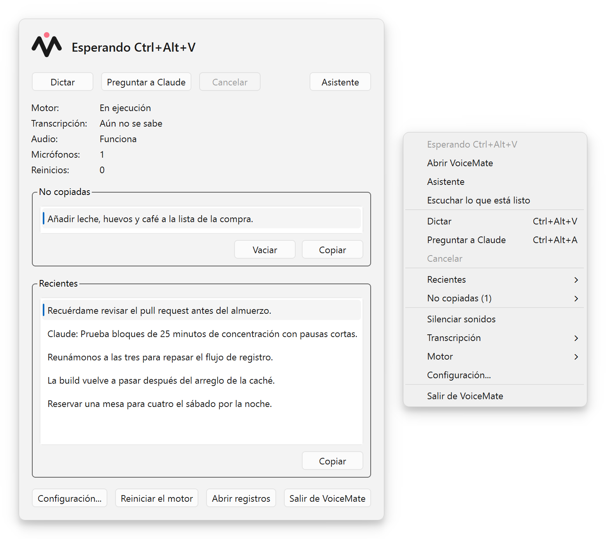

</div>

## Por qué VoiceMate

Construí VoiceMate porque creo en algo sencillo: cuanto más rápido y fácil es expresarle una idea a una IA, y cuanto más detalle le das, mejor es el resultado. Hablar es mucho más rápido que escribir. Cuando piensas en voz alta, explicas una idea como se la explicarías a otra persona, con mucho más contexto del que escribirías jamás.

VoiceMate convierte el habla en texto al instante, listo para cualquier herramienta de IA: un prompt para un asistente de programación, un mensaje en un chat, cualquier cosa que puedas pegar. Presiona un atajo, habla con naturalidad, vuelve a presionarlo y pega. Whisper funciona en local, así que tu audio se queda en tu computadora. El dictado no necesita ningún servicio en la nube ni suscripción.

El dictado al portapapeles es el núcleo de VoiceMate. Lo uso para trabajar de verdad, prácticamente todos los días laborables, desde marzo de 2026. Nació y se probó a fondo en Windows con una GPU NVIDIA. Cuando cambié mi GPU por una AMD, adapté VoiceMate a AMD mediante WSL2 y Linux, y ahora también se prueba ahí. Ese camino sigue siendo **experimental**.

Más tarde llegó un segundo módulo: una conversación por voz con Claude. Hablas, Claude responde y la respuesta se lee en voz alta con síntesis de voz (TTS). Este módulo es opcional y **experimental**.

Un tercero está empezando: un **asistente de voz**. Es una conversación de Claude que sabe qué hacen mis otras conversaciones, les pregunta cosas por mí y me avisa, por voz, cuando responden. Vive en una conversación que VoiceMate inicia o en una que ya tengo en Claude Desktop. Es **experimental** y viene desactivado.

## Contenido

[Funciones](#funciones) · [Capturas de pantalla](#capturas-de-pantalla) · [Inicio rápido](#inicio-rápido) · [Uso](#uso) · [Asistente de voz](#asistente-de-voz-experimental) · [Configuración](#configuración) · [Arquitectura](#arquitectura) · [Solución de problemas](#solución-de-problemas) · [Documentación](#documentación) · [Cómo contribuir](#cómo-contribuir) · [Licencia](#licencia)

## Funciones

**Dictado (el núcleo)**
- Un solo atajo inicia y detiene la grabación (`Ctrl+Alt+V` por defecto). El texto llega al portapapeles, listo para pegar.
- Modelos Whisper locales, `large-v3-turbo` por defecto. Ningún audio sale de tu computadora.
- El idioma del dictado queda fijado para obtener resultados estables, y los términos técnicos en inglés dentro de otros idiomas se siguen transcribiendo.
- Sonidos de aviso para inicio, transcripción, copiado, advertencia y error. Una grabación se detiene sola a los 10 minutos (configurable).

**Aplicación companion para Windows**
- Un icono en la bandeja que muestra el estado de un vistazo, una ventana de estado con las transcripciones recientes y la configuración de atajos, sonidos de aviso, notificaciones, idioma y el motor.
- Entrega verificada al portapapeles: la aplicación escribe el texto, lo vuelve a leer y lo compara. Un texto que no consigue llegar al portapapeles se queda en **No copiadas**, incluso después de reiniciar.
- Un supervisor que inicia el motor dentro de WSL2, lo reinicia cuando falla y reinicia WSL cuando se detiene su audio.
- Un instalador por usuario (sin pedir permisos de administrador) en 5 idiomas.
- Dos modos de reconocimiento de voz, que cambias desde el menú de la bandeja ("Transcripción") o en Configuración: **CPU** (deja la GPU libre para otros trabajos) y **GPU** (la más rápida). Cada modo guarda su propio modelo de Whisper. Un modo que aún no está instalado lo instala la aplicación después de preguntar, con el tamaño de la descarga, y solo dentro del entorno del propio motor.

<a id="idiomas"></a>**Idiomas**: el companion, los mensajes del motor y el instalador hablan inglés, portugués de Brasil, español, ruso y chino simplificado.

<a id="plataformas-y-gpus"></a>**Plataformas y GPUs**
- Windows 10/11 con NVIDIA (CUDA): el camino original, probado a fondo. El motor funciona de forma nativa desde la línea de comandos.
- **Experimental:** el motor dentro de WSL2 (la configuración del companion), GPUs AMD (ROCm, Vulkan) en WSL2, Linux y Windows, y Linux (X11, Wayland) con un companion opcional.
- En todas las plataformas hay respaldo en CPU. `make setup` detecta la plataforma y la GPU e instala la compilación de PyTorch y el backend de reconocimiento de voz que corresponden.

**Conversación por voz con Claude (experimental)**
- `Ctrl+Alt+A` envía tu voz a Claude mediante la CLI de Claude Code (con tu propio inicio de sesión: el texto transcrito va a Anthropic, el audio no). La respuesta se copia al portapapeles y se lee en voz alta.
- Motores de TTS: OmniVoice (el que se usa cuando no hay nada guardado), Kokoro (el que propone `make setup`) y VoxCPM2. O el tuyo: cualquier servicio que siga el [protocolo de proveedor de TTS](docs/tts-provider-protocol.md) (Ajustes > Voz > Proveedor personalizado). La conversación continúa entre turnos; cualquier atajo interrumpe la respuesta e inicia una nueva grabación.

**Asistente de voz (experimental, desactivado por defecto)**
- Una conversación central de Claude en dos modos: la conversación propia de VoiceMate (un proceso de Claude Code que VoiceMate inicia, visible también en Claude Desktop y en el móvil) o una conversación de Claude Desktop que ya tienes (escrita con un "flash" breve de teclado, solo en Windows). Lista, lee y envía mensajes a tus otras conversaciones, e inicia nuevas en segundo plano.
- Habla con él con `Ctrl+Alt+S` y escúchalo con la voz del motor (Kokoro o tu propio proveedor). Los comandos de voz en español, inglés y portugués leen la última respuesta, cambian de conversación, le envían un mensaje o hablan directamente con ella. Una ventana muestra el chat y las respuestas en espera; una insignia azul en la bandeja y el sonido "Respuesta lista" avisan cuando llega una, y `Ctrl+Alt+R` lee lo que está listo.
- Cambia por voz una lista fija de ajustes de VoiceMate, admite una personalidad (un archivo, una nota de una bóveda de Obsidian o un texto que escribes) y usa una skill en español o inglés que también funciona sola en cualquier conversación de Claude Code. Consulta [Asistente de voz](#asistente-de-voz-experimental).

## Capturas de pantalla

| El menú de la bandeja | "¿Reiniciar WSL?" y "¿Reiniciar VoiceMate?" |
|:---:|:---:|
| 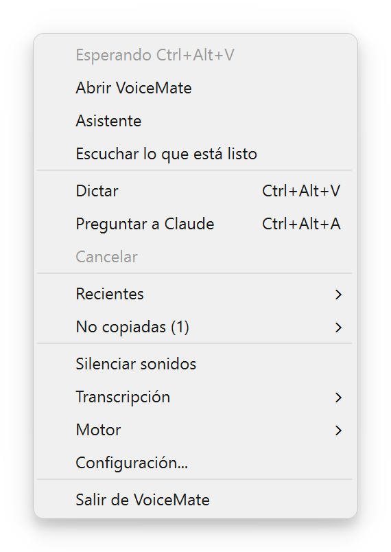 | 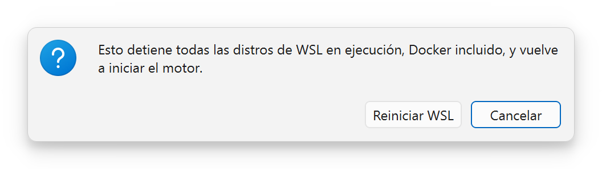<br>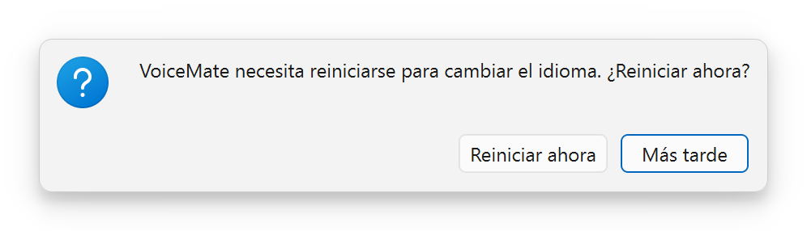 |

<p align="center">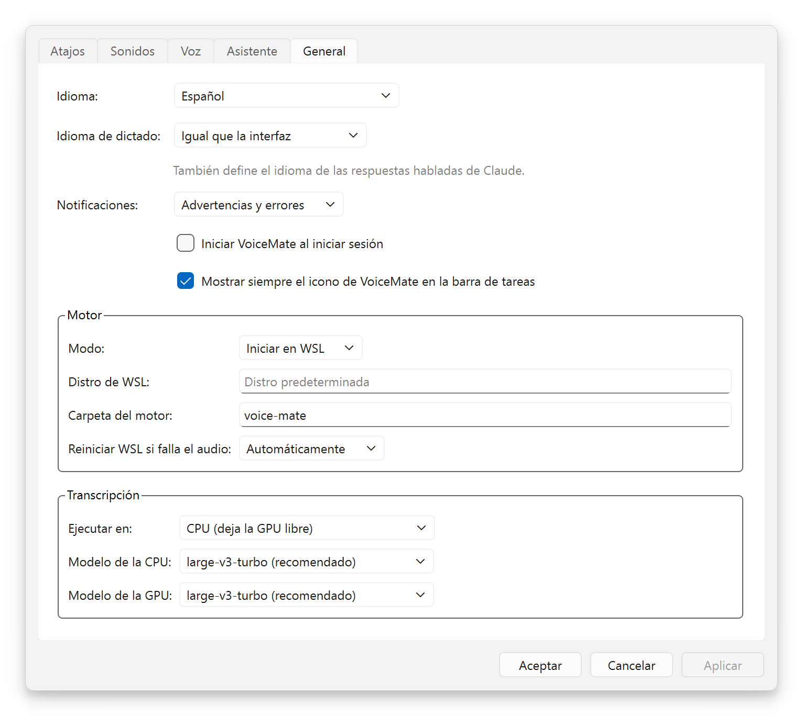<br><sub>"Configuración de VoiceMate", pestaña "General". Mira también las pestañas <a href="docs/assets/screenshots/es/settings-hotkeys.png">"Atajos"</a> y <a href="docs/assets/screenshots/es/settings-sounds.png">"Sonidos"</a>.</sub></p>

<p align="center">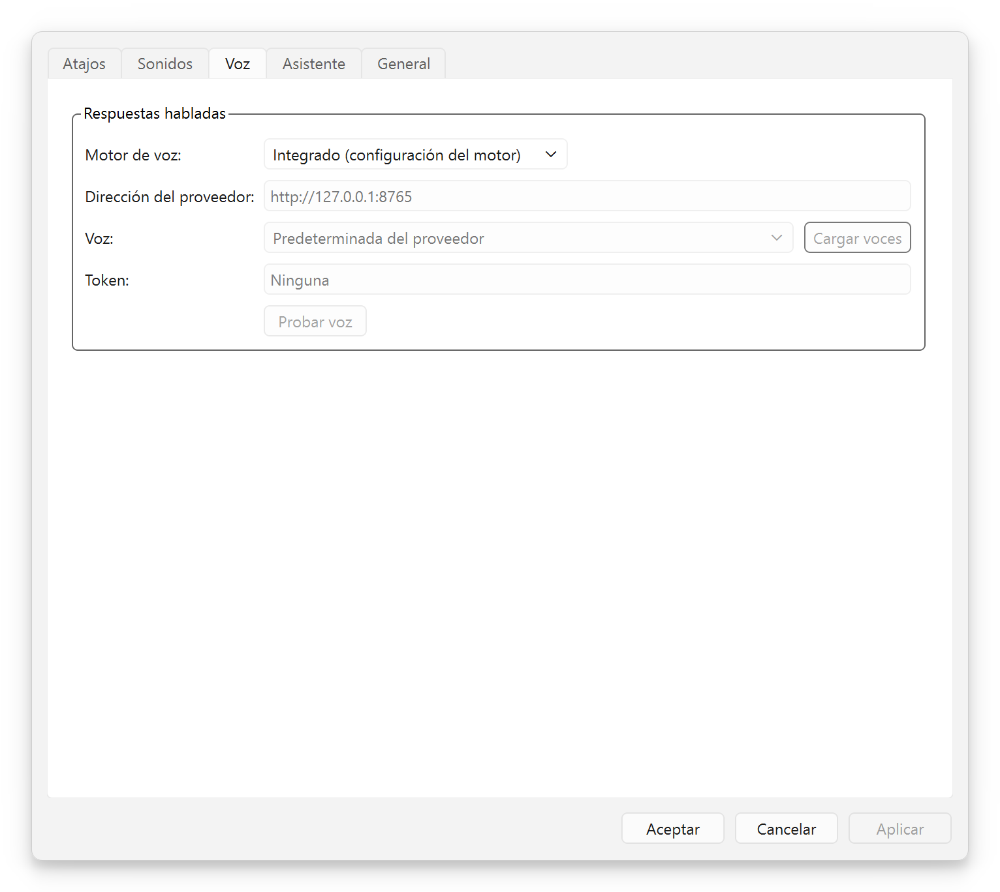<br><sub>"Configuración de VoiceMate", pestaña "Voz": el motor de voz que habla las respuestas, incluido "Proveedor personalizado (HTTP)".</sub></p>

<p align="center">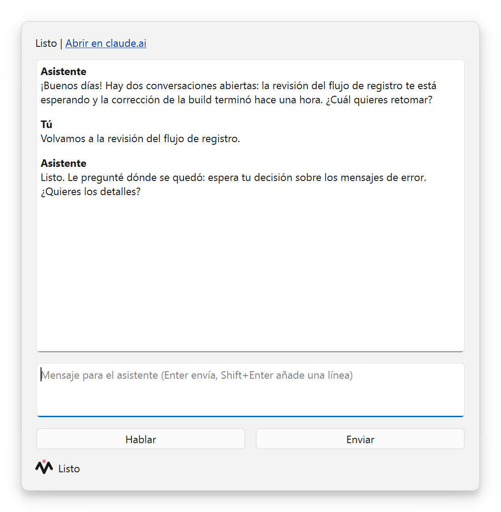<br><sub>La ventana del asistente (**experimental**), que se abre con la entrada "Asistente" del menú de la bandeja. Configuración: la pestaña <a href="docs/assets/screenshots/es/settings-assistant.png">"Asistente"</a>. El cuadro "Transcripción", con la elección entre CPU y GPU, está en la pestaña "General" de arriba.</sub></p>

<p align="center">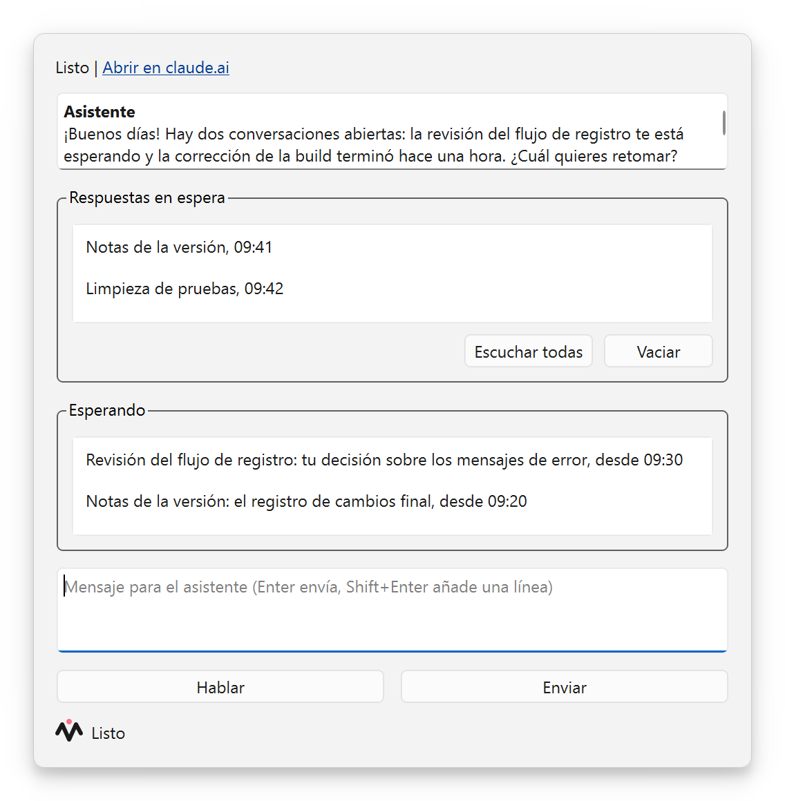<br><sub>La misma ventana con el grupo "Respuestas en espera" y la lista "Esperando".</sub></p>

<p align="center">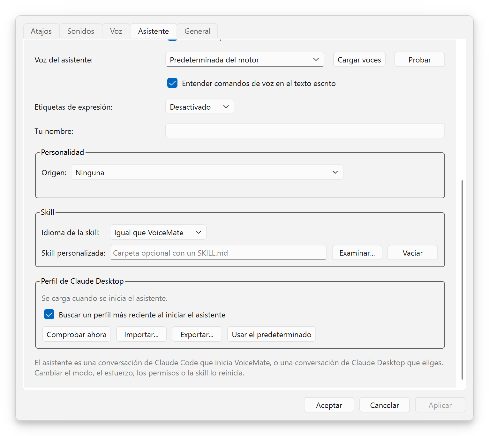<br><sub>La pestaña "Asistente" desplazada: los grupos "Personalidad", "Skill" y "Perfil de Claude Desktop".</sub></p>

<p align="center"><br><sub>El icono de la bandeja muestra el estado con una insignia, y una insignia azul cuando hay respuestas en espera. Qué significa cada insignia: <a href="docs/usage.md#tray-icon-and-menu">Uso, icono y menú de la bandeja</a>.</sub></p>

## Inicio rápido

### Windows, con el instalador

El instalador incluye solo la aplicación companion. El motor funciona dentro de una distro de WSL2, así que configura eso primero (**experimental**; guía completa en [docs/installation.md](docs/installation.md)).

1. En PowerShell, instala WSL2 con Ubuntu: `wsl --install -d Ubuntu-24.04`, y luego abre Ubuntu (si ya tenías otra distro de WSL, ejecuta también `wsl --set-default Ubuntu-24.04`, o define "Distro de WSL:" en Configuración más adelante). Dentro de Ubuntu, instala los paquetes de audio; Python 3.12 (Ubuntu 24.04 lo trae) y [Poetry](https://python-poetry.org/docs/#installation) deben estar también en el `PATH` de un shell de login:
   ```bash
   sudo apt install -y libportaudio2 libasound2-plugins pulseaudio-utils wl-clipboard git make
   ```
2. Clona el motor y ejecuta la configuración guiada:
   ```bash
   git clone https://github.com/nano-br/voice-mate.git ~/voice-mate
   cd ~/voice-mate
   make setup    # solo para dictado, responde 1 (clipboard) en "¿Qué flujo principal?"
   make doctor   # todas las comprobaciones deben mostrar ✓
   ```
   El companion busca el motor en `~/voice-mate` y en algunas otras carpetas habituales ([la lista](docs/installation.md#2-install-the-engine)); en cualquier otro lugar, define "Carpeta del motor:" en Configuración. Con una GPU AMD, instala también el controlador de AMD y ROCm para WSL ([docs/wsl2.md](docs/wsl2.md)).
3. Recomendado: aún en `~/voice-mate`, ejecuta `make run` una vez y deténlo con `Ctrl+C` cuando termine de cargar. El primer inicio descarga el modelo Whisper, y el companion le da solo 240 segundos al motor para iniciar (deja de reintentar tras 3 tiempos de espera agotados seguidos), algo que una conexión lenta puede superar.
4. Descarga `VoiceMate-Setup-x.y.z.exe` desde la [última versión](https://github.com/nano-br/voice-mate/releases/latest) y ejecútalo. El instalador no tiene firma de código, así que Windows SmartScreen puede avisarte: elige **Más información** y luego **Ejecutar de todas formas**. Se instala solo para tu usuario, sin pedir permisos de administrador.
5. Abre VoiceMate. La bandeja muestra "Iniciando el motor..." mientras carga el modelo (de 10 a 60 segundos una vez descargado el modelo) y luego "Esperando Ctrl+Alt+V".
6. Opcional: ancla la aplicación a la barra de tareas. Abre Inicio, busca VoiceMate, haz clic derecho sobre él y elige **Anclar a la barra de tareas**.

### Desde el código fuente

Necesitas Python 3.12, [Poetry](https://python-poetry.org/docs/#installation), `make` de GNU (en Windows, instálalo antes, por ejemplo con Chocolatey o Scoop) y `git`.

```bash
git clone https://github.com/nano-br/voice-mate.git
cd voice-mate
make setup                           # detecta plataforma y GPU, instala PyTorch y los módulos que elijas
make doctor                          # comprueba micrófono, audio, atajos y GPU, e imprime una solución para cada problema
make run ARGS="--output-lang en"     # inicia el motor con sus propios atajos (Windows nativo o Linux)
```

**El motor usa portugués por defecto** (`--output-lang pt-BR`), lo que fija el idioma que escucha Whisper, las respuestas de Claude y los mensajes del motor. Pasa `--output-lang en` (u otro código) como arriba; `--transcription-language` y `VOICEMATE_LANG` cambian solo uno de ellos ([configuración](docs/configuration.md)). El companion pasa estas opciones por sí solo, mira [Uso](#uso).

Para ejecutar el companion desde el código fuente en Windows, con el motor en WSL2: `make companion-venv` una vez y luego `make run-tray`. En Linux, ejecuta `make setup` y `make run` como arriba; para la bandeja y la ventana de estado opcionales, `poetry install --extras ui` y luego `make run-tray` ([detalles](docs/installation.md#linux-experimental)).

## Uso

| Atajo | Acción en el menú de la bandeja | Qué ocurre |
|---|---|---|
| `Ctrl+Alt+V` | "Dictar" | Voz a texto, copiado al portapapeles |
| `Ctrl+Alt+A` | "Preguntar a Claude" | Voz a Claude, respuesta copiada y leída en voz alta (**experimental**) |
| `Ctrl+Alt+S` | "Hablar con el asistente" | Voz al asistente en lugar del portapapeles (**experimental**) |
| `Ctrl+Alt+W` | "Abrir la ventana del asistente" | Abre o cierra la ventana del asistente |
| `Ctrl+Alt+R` | "Escuchar lo que está listo" | El asistente lee las respuestas que esperan |

Presiona `Ctrl+Alt+V`, habla tras la señal de inicio, vuelve a presionar `Ctrl+Alt+V` y pega con `Ctrl+V` donde quieras. El atajo que detiene la grabación decide adónde va el texto. Un texto que no pudo llegar al portapapeles espera en **No copiadas** (menú de la bandeja y ventana de estado), donde un clic lo copia. Para salir, elige **Salir de VoiceMate** en el menú de la bandeja; un motor que el companion no inició sigue en ejecución.

**Idioma de dictado.** En Configuración > **General**, "Idioma de dictado:" decide el idioma que hablas. Por defecto es "Igual que la interfaz"; "Detectar automáticamente" deja que Whisper detecte cada grabación (Claude sigue respondiendo en el idioma de la interfaz; con Kokoro, fija un idioma); o elige un idioma. El companion se lo pasa al motor que inicia, mediante `--transcription-language` y `--output-lang`, y cambiarlo reinicia el motor. Un motor al que el companion solo se conecta (una unidad de systemd, o uno iniciado a mano) conserva sus propias opciones.

La conversación por voz con Claude necesita la CLI de Claude Code instalada y con la sesión iniciada, y el módulo `claude` elegido en `make setup`. Mira [docs/usage.md](docs/usage.md#claude-flow-experimental).

**Modo de transcripción.** En Configuración > **General** > "Transcripción", "Ejecutar en:" ofrece "CPU (deja la GPU libre)", "GPU (la más rápida)" o "Automático (configuración del motor)". El menú "Transcripción" de la bandeja hace lo mismo. Cada modo tiene su propio modelo ("Modelo de la CPU:", "Modelo de la GPU:"). Cambiarlo reinicia el motor, y si el modo aún no está instalado, VoiceMate pregunta antes (con el tamaño de la descarga) y lo instala en una ventana que muestra la salida. Desde el terminal: `make stt-check` y `make stt-install MODE=cpu` (o `gpu`). Cifras de velocidad y precisión: [docs/configuration.md](docs/configuration.md#speech-to-text-modes).

### Asistente de voz (experimental)

El asistente es una conversación de Claude, la central, que sabe qué hacen tus otras conversaciones y las dirige por ti: las lista, las lee, les envía un mensaje, inicia nuevas en segundo plano y te avisa cuando responden. Viene desactivado. En Ajustes > **Asistente**, "Modo del asistente:" elige dónde vive la conversación central.

| | Conversación propia de VoiceMate | Una conversación de Claude Desktop |
|---|---|---|
| Qué es | Un proceso de Claude Code que VoiceMate inicia y mantiene | Una conversación que ya tienes, elegida por su título exacto en "Conversación de Desktop:" |
| Cómo escribe VoiceMate en ella | Directamente, por el proceso | Un "flash" breve de UI Automation: la ventana de Desktop pasa al frente, se borra el borrador, se pega y envía el texto, y el foco vuelve (unos 2 segundos) |
| Herramientas | Las herramientas `voicemate`: listar, leer y enviar a conversaciones, iniciar una, ajustar su modelo, detenerla | Las herramientas de sesión del propio Desktop |
| Necesita | La CLI `claude` y un inicio de sesión de Claude | Claude Desktop abierto y la pantalla desbloqueada; solo en Windows |
| Móvil | Remote Control activado | Fuera del control de VoiceMate |

1. **Requisitos:** la CLI de Claude Code (`claude` en el `PATH` de Windows, o su ruta en `VOICEMATE_CLAUDE_CLI`) y un inicio de sesión de Claude en ese equipo (`claude auth login`, una vez). Sin ellos, la ventana del asistente dice qué falta.
2. **Activarlo:** en Ajustes > **Asistente**, elige "Conversación propia de VoiceMate" o "Una conversación de Claude Desktop" en "Modo del asistente:" (y escribe su título exacto) y pulsa OK. El menú de la bandeja gana la entrada "Asistente".
3. **Usarlo:** pulsa `Ctrl+Alt+S`, habla, pulsa `Ctrl+Alt+S` otra vez, y responde con la voz del motor. O abre "Asistente" y escribe (Enter envía, Shift+Enter añade una línea). La ventana muestra los últimos 30 mensajes y un grupo "Respuestas en espera" y una lista "Esperando" (lo que el asistente espera de otras conversaciones).

`Ctrl+Alt+S` habla, `Ctrl+Alt+W` abre la ventana y `Ctrl+Alt+R` lee lo que está listo. "Cambiar el modo del asistente" y "Volver al asistente" no tienen tecla por defecto; defínelas en Ajustes > **Atajos**.

**Comandos de voz.** Algunas frases se detectan sin ninguna IA, en español, inglés y portugués: leer la última respuesta, dejar de hablar, ir a una conversación, enviar a una conversación, hablar directamente con una conversación y volver al asistente. El modo directo manda lo que dices directo a esa conversación hasta que vuelves. Las frases están en [uso](docs/usage.md#voice-commands).

**Respuestas de otras conversaciones.** "Respuestas de otras conversaciones:" ofrece "Decirme la respuesta en cuanto llegue", "Dar un aviso corto y guardar la respuesta para después" (por defecto), "Solo reproducir un sonido y guardar la respuesta" o "Solo guardarla". Las respuestas guardadas esperan en la bandeja de entrada (50 como máximo, conservadas entre reinicios), en la ventana en "Respuestas en espera", con una insignia azul en el icono de la bandeja y el sonido "Respuesta lista". No se anuncia nada mientras grabas, transcribes o escuchas una respuesta.

**Conversaciones que inicia el asistente.** Como máximo 4 a la vez, con Remote Control activado y recordadas entre reinicios. "Las conversaciones nuevas usan:" y "Con el esfuerzo:" fijan su modelo y esfuerzo, y "Permisos:" fija lo que pueden hacer.

> [!WARNING]
> "Acceso total, nunca preguntar (arriesgado)" (`bypassPermissions`) deja que esas conversaciones cambien cualquier archivo y ejecuten cualquier comando sin preguntar. Mantén el valor por defecto salvo que confíes en lo que les pides.

**El flash del modo Desktop.** Toma el primer plano unos 2 segundos, borra cualquier borrador de ese campo y no escribe nada si la pantalla está bloqueada o si otra ventana toma el foco. No toques el teclado durante esos 2 segundos.

**Ajustes por voz.** El asistente cambia 23 ajustes de una lista fija: el modo (entre los dos), modelo, esfuerzo, permisos, entrega de respuestas, modelo y esfuerzo de las conversaciones nuevas, la conversación de Desktop, voz, comandos de voz, etiquetas de expresión, tu nombre, el origen de la personalidad, la actualización del perfil, el idioma de la skill, los interruptores y volúmenes de los sonidos, el idioma del dictado, el modo de transcripción y las notificaciones.

Los atajos, los archivos y carpetas, el motor de voz y sus ajustes, y apagar el asistente quedan fuera a propósito. La lista: [uso](docs/usage.md#change-voicemate-by-voice).

**Personalidad y skill.** En Personalidad, "Origen:" es ninguna, un archivo Markdown (por ejemplo una nota en una bóveda de Obsidian) o un texto que escribes; "Carpeta de la bóveda:" indica dónde están tus notas, y el asistente solo las lee cuando se lo pides. "Idioma de la skill:" es automático, inglés o portugués de Brasil, y "Skill personalizada:" sustituye la skill por una carpeta tuya con un `SKILL.md`.

La skill es opcional y compartible: copia `app/companion/assistant/skill/en/voicemate-assistant` (o `pt-BR`) en `~/.claude/skills` y pide "el asistente" en cualquier conversación de Claude Code. Sus ajustes están en `~/.voicemate/assistant.json`.

**Voz.** El asistente habla con la voz del motor: Kokoro o tu propio proveedor (Ajustes > **Voz**, `make tts-provider-check`, [protocolo](docs/tts-provider-protocol.md)). Si el motor no puede hablar, las respuestas quedan en texto y los avisos cortos usan la voz de Windows.

**Perfil de Claude Desktop.** Un archivo JSON indica al modo Desktop dónde están los controles, así que una actualización de Claude Desktop se arregla con un perfil nuevo y no con una versión. VoiceMate busca uno más reciente al iniciar el asistente (se puede desactivar); Ajustes > **Asistente** tiene **Comprobar ahora**, **Importar...**, **Exportar...** y **Usar el predeterminado**. Consulta [desktop-profile.md](docs/desktop-profile.md).

El diseño está en [docs/research/voice-assistant-design.md](docs/research/voice-assistant-design.md), las pruebas con Claude Desktop y el móvil que lo respaldan en [docs/research/claude-code-client.md](docs/research/claude-code-client.md), y cada paso en [docs/usage.md](docs/usage.md#voice-assistant-experimental).

## Configuración

| Qué | Dónde |
|---|---|
| Configuración del companion | Windows `%APPDATA%\VoiceMate\companion.toml`, Linux `~/.config/voicemate/companion.toml` |
| Elecciones del motor hechas con `make setup`, token de la API | `~/.config/voicemate/` (dentro de WSL para el companion; `%USERPROFILE%\.config\voicemate\` para un motor ejecutado de forma nativa en Windows) |
| API HTTP del motor | `127.0.0.1:47821` |
| Registros (`companion.log`, `engine.log`) | Windows `%LOCALAPPDATA%\VoiceMate\logs`, Linux `~/.local/state/voicemate/logs` |
| Lista **No copiadas** | `pending.json`, junto a la carpeta `logs` |
| Configuración del asistente (la skill la lee) | `~/.voicemate/assistant.json`, en tu carpeta de usuario |
| Sesión del asistente, bandeja de entrada, conversaciones que inició, texto de la personalidad y caché del perfil de Desktop | `assistant-session.json`, `assistant-inbox.json`, `assistant-conversations\`, `assistant-personality.md`, `desktop-profile\` y `assistant\` junto a `pending.json` |

Todas las opciones del motor, todas las claves de configuración y todas las variables de entorno: [docs/configuration.md](docs/configuration.md).

## Arquitectura

VoiceMate tiene dos partes. El **motor** graba, transcribe y ejecuta el flujo de Claude; es un daemon en Python con una API HTTP local. El **companion** es una aplicación de bandeja en PySide6 para Windows que se encarga de los atajos y del portapapeles y supervisa el motor dentro de WSL2. El motor también puede ejecutarse por sí solo desde la línea de comandos. Los diagramas de abajo son vistas generales simplificadas; cada uno enlaza al diagrama completo en [docs/architecture.md](docs/architecture.md), que incluye además los diagramas de componentes, la API HTTP y las decisiones de diseño.

<details>
<summary>Contexto del sistema (vista general)</summary>

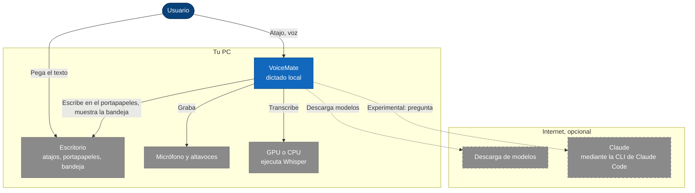

Vista general. Diagrama completo: [docs/architecture.md, Contexto del sistema](docs/architecture.md#1-system-context).

</details>

<details>
<summary>Contenedores, Windows con WSL2 (vista general)</summary>

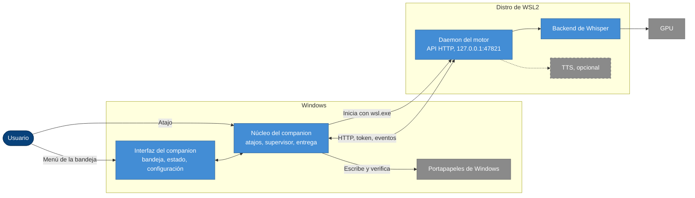

Vista general. Diagrama completo: [docs/architecture.md, Contenedores](docs/architecture.md#2-containers).

</details>

<details>
<summary>Un dictado, paso a paso (vista general)</summary>

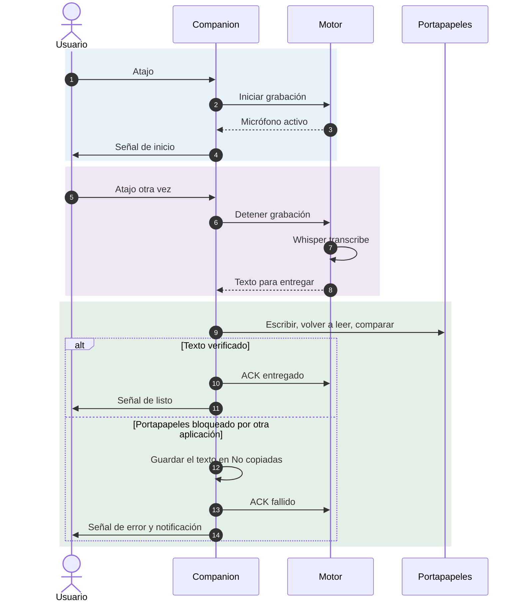

Vista general. Diagrama completo: [docs/architecture.md, Un dictado](docs/architecture.md#4-runtime-one-dictation).

</details>

<details>
<summary>Estados de la bandeja (vista general)</summary>

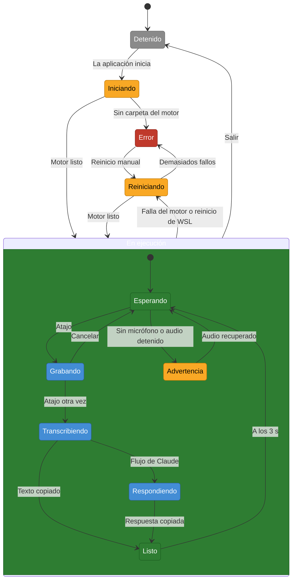

Vista general. Diagrama completo: [docs/architecture.md, Estados de la bandeja](docs/architecture.md#5-tray-states).

</details>

<details>
<summary>Asistente de voz, experimental (resumen)</summary>

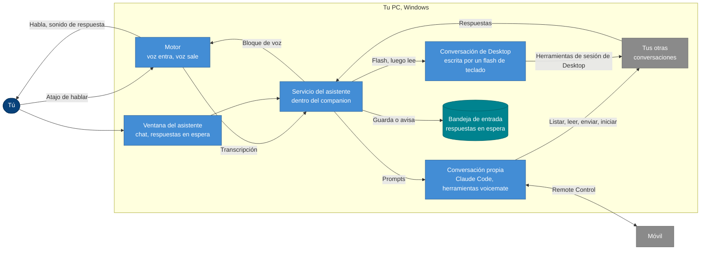

Los dos modos siguen el mismo ciclo: el asistente llega a tus otras conversaciones, las respuestas vuelven por el servicio, y el servicio las habla o las guarda en la bandeja de entrada. Azul: VoiceMate; verde azulado: datos guardados; gris: fuera de VoiceMate. Diagrama completo: [docs/architecture.md](docs/architecture.md#61-voice-assistant-experimental).

</details>

<details>
<summary>Supervisor del motor y recuperación del audio de WSL (vista general)</summary>

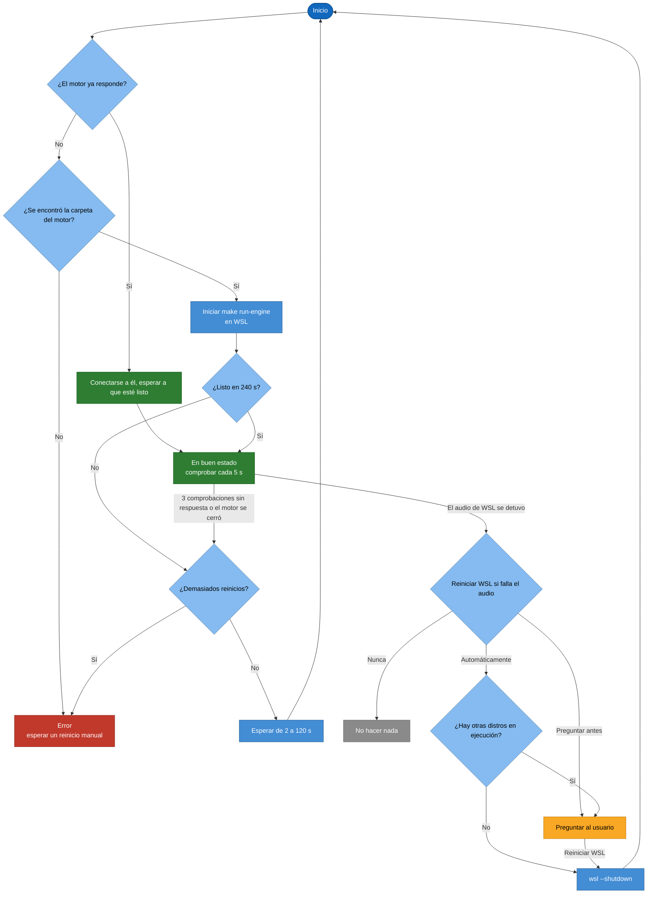

Vista general. Diagrama completo: [docs/architecture.md, Supervisor](docs/architecture.md#6-supervisor-on-windows-and-wsl2).

</details>

## Solución de problemas

| Síntoma | Qué hacer |
|---|---|
| "Iniciando el motor..." durante mucho tiempo | El primer inicio descarga el modelo, lo que puede tardar minutos (ejecuta `make run` una vez en WSL, mira [Inicio rápido](#windows-con-el-instalador)). Los siguientes tardan de 10 a 60 segundos. Abre **Motor** > **Abrir registros** y lee `engine.log`. |
| "No se encontró la carpeta del motor" | Clona el motor en una de las [carpetas habituales](docs/installation.md#2-install-the-engine), o define "Carpeta del motor:" en Configuración > **General**. |
| Un atajo dice "En uso por otra aplicación" | Puede que un script antiguo de atajos de VoiceMate siga en ejecución. Ciérralo y quítalo de `shell:startup`, o elige otros atajos. |
| "El audio de WSL se detuvo" o "Sin micrófono" | Conecta un micrófono. VoiceMate reinicia WSL según lo definido en "Reiniciar WSL si falla el audio:"; para hacerlo a mano, usa **Motor** > **Reiniciar WSL...**. |
| Un texto no llegó al portapapeles | Está en **No copiadas** (menú de la bandeja y ventana de estado). Haz clic en él para copiarlo de nuevo. |
| El habla en inglés sale mal, o los mensajes del motor están en portugués | Un motor iniciado a mano usa portugués por defecto: añade `ARGS="--output-lang en"` a `make run`. |
| La GPU está ocupada con otro trabajo | Elige el modo CPU: Configuración > **General** > "Transcripción", o menú de la bandeja > "Transcripción". VoiceMate pregunta antes de instalar un modo que falta. |
| El asistente dice "No se encontró Claude Code" o "Claude Code no ha iniciado sesión" | Instala Claude Code (o define `VOICEMATE_CLAUDE_CLI`), o ejecuta `claude auth login` en un terminal, y pulsa **Reiniciar** en la ventana del asistente. Más en [docs/troubleshooting.md](docs/troubleshooting.md#voice-assistant-experimental). |
| El modo Desktop dice "No se ha elegido ninguna conversación de Claude Desktop" o "No se pudo preparar el asistente" | "Conversación de Desktop:" está vacía, o ninguna conversación de Claude Desktop tiene ese título exacto | Escribe el título tal como aparece en la barra lateral de Claude Desktop, abre Claude Desktop y pulsa **Reiniciar**. Más en [docs/troubleshooting.md](docs/troubleshooting.md#voice-assistant-experimental). |
| Otro problema del lado del motor | Ejecuta `make doctor` en la carpeta del motor. Imprime una solución para cada comprobación fallida. |

Más problemas y los mensajes exactos: [docs/troubleshooting.md](docs/troubleshooting.md).

## Documentación

- [Installation](docs/installation.md) (en inglés): todas las vías de instalación, actualización y desinstalación.
- [Usage](docs/usage.md): flujos, atajos, icono de la bandeja, modos de transcripción, modelos, opciones de voz y el asistente de voz.
- [Configuration](docs/configuration.md): opciones del motor, archivos de configuración, variables de entorno, modos de reconocimiento de voz y benchmark.
- [Troubleshooting](docs/troubleshooting.md): `make doctor`, audio de WSL, registros, mensajes conocidos.
- [Architecture](docs/architecture.md): diagramas y decisiones de diseño.
- [WSL2 and AMD](docs/wsl2.md) (experimental), [Companion design](docs/companion-app.md), [Brand](docs/brand.md), [Releasing](docs/releasing.md).
- [Perfil de Claude Desktop](docs/desktop-profile.md) y [protocolo de proveedor TTS](docs/tts-provider-protocol.md): el archivo que indica al modo Desktop dónde están los controles, y el contrato HTTP para tu propia voz.
- Investigación (trabajo experimental, en inglés): [Diseño del asistente de voz](docs/research/voice-assistant-design.md) y [VoiceMate como cliente de Claude Code](docs/research/claude-code-client.md).

## Cómo contribuir

Las issues y los pull requests son bienvenidos. Todo comando de desarrollo pasa por el Makefile: `make format lint test` para el motor (Ruff y mypy estricto) y `make companion-lint companion-test` para el companion. Todo texto visible para el usuario existe en 5 idiomas mediante gettext. Los commits siguen Conventional Commits y explican el contexto. Lee primero [CONTRIBUTING.md](CONTRIBUTING.md).

## Agradecimientos

VoiceMate se apoya en el trabajo de muchos proyectos: [Whisper](https://github.com/openai/whisper) de OpenAI, [faster-whisper](https://github.com/SYSTRAN/faster-whisper), [whisper.cpp](https://github.com/ggml-org/whisper.cpp), [CTranslate2-ROCm](https://github.com/arlo-phoenix/CTranslate2-rocm), [PySide6](https://doc.qt.io/qtforpython-6/), [OmniVoice](https://huggingface.co/k2-fsa/OmniVoice), [Kokoro](https://github.com/hexgrad/kokoro), [VoxCPM](https://github.com/OpenBMB/VoxCPM), el [Claude Agent SDK](https://github.com/anthropics/claude-agent-sdk-python) con [Claude Code](https://docs.claude.com/en/docs/claude-code), [Inno Setup](https://jrsoftware.org/isinfo.php) y [PyInstaller](https://pyinstaller.org/).

## Licencia

[MIT](LICENSE) © Álli Terhorst. Parte de [NanoBR](https://github.com/nano-br): utilidades de código abierto para la productividad del día a día.
