**English** | [Português](README.pt-BR.md) | [Español](README.es.md) | [Русский](README.ru.md) | [简体中文](README.zh-CN.md)

<div align="center">

<picture>
  <source media="(prefers-color-scheme: dark)" srcset="docs/assets/brand/banner-dark.png">
  <source media="(prefers-color-scheme: light)" srcset="docs/assets/brand/banner-light.png">
  
</picture>

**Press a hotkey, speak, paste. Local voice dictation to the clipboard, powered by Whisper on your own computer.**

[](https://github.com/nano-br/voice-mate/actions/workflows/ci.yml)
[](https://github.com/nano-br/voice-mate/releases/latest)
[](LICENSE)
[](pyproject.toml)
[](#platforms-and-gpus)
[](#languages)

[Download](https://github.com/nano-br/voice-mate/releases/latest) · [Quick start](#quick-start) · [Documentation](#documentation) · [Changelog](CHANGELOG.md)

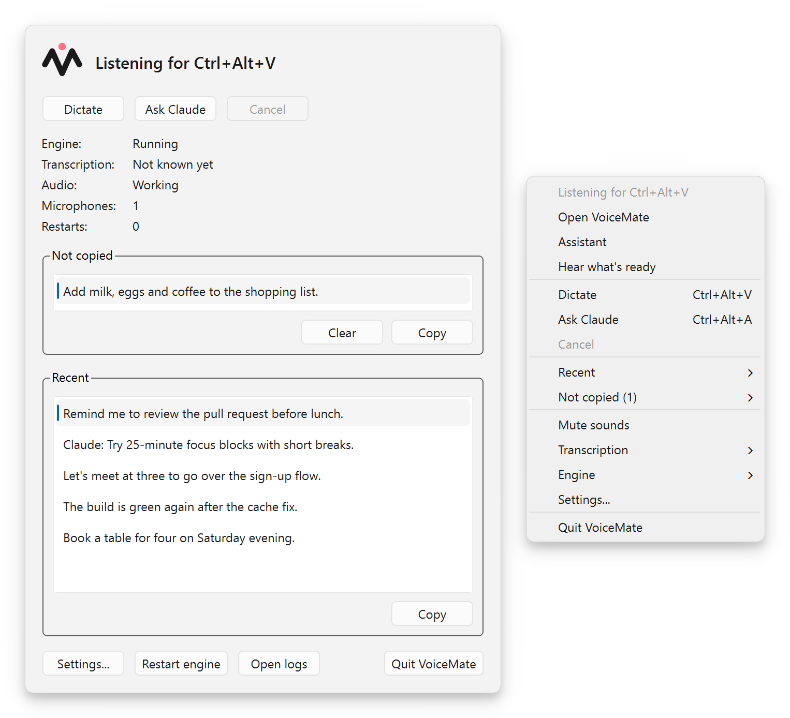

</div>

## Why VoiceMate

VoiceMate is a personal voice assistant that runs on your computer and integrates with Claude Desktop and Claude Code. It started as dictation: press a shortcut, speak, and the text is ready to paste into any AI tool, with Whisper running locally so your audio never leaves your machine. Today it goes further: a personal AI agent, with a name and personality you choose, orchestrates your Claude Code conversations by voice and changes VoiceMate's own settings in natural conversation. For developers working with Claude Code, it means talking in the same conversation you are working in. For people who need accessibility, it means using Claude Code without depending on the keyboard.

I built it because I believe one simple thing: the faster and easier it is to express an idea to an AI, and the more detail you give it, the better the result. Speaking is much faster than typing, and when you think out loud you give far more context than you would ever type.

**Dictation to the clipboard is the core.** I have used it for real work practically every working day since March 2026, on Windows with an NVIDIA GPU. When I replaced my GPU with an AMD card, I adapted VoiceMate to AMD through WSL2 and ROCm 7.2, and it is tested there too (Radeon RX 9070 XT, `gfx1201`). Whisper runs locally: dictation needs no cloud service and no fee.

**The voice assistant is a central conversation** that orchestrates your other Claude Code conversations: it lists them, reads them, asks them things and tells you, by voice, when they answer. It runs in two modes: its own session (with Claude Desktop closed) or inside Claude Desktop, with its native tools. You choose its name, its personality (a Markdown file, which can live in your Obsidian vault) and a vault of notes it can read. The voice conversation with Claude (`Ctrl+Alt+A`) is the lighter sibling: speech in, answer read aloud.

VoiceMate is open source under the MIT license. If you try it, tell me how it went.

## Demo

A demonstration and live test of the personal AI agent, in Brazilian Portuguese for now. More videos, more polished and in other languages, will come.

[VoiceMate e seu agente pessoal de IA: demonstração e teste ao vivo com o Claude Code](https://youtu.be/T9H30G-AbZo), on the Prompt Falado channel.

## Contents

[Demo](#demo) · [Features](#features) · [Screenshots](#screenshots) · [Quick start](#quick-start) · [Usage](#usage) · [Voice assistant](#voice-assistant) · [Configuration](#configuration) · [Architecture](#architecture) · [Troubleshooting](#troubleshooting) · [Documentation](#documentation) · [Contributing](#contributing) · [License](#license)

## Features

**Dictation (core)**
- One hotkey starts and stops the recording (`Ctrl+Alt+V` by default). The text lands in the clipboard, ready to paste.
- Local Whisper models, `large-v3-turbo` by default. No audio leaves your computer.
- The dictation language is pinned for stable results, and English technical terms inside other languages are still transcribed.
- Sound cues for start, transcribing, copied, warning and error. A recording stops by itself after 10 minutes (configurable).

**Windows companion app**
- A tray icon that shows the state at a glance, a status window with recent transcriptions, and settings for hotkeys, sound cues, notifications, language, transcription and the engine.
- Two speech-to-text modes, switchable from the tray menu ("Transcription") or Settings: **CPU** (leaves the GPU free for other work) and **GPU** (the fastest). Each mode keeps its own Whisper model. A mode that is not installed is installed by the app after it asks, showing the download size, and only inside the engine's own environment.
- Verified clipboard delivery: the app writes the text, reads it back and compares. A text that cannot reach the clipboard stays in **Not copied**, even after a restart.
- A supervisor that starts the engine inside WSL2, restarts it when it fails, and restarts WSL when its audio stops.
- A per-user installer (no administrator prompt) in 5 languages.

<a id="languages"></a>**Languages**: the companion, the engine messages and the installer speak English, Brazilian Portuguese, Spanish, Russian and Simplified Chinese.

<a id="platforms-and-gpus"></a>**Platforms and GPUs**
- Windows 10/11 with NVIDIA (CUDA): the original path, battle-tested. The engine runs natively from the command line.
- The engine inside WSL2 (the companion's setup) and AMD GPUs (ROCm 7.2) through WSL2: tested on a Radeon RX 9070 XT (RDNA4, `gfx1201`).
- AMD with Vulkan on Windows, and Linux (X11, Wayland) with an optional companion, use the same setup.
- CPU fallback everywhere. `make setup` detects the platform and the GPU and installs the matching PyTorch build and speech-to-text backend.

**Voice conversation with Claude**
- `Ctrl+Alt+A` sends your speech to Claude through the Claude Code CLI (your own sign-in: the transcribed text goes to Anthropic, the audio does not). The answer is copied to the clipboard and read aloud.
- TTS engines: the default local engine (used when nothing is saved), Kokoro (the one `make setup` proposes) and VoxCPM2. Or your own: any service that follows the [TTS provider protocol](docs/tts-provider-protocol.md) (Settings > Voice > Custom provider). The conversation continues across turns; any hotkey interrupts the answer and starts a new recording.

**Voice assistant (off by default)**
- One central Claude conversation in two modes: VoiceMate's own conversation (a Claude Code process that VoiceMate starts, also visible in Claude Desktop and on your phone) or a Claude Desktop conversation you already have (written by a brief keyboard "flash", Windows only). It lists, reads and sends to your other conversations and starts new ones in the background.
- Talk to it with `Ctrl+Alt+S`, or click **Talk** in its window (it turns into **Stop and send** while recording). It speaks with the voices Windows already has, with nothing to install, or with the engine's voice (Kokoro or your own provider): Settings > **Assistant** > "Voice source:". Voice commands in English, Portuguese and Spanish read the last answer, switch to a conversation, send to it or talk directly to it. A window shows the chat and the answers waiting; its voice waits while you record and while the recording is transcribed, then repeats what you cut; a blue tray badge and an "Answer ready" sound tell you when one arrives, and `Ctrl+Alt+R` reads what is ready.
- It can change a fixed list of VoiceMate settings by voice, takes a personality (a file, a note in an Obsidian vault or a text you write) and uses a skill in English or Brazilian Portuguese that also works on its own in any Claude Code conversation. See [Voice assistant](#voice-assistant) and the [full guide](docs/voice-assistant.md).

## Screenshots

| The tray menu | "Restart WSL?" and "Restart VoiceMate?" |
|:---:|:---:|
| 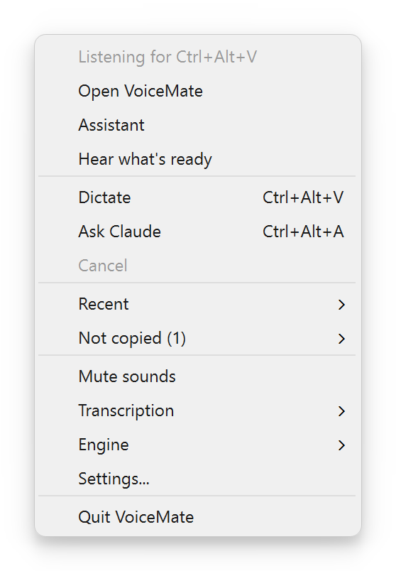 | 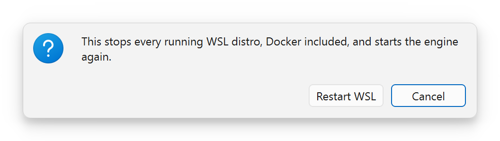<br>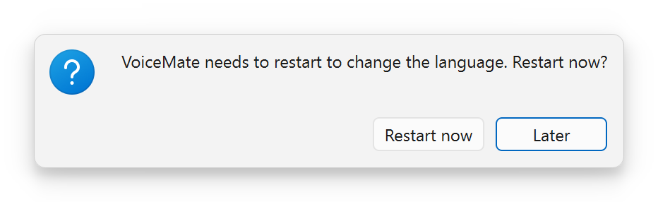 |

<p align="center">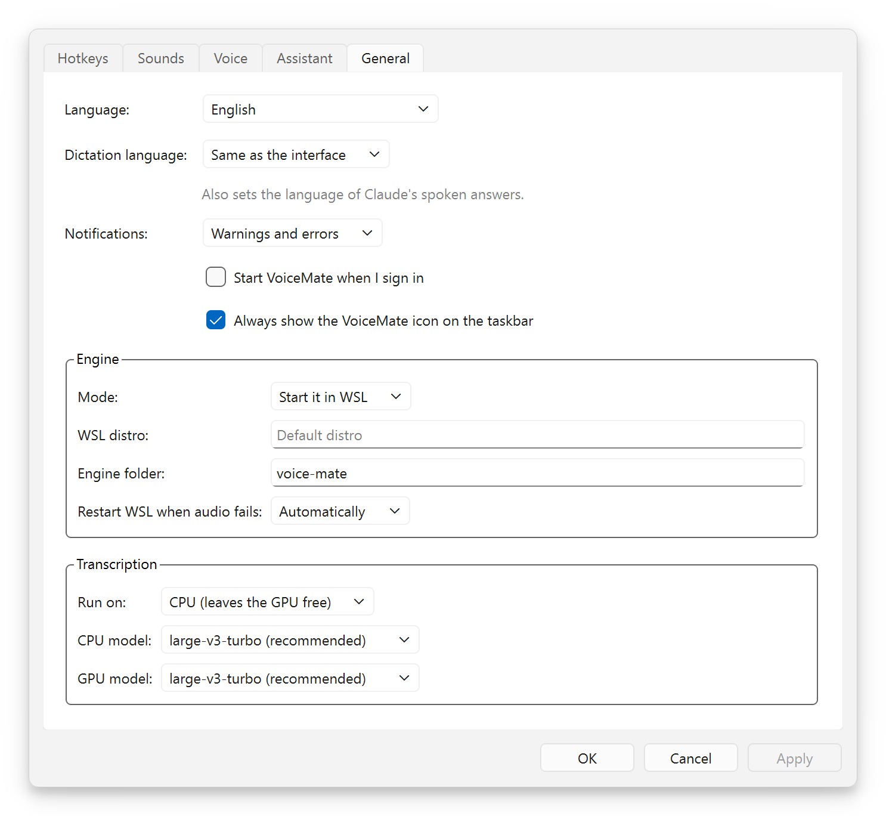<br><sub>"VoiceMate Settings", "General" tab. Also: the <a href="docs/assets/screenshots/en/settings-hotkeys.png">"Hotkeys"</a> and <a href="docs/assets/screenshots/en/settings-sounds.png">"Sounds"</a> tabs.</sub></p>

<p align="center"><br><sub>"VoiceMate Settings", "Voice" tab: the voice engine that speaks the answers, including "Custom provider (HTTP)".</sub></p>

<p align="center">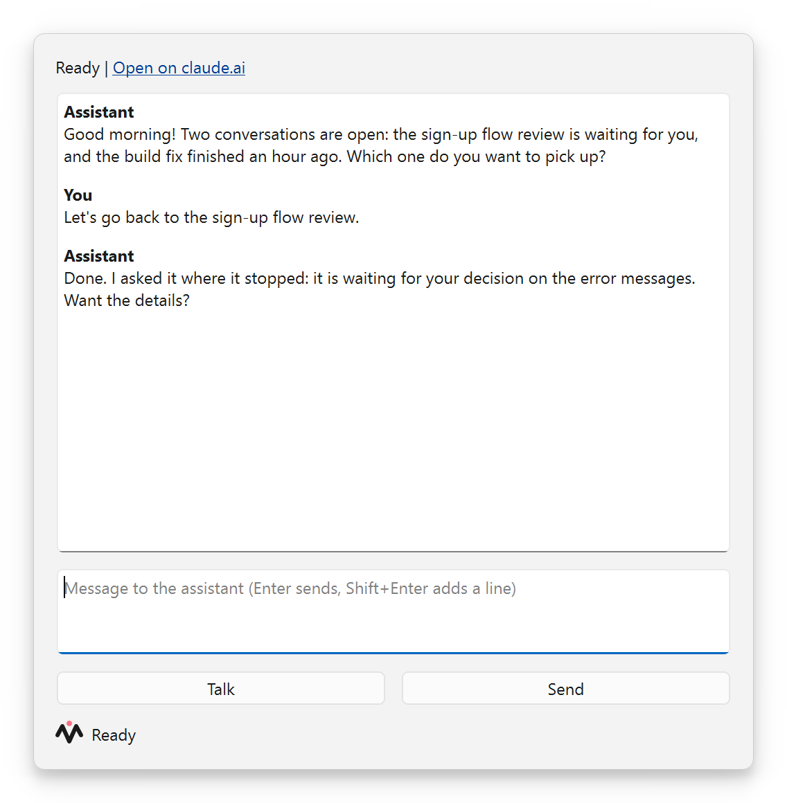<br><sub>The assistant window, with the **Talk** button, opened from the tray menu entry "Assistant". Settings: the <a href="docs/assets/screenshots/en/settings-assistant.png">"Assistant"</a> tab. The "Transcription" box with the CPU and GPU choice is in the "General" tab above.</sub></p>

<p align="center"><br><sub>The same window with the "Answers waiting" group and the "Waiting for" list.</sub></p>

<p align="center"><br><sub>The "Assistant" tab scrolled down: the "Personality", "Skill" and "Claude Desktop profile" groups.</sub></p>

<p align="center"><br><sub>The tray icon shows the state with a badge, and a blue one when answers are waiting. What each badge means: <a href="docs/usage.md#tray-icon-and-menu">Usage, tray icon and menu</a>.</sub></p>

## Quick start

### Windows, with the installer

**Step by step, with screenshots of the installer: the [installation guide](docs/install-guide.md)** ([Português](docs/install-guide.pt-BR.md), [Español](docs/install-guide.es.md), [Русский](docs/install-guide.ru.md), [简体中文](docs/install-guide.zh-CN.md)). The short version follows; the full reference is [docs/installation.md](docs/installation.md).

The installer contains the companion app only. The engine runs inside a WSL2 distro, so set that up first.

1. In PowerShell, install WSL2 with Ubuntu: `wsl --install -d Ubuntu-24.04`, then open Ubuntu (if you already had another WSL distro, also run `wsl --set-default Ubuntu-24.04`, or set "WSL distro:" in Settings later). Inside it, install the audio packages; Python 3.12 (Ubuntu 24.04 ships it) and [Poetry](https://python-poetry.org/docs/#installation) must be on the `PATH` of a login shell too:
   ```bash
   sudo apt install -y libportaudio2 libasound2-plugins pulseaudio-utils wl-clipboard git make
   ```
2. Clone the engine and run the guided setup:
   ```bash
   git clone https://github.com/nano-br/voice-mate.git ~/voice-mate
   cd ~/voice-mate
   make setup    # for dictation only, answer 1 (clipboard) to "Which main flow?"
   make doctor   # every check should show a check mark
   ```
   The companion looks for the engine in `~/voice-mate` and a few other usual folders ([the list](docs/installation.md#2-install-the-engine)); anywhere else, set "Engine folder:" in Settings. With an AMD GPU, also install the AMD driver and ROCm for WSL ([docs/wsl2.md](docs/wsl2.md)).
3. Recommended: still in `~/voice-mate`, run `make run` once and stop it with `Ctrl+C` when it has loaded. The very first start downloads the Whisper model, and the companion gives an engine start only 240 seconds (it stops retrying after 3 start timeouts in a row), which a slow connection can exceed.
4. Download `VoiceMate-Setup-x.y.z.exe` from the [latest release](https://github.com/nano-br/voice-mate/releases/latest) and run it. The installer is not code-signed, so Windows SmartScreen may warn you: choose **More info**, then **Run anyway**. It installs for your user only, with no administrator prompt.
5. Start VoiceMate. The tray shows "Starting engine..." while the model loads (10 to 60 seconds once the model is downloaded), then "Listening for Ctrl+Alt+V".
6. Optional: pin it to the taskbar. Open Start, search for VoiceMate, right-click it and choose **Pin to taskbar**.

### From source

You need Python 3.12, [Poetry](https://python-poetry.org/docs/#installation), GNU `make` (on Windows, install it first, for example with Chocolatey or Scoop) and `git`.

```bash
git clone https://github.com/nano-br/voice-mate.git
cd voice-mate
make setup                           # detects platform and GPU, installs PyTorch and the modules you choose
make doctor                          # checks microphone, audio, hotkeys and GPU, and prints a fix for each problem
make run ARGS="--output-lang en"     # starts the engine with its own hotkeys (Windows native or Linux)
```

**The engine defaults to Portuguese** (`--output-lang pt-BR`), which sets the language Whisper hears, Claude's answers and the engine messages. Pass `--output-lang en` (or another code) as above; `--transcription-language` and `VOICEMATE_LANG` change one of them only ([configuration](docs/configuration.md)). The companion passes these flags itself, see [Usage](#usage).

To run the companion from source on Windows, with the engine in WSL2: `make companion-venv` once, then `make run-tray`. On Linux, run `make setup` and `make run` as above; for the optional tray and status window, `poetry install --extras ui` and then `make run-tray` ([details](docs/installation.md#linux)).

## Usage

| Hotkey | Tray menu action | What happens |
|---|---|---|
| `Ctrl+Alt+V` | "Dictate" | Speech to text, copied to the clipboard |
| `Ctrl+Alt+A` | "Ask Claude" | Speech to Claude, answer copied and read aloud  |
| `Ctrl+Alt+S` | "Talk to the assistant" | Speech to the assistant instead of the clipboard |
| `Ctrl+Alt+W` | "Open the assistant window" | Opens or closes the assistant window |
| `Ctrl+Alt+R` | "Hear what's ready" | The assistant reads the answers that are waiting |

Press `Ctrl+Alt+V`, speak after the start cue, press `Ctrl+Alt+V` again, then paste with `Ctrl+V` anywhere. The hotkey that stops the recording decides where the text goes. A text that could not reach the clipboard waits in **Not copied** (tray menu and status window), where one click copies it. To quit, choose **Quit VoiceMate** in the tray menu; an engine that the companion did not start keeps running.

**Dictation language.** In Settings > **General**, "Dictation language:" decides the language you speak. The default is "Same as the interface"; "Detect automatically" lets Whisper detect each recording (Claude keeps answering in the interface language; with Kokoro, pin a language instead); or pick one language. The companion passes it to the engine it starts as `--transcription-language` and `--output-lang`, and changing it restarts the engine. An engine the companion only connects to (a systemd unit, or one started by hand) keeps its own flags.

The voice conversation with Claude needs the Claude Code CLI installed and signed in, and the `claude` module chosen in `make setup`. See [docs/usage.md](docs/usage.md#claude-flow).

**Transcription mode.** In Settings > **General** > "Transcription", "Run on:" is "CPU (leaves the GPU free)", "GPU (fastest)" or "Automatic (engine setup)". The tray menu "Transcription" does the same. Each mode has its own model ("CPU model:", "GPU model:"). Switching restarts the engine, and if the mode is not installed yet VoiceMate asks first (it names the download size), then installs it in a window that shows the output. From a terminal: `make stt-check` and `make stt-install MODE=cpu` (or `gpu`). Speed and accuracy numbers: [docs/configuration.md](docs/configuration.md#speech-to-text-modes).

### Voice assistant

The assistant is one Claude conversation, the central one, that knows what your other conversations are doing and conducts them for you: it lists them, reads them, sends them a message, starts new ones in the background and tells you when they answer. It is off by default.

**The whole flow, with diagrams: [docs/voice-assistant.md](docs/voice-assistant.md)** (how VoiceMate plugs into Claude, the two modes, the orchestration of your conversations, how answers come back, the voice and safety).

| | VoiceMate's own conversation | A Claude Desktop conversation |
|---|---|---|
| What it is | A Claude Code process that VoiceMate starts and owns | A conversation you already have, chosen by its exact title in "Desktop conversation:" |
| How VoiceMate writes to it | Directly, through the process | A brief "flash": the Desktop window comes forward, the text is pasted and sent, and the focus goes back (about 2 seconds) |
| Needs | The `claude` CLI and a Claude login | Claude Desktop open and the screen unlocked; Windows only |

1. **Requirements:** the Claude Code CLI (`claude` on the `PATH` of Windows, in `~/.local/bin` or `%APPDATA%\npm`, or its path in `VOICEMATE_CLAUDE_CLI`) and a Claude login on that computer (`claude auth login` once).
2. **Turn it on:** press **Assistant** in the status window (it says how when the assistant is off), or go to Settings > **Assistant** and set "Assistant mode:".
3. **Use it:** press `Ctrl+Alt+S`, speak, press `Ctrl+Alt+S` again, and it answers in the engine's voice. Or type in its window (`Ctrl+Alt+W`). `Ctrl+Alt+R` reads the answers that are waiting.

> [!WARNING]
> "Full access, never ask (risky)" (`bypassPermissions`) lets the conversations the assistant starts change any file and run any command without asking. Keep the default unless you trust what you ask them to do.

More: [voice commands and direct mode](docs/voice-assistant.md#6-direct-mode-and-voice-commands), [answers from other conversations](docs/voice-assistant.md#5-answers-coming-back), [settings by voice](docs/voice-assistant.md#8-settings-by-voice), [every setting step by step](docs/usage.md#voice-assistant), the [Claude Desktop profile](docs/desktop-profile.md) and the [TTS provider protocol](docs/tts-provider-protocol.md).

## Configuration

| What | Where |
|---|---|
| Companion settings | Windows `%APPDATA%\VoiceMate\companion.toml`, Linux `~/.config/voicemate/companion.toml` |
| Engine choices from `make setup`, API token | `~/.config/voicemate/` (inside WSL for the companion; `%USERPROFILE%\.config\voicemate\` for an engine run natively on Windows) |
| Engine HTTP API | `127.0.0.1:47821` |
| Logs (`companion.log`, `engine.log`) | Windows `%LOCALAPPDATA%\VoiceMate\logs`, Linux `~/.local/state/voicemate/logs` |
| **Not copied** list | `pending.json` next to the `logs` folder |
| Assistant settings (the skill reads them) | `~/.voicemate/assistant.json` in your user folder |
| Assistant session, inbox, conversations it started, personality text and Desktop profile cache | `assistant-session.json`, `assistant-inbox.json`, `assistant-conversations\`, `assistant-personality.md`, `desktop-profile\` and `assistant\` next to `pending.json` |

Every engine flag, every settings key and every environment variable: [docs/configuration.md](docs/configuration.md).

## Architecture

VoiceMate has two parts. The **engine** records, transcribes and runs the Claude flow; it is a Python daemon with a local HTTP API. The **companion** is a PySide6 tray app on Windows that owns the hotkeys and the clipboard and supervises the engine inside WSL2. The engine also runs alone from the command line. The diagrams below are simplified overviews; each one links to the full diagram in [docs/architecture.md](docs/architecture.md), which also has the component diagrams, the HTTP API and the design choices.

<details>
<summary>System context (overview)</summary>

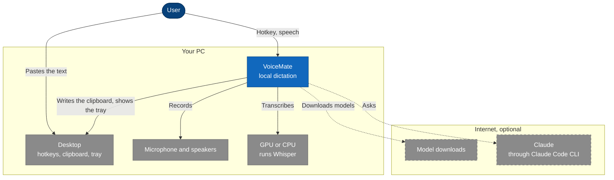

Overview. Full diagram: [docs/architecture.md, System context](docs/architecture.md#1-system-context).

</details>

<details>
<summary>Containers, Windows with WSL2 (overview)</summary>

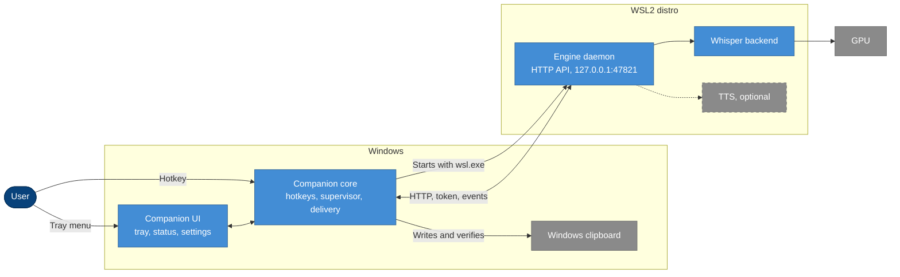

Overview. Full diagram: [docs/architecture.md, Containers](docs/architecture.md#2-containers).

</details>

<details>
<summary>One dictation, step by step (overview)</summary>

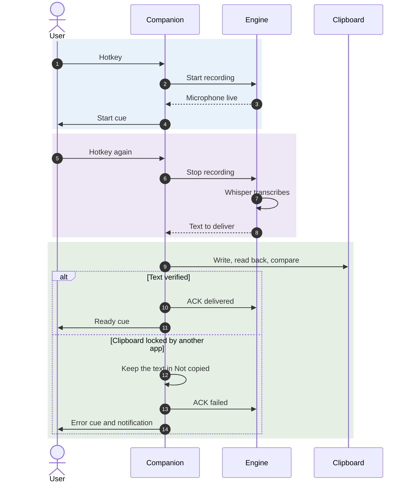

Overview. Full diagram: [docs/architecture.md, One dictation](docs/architecture.md#4-runtime-one-dictation).

</details>

<details>
<summary>Tray states (overview)</summary>

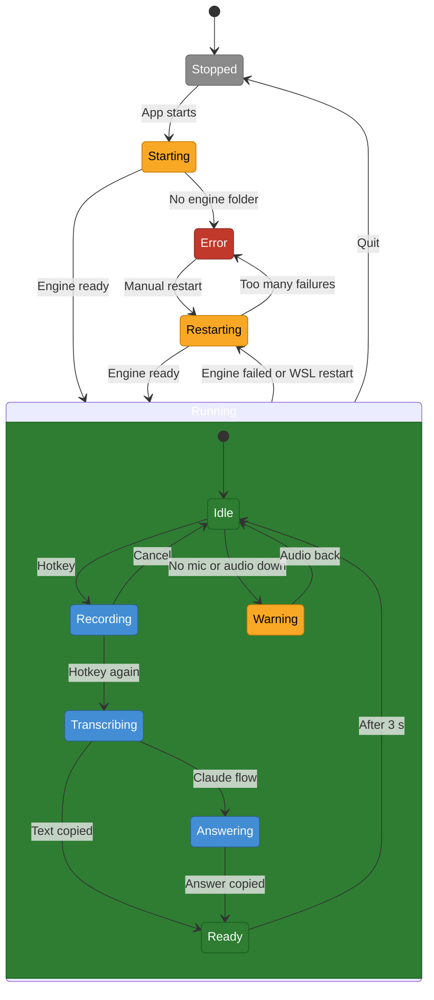

Overview. Full diagram: [docs/architecture.md, Tray states](docs/architecture.md#5-tray-states).

</details>

<details>
<summary>Voice assistant (overview)</summary>

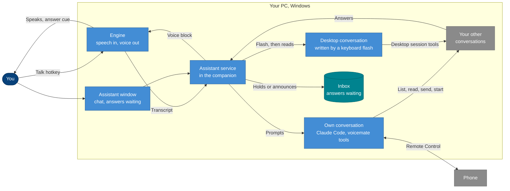

Both modes share the same loop: the assistant reaches your other conversations, the answers come back through the service, and the service speaks them or keeps them in the inbox. Blue: VoiceMate; teal: stored data; grey: outside VoiceMate. Full diagram: [docs/architecture.md](docs/architecture.md#61-voice-assistant). The whole flow: [docs/voice-assistant.md](docs/voice-assistant.md).

</details>

<details>
<summary>Engine supervisor and WSL audio recovery (overview)</summary>

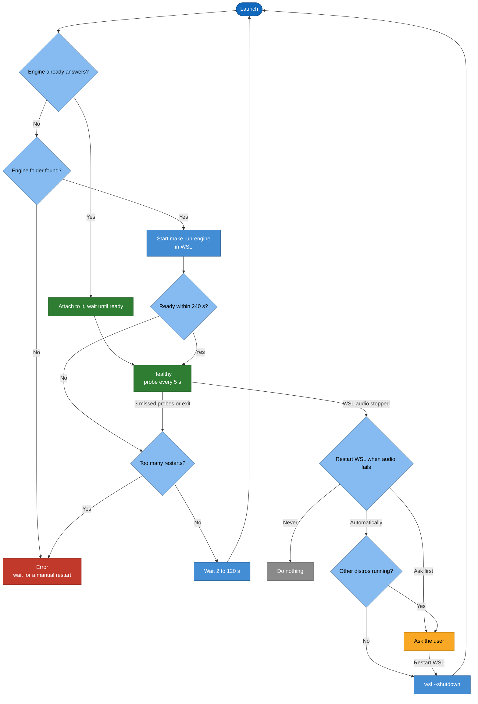

Overview. Full diagram: [docs/architecture.md, Supervisor](docs/architecture.md#6-supervisor-on-windows-and-wsl2).

</details>

## Troubleshooting

| Symptom | What to do |
|---|---|
| "Starting engine..." for a long time | The first start downloads the model, which can take minutes (run `make run` once in WSL, see [Quick start](#windows-with-the-installer)). Later starts take 10 to 60 seconds. Open **Engine** > **Open logs** and read `engine.log`. |
| "Engine folder not found" | Clone the engine into one of the [usual folders](docs/installation.md#2-install-the-engine), or set "Engine folder:" in Settings > **General**. |
| A hotkey says "Used by another app" | An old VoiceMate hotkey script may still run. Close it and remove it from `shell:startup`, or choose other hotkeys. |
| "WSL audio stopped" or "No microphone" | Connect a microphone. VoiceMate restarts WSL as set in "Restart WSL when audio fails:"; to do it by hand, use **Engine** > **Restart WSL...**. |
| A text did not reach the clipboard | It is in **Not copied** (tray menu and status window). Click it to copy it again. |
| English speech comes out wrong, or engine messages are in Portuguese | An engine started by hand defaults to Portuguese: add `ARGS="--output-lang en"` to `make run`. |
| The GPU is busy with other work | Choose the CPU mode: Settings > **General** > "Transcription", or tray menu > "Transcription". VoiceMate asks before it installs a mode that is missing. |
| The assistant says "Claude Code was not found" or "Claude Code is not signed in" | Run `where claude` in a terminal. VoiceMate also looks in `~/.local/bin` and `%APPDATA%\npm`; if `claude` is somewhere else, set `VOICEMATE_CLAUDE_CLI` to its full path. If it is not installed, install Claude Code. For the sign-in message, run `claude auth login`. Then press **Restart** in the assistant window. More in [docs/troubleshooting.md](docs/troubleshooting.md#voice-assistant). |
| The Desktop mode says "No Claude Desktop conversation is chosen" or "The assistant could not be set up" | "Desktop conversation:" is empty, or no Claude Desktop conversation has that exact title: type the title exactly as in the Claude Desktop sidebar, open Claude Desktop, then press **Restart**. More in [docs/troubleshooting.md](docs/troubleshooting.md#voice-assistant). |
| Something else on the engine side | Run `make doctor` in the engine folder. It prints a fix for each failed check. |

More problems and the exact messages: [docs/troubleshooting.md](docs/troubleshooting.md).

## Documentation

- [Installation guide](docs/install-guide.md): step by step, with screenshots of the installer.
- [Installation](docs/installation.md): every install path, updating and uninstalling.
- [Voice assistant and Claude](docs/voice-assistant.md): the whole assistant flow with diagrams, the two modes and how it conducts your other conversations.
- [Usage](docs/usage.md): flows, hotkeys, tray icon, transcription modes, models, voice options and the voice assistant.
- [Configuration](docs/configuration.md): engine flags, settings files, environment variables, speech-to-text modes and benchmark.
- [Troubleshooting](docs/troubleshooting.md): `make doctor`, WSL audio, logs, known messages.
- [Architecture](docs/architecture.md): diagrams and design choices.
- [WSL2 and AMD](docs/wsl2.md), [Companion design](docs/companion-app.md), [Brand](docs/brand.md), [Releasing](docs/releasing.md).
- [Claude Desktop profile](docs/desktop-profile.md) and [TTS provider protocol](docs/tts-provider-protocol.md): the file that tells the Desktop mode where the controls are, and the HTTP contract for your own voice.
- Research notes: [Voice assistant design](docs/research/voice-assistant-design.md) and [VoiceMate as a Claude Code client](docs/research/claude-code-client.md).

## Contributing

Issues and pull requests are welcome. Every dev command goes through the Makefile: `make format lint test` for the engine (Ruff and strict mypy), and `make companion-lint companion-test` for the companion. Every user-facing string exists in 5 languages through gettext. Commits follow Conventional Commits and explain the context. Read [CONTRIBUTING.md](CONTRIBUTING.md) first.

## Acknowledgements

VoiceMate stands on the work of many projects: [Whisper](https://github.com/openai/whisper) by OpenAI, [faster-whisper](https://github.com/SYSTRAN/faster-whisper), [whisper.cpp](https://github.com/ggml-org/whisper.cpp), [CTranslate2-ROCm](https://github.com/arlo-phoenix/CTranslate2-rocm), [PySide6](https://doc.qt.io/qtforpython-6/), [Kokoro](https://github.com/hexgrad/kokoro), [VoxCPM](https://github.com/OpenBMB/VoxCPM), the [Claude Agent SDK](https://github.com/anthropics/claude-agent-sdk-python) with [Claude Code](https://docs.claude.com/en/docs/claude-code), [Inno Setup](https://jrsoftware.org/isinfo.php) and [PyInstaller](https://pyinstaller.org/).

## License

[MIT](LICENSE) © Álli Terhorst. Part of [NanoBR](https://github.com/nano-br): open source utilities for everyday productivity.
