[English](README.md) | [Português](README.pt-BR.md) | [Español](README.es.md) | [Русский](README.ru.md) | **简体中文**

<div align="center">

<picture>
  <source media="(prefers-color-scheme: dark)" srcset="docs/assets/brand/banner-dark.png">
  <source media="(prefers-color-scheme: light)" srcset="docs/assets/brand/banner-light.png">
  
</picture>

**按下快捷键，说话，粘贴。本地语音听写直达剪贴板，由运行在你自己电脑上的 Whisper 驱动。**

[](https://github.com/nano-br/voice-mate/actions/workflows/ci.yml)
[](https://github.com/nano-br/voice-mate/releases/latest)
[](LICENSE)
[](pyproject.toml)
[](#platforms-and-gpus)
[](#languages)

[下载](https://github.com/nano-br/voice-mate/releases/latest) · [快速开始](#快速开始) · [文档](#文档) · [更新日志](CHANGELOG.md)

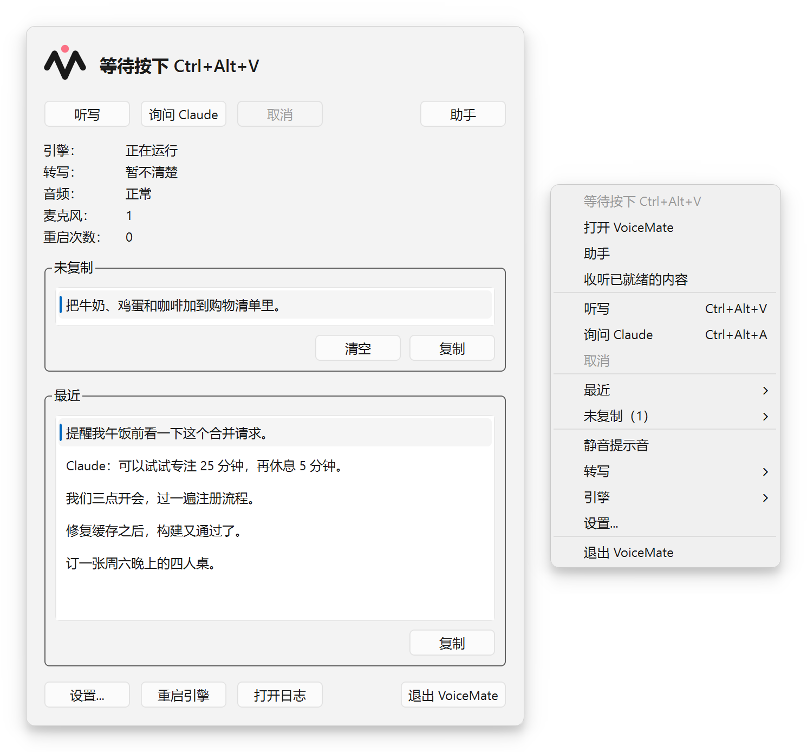

</div>

## 为什么做 VoiceMate

<!-- POSITIONING: aguardando texto alinhado -->
VoiceMate 是一个运行在你电脑上的个人语音助手，并与 Claude Desktop 和 Claude Code 集成。它从听写起步：按下快捷键，说话，文本就可以粘贴到任何 AI 工具里，Whisper 在本地运行，音频不会离开你的电脑。如今它走得更远：一个有名字、有个性（由你来定）的个人 AI 智能体，用语音统筹你的 Claude Code 对话，还能在自然的交谈中修改 VoiceMate 自身的设置。对用 Claude Code 编程的人来说，就是在自己正在工作的那个对话里开口说话。对需要无障碍支持的人来说，就是不依赖键盘也能使用 Claude Code。

我做它，是因为我相信一件很简单的事：向 AI 表达想法越快、越轻松，给出的细节越多，得到的结果就越好。说话比打字快得多，边想边说的时候，你给出的上下文远比你愿意敲出来的多。

**听写到剪贴板是核心。**从 2026 年 3 月起，我几乎每个工作日都在真实的工作中使用它，平台是搭载 NVIDIA 显卡的 Windows。后来我把显卡换成了 AMD，于是通过 WSL2 和 ROCm 7.2 把 VoiceMate 适配到了 AMD，这条路径也经过了测试（Radeon RX 9070 XT，`gfx1201`）。Whisper 在本地运行：听写不需要云服务，也不需要付费。

**语音助手是一个中央对话**，负责统筹你的其他 Claude Code 对话：列出它们、阅读它们、向它们提问，并在它们回答时用语音告诉你。它有两种运行方式：自己的会话（Claude Desktop 关闭时），或在 Claude Desktop 里，使用其原生工具。名字、个性（一个 Markdown 文件，可以放在你的 Obsidian 笔记库里）以及它可以阅读的笔记库，都由你来选。与 Claude 的语音对话（`Ctrl+Alt+A`）是它更轻量的同伴：语音输入，回答朗读出来。

VoiceMate 是开源的，采用 MIT 许可证。如果你试用了，请告诉我感觉如何。

## 演示

对个人 AI 智能体的演示和现场测试，目前使用巴西葡萄牙语。之后会陆续推出更精心制作、使用其他语言的视频。

[VoiceMate e seu agente pessoal de IA: demonstração e teste ao vivo com o Claude Code](https://youtu.be/T9H30G-AbZo)，来自 Prompt Falado 频道。

## 目录

[演示](#演示) · [功能](#功能) · [截图](#截图) · [快速开始](#快速开始) · [使用](#使用) · [语音助手](#语音助手) · [配置](#配置) · [架构](#架构) · [故障排查](#故障排查) · [文档](#文档) · [参与贡献](#参与贡献) · [许可证](#许可证)

## 功能

**听写（核心）**
- 一个快捷键即可开始和停止录音（默认 `Ctrl+Alt+V`）。文本进入剪贴板，随时可以粘贴。
- 本地 Whisper 模型，默认 `large-v3-turbo`。音频不会离开你的电脑。
- 听写语言是固定的，以保证结果稳定；在其他语言中夹杂的英文技术术语也依然能被转写。
- 开始、转写、已复制、警告和错误都有各自的提示音。录音在 10 分钟后自动停止（可配置）。

**Windows 配套应用**
- 托盘图标让你一眼看清当前状态，状态窗口列出最近的转写，设置中可以调整快捷键、提示音、通知、语言和引擎。
- 经过校验的剪贴板写入：应用写入文本，再读回来进行比对。无法进入剪贴板的文本会保留在“未复制”列表中，即使重启后也不会丢失。
- 配套应用会负责监管引擎：在 WSL2 内启动引擎，引擎失败时重启它，WSL 的音频中断时重启 WSL。
- 只为当前用户安装的安装程序（无需管理员权限），提供 5 种语言。
- 两种语音识别模式，可在托盘菜单（“转写”）或设置中切换：**CPU**（把 GPU 留给其他工作）和 **GPU**（最快）。每种模式有自己的 Whisper 模型。尚未安装的模式会在询问并告知下载大小之后由应用安装，而且只装在引擎自己的环境里。

<a id="languages"></a>**语言**：配套应用、引擎消息和安装程序支持英语、巴西葡萄牙语、西班牙语、俄语和简体中文。

<a id="platforms-and-gpus"></a>**平台与 GPU**
- Windows 10/11 搭配 NVIDIA（CUDA）：最初的路径，经过实战检验。引擎可以在命令行中原生运行。
- 引擎运行在 WSL2 内（配套应用采用的方式），以及通过 WSL2 使用 AMD GPU（ROCm 7.2）：已在 Radeon RX 9070 XT（RDNA4，`gfx1201`）上测试。
- Windows 上的 AMD（Vulkan），以及搭配可选配套应用的 Linux（X11、Wayland），使用同样的设置。
- 各平台都可以回退到 CPU。`make setup` 会检测平台和 GPU，并安装匹配的 PyTorch 版本和语音转文字后端。

**与 Claude 的语音对话**
- `Ctrl+Alt+A` 通过 Claude Code CLI 把你的语音发送给 Claude（使用你自己的登录账号：转写后的文本会发送给 Anthropic，音频不会）。回答会复制到剪贴板并朗读出来。
- TTS 引擎：默认的本地引擎（没有保存任何选择时使用）、Kokoro（`make setup` 推荐的引擎）和 VoxCPM2。也可以用你自己的：任何遵循 [TTS 提供方协议](docs/tts-provider-protocol.md) 的服务（设置 > 声音 > 自定义提供方）。对话可以跨轮次继续；按下任何快捷键都会打断回答并开始新的录音。

**语音助手（默认关闭）**
- 一个中央 Claude 对话，有两种模式：VoiceMate 自己的对话（VoiceMate 启动的 Claude Code 进程，也能在 Claude Desktop 和手机上看到），或你已有的一个 Claude Desktop 对话（通过短暂的键盘“闪现”写入，仅限 Windows）。它会列出、阅读并向你的其他对话发消息，还能在后台启动新对话。
- 用 `Ctrl+Alt+S` 对它说话，或在它的窗口里点 **说话**（录音时它会变成 **停止并发送**）。它用 Windows 自带的语音朗读，无需安装任何东西，也可以用引擎的声音（Kokoro 或你自己的提供方）：设置 > **助手** > “语音来源：”。英语、葡萄牙语和西班牙语的语音指令可以朗读上一条回答、切换到某个对话、向它发送消息或直接与它交谈。窗口显示聊天和待听的回答；它的声音会在你录音和录音转写期间等待，之后再重复被你打断的内容；托盘上的蓝色角标和“回答已就绪”提示音会在回答到达时提醒你，`Ctrl+Alt+R` 朗读已就绪的内容。
- 它能用语音修改一份固定清单中的 VoiceMate 设置，支持个性（文件、Obsidian 笔记库中的笔记或你自己写的文本），并使用英语或巴西葡萄牙语的技能，该技能也可以在任何 Claude Code 对话中单独使用。参见[语音助手](#语音助手)和[完整指南](docs/voice-assistant.md)（英文）。

## 截图

| 托盘菜单 | “重启 WSL？”和“重启 VoiceMate？” |
|:---:|:---:|
| 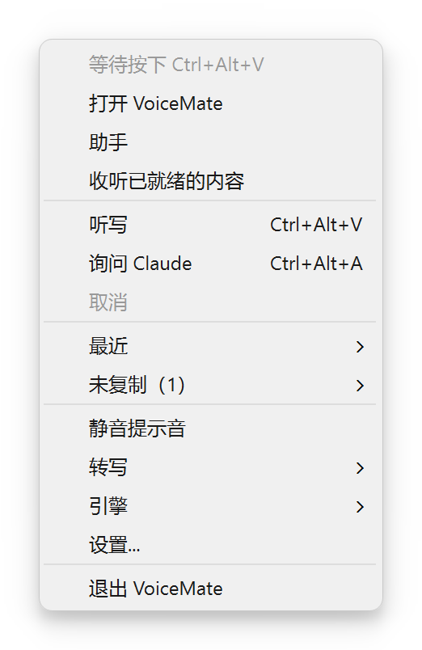 | 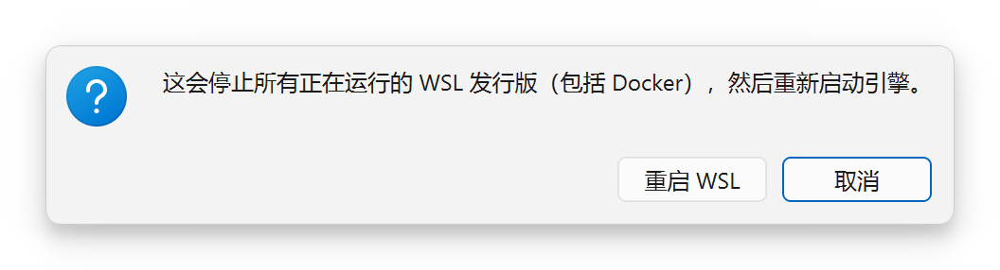<br>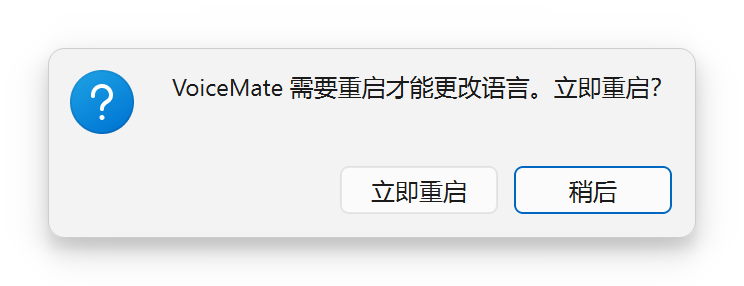 |

<p align="center">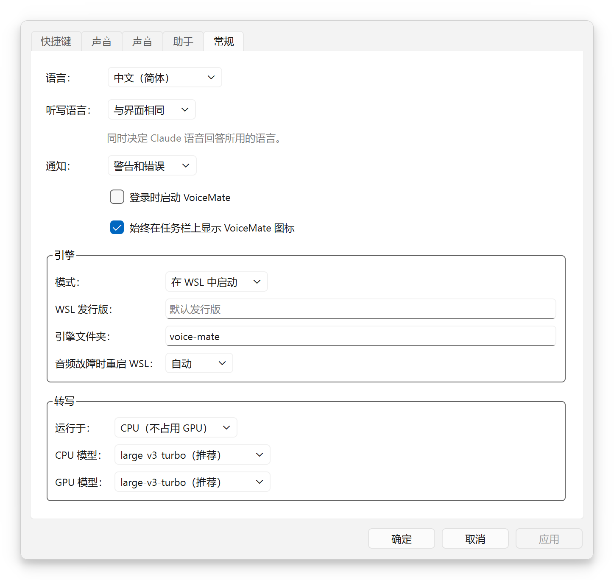<br><sub>“VoiceMate 设置”，“常规”选项卡。另见：<a href="docs/assets/screenshots/zh-CN/settings-hotkeys.png">“快捷键”</a>和<a href="docs/assets/screenshots/zh-CN/settings-sounds.png">“声音”</a>选项卡。</sub></p>

<p align="center">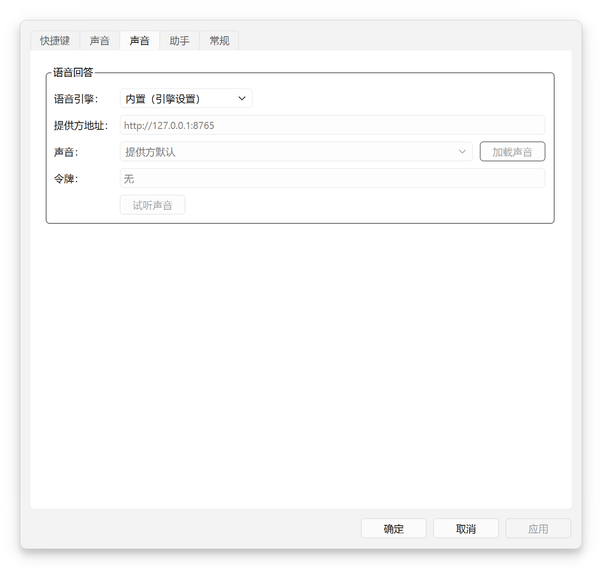<br><sub>“VoiceMate 设置”，“声音”选项卡：朗读回答的语音引擎，包括“自定义提供方（HTTP）”。</sub></p>

<p align="center">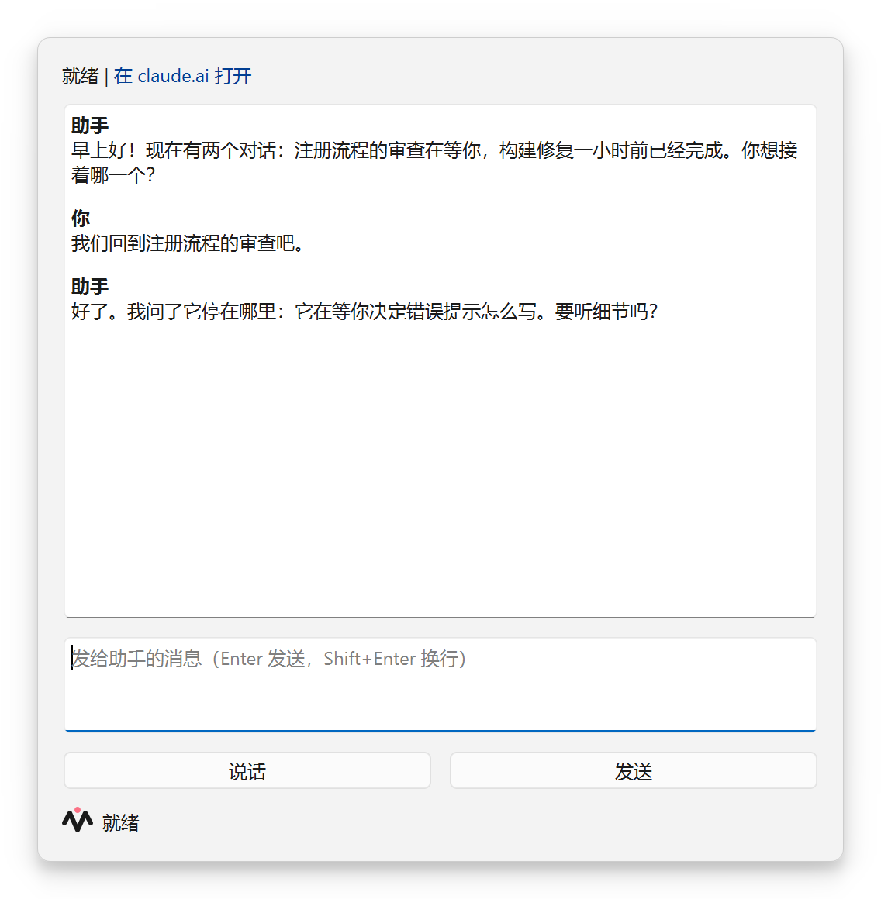<br><sub>助手窗口，带有 **说话** 按钮，从托盘菜单的“助手”打开。设置：<a href="docs/assets/screenshots/zh-CN/settings-assistant.png">“助手”</a>标签页。带有 CPU 或 GPU 选项的“转写”分组在上面的“常规”标签页里。</sub></p>

<p align="center">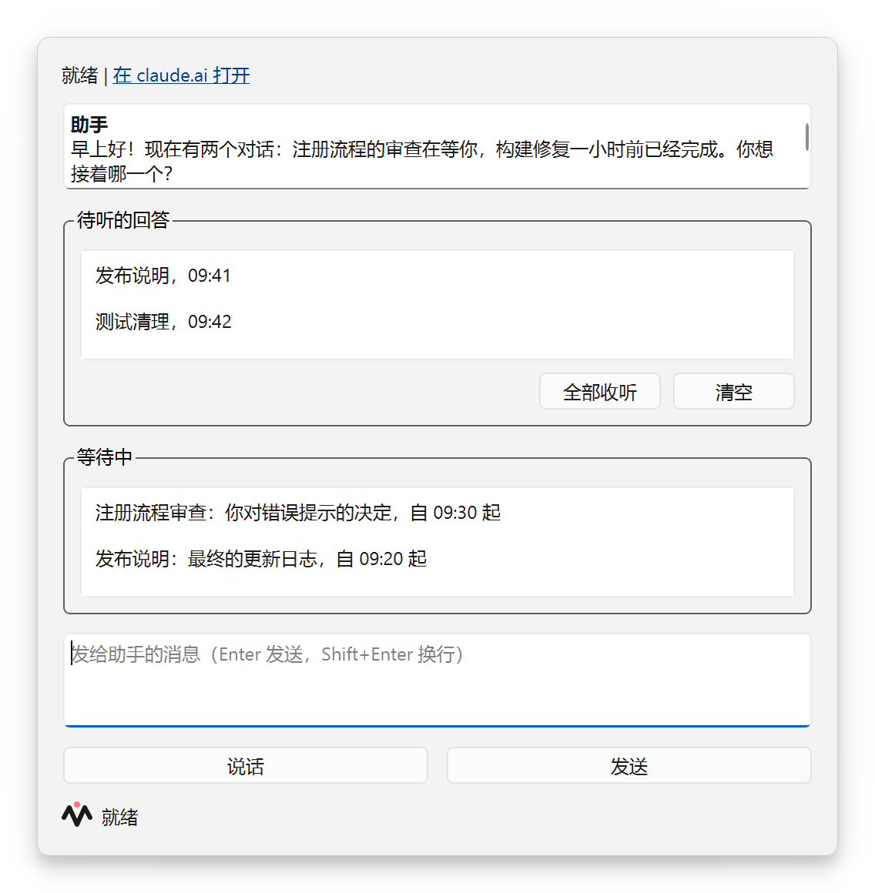<br><sub>同一个窗口，含“待听的回答”分组和“等待中”列表。</sub></p>

<p align="center">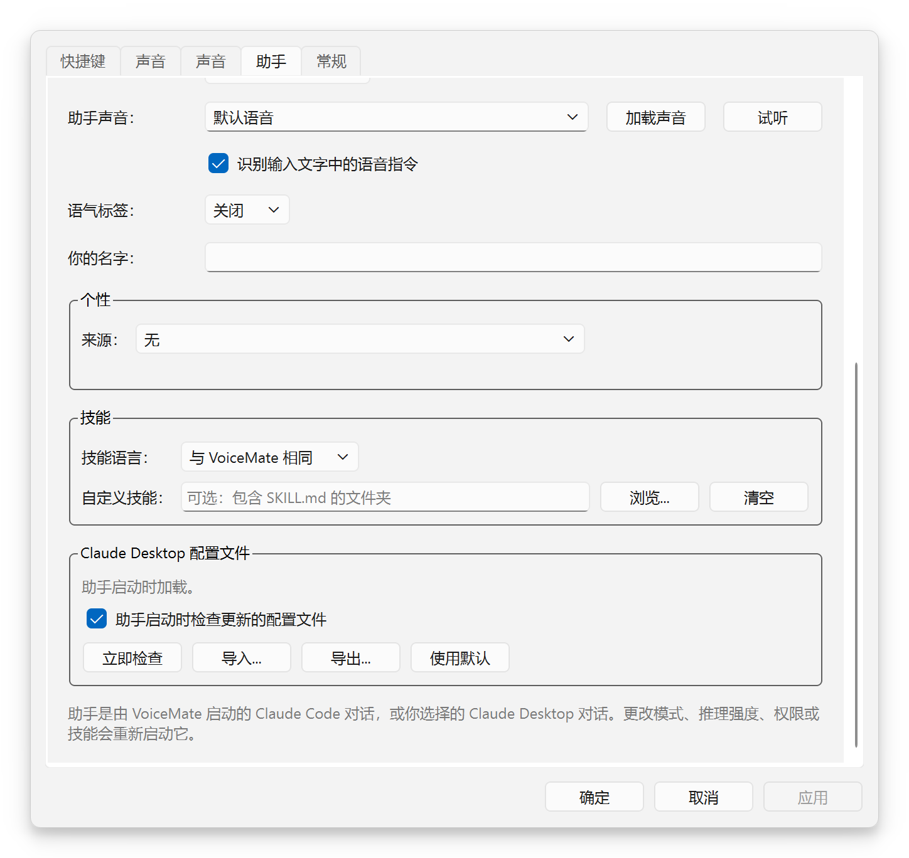<br><sub>向下滚动的“助手”选项卡：“个性”“技能”和“Claude Desktop 配置文件”分组。</sub></p>

<p align="center"><br><sub>托盘图标用角标显示状态，有待听的回答时显示蓝色角标。每个角标的含义：<a href="docs/usage.md#tray-icon-and-menu">Usage, tray icon and menu</a>（英文）。</sub></p>

## 快速开始

### Windows，使用安装程序

**带安装程序截图的分步指南：[安装指南](docs/install-guide.zh-CN.md)**（[English](docs/install-guide.md)、[Português](docs/install-guide.pt-BR.md)、[Español](docs/install-guide.es.md)、[Русский](docs/install-guide.ru.md)、[简体中文](docs/install-guide.zh-CN.md)）。下面是简要版本；完整参考见 [docs/installation.md](docs/installation.md)（英文）。

安装程序只包含配套应用。引擎运行在 WSL2 发行版内，所以请先把它准备好。

1. 在 PowerShell 中安装带 Ubuntu 的 WSL2：`wsl --install -d Ubuntu-24.04`，然后打开 Ubuntu（如果你原来就有别的 WSL 发行版，还要运行 `wsl --set-default Ubuntu-24.04`，或者稍后在设置中指定“WSL 发行版：”）。在 Ubuntu 里安装音频相关的包；Python 3.12（Ubuntu 24.04 自带）和 [Poetry](https://python-poetry.org/docs/#installation) 也必须在登录 shell 的 `PATH` 中：
   ```bash
   sudo apt install -y libportaudio2 libasound2-plugins pulseaudio-utils wl-clipboard git make
   ```
2. 克隆引擎并运行引导式安装：
   ```bash
   git clone https://github.com/nano-br/voice-mate.git ~/voice-mate
   cd ~/voice-mate
   make setup    # 只需要听写时，在“选择哪个主流程？”处回答 1（clipboard）
   make doctor   # 每一项检查都应显示对勾
   ```
   配套应用会在 `~/voice-mate` 和其他几个常用文件夹中查找引擎（[列表](docs/installation.md#2-install-the-engine)）；如果放在别处，请在设置中指定“引擎文件夹：”。使用 AMD GPU 时，还要安装 AMD 驱动和适用于 WSL 的 ROCm（[docs/wsl2.md](docs/wsl2.md)）。
3. 推荐：仍在 `~/voice-mate` 中，运行一次 `make run`，加载完成后按 `Ctrl+C` 停止。第一次启动时会下载 Whisper 模型，而配套应用只给引擎启动 240 秒（连续 3 次启动超时后就不再重试），网速慢的话可能不够用。
4. 从[最新发布版](https://github.com/nano-br/voice-mate/releases/latest)下载 `VoiceMate-Setup-x.y.z.exe` 并运行。安装程序没有代码签名，所以 Windows SmartScreen 可能会发出警告：选择 **更多信息**，然后选择 **仍要运行**。它只为当前用户安装，不会弹出管理员权限提示。
5. 启动 VoiceMate。模型加载期间托盘显示“正在启动引擎...”（模型下载完成后需要 10 到 60 秒），然后显示“等待按下 Ctrl+Alt+V”。
6. 可选：固定到任务栏。打开“开始”菜单，搜索 VoiceMate，右键单击它并选择 **固定到任务栏**。

### 从源码安装

你需要 Python 3.12、[Poetry](https://python-poetry.org/docs/#installation)、GNU `make`（在 Windows 上要先安装，例如通过 Chocolatey 或 Scoop）和 `git`。

```bash
git clone https://github.com/nano-br/voice-mate.git
cd voice-mate
make setup                           # 检测平台和 GPU，安装 PyTorch 和你选择的模块
make doctor                          # 检查麦克风、音频、快捷键和 GPU，并为每个问题给出修复方法
make run ARGS="--output-lang en"     # 用引擎自带的快捷键启动引擎（Windows 原生或 Linux）
```

**引擎默认使用葡萄牙语**（`--output-lang pt-BR`），它决定 Whisper 听的语言、Claude 回答的语言和引擎消息的语言。请像上面那样传入 `--output-lang en`（或其他语言代码）；`--transcription-language` 和 `VOICEMATE_LANG` 只会改变其中一项（[配置](docs/configuration.md)）。配套应用会自己传入这些参数，参见[使用](#使用)。

在 Windows 上从源码运行配套应用（引擎在 WSL2 中）：先运行一次 `make companion-venv`，然后运行 `make run-tray`。在 Linux 上，像上面那样运行 `make setup` 和 `make run`；如需可选的托盘和状态窗口，运行 `poetry install --extras ui`，然后运行 `make run-tray`（[详情](docs/installation.md#linux)）。

## 使用

| 快捷键 | 托盘菜单项 | 效果 |
|---|---|---|
| `Ctrl+Alt+V` | “听写” | 语音转为文本，复制到剪贴板 |
| `Ctrl+Alt+A` | “询问 Claude” | 语音发送给 Claude，回答被复制并朗读出来 |
| `Ctrl+Alt+S` | “与助手对话” | 语音发给助手，而不是剪贴板 |
| `Ctrl+Alt+W` | “打开助手窗口” | 打开或关闭助手窗口 |
| `Ctrl+Alt+R` | “收听已就绪的内容” | 助手朗读正在等待的回答 |

按下 `Ctrl+Alt+V`，在开始提示音之后说话，再按一次 `Ctrl+Alt+V`，然后在任何地方用 `Ctrl+V` 粘贴。文本的去向由用来停止录音的那个快捷键决定。无法进入剪贴板的文本会留在 **未复制** 列表中（托盘菜单和状态窗口里都有），单击一下就能复制。要退出，请在托盘菜单中选择 **退出 VoiceMate**；不是由配套应用启动的引擎会继续运行。

**听写语言。** 在设置 > **常规** 中，“听写语言：”决定你说话的语言。默认是“与界面相同”；选择“自动检测”则让 Whisper 检测每一段录音的语言（Claude 仍然用界面语言回答；使用 Kokoro 时，请改为固定一种语言）；也可以只选一种语言。配套应用会把它以 `--transcription-language` 和 `--output-lang` 的形式传给它启动的引擎，更改后会重启引擎。配套应用仅连接、而非由它启动的引擎（systemd 单元，或手动启动的引擎）会沿用它自己的参数。

与 Claude 的语音对话需要安装并登录 Claude Code CLI，并且在 `make setup` 中选择了 `claude` 模块。参见 [docs/usage.md](docs/usage.md#claude-flow)。

**转写模式。** 在设置 > **常规** > “转写”中，“运行于：”可选“CPU（不占用 GPU）”“GPU（最快）”或“自动（引擎设置）”。托盘菜单里的“转写”作用相同。每种模式有自己的模型（“CPU 模型：”“GPU 模型：”）。切换会重启引擎；如果该模式尚未安装，VoiceMate 会先询问（并告知下载大小），再在一个显示输出的窗口里安装。在终端里：`make stt-check` 和 `make stt-install MODE=cpu`（或 `gpu`）。速度和准确率数据见 [docs/configuration.md](docs/configuration.md#speech-to-text-modes)。

### 语音助手

助手是一个 Claude 对话，即中央对话，它知道你的其他对话在做什么，并替你统筹它们：列出、阅读、发消息、在后台启动新对话，并在它们回答时告诉你。默认关闭。

**完整流程，附图示：[docs/voice-assistant.md](docs/voice-assistant.md)**（英文；VoiceMate 如何接入 Claude、两种模式、对你其他对话的统筹、回答如何返回、声音与安全）。

| | VoiceMate 自己的对话 | 一个 Claude Desktop 对话 |
|---|---|---|
| 是什么 | VoiceMate 启动并持有的 Claude Code 进程 | 你已有的对话，在“Desktop 对话：”中按确切标题选择 |
| VoiceMate 如何写入 | 直接通过进程 | 短暂的“闪现”：Desktop 窗口来到前台，文本被粘贴并发送，焦点随后返回（约 2 秒） |
| 需要 | `claude` CLI 和 Claude 登录 | Claude Desktop 已打开且屏幕未锁定；仅限 Windows |

1. **要求：**Claude Code CLI（Windows 的 `PATH` 中，或 `~/.local/bin`、`%APPDATA%\npm` 中有 `claude`，或在 `VOICEMATE_CLAUDE_CLI` 中给出路径）以及这台电脑上的 Claude 登录（执行一次 `claude auth login`）。
2. **开启：**在状态窗口中点 **助手**（助手关闭时它会说明怎么做），或到 设置 > **助手** 设定“助手模式：”。
3. **使用：**按 `Ctrl+Alt+S`，说话，再按一次 `Ctrl+Alt+S`，它会用引擎的声音回答。或者在它的窗口里输入文字（`Ctrl+Alt+W`）。`Ctrl+Alt+R` 朗读待听的回答。

> [!WARNING]
> “完全访问，从不询问（有风险）”（`bypassPermissions`）会让助手启动的对话不经询问就修改任何文件、运行任何命令。除非你信任要交给它们的事，否则请保持默认值。

更多（英文）：[语音指令与直接模式](docs/voice-assistant.md#6-direct-mode-and-voice-commands)、[其他对话的回答](docs/voice-assistant.md#5-answers-coming-back)、[用语音改设置](docs/voice-assistant.md#8-settings-by-voice)、[每项设置的步骤](docs/usage.md#voice-assistant)、[Claude Desktop 配置文件](docs/desktop-profile.md)和 [TTS 提供方协议](docs/tts-provider-protocol.md)。

## 配置

| 内容 | 位置 |
|---|---|
| 配套应用设置 | Windows `%APPDATA%\VoiceMate\companion.toml`，Linux `~/.config/voicemate/companion.toml` |
| `make setup` 中为引擎选定的设置、API 令牌 | `~/.config/voicemate/`（对配套应用来说在 WSL 内；对在 Windows 上原生运行的引擎则是 `%USERPROFILE%\.config\voicemate\`） |
| 引擎 HTTP API | `127.0.0.1:47821` |
| 日志（`companion.log`、`engine.log`） | Windows `%LOCALAPPDATA%\VoiceMate\logs`，Linux `~/.local/state/voicemate/logs` |
| **未复制** 列表 | `logs` 文件夹旁边的 `pending.json` |
| 助手设置（skill 会读取） | `~/.voicemate/assistant.json`，在你的用户文件夹中 |
| 助手会话、收件箱、它启动的对话、个性文本和 Desktop 配置文件缓存 | `assistant-session.json`、`assistant-inbox.json`、`assistant-conversations\`、`assistant-personality.md`、`desktop-profile\`，以及 `pending.json` 旁的 `assistant\` |

所有引擎参数、所有设置项和所有环境变量：[docs/configuration.md](docs/configuration.md)。

## 架构

VoiceMate 由两部分组成。**引擎**负责录音、转写并运行 Claude 流程；它是一个带本地 HTTP API 的 Python 守护进程。**配套应用**是 Windows 上基于 PySide6 的托盘应用，负责处理快捷键和剪贴板，并在 WSL2 内监管引擎。引擎也可以脱离配套应用，单独从命令行运行。下面的图都是简化的概览；每张图都链接到 [docs/architecture.md](docs/architecture.md)（英文）中的完整图，那里还有组件图、HTTP API 和设计取舍。

<details>
<summary>系统上下文（概览）</summary>

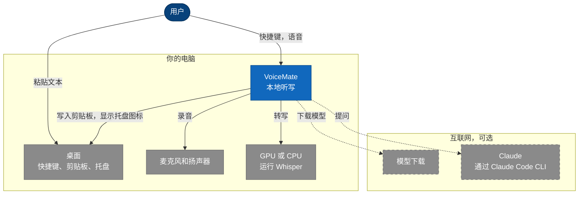

概览。完整的图：[docs/architecture.md, System context](docs/architecture.md#1-system-context)。

</details>

<details>
<summary>容器，Windows 与 WSL2（概览）</summary>

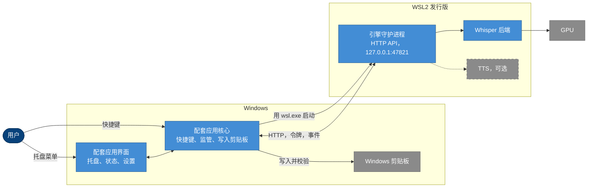

概览。完整的图：[docs/architecture.md, Containers](docs/architecture.md#2-containers)。

</details>

<details>
<summary>一次听写，逐步说明（概览）</summary>

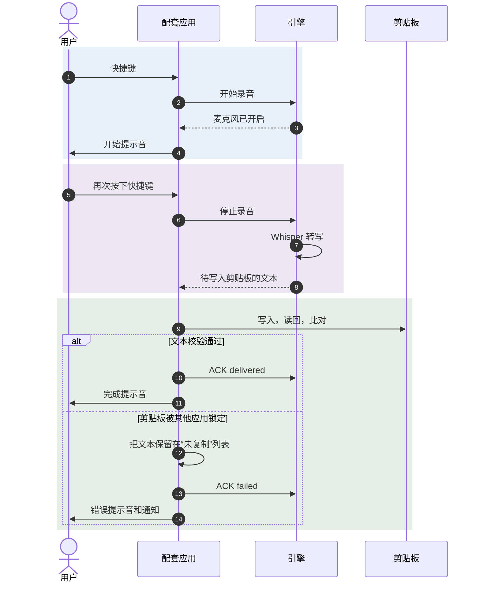

概览。完整的图：[docs/architecture.md, One dictation](docs/architecture.md#4-runtime-one-dictation)。

</details>

<details>
<summary>托盘状态（概览）</summary>

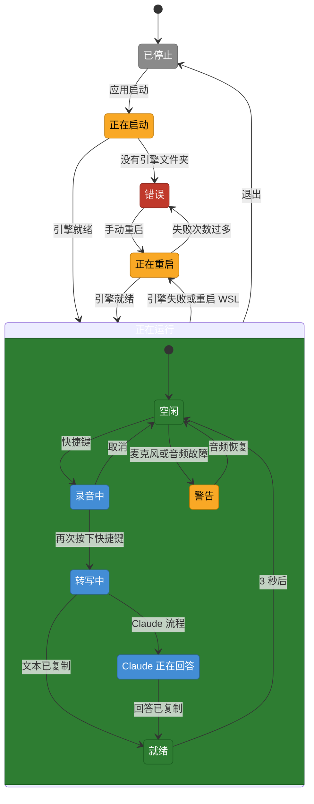

概览。完整的图：[docs/architecture.md, Tray states](docs/architecture.md#5-tray-states)。

</details>

<details>
<summary>语音助手（概览）</summary>

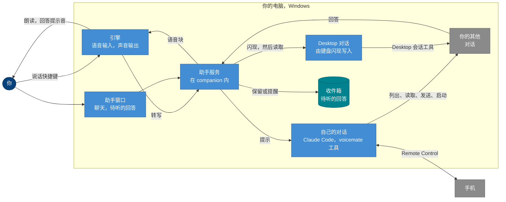

两种模式走同一个循环：助手联系你的其他对话，回答经服务返回，服务把它们读出来或存入收件箱。蓝色：VoiceMate；青色：存储的数据；灰色：VoiceMate 之外。完整图表：[docs/architecture.md](docs/architecture.md#61-voice-assistant)。完整流程：[docs/voice-assistant.md](docs/voice-assistant.md)。

</details>

<details>
<summary>引擎监管与 WSL 音频恢复（概览）</summary>

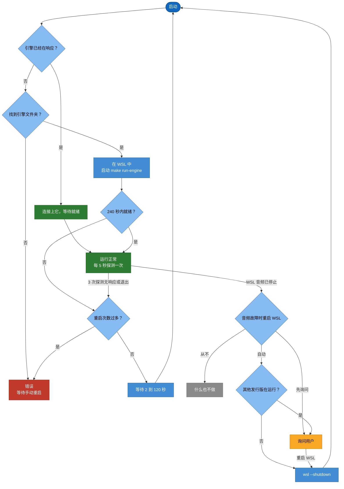

概览。完整的图：[docs/architecture.md, Supervisor](docs/architecture.md#6-supervisor-on-windows-and-wsl2)。

</details>

## 故障排查

| 现象 | 怎么办 |
|---|---|
| “正在启动引擎...”持续很久 | 第一次启动要下载模型，可能需要几分钟（先在 WSL 中运行一次 `make run`，参见[快速开始](#windows使用安装程序)）。之后每次启动需要 10 到 60 秒。打开 **引擎** > **打开日志**，查看 `engine.log`。 |
| “未找到引擎文件夹” | 把引擎克隆到[常用文件夹](docs/installation.md#2-install-the-engine)之一，或者在设置 > **常规** 中指定“引擎文件夹：”。 |
| 某个快捷键提示“已被其他应用占用” | 可能还有旧的 VoiceMate 快捷键脚本在运行。关闭它并从 `shell:startup` 中删除，或者选择其他快捷键。 |
| “WSL 音频已停止”或“没有麦克风” | 请连接麦克风。VoiceMate 会按“音频故障时重启 WSL：”的设置重启 WSL；想手动重启，请使用 **引擎** > **重启 WSL...**。 |
| 文本没有进入剪贴板 | 它在 **未复制** 列表中（托盘菜单和状态窗口里都有）。单击它即可再次复制。 |
| 英语语音识别结果不对，或者引擎消息是葡萄牙语 | 手动启动的引擎默认使用葡萄牙语：给 `make run` 加上 `ARGS="--output-lang en"`。 |
| GPU 正忙于其他工作 | 选择 CPU 模式：设置 > **常规** > “转写”，或托盘菜单 > “转写”。尚未安装的模式会先询问你，再安装。 |
| 助手提示“未找到 Claude Code”或“Claude Code 尚未登录” | 在终端运行 `where claude`。VoiceMate 还会在 `~/.local/bin` 和 `%APPDATA%\npm` 中查找；如果 `claude` 在其他位置，请把 `VOICEMATE_CLAUDE_CLI` 设为它的完整路径。如果尚未安装，请安装 Claude Code。遇到未登录的提示时，运行 `claude auth login`。然后在助手窗口点“重新启动”。更多见 [docs/troubleshooting.md](docs/troubleshooting.md#voice-assistant)。 |
| Desktop 模式提示“未选择 Claude Desktop 对话”或“无法准备助手” | “Desktop 对话：”为空，或没有 Claude Desktop 对话有这个确切标题：按 Claude Desktop 侧边栏中的样子准确输入标题，打开 Claude Desktop，然后点 **重新启动**。更多见 [docs/troubleshooting.md](docs/troubleshooting.md#voice-assistant)。 |
| 引擎一侧的其他问题 | 在引擎文件夹中运行 `make doctor`。每一项未通过的检查它都会给出修复方法。 |

更多问题和确切的消息文本：[docs/troubleshooting.md](docs/troubleshooting.md)。

## 文档

详细文档（英文）：

- [安装指南](docs/install-guide.zh-CN.md)：分步说明，附安装程序截图。
- [安装](docs/installation.md)：所有安装方式、更新和卸载。
- [语音助手与 Claude](docs/voice-assistant.md)：助手的完整流程（含图示）、两种模式，以及它如何统筹你的其他对话。
- [使用](docs/usage.md)：流程、快捷键、托盘图标、转写模式、模型、语音选项和语音助手。
- [配置](docs/configuration.md)：引擎参数、设置文件、环境变量、语音识别模式和基准测试。
- [故障排查](docs/troubleshooting.md)：`make doctor`、WSL 音频、日志、已知消息。
- [架构](docs/architecture.md)：图表和设计取舍。
- [WSL2 与 AMD](docs/wsl2.md)、[配套应用设计](docs/companion-app.md)、[品牌](docs/brand.md)、[发布流程](docs/releasing.md)。
- [Claude Desktop 配置文件](docs/desktop-profile.md)和 [TTS 提供方协议](docs/tts-provider-protocol.md)：告诉 Desktop 模式控件位置的文件，以及你自己的声音所用的 HTTP 约定。
- 研究笔记（英文）：[语音助手设计](docs/research/voice-assistant-design.md) 和 [VoiceMate 作为 Claude Code 客户端](docs/research/claude-code-client.md)。

## 参与贡献

欢迎提交 issue 和 pull request。所有开发命令都通过 Makefile 运行：引擎用 `make format lint test`（Ruff 和严格模式的 mypy），配套应用用 `make companion-lint companion-test`。每一条面向用户的字符串都通过 gettext 提供 5 种语言。提交遵循 Conventional Commits，并说明背景。请先阅读 [CONTRIBUTING.md](CONTRIBUTING.md)。

## 致谢

VoiceMate 建立在许多项目的成果之上：OpenAI 的 [Whisper](https://github.com/openai/whisper)、[faster-whisper](https://github.com/SYSTRAN/faster-whisper)、[whisper.cpp](https://github.com/ggml-org/whisper.cpp)、[CTranslate2-ROCm](https://github.com/arlo-phoenix/CTranslate2-rocm)、[PySide6](https://doc.qt.io/qtforpython-6/)、[Kokoro](https://github.com/hexgrad/kokoro)、[VoxCPM](https://github.com/OpenBMB/VoxCPM)、[Claude Agent SDK](https://github.com/anthropics/claude-agent-sdk-python) 与 [Claude Code](https://docs.claude.com/en/docs/claude-code)、[Inno Setup](https://jrsoftware.org/isinfo.php) 以及 [PyInstaller](https://pyinstaller.org/)。

## 许可证

[MIT](LICENSE) © Álli Terhorst。[NanoBR](https://github.com/nano-br) 旗下项目：服务于日常效率的开源工具。
