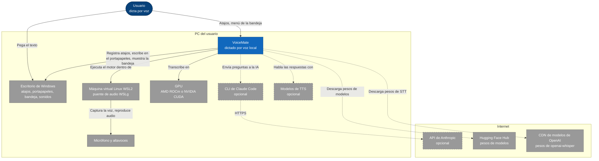
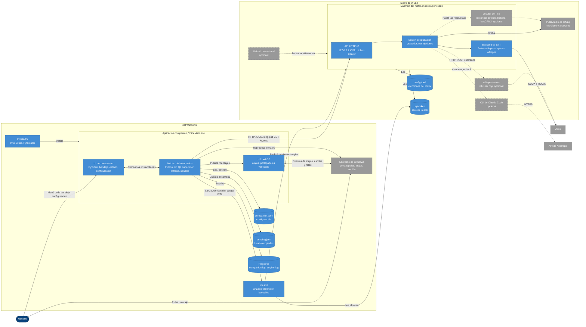
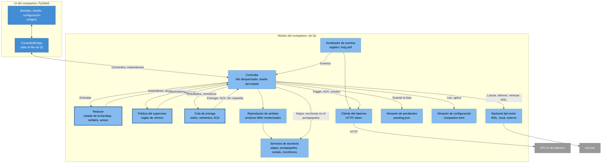
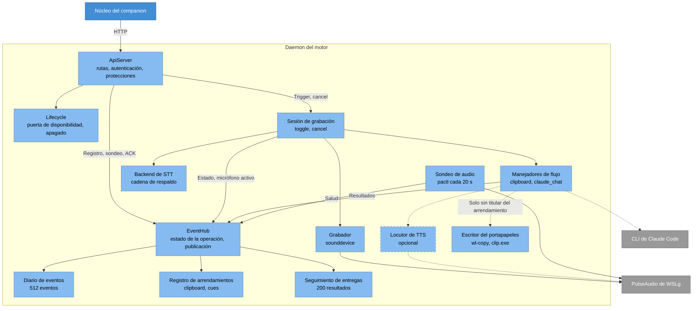
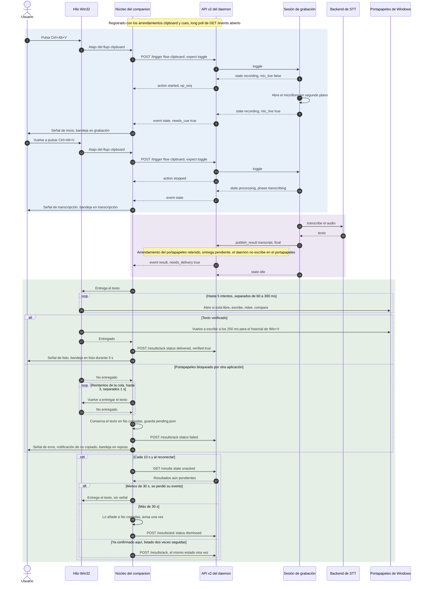
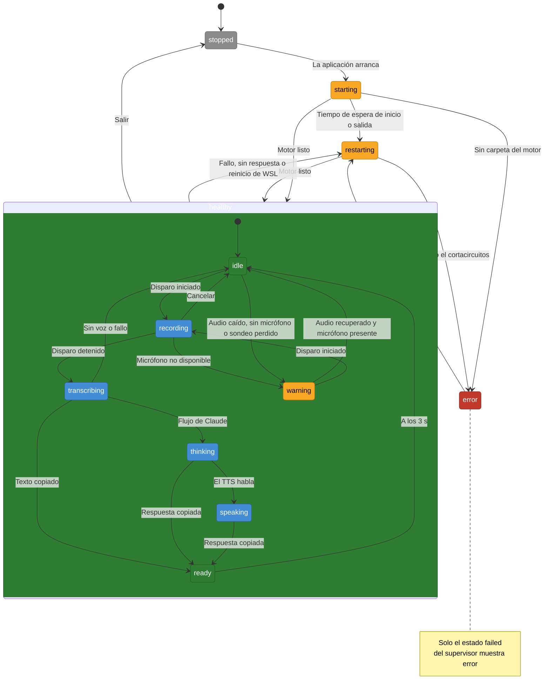
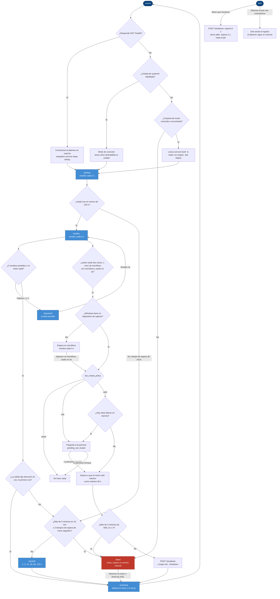
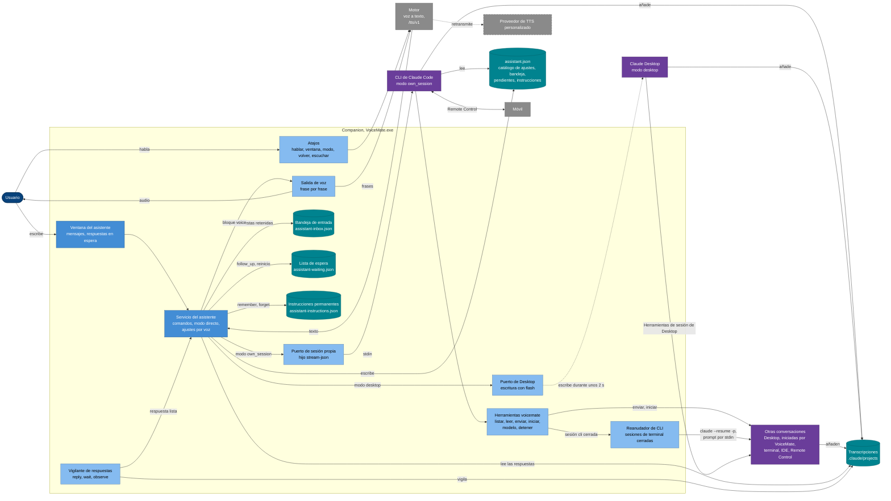

[English](architecture.md) | [Português](architecture.pt-BR.md) | **Español** | [Русский](architecture.ru.md) | [简体中文](architecture.zh-CN.md)

# Arquitectura

Propósito: cómo está construido VoiceMate, con los diagramas de cada nivel, la API HTTP, el árbol de paquetes y las razones de las principales decisiones de diseño. Volver al [README](../README.es.md).

Esta página describe la configuración Windows + WSL2 (la aplicación companion en Windows, el motor dentro de WSL2), la configuración para la que se construyó el companion. El modo `local` de Linux y el modo de línea de comandos se mencionan donde difieren. Cuando el código cambia, esta página cambia en el mismo pull request. El contrato del protocolo, con todo detalle, está en [companion-app.md](companion-app.md).

## 1. Contexto del sistema



El usuario pulsa un atajo global en Windows y pega el texto donde esté el cursor. VoiceMate es un sistema local repartido entre las dos mitades del mismo PC. El escritorio de Windows aporta los atajos, el portapapeles, la bandeja y la salida de sonido para las señales. El motor corre dentro de la máquina virtual Linux WSL2 porque allí se puede alcanzar una GPU AMD mediante ROCm ([wsl2.md](wsl2.md)). El micrófono y los altavoces llegan al motor por el puente PulseAudio de WSLg, que el motor sondea con `pactl info` cada 20 segundos (`app/platform/audio_probe.py`).

Todo lo opcional queda detrás de flechas discontinuas. El flujo de Claude ejecuta la CLI local de Claude Code a través de `claude-agent-sdk` (`app/features/claude/runtime.py`), que llama a la API de Anthropic (modelo por defecto `claude-haiku-5-5`). Las bibliotecas de TTS hablan la respuesta (se usa un motor local por defecto cuando no hay nada guardado; `make setup` propone `kokoro`). Los pesos de los modelos vienen de internet en el primer uso:

| Qué | Origen | Cuándo |
|---|---|---|
| Modelo GGML de whisper.cpp, su variante q8, Silero VAD para whisper.cpp | Hugging Face (`ggerganov/whisper.cpp`, `ggml-org/whisper-vad`) | `make setup` o `make configure` |
| Modelo de faster-whisper (`large-v3-turbo` por defecto) | Hugging Face, a través de la biblioteca `faster-whisper` | Primera carga del modelo |
| Modelo de openai-whisper (el backend habitual en WSL2 + AMD sin CTranslate2-ROCm) | El CDN de modelos de OpenAI, a través de la biblioteca `openai-whisper` | Primera carga del modelo |
| Pesos del motor de TTS (el motor por defecto, VoxCPM2 y Kokoro) | Hugging Face (`openbmb/VoxCPM2`, Kokoro a través de su biblioteca, el repositorio propio del motor por defecto) | Primera carga del TTS |
| Wheels de PyTorch ROCm, fuentes de whisper.cpp, el fork de CTranslate2-ROCm | `repo.radeon.com`, GitHub | `make setup` |

## 2. Contenedores



Dos hosts, un contrato de loopback. En Windows, el companion (`VoiceMate.exe`, instalado por usuario con Inno Setup en `%LOCALAPPDATA%\Programs\VoiceMate`) se divide en un **núcleo** sin Qt y una **UI** de PySide6. La UI solo muestra objetos `CompanionSnapshot` inmutables y llama a comandos de `CompanionController` (`app/companion/contract.py`). Una prueba impide que el companion importe la pila del motor (`tests/test_import_boundary.py`).

Dentro del núcleo, un **hilo Win32** dedicado es dueño de `RegisterHotKey` y de toda escritura y relectura del portapapeles (`app/companion/win/hotkeys_clipboard.py`). El núcleo inicia el motor con `wsl.exe -d <distro> -e bash -lc 'cd ... && exec make run-engine ARGS="--daemon-port <port> --transcription-language <code> --output-lang <BCP-47>"'`, dentro de un Job Object, con stdin abierto y la salida volcada en `engine.log` (`app/companion/supervisor/wsl.py`, `app/companion/supervisor/backend.py`). Las dos opciones de idioma salen del ajuste `dictation_language` (`app/companion/dictation.py`; mira [companion-app.md](companion-app.md)). `make run-engine` es `voice-mate --supervised --api --api-token`.

Dentro de WSL2, el **daemon del motor** enlaza su API HTTP en `127.0.0.1:47821` ANTES de cargar el modelo, crea el archivo de token `~/.config/voicemate/api-token` e inicia el vigilante del fin de archivo de stdin (`app/main.py`). WSL2 reenvía ese puerto al loopback de Windows. El núcleo lee el token con `wsl.exe ... cat` (`app/companion/supervisor/wsl.py`) y habla HTTP JSON simple con `urllib`, sin el proxy del sistema, con un long poll de 25 segundos en `GET /events` (`app/companion/client.py`).

El reconocimiento de voz y el TTS corren en el proceso del daemon. Solo whisper.cpp en modo servidor (`whisper-server` en un puerto de loopback libre) y la CLI de Claude Code (iniciada por `claude-agent-sdk`) son procesos aparte. Estado local en Windows: `companion.toml` en `%APPDATA%\VoiceMate`, `pending.json` y `logs\` en `%LOCALAPPDATA%\VoiceMate` (`app/companion/paths.py`). Un servicio de usuario de systemd opcional puede ejecutar el daemon en su lugar; el companion se conecta entonces a él.

### API HTTP v2

Rutas en `app/daemon/server.py`, cargas útiles en `app/protocol/models.py`:

| Ruta | Propósito |
|---|---|
| `GET /health` | Disponibilidad, `api_version`, `instance`, `audio`, `flow_info`. Nunca necesita el token |
| `POST /register`, `POST /unregister` | Id de cliente, arrendamientos exclusivos `clipboard` y `cues` (de 10 a 120 segundos, 40 por defecto), instantánea y cursor |
| `GET /events?client_id&instance&since&wait` | Long poll (como máximo 25 segundos) sobre un anillo de 512 eventos: `snapshot`, `state`, `result`, `error`, `warning`, `health`, `shutdown` |
| `POST /trigger` (`expect`: toggle, start, stop), `POST /cancel` | Manejan la sesión de grabación |
| `POST /results/ack`, `GET /results?state=unacked` o `recent` | Confirmación de entrega y conciliación sobre los últimos 200 resultados |
| `POST /shutdown` | Parada ordenada, motivo `user_quit`, `restart` o `supervisor` |
| `/tts/v1/...` | El protocolo `voicemate-tts` ([tts-provider-protocol.md](tts-provider-protocol.md#the-engine-speaks-the-same-protocol)), servido solo para Kokoro y el proveedor personalizado; el companion lo usa para hablar las respuestas del asistente |

Las rutas v1 de los antiguos scripts de Windows (`/status`, `/result`, `/register` con cuerpo vacío, `POST /trigger`) siguen funcionando contra un daemon sin token. Protecciones en cada petición: `403` para cualquier cabecera `Origin` o un `Host` que no sea loopback, `401` sin el token bearer (salvo `/health`), `503` hasta que esté listo (salvo `/health`, `/shutdown`, `/unregister`).

## 3. Componentes

### 3.1 Núcleo del companion



El núcleo está construido como máquinas de estado puras manejadas por un solo hilo. El hilo `Dispatcher` es dueño del único `CoreState` y ejecuta en orden las tareas y los temporizadores publicados (`app/companion/runtime.py`). El trabajo lento va a ejecutores seriales (E/S, comandos, supervisor, sondeador, escritor de pendientes) cuyos resultados se publican de vuelta (`app/companion/controller.py`).

Tres módulos puros contienen las reglas y no hacen E/S: el **reducer** (`app/companion/model.py`), la **política del supervisor** (`app/companion/supervisor/policy.py`) y la **cola de entrega** (`app/companion/delivery.py`). Cada uno devuelve efectos o acciones que ejecuta el controller. El hilo `EventPoller` se registra, hace long poll de `/events` y se registra de nuevo ante `410`, un cambio de instancia o un arrendamiento perdido (`app/companion/client.py`). Los hosts del motor son intercambiables: `WslBackend`, `LocalBackend`, `ExternalBackend`. Los servicios del sistema operativo quedan detrás del paquete `Desktop`: atajos, portapapeles, sonido, el recuento de dispositivos de captura (Core Audio en Windows), el inicio automático y la promoción del icono de la bandeja (`app/companion/desktop.py`). La UI llega al núcleo solo a través de `ControllerBridge`, que mueve cada callback al hilo de Qt (`app/companion/ui/bridge.py`).

### 3.2 Daemon del motor



`ApiServer` solo traduce HTTP en llamadas a `EventHub`, el único dueño del estado de la API v2 (`app/daemon/server.py`, `app/daemon/hub.py`). El hub mantiene la operación actual, añade eventos tipados al `EventJournal` (un anillo de 512), sigue los resultados en el `DeliveryTracker` (los últimos 200, envejecidos con el reloj monótono del daemon) y consulta el `LeaseRegistry`. Las decisiones sobre arrendamientos se toman una vez por publicación bajo el bloqueo del hub: la misma instantánea del titular define las marcas `needs_cue` y `needs_delivery` de cada cliente e indica al motor si debe escribir en el portapapeles o emitir el pitido él mismo. `Lifecycle` contiene la puerta de disponibilidad y la única petición de apagado (`app/daemon/lifecycle.py`).

`RecordingSession` ejecuta la operación: publica `recording` antes de abrir el micrófono, define `mic_live` cuando el flujo está realmente abierto y transcribe en su propio hilo, esperando al calentamiento la primera vez (`app/core/recording_session.py`). Manejadores por flujo: `ClipboardHandler` publica la transcripción y escribe él mismo en el portapapeles solo cuando nadie tiene el arrendamiento (con `wl-copy`, luego `pyperclip`, luego `clip.exe` en WSL2; `app/core/transcription_handler.py`, `app/platform/clipboard.py`). `ClaudeChatHandler` añade las fases `thinking` y `speaking`. El backend de reconocimiento de voz se elige una vez al inicio mediante una cadena de respaldo (`app/cli/wiring.py`); en WSL2 + AMD: faster-whisper con CTranslate2-ROCm si está validado, luego openai-whisper, luego whisper.cpp, luego CPU. Con `--stt-engine external`, cada grabación va en cambio a un servicio que sigue el [protocolo de proveedor de STT](stt-provider-protocol.es.md), con esa cadena como respaldo (`app/features/stt_external/`). `AudioServerProbe` publica eventos `health` cuando PulseAudio de WSLg cambia de estado.

## 4. Ejecución: un dictado



El companion, no el motor, es dueño del atajo y del portapapeles de Windows. Un atajo llega al núcleo desde el hilo Win32. El núcleo se niega a disparar mientras el supervisor no esté sano (o degradado) o el motor no esté listo, y muestra una notificación en su lugar; en otro caso envía `POST /trigger` con `expect: "toggle"`. La sesión publica `recording` antes de abrir el micrófono y un segundo evento `state` con `mic_live: true` cuando el flujo ya está abierto, así que la señal de inicio significa "habla ahora".

La segunda pulsación pasa a `processing` con la fase `transcribing`; la transcripción se publica como un `result`. Como el companion tiene el arrendamiento `clipboard`, el resultado se guarda como pendiente y solo ese cliente recibe `needs_delivery: true`; el daemon se salta su propia escritura en el portapapeles y su pitido. La cola de entrega envía los textos en orden de `result_seq` al hilo Win32, que ejecuta una máquina de estados guiada por temporizador: se salta el intento mientras otro proceso tiene el portapapeles, escribe, relee, compara, hasta 5 intentos, y luego vuelve a escribir a los 250 ms para el historial de `Win+V`. Una escritura verificada se confirma como `delivered` y reproduce la señal `ready`.

Rama de fallo: tras 3 reintentos de la cola separados 1 segundo, el resultado se confirma como `failed`, se conserva en **No copiadas** (guardado en `pending.json`) y se anuncia con la señal `error` y una notificación. La conciliación se ejecuta cada 10 segundos y al reconectar: los resultados sin confirmar de menos de 30 segundos se entregan sin señal; los más antiguos se confirman como `dismissed` y acaban en **No copiadas**. Una confirmación que el companion abandonó se envía de nuevo cuando dos listados seguidos aún muestran el resultado. Una entrega que sigue esperando cuando cambia la instancia del daemon también va a **No copiadas**: nunca se escribe tarde.

## 5. Estados de la bandeja



El estado de la bandeja no se almacena: el reducer lo deriva en cada cambio a partir del estado del supervisor, la operación del motor y dos temporizadores (`app/companion/model.py`). Precedencia: primero el supervisor (`stopped`, `starting`, `restarting` tanto para `restarting` como para `backoff`, `error` solo para `failed`, `warning` para `degraded` o un motor desactualizado), luego la operación (`recording`, `transcribing`, `thinking`, `speaking`), luego `ready` durante 3 segundos después de que un resultado final llegara al portapapeles, luego una advertencia pendiente (sin micrófono, audio caído, micrófono no disponible), y si no `idle`. El recuadro compuesto es el estado `healthy` del supervisor. Los once nombres coinciden con `TrayState` (`app/companion/contract.py`).

Las señales siguen al mismo reducer: entrar en `transcribing`, `warning` o `error` reproduce su señal, salvo que la propia señal de un evento la sustituya, y los eventos del daemon solo reproducen una señal cuando `needs_cue` es verdadero. Una transcripción o una petición a Claude que falla vuelve a `idle` con la señal `error`, así que `error` en la bandeja siempre significa que el supervisor se rindió.

## 6. Supervisor en Windows y WSL2



`SupervisorPolicy` es una máquina de estados pura sobre `SupervisorState` (`stopped`, `starting`, `healthy`, `degraded`, `restarting`, `backoff`, `failed`); el controller ejecuta sus acciones en una cola del supervisor. El lanzamiento prefiere conectarse: si `/health` responde, el companion se conecta y mantiene un keepalive `wsl.exe ... sleep infinity` para que WSL no detenga la distro; si el servicio de usuario `voicemate` de systemd está habilitado, se conecta y muestra cómo deshabilitar el servicio; en otro caso encuentra la carpeta del motor e inicia el motor.

Los sondeos se ejecutan cada 5 segundos: una conexión TCP de 500 ms y luego `/health` con un tiempo de espera de 2 segundos. Umbrales: un margen de inicio de 240 segundos, 3 sondeos perdidos, un backoff de 2, 5, 15, 30, 60 y 120 segundos (se reinicia tras 10 minutos sanos), y cortacircuitos con más de 5 reinicios del motor en 15 minutos, más de 3 reinicios de WSL en 1 hora, o 3 tiempos de espera de inicio seguidos (`app/companion/supervisor/policy.py`). Un motor que sale con "address in use" hace que el companion se conecte una vez en lugar de esperar con backoff.

Se quiere un reinicio de WSL cuando `audio` está `down` dos veces seguidas, o ante `mic_unavailable` mientras Windows tiene un dispositivo de captura y el audio no está `ok`; nunca sin un dispositivo de captura. El ajuste `wsl_restart_policy` es `auto`, `ask` o `never` (por defecto `auto`); `auto` sigue preguntando cuando corren otras distros, porque `wsl --shutdown` las detiene todas. El reinicio espera hasta 30 segundos a que el motor esté inactivo, luego envía `POST /shutdown`, ejecuta `wsl --shutdown` y vuelve a lanzar. Salir detiene solo lo que inició la aplicación: `POST /shutdown`, espera 8 segundos, cierra stdin, espera 2 segundos, mata el job. A un daemon al que se conectó solo se le envía `/unregister`.

### 6.1 Asistente de voz

El asistente vive en el companion; el motor solo participa para transcribir la voz y para hablar las respuestas. **Flujo: cómo llega una petición a la conversación central en cualquiera de los dos modos, cómo responden las otras conversaciones y cómo se habla la respuesta.** El mismo flujo desde el lado del usuario, paso a paso: [voice-assistant.md](voice-assistant.md); lo que hace el asistente con él (enrutamiento, iniciativa, vigilancias, instrucciones permanentes): [assistant.es.md](assistant.es.md).



**Modos.** El servicio inicia un puerto para la conversación central, según `mode`:

- **`own_session`**: `OwnSessionPort` ejecuta un hijo persistente `claude -p --input-format stream-json` llamado "VoiceMate" con las herramientas `voicemate` (un servidor MCP del SDK que el companion sirve por el stdio del hijo, `mcp_tools.py`). VoiceMate es el único escritor; Claude Desktop y el móvil son clientes de Remote Control de él. Las herramientas listan y leen conversaciones a partir de las transcripciones, envían a una conversación (una propiedad de VoiceMate recibe el prompt por su stdin, una de Desktop recibe un flash, una sesión de terminal, IDE o Remote Control cerrada la reanuda `CliResumer`), e inician, cambian de modelo y detienen las conversaciones que posee VoiceMate (`conversations.py`: como máximo 4 vivas, contando las que aún se están iniciando; Remote Control activado, recordadas en `assistant-conversations\conversations.json` y reanudadas en el siguiente arranque).
- **`desktop`**: `DesktopConversationPort` encuentra la conversación de Desktop por su título exacto y le escribe con un **flash** (`app/companion/win/claude_desktop.py`): trae la ventana de Claude al frente, borra el borrador, pega a través del portapapeles (guardado, y restaurado solo si nadie copió nada durante el flash: el número de secuencia del portapapeles se comprueba antes de pegar y antes de Intro), pulsa Intro y devuelve el primer plano, en unos 2 segundos. Se comprueban tres protecciones antes de cada tecla (cada tecla es una pulsación independiente). Un fallo del flash de Desktop siempre es un error tipado (`DesktopError`): un portapapeles retenido por otro programa pasa a ser `busy`, un fallo de UI Automation (la ventana que se recarga o se cierra) pasa a ser `unavailable`, así que la ventana muestra "No enviado a ..." en lugar de perder el mensaje. Dónde están los controles lo da un [perfil](desktop-profile.md). La central usa las herramientas de sesión propias de Desktop, así que las herramientas `voicemate` no existen aquí.

En ambos casos, las respuestas se leen de la transcripción en el disco, nunca de la salida del proceso, así que un prompt escrito en el móvil o en Claude Desktop también aparece.

**Sesiones de terminal cerradas.** `cli_resume.py` escribe en una sesión `cli` solo cuando ningún programa la tiene abierta: no está en el registro de sesiones vivas, su transcripción no ha cambiado en 120 segundos, y la reanudación propia de VoiceMate ni está en marcha ni acaba de terminar. Ejecuta `claude --resume <id> -p --output-format json` en la carpeta de la sesión, con un entorno depurado y el prompt por stdin tras una cabecera que dice que el texto viene del asistente y no aprueba nada.

No se pasa ningún `--permission-mode` salvo que la persona haya definido `resume_permission_mode` (`default`, `acceptEdits` o `plan`; `bypassPermissions` se rechaza). El id debe ser un UUID, el texto se limita a 16.000 caracteres, y un turno se detiene tras 30 minutos. Una salida distinta de cero, un tiempo de espera agotado o una tubería rota restauran la vigilancia anterior y le envían a la central una nota de que el mensaje no se entregó. Una sesión en uso sigue siendo de solo lectura para VoiceMate; la skill puede llegar a ella con las herramientas de sesión del propio cliente cuando la central las tiene.

**Otras conversaciones y respuestas.** Las herramientas que escriben en una conversación nunca esperan. La registran en el `AnswerWatcher` (`notifier.py`), que sigue su transcripción y entrega los turnos terminados al servicio. Una vigilancia es de uno de tres tipos: `reply` (la respuesta a un mensaje recién enviado, entregada una vez), `wait` (el siguiente turno, durante hasta 1 hora) y `observe` (cada turno, durante hasta 12 horas, pedida con `follow_up` y `"watch": true`).

Los turnos observados que terminan en 15 segundos se agrupan en una sola nota, y la central recibe como máximo 4 notas observadas por minuto. Una respuesta en una conversación observada se entrega una vez, y luego la observación continúa. La lista "Esperando" se guarda en `assistant-waiting.json` con la posición de lectura de cada transcripción, así que un turno que terminó mientras VoiceMate estaba cerrado se informa igualmente, y una entrada cuyo plazo venció sale con una nota.

Después decide `answer_delivery` (una observación siempre va a la central, salvo que la persona esté ausente en modo directo o siguiendo otra conversación, y entonces va a la bandeja de entrada):

| Valor | Camino |
|---|---|
| `speak` | La respuesta va a la central al instante como una nota (los turnos marcados con `[voicemate:event]` se ocultan en la ventana) |
| `announce`, `sound`, `silent` | La respuesta se guarda en la `Inbox` (`inbox.py`, 50 elementos, persistente); `announce` y `sound` reproducen la señal de respuesta, y `announce` además dice una línea |

Las respuestas retenidas nunca reproducen un aviso durante una grabación o una respuesta hablada. "Escuchar lo que está listo" le envía a la central una sola nota resumen con todas ellas. El modo directo se salta la central: el servicio envía el texto de la persona tal cual a una conversación hasta "vuelve al asistente", y entonces le cuenta a la central lo que pasó allí.

**Camino de la voz.** Una grabación detenida con el atajo de hablar la transcribe el motor, y su texto va al servicio en lugar del portapapeles. El bloque `<voice>` de cada respuesta se corta en frases y se envía al endpoint `/tts/v1` del motor (`voice.py`); el audio que llega en streaming se reproduce en este equipo mientras se genera la siguiente frase. El motor sirve ese endpoint solo para Kokoro o para el proveedor personalizado que retransmite. Cuando no puede hablar, las voces que Windows ya tiene (`app/companion/win/system_voice.py`, mediante SAPI) hablan las respuestas en el origen de voz "auto" por defecto (`assistant.voice_source`); si ninguna puede, las respuestas quedan en texto y los avisos cortos recurren al habla de Windows. Con el origen "engine" no hay respaldo: una frase espera (hasta 90 segundos, una vez por caída) a un motor que aún carga su voz, y los avisos cortos se quedan en pantalla.

**El botón del micrófono.** La ventana del asistente tiene un botón **Hablar** que hace lo que hace el atajo de hablar: inicia una grabación, pasa a **Detener y enviar** mientras graba, y muestra el estado de la bandeja de la ventana de estado (la misma insignia y la misma línea, con el tiempo transcurrido), así que una grabación iniciada con el atajo también se ve ahí.

**Ajustes y acciones.** `settings_catalog.py` es la lista de ajustes que la central puede cambiar. VoiceMate la escribe, con los valores actuales, en `assistant.json`; una acción `set_setting` en una respuesta se comprueba contra ella y se aplica por el mismo camino que la ventana de configuración. `read_inbox` y `clear_inbox` también se llevan a cabo.

`follow_up` añade (o actualiza) una entrada de la lista "Esperando" (conversación, título, motivo, desde cuándo, y `watch` para una observación); `follow_up_done` la quita; `remember` y `forget` añaden y quitan una instrucción permanente (`instructions.py`: 40 reglas de hasta 300 caracteres en `assistant-instructions.json`, copiadas a `assistant.json`), aceptadas solo en una respuesta a las propias palabras de la persona; `focus` hace que la pantalla de texto siga esa conversación, y `focus` sin id de sesión vuelve a la central. `open_conversation` y `notify` solo se analizan y se registran.

- **Un solo escritor.** El proceso de VoiceMate es el único escritor de su propia conversación. Un reinicio reanuda la sesión por id (`--resume`) solo cuando ningún proceso vivo la posee; en otro caso inicia una nueva.
- **El hijo se inicia limpio.** El entorno descarta las variables que Claude Desktop define en sus propias sesiones, porque un hijo que las heredó reescribió el archivo de credenciales en el laboratorio ([investigación](research/claude-code-client.md#2-authentication-is-the-first-blocker)).
- **El texto de otras conversaciones son datos.** Las respuestas citadas llegan a la central marcadas como datos, y la skill nunca actúa sobre instrucciones que encuentre en ellas.

Diseño, riesgos y las historias que faltan: [research/voice-assistant-design.md](research/voice-assistant-design.md).

## 7. Árbol de paquetes

```text
app/
├── main.py              Punto de entrada del motor (`voice-mate`): conecta todo y ejecuta el bucle
├── cli/                 opciones de argparse, constructor de configuración, conexión de manejadores y oyentes
├── core/                Motor independiente del SO: grabador, sesión de grabación, transcriptor,
│   │                    manejadores, oyentes de atajos, keepalive, watchdog, señales de audio
│   └── prompts/         Prompt de sistema canónico con el marcador {output_lang}
├── daemon/              API HTTP v2: servidor, hub de eventos, diario, arrendamientos, entrega, autenticación, ciclo de vida
├── features/            Módulos opcionales (extras de Poetry)
│   ├── claude/          Runtime del Claude Agent SDK, manejador de chat, búfer de frases
│   ├── openai_whisper/  Backend de openai-whisper y Silero VAD
│   ├── tts/             Protocolo de TTS, reproductores de audio, los locutores de Kokoro, VoxCPM2 y por defecto
│   └── whispercpp/      Backends CLI y servidor de whisper.cpp
├── platform/            Detección de plataforma, escritores del portapapeles, sondeo de audio de WSLg
│   └── listeners/       Disparadores evdev, pynput y socket HTTP
├── protocol/            Modelos de transporte del daemon y del companion, analizador de respuestas del asistente (solo biblioteca estándar)
├── setup/               make setup / configure (arranque y detección de GPU), make doctor,
│                        compilación de CTranslate2-ROCm, ~/.config/voicemate/config.toml
├── i18n/                envoltorio de gettext y catálogos (en, pt_BR, es, ru, zh_CN)
└── companion/           Aplicación de bandeja: controller, cliente, reducer, entrega, configuración, rutas
    ├── assistant/       Asistente de voz: servicio, sesión propia, puerto de Desktop,
    │   │                herramientas voicemate, conversaciones, reanudador de CLI, notificador, bandeja de entrada, instrucciones
    │   │                permanentes, lector de sesiones, detector de comandos, catálogo de ajustes,
    │   │                personalidad, instalación de la skill
    │   └── skill/       La skill voicemate-assistant incluida, en en/ y pt-BR/
    ├── supervisor/      Política, backends de motor WSL, local y externo
    ├── ui/              PySide6: bandeja, ventana de estado, configuración, ventana del asistente, notificaciones
    ├── win/             Windows: atajos y portapapeles, Job Object, jump list, inicio automático,
    │   │                controlador de Claude Desktop (UI Automation) y su perfil
    │   └── profiles/    El perfil de Claude Desktop incluido
    └── linux/           Linux: herramientas del portapapeles, sonido, inicio automático, dispositivos de audio
```

## 8. Decisiones de diseño

**Por qué la API v2 con token y arrendamientos.** WSL2 reenvía el puerto del motor al loopback de Windows, donde cualquier página web podría alcanzarlo. El daemon rechaza las peticiones de navegador (cabecera `Origin`), las cabeceras `Host` que no son loopback (DNS rebinding) y `GET /trigger`, y con `--api-token` exige un token bearer guardado en un archivo 0600. Los arrendamientos exclusivos deciden quién escribe en el portapapeles y quién reproduce las señales: un titular por tarea. Un companion que se bloquea o se cierra pierde su arrendamiento, y el daemon vuelve a escribir en el portapapeles y a emitir pitidos, así que un dictado nunca se pierde y nunca suena dos veces. La API se enlaza antes de que cargue el modelo, así que Salir y Reiniciar funcionan durante los 10 a 60 segundos de carga del modelo.

**Por qué el companion verifica el portapapeles.** En WSL2 el puente del portapapeles de WSLg y `clip.exe` no son fiables: a veces una transcripción nunca llegaba a Windows. El companion escribe él mismo en el portapapeles de Windows, lo relee y lo compara, confirma cada resultado ("el último estado gana"), concilia los eventos perdidos, nunca pega texto obsoleto sobre el portapapeles del usuario, y guarda cada fallo en una lista **No copiadas** persistente (escrita de forma atómica: archivo temporal, `fsync`, `os.replace`).

**Por qué el keepalive del oyente.** En Windows, los hooks de bajo nivel (`WH_KEYBOARD_LL`, `WH_MOUSE_LL`) que usan las bibliotecas de atajos globales los quita el SO en silencio cuando un callback supera `LowLevelHooksTimeout`, lo que ocurre con mucha carga de CPU ([Microsoft Learn](https://learn.microsoft.com/en-us/windows/win32/winmsg/lowlevelkeyboardproc)). El motor nativo reinstala su hook cada 60 segundos, así que un hook perdido vuelve en el siguiente ciclo. El companion usa `RegisterHotKey` en su lugar, que no tiene ese tiempo de espera.

**Por qué un TTS intercambiable.** El protocolo `TextToSpeech` (`app/features/tts/base.py`) separa el flujo de Claude de cada motor. El motor por defecto, Kokoro y VoxCPM2 son locutores independientes tras extras independientes, `NullSpeaker` ocupa su lugar cuando el TTS está desactivado, y un paquete que falta o un inicio fallido degradan a sin TTS con un aviso. Añadir o quitar un motor solo toca su propio módulo.

**Otros principios.**
- El contrato primero, en el código: `app/protocol/models.py` lo comparten ambos lados y usa tipos `Literal` para cada opción discreta; `app/companion/contract.py` es la única costura entre el núcleo del companion y su UI.
- Las reglas viven en máquinas de estado puras a las que se les pasa el tiempo, así que cada regla se prueba con pruebas unitarias sin hilos, HTTP ni Win32.
- Supervisión con reintentos acotados: backoff, tres cortacircuitos, una escalera de parada ordenada (HTTP, fin de archivo de stdin, kill), un Job Object como red de seguridad, y ningún `wsl --shutdown` automático que sorprenda a otras distros.
- Disciplina de hilos: un despachador es dueño del estado, las API de Win32 ligadas a un hilo viven en un solo hilo guiado por temporizador, y la UI pasa al hilo de Qt mediante señales.
- Disciplina de reloj: las edades de los resultados salen del reloj monótono del daemon, porque el reloj de la máquina virtual de WSL se desfasa cuando el host se suspende.
- Límites impuestos por pruebas: `tests/test_import_boundary.py` mantiene al companion libre de la pila del motor.
