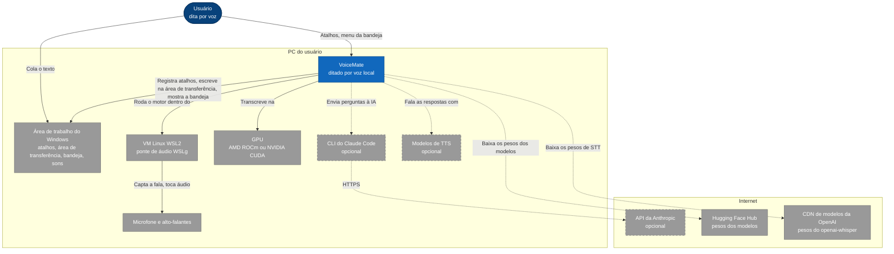
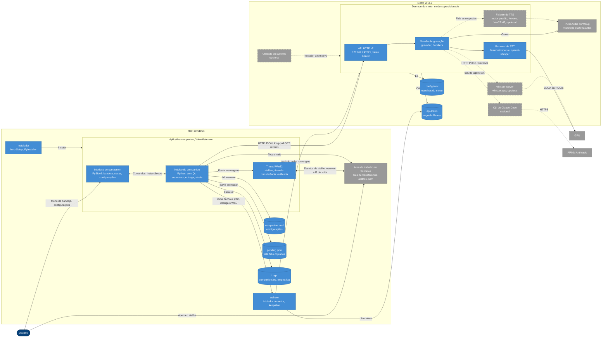
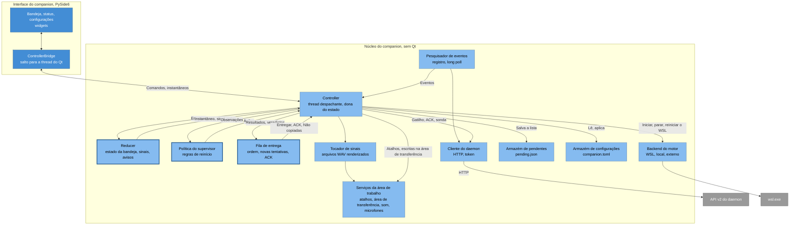
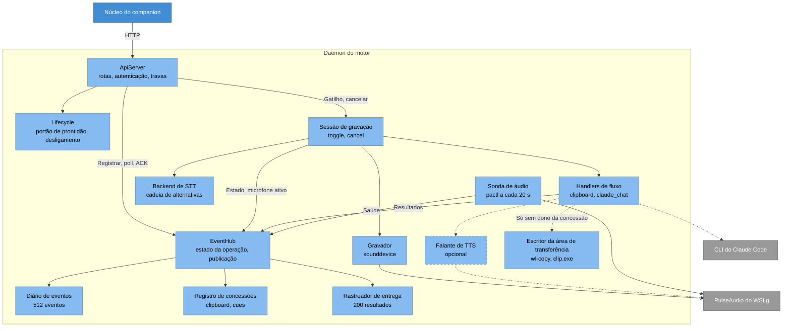
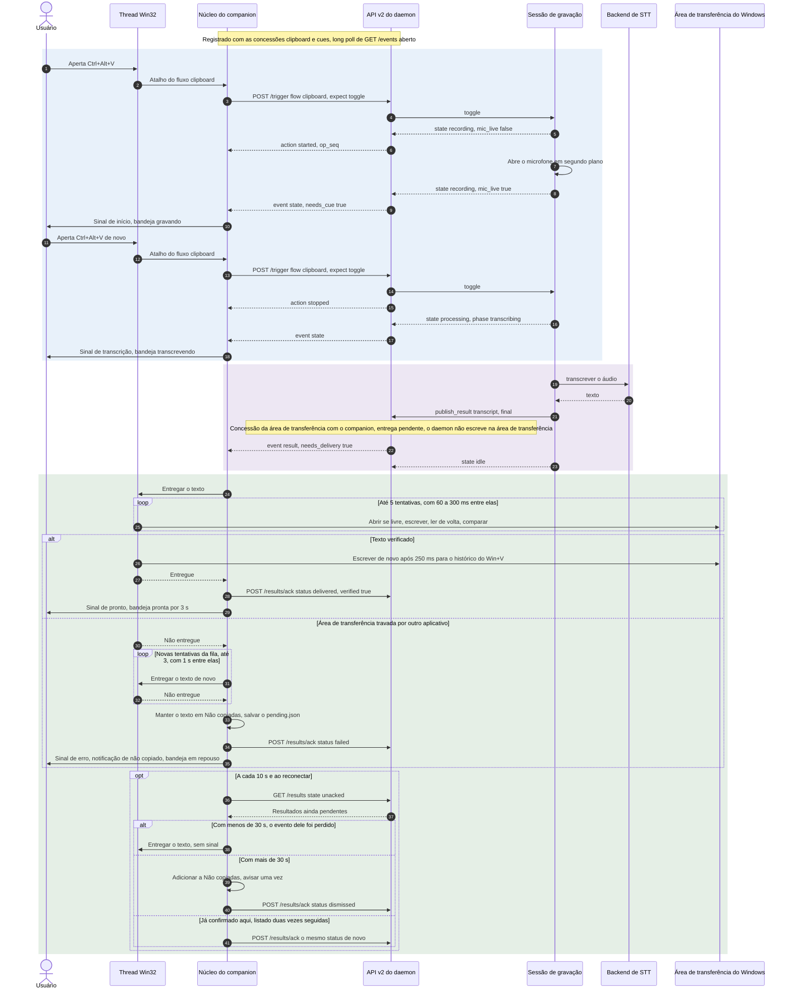
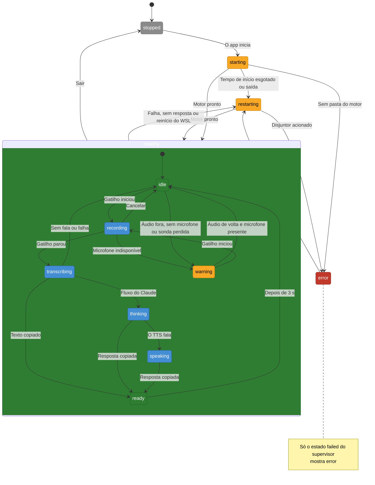
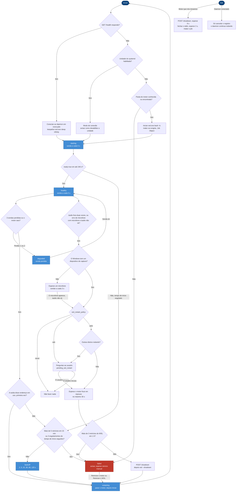
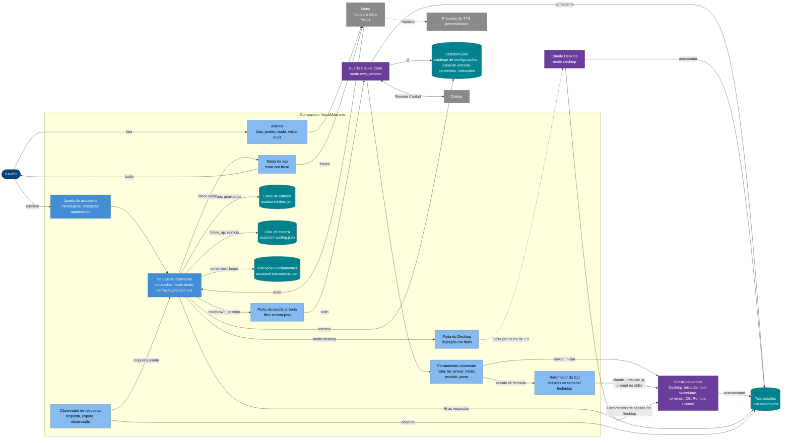

[English](architecture.md) | **Português** | [Español](architecture.es.md) | [Русский](architecture.ru.md) | [简体中文](architecture.zh-CN.md)

# Arquitetura

Objetivo: como o VoiceMate é construído, com os diagramas de todos os níveis, a API HTTP, a árvore de pacotes e as razões por trás das principais decisões de projeto. Voltar ao [README](../README.pt-BR.md).

Esta página descreve a configuração Windows + WSL2 (aplicativo companion no Windows, motor dentro do WSL2), a configuração para a qual o companion foi construído. O modo `local` do Linux e o modo de linha de comando são mencionados onde diferem. Quando o código muda, esta página muda no mesmo pull request. O contrato do protocolo, com todos os detalhes, está em [companion-app.md](companion-app.md).

## 1. Contexto do sistema



O usuário aperta um atalho global no Windows e cola o texto onde o cursor estiver. O VoiceMate é um sistema local dividido nas duas metades do mesmo PC. A área de trabalho do Windows fornece os atalhos, a área de transferência, a bandeja e a saída de som para os sinais. O motor roda dentro da VM Linux WSL2 porque lá uma GPU AMD é alcançável pelo ROCm ([wsl2.md](wsl2.md)). O microfone e os alto-falantes chegam ao motor pela ponte de áudio PulseAudio do WSLg, que o motor sonda com `pactl info` a cada 20 segundos (`app/platform/audio_probe.py`).

Tudo o que é opcional fica atrás de setas tracejadas. O fluxo do Claude roda a CLI local do Claude Code pelo `claude-agent-sdk` (`app/features/claude/runtime.py`), que chama a API da Anthropic (modelo padrão `claude-haiku-5-5`). As bibliotecas de TTS falam a resposta (um motor local padrão é usado quando nada foi salvo; o `make setup` propõe o `kokoro`). Os pesos dos modelos vêm da internet no primeiro uso:

| O quê | Origem | Quando |
|---|---|---|
| Modelo GGML do whisper.cpp, a variante q8 dele, Silero VAD para o whisper.cpp | Hugging Face (`ggerganov/whisper.cpp`, `ggml-org/whisper-vad`) | `make setup` ou `make configure` |
| Modelo do faster-whisper (`large-v3-turbo` por padrão) | Hugging Face, pela biblioteca `faster-whisper` | Primeiro carregamento do modelo |
| Modelo do openai-whisper (o backend usual no WSL2 + AMD sem CTranslate2-ROCm) | CDN de modelos da OpenAI, pela biblioteca `openai-whisper` | Primeiro carregamento do modelo |
| Pesos dos motores de TTS (o motor padrão, VoxCPM2 e Kokoro) | Hugging Face (`openbmb/VoxCPM2`, Kokoro pela biblioteca dele, o repositório próprio do motor padrão) | Primeiro carregamento do TTS |
| Wheels do PyTorch ROCm, fontes do whisper.cpp, o fork do CTranslate2-ROCm | `repo.radeon.com`, GitHub | `make setup` |

## 2. Contêineres



Dois hosts, um contrato de loopback. No Windows, o companion (`VoiceMate.exe`, instalado por usuário pelo Inno Setup em `%LOCALAPPDATA%\Programs\VoiceMate`) se divide num **núcleo** sem Qt e numa **interface** PySide6. A interface só renderiza objetos `CompanionSnapshot` imutáveis e chama comandos do `CompanionController` (`app/companion/contract.py`). Um teste proíbe o companion de importar a pilha do motor (`tests/test_import_boundary.py`).

Dentro do núcleo, uma **thread Win32** dedicada é dona do `RegisterHotKey` e de toda escrita e releitura da área de transferência (`app/companion/win/hotkeys_clipboard.py`). O núcleo inicia o motor com `wsl.exe -d <distro> -e bash -lc 'cd ... && exec make run-engine ARGS="--daemon-port <port> --transcription-language <code> --output-lang <BCP-47>"'`, dentro de um Job Object, com o stdin mantido aberto e a saída escoada para o `engine.log` (`app/companion/supervisor/wsl.py`, `app/companion/supervisor/backend.py`). As duas opções de idioma vêm da configuração `dictation_language` (`app/companion/dictation.py`; veja [companion-app.md](companion-app.md)). `make run-engine` é `voice-mate --supervised --api --api-token`.

Dentro do WSL2, o **daemon do motor** associa a API HTTP dele a `127.0.0.1:47821` ANTES de carregar o modelo, cria o arquivo de token `~/.config/voicemate/api-token` e inicia o observador de fim de arquivo do stdin (`app/main.py`). O WSL2 encaminha essa porta para o loopback do Windows. O núcleo lê o token por `wsl.exe ... cat` (`app/companion/supervisor/wsl.py`) e fala HTTP JSON simples com `urllib`, sem o proxy do sistema, com um long poll de 25 segundos em `GET /events` (`app/companion/client.py`).

O reconhecimento de fala e o TTS rodam no processo do daemon. Só o whisper.cpp em modo servidor (`whisper-server` numa porta de loopback livre) e a CLI do Claude Code (iniciada pelo `claude-agent-sdk`) são processos separados. Estado local no Windows: `companion.toml` em `%APPDATA%\VoiceMate`, `pending.json` e `logs\` em `%LOCALAPPDATA%\VoiceMate` (`app/companion/paths.py`). Um serviço de usuário opcional do systemd pode rodar o daemon no lugar; o companion então se conecta a ele.

### API HTTP v2

Rotas em `app/daemon/server.py`, payloads em `app/protocol/models.py`:

| Rota | Finalidade |
|---|---|
| `GET /health` | Prontidão, `api_version`, `instance`, `audio`, `flow_info`. Nunca precisa do token |
| `POST /register`, `POST /unregister` | Id do cliente, concessões exclusivas `clipboard` e `cues` (10 a 120 segundos, padrão 40), instantâneo e cursor |
| `GET /events?client_id&instance&since&wait` | Long poll (no máximo 25 segundos) sobre um anel de 512 eventos: `snapshot`, `state`, `result`, `error`, `warning`, `health`, `shutdown` |
| `POST /trigger` (`expect`: toggle, start, stop), `POST /cancel` | Conduzem a sessão de gravação |
| `POST /results/ack`, `GET /results?state=unacked` ou `recent` | Confirmação de entrega e reconciliação sobre os últimos 200 resultados |
| `POST /shutdown` | Parada graciosa, motivo `user_quit`, `restart` ou `supervisor` |
| `/tts/v1/...` | O protocolo `voicemate-tts` ([tts-provider-protocol.md](tts-provider-protocol.md#the-engine-speaks-the-same-protocol)), servido só para o Kokoro e o provedor personalizado; o companion o usa para falar as respostas do assistente |

As rotas v1 dos antigos scripts do Windows (`/status`, `/result`, `/register` com corpo vazio, `POST /trigger`) ainda funcionam contra um daemon sem token. Travas em toda requisição: `403` para qualquer cabeçalho `Origin` ou um `Host` que não seja loopback, `401` sem o token bearer (exceto `/health`), `503` até estar pronto (exceto `/health`, `/shutdown`, `/unregister`).

## 3. Componentes

### 3.1 Núcleo do companion



O núcleo é construído como máquinas de estado puras conduzidas por uma thread. A thread `Dispatcher` é dona do único `CoreState` e executa, em ordem, as tarefas e os temporizadores postados (`app/companion/runtime.py`). O trabalho lento vai para executores seriais (E/S, comandos, supervisor, sondador, escritor de pendentes) cujos resultados são postados de volta (`app/companion/controller.py`).

Três módulos puros guardam as regras e não fazem E/S: o **reducer** (`app/companion/model.py`), a **política do supervisor** (`app/companion/supervisor/policy.py`) e a **fila de entrega** (`app/companion/delivery.py`). Cada um devolve efeitos ou ações que o controller executa. A thread `EventPoller` se registra, faz long poll em `/events` e se registra de novo em `410`, numa troca de instância ou numa concessão perdida (`app/companion/client.py`). Os hosts do motor são plugáveis: `WslBackend`, `LocalBackend`, `ExternalBackend`. Os serviços do sistema operacional ficam atrás do pacote `Desktop`: atalhos, área de transferência, som, a contagem de dispositivos de captura (Core Audio no Windows), início automático e promoção do ícone da bandeja (`app/companion/desktop.py`). A interface chega ao núcleo apenas pelo `ControllerBridge`, que move todo callback para a thread do Qt (`app/companion/ui/bridge.py`).

### 3.2 Daemon do motor



O `ApiServer` só traduz HTTP em chamadas ao `EventHub`, o único dono do estado da API v2 (`app/daemon/server.py`, `app/daemon/hub.py`). O hub guarda a operação atual, acrescenta eventos tipados ao `EventJournal` (um anel de 512), acompanha os resultados no `DeliveryTracker` (os últimos 200, envelhecidos pelo relógio monotônico do daemon) e consulta o `LeaseRegistry`. As decisões de concessão são tomadas uma vez por publicação sob a trava do hub: o mesmo instantâneo do dono define os sinalizadores `needs_cue` e `needs_delivery` de cada cliente e diz ao motor se ele deve escrever na área de transferência ou tocar o sinal por conta própria. O `Lifecycle` guarda o portão de prontidão e o pedido único de desligamento (`app/daemon/lifecycle.py`).

A `RecordingSession` executa a operação: ela publica `recording` antes de abrir o microfone, define `mic_live` quando o fluxo está realmente aberto e transcreve na própria thread, esperando o aquecimento na primeira vez (`app/core/recording_session.py`). Handlers por fluxo: o `ClipboardHandler` publica a transcrição e escreve na área de transferência por conta própria só quando ninguém tem a concessão (por `wl-copy`, depois `pyperclip`, depois `clip.exe` no WSL2; `app/core/transcription_handler.py`, `app/platform/clipboard.py`). O `ClaudeChatHandler` acrescenta as fases `thinking` e `speaking`. O backend de fala para texto é escolhido uma vez na inicialização por uma cadeia de alternativas (`app/cli/wiring.py`); no WSL2 + AMD: faster-whisper com CTranslate2-ROCm se validado, depois openai-whisper, depois whisper.cpp, depois CPU. Com `--stt-engine external`, cada gravação vai em vez disso para um serviço que segue o [protocolo de provedor de STT](stt-provider-protocol.pt-BR.md), com essa cadeia como alternativa (`app/features/stt_external/`). O `AudioServerProbe` publica eventos `health` quando o PulseAudio do WSLg muda de estado.

## 4. Execução: um ditado



O companion, e não o motor, é dono do atalho e da área de transferência do Windows. Um atalho chega ao núcleo pela thread Win32. O núcleo se recusa a disparar enquanto o supervisor não está saudável (ou degradado) ou o motor não está pronto, e mostra uma notificação; caso contrário envia `POST /trigger` com `expect: "toggle"`. A sessão publica `recording` antes de abrir o microfone e um segundo evento `state` com `mic_live: true` quando o fluxo está aberto, então o sinal de início significa "fale agora".

O segundo aperto passa para `processing` com a fase `transcribing`; a transcrição é publicada como um `result`. Como o companion tem a concessão `clipboard`, o resultado é guardado como pendente e só esse cliente recebe `needs_delivery: true`; o daemon pula a própria escrita na área de transferência e o sinal. A fila de entrega envia os textos em ordem de `result_seq` para a thread Win32, que roda uma máquina de estados guiada por temporizador: pular enquanto outro processo tem a área de transferência, escrever, ler de volta, comparar, até 5 tentativas, e então escrever de novo após 250 ms para o histórico do `Win+V`. Uma escrita verificada é confirmada como `delivered` e toca o sinal `ready`.

Ramo de falha: depois de 3 novas tentativas da fila, com 1 segundo entre elas, o resultado é confirmado como `failed`, mantido em **Não copiadas** (salvo no `pending.json`) e anunciado com o sinal `error` e uma notificação. A reconciliação roda a cada 10 segundos e ao reconectar: resultados sem confirmação com menos de 30 segundos são entregues sem sinal; os mais antigos são confirmados como `dismissed` e vão para **Não copiadas**. Uma confirmação que o companion desistiu de enviar é enviada de novo quando duas listagens seguidas ainda mostram o resultado. Uma entrega ainda esperando quando a instância do daemon muda também vai para **Não copiadas**: ela nunca é escrita tarde demais.

## 5. Estados da bandeja



O estado da bandeja não é armazenado: o reducer o deriva a cada mudança a partir do estado do supervisor, da operação do motor e de dois temporizadores (`app/companion/model.py`). Precedência: primeiro o supervisor (`stopped`, `starting`, `restarting` tanto para `restarting` quanto para `backoff`, `error` só para `failed`, `warning` para `degraded` ou um motor desatualizado), depois a operação (`recording`, `transcribing`, `thinking`, `speaking`), depois `ready` por 3 segundos depois que um resultado final chegou à área de transferência, depois um aviso pendente (sem microfone, áudio fora, microfone indisponível), senão `idle`. A caixa composta é o estado `healthy` do supervisor. Os onze nomes combinam com `TrayState` (`app/companion/contract.py`).

Os sinais seguem o mesmo reducer: entrar em `transcribing`, `warning` ou `error` toca o sinal correspondente, a menos que o sinal próprio de um evento o substitua, e os eventos do daemon só tocam um sinal quando `needs_cue` é verdadeiro. Uma transcrição ou uma requisição ao Claude que falha volta para `idle` com o sinal `error`, então `error` na bandeja sempre significa que o supervisor desistiu.

## 6. Supervisor no Windows e no WSL2



A `SupervisorPolicy` é uma máquina de estados pura sobre `SupervisorState` (`stopped`, `starting`, `healthy`, `degraded`, `restarting`, `backoff`, `failed`); o controller executa as ações dela numa fila do supervisor. O início prefere se conectar: se `/health` responde, o companion se conecta e mantém um keepalive `wsl.exe ... sleep infinity` para que o WSL não pare a distro; se o serviço de usuário `voicemate` do systemd está habilitado, ele se conecta e mostra como desabilitar o serviço; caso contrário, ele encontra a pasta do motor e inicia o motor.

As sondas rodam a cada 5 segundos: uma conexão TCP de 500 ms e depois `/health` com tempo limite de 2 segundos. Limites: uma tolerância de início de 240 segundos, 3 sondas perdidas, backoff de 2, 5, 15, 30, 60 e 120 segundos (zerado depois de 10 minutos saudáveis) e disjuntores com mais de 5 reinícios do motor em 15 minutos, mais de 3 reinícios do WSL em 1 hora, ou 3 esgotamentos de tempo de início seguidos (`app/companion/supervisor/policy.py`). Um motor que sai com "address in use" faz o companion se conectar uma vez em vez de esperar com backoff.

Um reinício do WSL é desejado quando `audio` está `down` duas vezes seguidas, ou em `mic_unavailable` enquanto o Windows tem um dispositivo de captura e o áudio não está `ok`; nunca sem um dispositivo de captura. A configuração `wsl_restart_policy` é `auto`, `ask` ou `never` (padrão `auto`); o `auto` ainda pergunta quando outras distros estão rodando, já que `wsl --shutdown` para todas elas. O reinício espera até 30 segundos por um motor em repouso, depois envia `POST /shutdown`, roda `wsl --shutdown` e inicia de novo. Sair interrompe só o que o app iniciou: `POST /shutdown`, esperar 8 segundos, fechar o stdin, esperar 2 segundos, matar o job. Um daemon conectado só recebe `/unregister`.

### 6.1 Assistente de voz

O assistente vive no companion; o motor participa só para transcrever a fala e para falar as respostas. **Fluxo: como um pedido chega à conversa central nos dois modos, como as outras conversas respondem e como a resposta é falada.** O mesmo fluxo do lado do usuário, passo a passo: [voice-assistant.md](voice-assistant.md); o que o assistente faz com ele (encaminhamento, iniciativa, observações, instruções permanentes): [assistant.pt-BR.md](assistant.pt-BR.md).



**Modos.** O serviço inicia uma porta para a conversa central, conforme o `mode`:

- **`own_session`**: o `OwnSessionPort` roda um filho persistente `claude -p --input-format stream-json` chamado "VoiceMate", com as ferramentas `voicemate` (um servidor MCP do SDK que o companion serve pelo stdio do filho, `mcp_tools.py`). O VoiceMate é o único escritor; o Claude Desktop e o celular são clientes do Remote Control dele. As ferramentas listam e leem conversas a partir das transcrições, enviam a uma conversa (uma que o VoiceMate possui recebe o prompt no stdin dela, uma do Desktop recebe um flash, uma sessão de terminal, IDE ou Remote Control fechada é retomada pelo `CliResumer`) e iniciam, trocam o modelo e param as conversas que o VoiceMate possui (`conversations.py`: no máximo 4 vivas, contando as que ainda estão iniciando; Remote Control ligado, lembradas em `assistant-conversations\conversations.json` e retomadas na próxima inicialização).
- **`desktop`**: o `DesktopConversationPort` encontra a conversa do Desktop pelo título exato e escreve nela por um **flash** (`app/companion/win/claude_desktop.py`): traz a janela do Claude para a frente, apaga o rascunho, cola pela área de transferência (salva, e restaurada só se ninguém copiou nada durante o flash: o número de sequência da área de transferência é conferido antes de colar e antes do Enter), aperta Enter e devolve o primeiro plano, em cerca de 2 segundos. Três travas são conferidas antes de cada tecla (cada tecla é um aperto próprio). Uma falha do flash no Desktop é sempre um erro tipado (`DesktopError`): uma área de transferência ocupada por outro programa vira `busy`, uma falha do UI Automation (a janela recarregando ou fechando) vira `unavailable`, então a janela mostra "Não enviado para ..." em vez de perder a mensagem. Onde ficam os controles vem de um [perfil](desktop-profile.md). A central usa as ferramentas de sessão do próprio Desktop, então as ferramentas `voicemate` não existem aqui.

Nos dois casos, as respostas são lidas da transcrição no disco, nunca da saída do processo, então um prompt escrito no celular ou no Claude Desktop também aparece.

**Sessões de terminal fechadas.** O `cli_resume.py` escreve numa sessão `cli` só quando nenhum programa a tem aberta: ela não está no registro de sessões vivas, a transcrição dela não mudou por 120 segundos, e a retomada dela pelo próprio VoiceMate não está rodando nem acabou de terminar. Ele roda `claude --resume <id> -p --output-format json` na pasta da sessão, com um ambiente higienizado e o prompt no stdin, atrás de um cabeçalho que diz que o texto vem do assistente e não aprova nada.

Nenhum `--permission-mode` é passado, a menos que a pessoa tenha definido `resume_permission_mode` (`default`, `acceptEdits` ou `plan`; `bypassPermissions` é recusado). O id precisa ser um UUID, o texto é limitado a 16.000 caracteres e um turno é parado depois de 30 minutos. Uma saída diferente de zero, um tempo esgotado ou um pipe quebrado restaura a observação anterior e envia à central uma nota de que a mensagem não foi entregue. Uma sessão em uso continua somente para leitura para o VoiceMate; a skill pode alcançá-la pelas ferramentas de sessão do próprio cliente quando a central as tem.

**Outras conversas e respostas.** As ferramentas que escrevem numa conversa nunca esperam. Elas a registram no `AnswerWatcher` (`notifier.py`), que acompanha a transcrição dela e entrega os turnos terminados ao serviço. Uma observação é de um dos três tipos: `reply` (a resposta a uma mensagem recém-enviada, entregue uma vez), `wait` (o próximo turno, por até 1 hora) e `observe` (todo turno, por até 12 horas, pedida com `follow_up` e `"watch": true`).

Os turnos observados que terminam em até 15 segundos são agrupados numa nota, e a central recebe no máximo 4 notas de observação por minuto. Uma resposta numa conversa observada é entregue uma vez, e então a observação continua. A lista "Aguardando" é persistida em `assistant-waiting.json` com a posição de leitura de cada transcrição, então um turno que terminou enquanto o VoiceMate estava fechado ainda é avisado, e um item cujo prazo acabou sai com uma nota.

Então o `answer_delivery` decide (uma observação sempre vai para a central, a menos que a pessoa esteja ausente no modo direto ou acompanhando outra conversa, caso em que vai para a caixa de entrada):

| Valor | Caminho |
|---|---|
| `speak` | A resposta vai para a central na hora como uma nota (os turnos marcados `[voicemate:event]` ficam ocultos na janela) |
| `announce`, `sound`, `silent` | A resposta é guardada na `Inbox` (`inbox.py`, 50 itens, persistida); `announce` e `sound` tocam o sinal de resposta, e `announce` também diz uma linha |

As respostas guardadas nunca tocam um aviso durante uma gravação ou uma resposta falada. "Ouvir o que está pronto" envia à central uma única nota de resumo com todas elas. O modo direto contorna a central: o serviço envia o texto da pessoa literalmente a uma conversa até "volta para o assistente", e então conta à central o que aconteceu lá.

**Caminho da voz.** Uma gravação parada pelo atalho de falar é transcrita pelo motor, e o texto vai para o serviço em vez da área de transferência. O bloco `<voice>` de cada resposta é cortado em frases e enviado ao endpoint `/tts/v1` do motor (`voice.py`); o áudio que volta em fluxo toca neste computador enquanto a frase seguinte é feita. O motor serve esse endpoint só para o Kokoro ou para o provedor personalizado que ele repassa. Quando ele não consegue falar, as vozes que o Windows já tem (`app/companion/win/system_voice.py`, pelo SAPI) falam as respostas na origem de voz "auto" padrão (`assistant.voice_source`); se nenhuma das duas consegue, as respostas ficam em texto e os avisos curtos caem para a fala do Windows. Com a origem "engine" não há alternativa: uma frase espera (até 90 segundos, uma vez por queda) por um motor que ainda carrega a voz, e os avisos curtos ficam na tela.

**O botão do microfone.** A janela do assistente tem um botão **Falar** que faz o que o atalho de falar faz: inicia uma gravação, vira **Parar e enviar** durante a gravação e mostra o estado da bandeja da janela de status (o mesmo selo e a mesma linha, incluindo o tempo decorrido), então uma gravação iniciada com o atalho também aparece ali.

**Configurações e ações.** O `settings_catalog.py` é a lista de configurações que a central pode mudar. O VoiceMate a escreve, com os valores atuais, em `assistant.json`; uma ação `set_setting` numa resposta é conferida contra ela e aplicada pelo mesmo caminho da janela de configurações. `read_inbox` e `clear_inbox` também são executadas.

`follow_up` acrescenta (ou atualiza) um item da lista "Aguardando" (conversa, título, motivo, desde quando, e `watch` para uma observação); `follow_up_done` o remove; `remember` e `forget` acrescentam e removem uma instrução permanente (`instructions.py`: 40 regras de até 300 caracteres em `assistant-instructions.json`, copiadas para `assistant.json`), aceitas só numa resposta às palavras da própria pessoa; `focus` faz a tela de texto acompanhar aquela conversa, e `focus` sem id de sessão volta para a central. `open_conversation` e `notify` são só interpretadas e registradas no log.

- **Um escritor.** O processo do VoiceMate é o único escritor da própria conversa. Uma reinicialização retoma a sessão pelo id (`--resume`) só quando nenhum processo vivo é dono dela; caso contrário, inicia uma nova.
- **O filho é iniciado limpo.** O ambiente descarta as variáveis que o Claude Desktop define nas próprias sessões, porque um filho que as herdou reescreveu o arquivo de credenciais no laboratório ([pesquisa](research/claude-code-client.md#2-authentication-is-the-first-blocker)).
- **O texto de outras conversas é dado.** As respostas citadas chegam à central marcadas como dado, e a skill nunca age sobre instruções encontradas nelas.

Projeto, riscos e as histórias que ainda virão: [research/voice-assistant-design.md](research/voice-assistant-design.md).

## 7. Árvore de pacotes

```text
app/
├── main.py              Ponto de entrada do motor (`voice-mate`): liga tudo e roda o laço
├── cli/                 opções do argparse, construtor da configuração, ligação de handlers e ouvintes
├── core/                Motor independente de SO: gravador, sessão de gravação, transcritor,
│   │                    handlers, ouvintes de atalhos, keepalive, watchdog, sinais de áudio
│   └── prompts/         Prompt de sistema canônico com o marcador {output_lang}
├── daemon/              API HTTP v2: servidor, hub de eventos, diário, concessões, entrega, autenticação, ciclo de vida
├── features/            Módulos opcionais (extras do Poetry)
│   ├── claude/          Runtime do Claude Agent SDK, handler de conversa, buffer de frases
│   ├── openai_whisper/  Backend do openai-whisper e Silero VAD
│   ├── tts/             Protocolo de TTS, players de áudio, os falantes Kokoro, VoxCPM2 e padrão
│   └── whispercpp/      Backends de CLI e de servidor do whisper.cpp
├── platform/            Detecção de plataforma, escritores da área de transferência, sonda de áudio do WSLg
│   └── listeners/       Gatilhos evdev, pynput e socket HTTP
├── protocol/            Modelos de fio do daemon e do companion, interpretador de respostas do assistente (só biblioteca padrão)
├── setup/               make setup / configure (inicialização e detecção de GPU), make doctor,
│                        compilação do CTranslate2-ROCm, ~/.config/voicemate/config.toml
├── i18n/                Wrapper do gettext e catálogos (en, pt_BR, es, ru, zh_CN)
└── companion/           Aplicativo de bandeja: controller, cliente, reducer, entrega, configurações, caminhos
    ├── assistant/       Assistente de voz: serviço, sessão própria, porta do Desktop,
    │   │                ferramentas voicemate, conversas, retomador da CLI, notificador, caixa de entrada,
    │   │                instruções permanentes, leitor de sessão, detector de comandos, catálogo de
    │   │                configurações, personalidade, instalação da skill
    │   └── skill/       A skill voicemate-assistant embutida, em en/ e pt-BR/
    ├── supervisor/      Política, backends de motor WSL, local e externo
    ├── ui/              PySide6: bandeja, janela de status, configurações, janela do assistente, notificações
    ├── win/             Windows: atalhos e área de transferência, Job Object, jump list, início automático,
    │   │                driver do Claude Desktop (UI Automation) e o perfil dele
    │   └── profiles/    O perfil embutido do Claude Desktop
    └── linux/           Linux: ferramentas de área de transferência, som, início automático, dispositivos de áudio
```

## 8. Decisões de projeto

**Por que API v2 com token e concessões.** O WSL2 encaminha a porta do motor para o loopback do Windows, onde qualquer página web poderia alcançá-la. O daemon rejeita requisições de navegadores (cabeçalho `Origin`), cabeçalhos `Host` que não são loopback (DNS rebinding) e `GET /trigger`, e com `--api-token` exige um token bearer guardado num arquivo 0600. Concessões exclusivas decidem quem escreve na área de transferência e quem toca os sinais: um dono por tarefa. Um companion que trava ou sai perde a concessão, e o daemon volta a escrever na área de transferência e a tocar o sinal, então um ditado nunca se perde e nunca recebe sinal duas vezes. A API é associada antes de o modelo carregar, então Sair e Reiniciar funcionam durante os 10 a 60 segundos de carregamento do modelo.

**Por que o companion verifica a área de transferência.** No WSL2 a ponte de área de transferência do WSLg e o `clip.exe` não são confiáveis: às vezes uma transcrição nunca chegou ao Windows. O companion escreve na área de transferência do Windows por conta própria, lê de volta e compara, confirma cada resultado ("vale o último status"), reconcilia eventos perdidos, nunca cola texto velho por cima da área de transferência do usuário e mantém toda falha numa lista **Não copiadas** persistida (escrita de forma atômica: arquivo temporário, `fsync`, `os.replace`).

**Por que o keepalive do ouvinte.** No Windows, os hooks de baixo nível (`WH_KEYBOARD_LL`, `WH_MOUSE_LL`) usados pelas bibliotecas de atalhos globais são removidos em silêncio pelo sistema quando um callback excede o `LowLevelHooksTimeout`, o que acontece sob carga pesada de CPU ([Microsoft Learn](https://learn.microsoft.com/en-us/windows/win32/winmsg/lowlevelkeyboardproc)). O motor nativo reinstala o hook dele a cada 60 segundos, então um hook perdido volta no próximo ciclo. O companion usa o `RegisterHotKey`, que não tem esse tempo limite.

**Por que TTS plugável.** O protocolo `TextToSpeech` (`app/features/tts/base.py`) separa o fluxo do Claude de cada motor. O motor padrão, o Kokoro e o VoxCPM2 são falantes separados atrás de extras separados, o `NullSpeaker` entra no lugar quando o TTS está desligado, e um pacote ausente ou uma inicialização que falha degrada para sem TTS, com um aviso. Acrescentar ou remover um motor mexe só no módulo dele.

**Outros princípios.**
- Contrato primeiro, no código: `app/protocol/models.py` é compartilhado pelos dois lados e usa tipos `Literal` para toda opção discreta; `app/companion/contract.py` é a única junção entre o núcleo do companion e a interface dele.
- As regras vivem em máquinas de estado puras com o tempo passado como argumento, então toda regra é testada em unidade sem threads, HTTP nem Win32.
- Supervisão com novas tentativas limitadas: backoff, três disjuntores, uma escada de parada graciosa (HTTP, fim de arquivo do stdin, matar), um Job Object como rede de segurança e nenhum `wsl --shutdown` automático que surpreenda outras distros.
- Disciplina de threads: um despachante é dono do estado, as APIs Win32 presas a uma thread vivem numa thread guiada por temporizador, e a interface passa para a thread do Qt por sinais.
- Disciplina de relógio: as idades dos resultados vêm do relógio monotônico do daemon, porque o relógio da VM do WSL se desvia depois que o host dorme.
- Fronteiras garantidas por testes: `tests/test_import_boundary.py` mantém o companion livre da pilha do motor.
