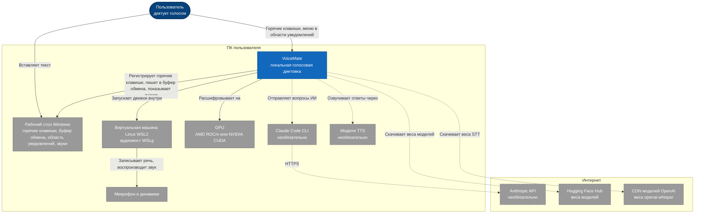
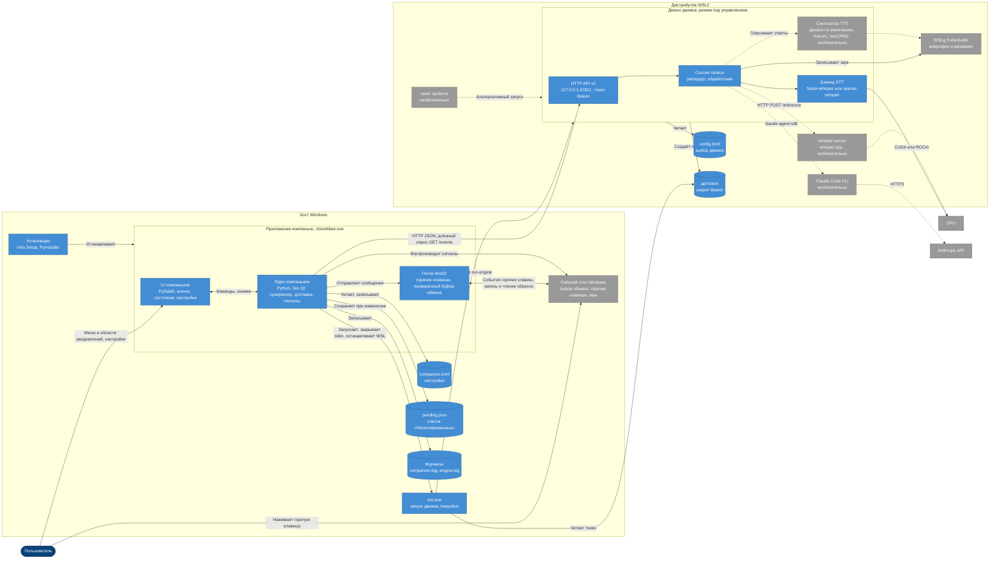
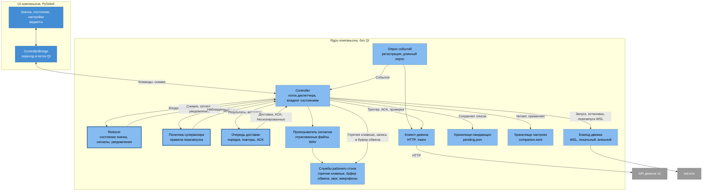
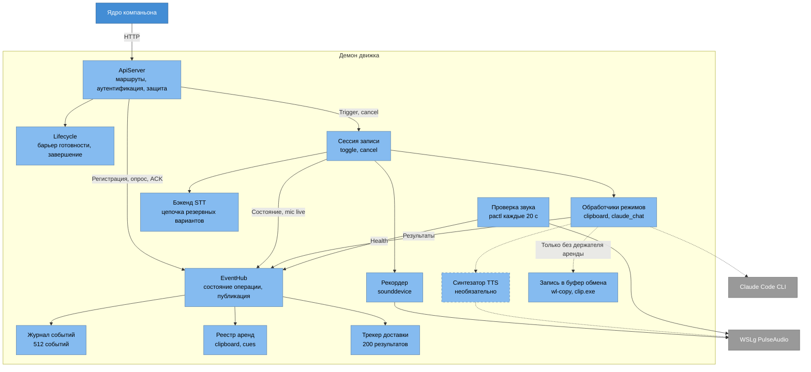
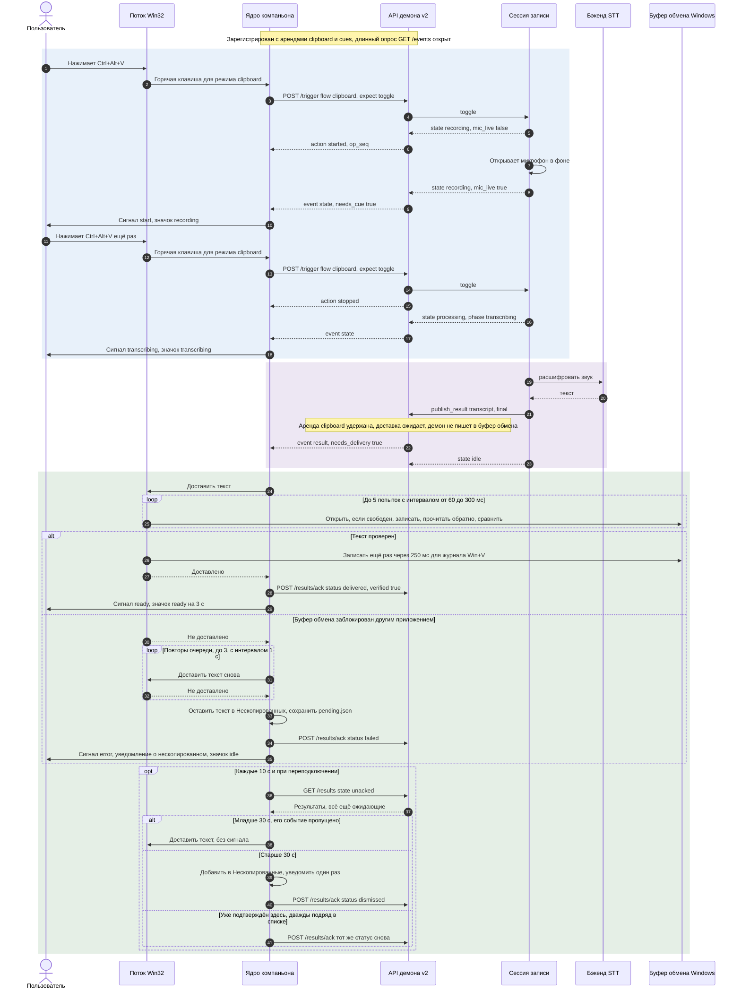
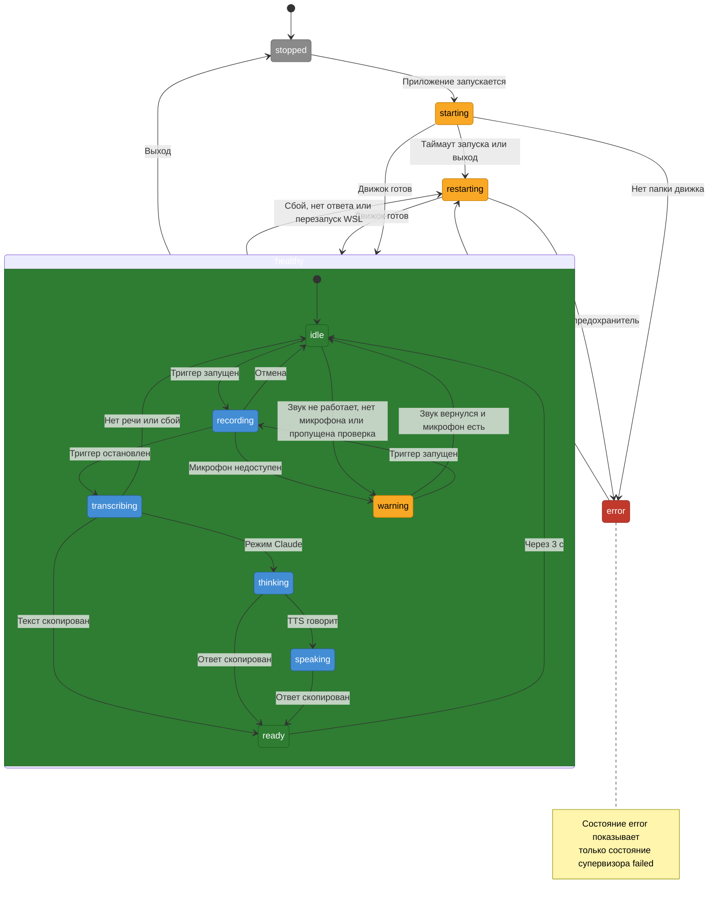
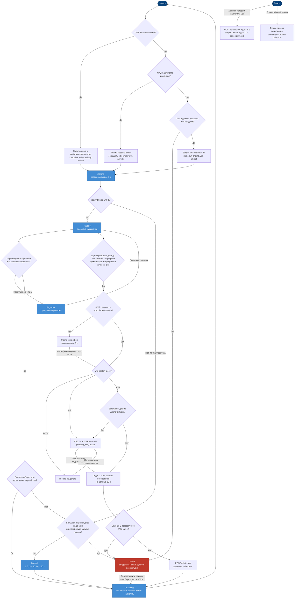
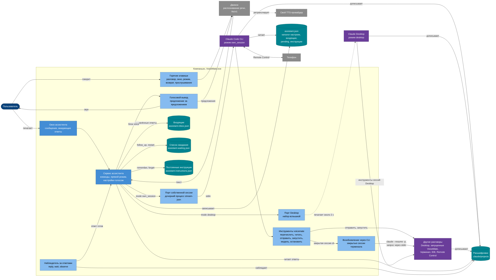

[English](architecture.md) | [Português](architecture.pt-BR.md) | [Español](architecture.es.md) | **Русский** | [简体中文](architecture.zh-CN.md)

# Архитектура

Назначение: как устроен VoiceMate, с диаграммами каждого уровня, HTTP API, деревом пакетов и причинами основных проектных решений. Назад к [README](../README.ru.md).

Эта страница описывает конфигурацию Windows + WSL2 (приложение-компаньон в Windows, движок внутри WSL2), для которой компаньон и создавался. Локальный режим `local` в Linux и режим командной строки упоминаются там, где они отличаются. Когда меняется код, эта страница меняется в том же pull request. Контракт протокола во всех подробностях описан в [companion-app.md](companion-app.md).

## 1. Контекст системы



Пользователь нажимает глобальную горячую клавишу в Windows и вставляет текст туда, где стоит курсор. VoiceMate это локальная система, разделённая между двумя половинами одного и того же ПК. Рабочий стол Windows предоставляет горячие клавиши, буфер обмена, значок в области уведомлений и вывод звука для сигналов. Движок работает внутри виртуальной машины Linux WSL2, потому что именно там через ROCm доступна GPU AMD ([wsl2.md](wsl2.md)). Микрофон и динамики доходят до движка через аудиомост WSLg PulseAudio, который движок опрашивает командой `pactl info` каждые 20 секунд (`app/platform/audio_probe.py`).

Всё необязательное находится за пунктирными стрелками. Режим Claude запускает локальный Claude Code CLI через `claude-agent-sdk` (`app/features/claude/runtime.py`), который обращается к Anthropic API (модель по умолчанию `claude-haiku-5-5`). Библиотеки TTS озвучивают ответ (если ничего не сохранено, используется локальный движок по умолчанию; `make setup` предлагает `kokoro`). Веса моделей скачиваются из интернета при первом использовании:

| Что | Источник | Когда |
|---|---|---|
| Модель GGML для whisper.cpp, её вариант q8, Silero VAD для whisper.cpp | Hugging Face (`ggerganov/whisper.cpp`, `ggml-org/whisper-vad`) | `make setup` или `make configure` |
| Модель faster-whisper (по умолчанию `large-v3-turbo`) | Hugging Face, через библиотеку `faster-whisper` | Первая загрузка модели |
| Модель openai-whisper (обычный бэкенд в WSL2 + AMD без CTranslate2-ROCm) | CDN моделей OpenAI, через библиотеку `openai-whisper` | Первая загрузка модели |
| Веса движков TTS (движок по умолчанию, VoxCPM2 и Kokoro) | Hugging Face (`openbmb/VoxCPM2`, Kokoro через свою библиотеку, собственный репозиторий движка по умолчанию) | Первая загрузка TTS |
| Колёса PyTorch ROCm, исходники whisper.cpp, форк CTranslate2-ROCm | `repo.radeon.com`, GitHub | `make setup` |

## 2. Контейнеры



Два хоста, один контракт через loopback. В Windows компаньон (`VoiceMate.exe`, устанавливается для каждого пользователя через Inno Setup в `%LOCALAPPDATA%\Programs\VoiceMate`) разделён на **ядро** без Qt и **UI** на PySide6. UI только отрисовывает неизменяемые объекты `CompanionSnapshot` и вызывает команды `CompanionController` (`app/companion/contract.py`). Тест запрещает компаньону импортировать стек движка (`tests/test_import_boundary.py`).

Внутри ядра один выделенный **поток Win32** владеет `RegisterHotKey` и каждой записью в буфер обмена и чтением обратно (`app/companion/win/hotkeys_clipboard.py`). Ядро запускает движок командой `wsl.exe -d <distro> -e bash -lc 'cd ... && exec make run-engine ARGS="--daemon-port <port> --transcription-language <code> --output-lang <BCP-47>"'`, внутри Job Object, с открытым stdin и выводом, который сливается в `engine.log` (`app/companion/supervisor/wsl.py`, `app/companion/supervisor/backend.py`). Два языковых флага берутся из настройки `dictation_language` (`app/companion/dictation.py`; см. [companion-app.md](companion-app.md)). `make run-engine` это `voice-mate --supervised --api --api-token`.

Внутри WSL2 **демон движка** привязывает свой HTTP API к `127.0.0.1:47821` ДО загрузки модели, создаёт файл токена `~/.config/voicemate/api-token` и запускает наблюдателя за концом файла stdin (`app/main.py`). WSL2 пробрасывает этот порт на loopback Windows. Ядро читает токен через `wsl.exe ... cat` (`app/companion/supervisor/wsl.py`) и общается простым HTTP JSON через `urllib`, без системного прокси, с длинным опросом `GET /events` на 25 секунд (`app/companion/client.py`).

Распознавание речи и TTS работают в процессе демона. Отдельными процессами являются только whisper.cpp в режиме сервера (`whisper-server` на свободном порту loopback) и Claude Code CLI (запускаемый `claude-agent-sdk`). Локальное состояние в Windows: `companion.toml` в `%APPDATA%\VoiceMate`, `pending.json` и `logs\` в `%LOCALAPPDATA%\VoiceMate` (`app/companion/paths.py`). Демон может запускать и необязательная пользовательская служба systemd; тогда компаньон подключается к ней.

### HTTP API v2

Маршруты в `app/daemon/server.py`, структуры данных в `app/protocol/models.py`:

| Маршрут | Назначение |
|---|---|
| `GET /health` | Готовность, `api_version`, `instance`, `audio`, `flow_info`. Токен не нужен никогда |
| `POST /register`, `POST /unregister` | Идентификатор клиента, эксклюзивные аренды `clipboard` и `cues` (от 10 до 120 секунд, по умолчанию 40), снимок и курсор |
| `GET /events?client_id&instance&since&wait` | Длинный опрос (не дольше 25 секунд) по кольцу из 512 событий: `snapshot`, `state`, `result`, `error`, `warning`, `health`, `shutdown` |
| `POST /trigger` (`expect`: toggle, start, stop), `POST /cancel` | Управление сессией записи |
| `POST /results/ack`, `GET /results?state=unacked` или `recent` | Подтверждение доставки и сверка по последним 200 результатам |
| `POST /shutdown` | Корректная остановка, причина `user_quit`, `restart` или `supervisor` |
| `/tts/v1/...` | Протокол `voicemate-tts` ([tts-provider-protocol.md](tts-provider-protocol.md#the-engine-speaks-the-same-protocol)), обслуживается только для Kokoro и своего провайдера; компаньон использует его, чтобы озвучивать ответы ассистента |

Маршруты v1 старых скриптов Windows (`/status`, `/result`, `/register` с пустым телом, `POST /trigger`) по-прежнему работают с демоном без токена. Защита на каждом запросе: `403` для любого заголовка `Origin` или `Host`, не являющегося loopback, `401` без bearer-токена (кроме `/health`), `503` до готовности (кроме `/health`, `/shutdown`, `/unregister`).

## 3. Компоненты

### 3.1 Ядро компаньона



Ядро построено как чистые конечные автоматы, которыми управляет один поток. Поток `Dispatcher` владеет единственным `CoreState` и по порядку выполняет отправленные ему задачи и таймеры (`app/companion/runtime.py`). Медленная работа уходит в последовательные исполнители (ввод-вывод, команды, супервизор, проверки, запись ожидающих), результаты которых отправляются обратно (`app/companion/controller.py`).

Три чистых модуля содержат правила и не выполняют ввод-вывод: **reducer** (`app/companion/model.py`), **политика супервизора** (`app/companion/supervisor/policy.py`) и **очередь доставки** (`app/companion/delivery.py`). Каждый возвращает эффекты или действия, которые выполняет контроллер. Поток `EventPoller` регистрируется, держит длинный опрос `/events` и регистрируется снова при `410`, при смене экземпляра или при потере аренды (`app/companion/client.py`). Хосты движка подключаемые: `WslBackend`, `LocalBackend`, `ExternalBackend`. Службы ОС скрыты за набором `Desktop`: горячие клавиши, буфер обмена, звук, число устройств записи (Core Audio в Windows), автозапуск и перенос значка на видное место (`app/companion/desktop.py`). UI обращается к ядру только через `ControllerBridge`, который переносит каждый обратный вызов в поток Qt (`app/companion/ui/bridge.py`).

### 3.2 Демон движка



`ApiServer` лишь переводит HTTP в вызовы `EventHub`, единственного владельца состояния API v2 (`app/daemon/server.py`, `app/daemon/hub.py`). Хаб хранит текущую операцию, добавляет типизированные события в `EventJournal` (кольцо на 512), отслеживает результаты в `DeliveryTracker` (последние 200, их возраст считается по монотонным часам демона) и обращается к `LeaseRegistry`. Решения об арендах принимаются один раз на публикацию под блокировкой хаба: один и тот же снимок держателей выставляет флаги `needs_cue` и `needs_delivery` для каждого клиента и говорит движку, записывать ли буфер обмена и подавать ли сигнал самому. `Lifecycle` хранит барьер готовности и единственный запрос на завершение (`app/daemon/lifecycle.py`).

`RecordingSession` выполняет операцию: она публикует `recording` до того, как открывает микрофон, выставляет `mic_live`, когда поток действительно открыт, и расшифровывает речь в собственном потоке, в первый раз дожидаясь прогрева (`app/core/recording_session.py`). Обработчики по режимам: `ClipboardHandler` публикует расшифровку и сам пишет в буфер обмена, только если аренду никто не держит (через `wl-copy`, затем `pyperclip`, затем `clip.exe` в WSL2; `app/core/transcription_handler.py`, `app/platform/clipboard.py`). `ClaudeChatHandler` добавляет фазы `thinking` и `speaking`. Бэкенд распознавания речи выбирается один раз при запуске цепочкой резервных вариантов (`app/cli/wiring.py`); в WSL2 + AMD: faster-whisper на CTranslate2-ROCm, если он проверен, затем openai-whisper, затем whisper.cpp, затем CPU. С `--stt-engine external` каждая запись вместо этого уходит сервису, который следует [протоколу STT-провайдера](stt-provider-protocol.ru.md), а эта цепочка служит резервным вариантом (`app/features/stt_external/`). `AudioServerProbe` публикует события `health`, когда состояние WSLg PulseAudio меняется.

## 4. Выполнение: одна диктовка



Горячей клавишей и буфером обмена Windows владеет компаньон, а не движок. Горячая клавиша попадает в ядро из потока Win32. Ядро отказывается запускать запись, пока супервизор не в порядке (не `healthy` и не `degraded`) или движок не готов, и вместо этого показывает уведомление; в остальных случаях оно отправляет `POST /trigger` с `expect: "toggle"`. Сессия публикует `recording` до того, как открывает микрофон, и второе событие `state` с `mic_live: true`, когда поток открыт, так что сигнал начала означает «говорите».

Второе нажатие переводит сессию в `processing` с фазой `transcribing`; расшифровка публикуется как `result`. Поскольку компаньон держит аренду `clipboard`, результат сохраняется как ожидающий, и только этот клиент получает `needs_delivery: true`; демон пропускает собственную запись в буфер обмена и свой сигнал. Очередь доставки отправляет тексты в порядке `result_seq` в поток Win32, который запускает конечный автомат на таймерах: пропустить, пока другой процесс держит буфер обмена, записать, прочитать обратно, сравнить, до 5 попыток, затем записать ещё раз через 250 мс для журнала `Win+V`. Проверенная запись подтверждается как `delivered` и подаёт сигнал `ready`.

Ветка сбоя: после 3 повторов очереди с интервалом 1 секунда результат подтверждается как `failed`, остаётся в **Нескопированные** (сохраняется в `pending.json`) и объявляется сигналом `error` и уведомлением. Сверка выполняется каждые 10 секунд и при переподключении: неподтверждённые результаты младше 30 секунд доставляются без сигнала; более старые подтверждаются как `dismissed` и попадают в **Нескопированные**. Подтверждение, от которого компаньон отказался, отправляется снова, если два списка подряд всё ещё показывают этот результат. Доставка, которая всё ещё ждёт, когда экземпляр демона меняется, тоже попадает в **Нескопированные**: поздно она не записывается никогда.

## 5. Состояния значка в области уведомлений



Состояние значка нигде не хранится: reducer выводит его при каждом изменении из состояния супервизора, операции движка и двух таймеров (`app/companion/model.py`). Приоритет: сначала супервизор (`stopped`, `starting`, `restarting` и для `restarting`, и для `backoff`, `error` только для `failed`, `warning` для `degraded` или устаревшего движка), затем операция (`recording`, `transcribing`, `thinking`, `speaking`), затем `ready` на 3 секунды после того, как окончательный результат попал в буфер обмена, затем ожидающее предупреждение (нет микрофона, не работает звук, микрофон недоступен), иначе `idle`. Составной блок это состояние супервизора `healthy`. Одиннадцать названий соответствуют `TrayState` (`app/companion/contract.py`).

Сигналы подчиняются тому же reducer: вход в `transcribing`, `warning` или `error` подаёт свой сигнал, если только его не заменяет собственный сигнал события, а события демона подают сигнал, только когда `needs_cue` равно true. Сбойная расшифровка или запрос к Claude возвращает в `idle` с сигналом `error`, поэтому `error` на значке всегда означает, что супервизор сдался.

## 6. Супервизор в Windows и WSL2



`SupervisorPolicy` это чистый конечный автомат над `SupervisorState` (`stopped`, `starting`, `healthy`, `degraded`, `restarting`, `backoff`, `failed`); контроллер выполняет его действия в очереди супервизора. При запуске предпочтение отдаётся подключению: если `/health` отвечает, компаньон подключается и держит keepalive `wsl.exe ... sleep infinity`, чтобы WSL не останавливал дистрибутив; если включена пользовательская служба systemd `voicemate`, он подключается и показывает, как отключить службу; иначе он находит папку движка и запускает движок.

Проверки выполняются каждые 5 секунд: TCP-соединение за 500 мс, затем `/health` с таймаутом 2 секунды. Пороги: 240 секунд на запуск, 3 пропущенные проверки, паузы 2, 5, 15, 30, 60 и 120 секунд (сбрасываются после 10 минут исправной работы) и предохранители при более чем 5 перезапусках движка за 15 минут, более чем 3 перезапусках WSL за 1 час или 3 таймаутах запуска подряд (`app/companion/supervisor/policy.py`). Движок, завершившийся с «address in use», заставляет компаньон один раз подключиться вместо паузы.

Перезапуск WSL нужен, когда `audio` равно `down` два раза подряд, либо при `mic_unavailable`, пока в Windows есть устройство записи, а звук не `ok`; никогда без устройства записи. Настройка `wsl_restart_policy` принимает `auto`, `ask` или `never` (по умолчанию `auto`); `auto` всё равно спрашивает, если запущены другие дистрибутивы, поскольку `wsl --shutdown` останавливает их все. Перезапуск ждёт до 30 секунд, пока движок освободится, затем отправляет `POST /shutdown`, выполняет `wsl --shutdown` и запускает всё заново. Выход останавливает только то, что запустило приложение: `POST /shutdown`, ожидание 8 секунд, закрытие stdin, ожидание 2 секунды, завершение job. Подключённый демон получает только `/unregister`.

### 6.1 Голосовой ассистент

Ассистент живёт в компаньоне; движок участвует только в том, чтобы расшифровывать речь и озвучивать ответы. **Поток: как запрос доходит до центрального разговора в любом из режимов, как отвечают другие разговоры и как озвучивается ответ.** Тот же поток со стороны пользователя, шаг за шагом: [voice-assistant.md](voice-assistant.md); что ассистент с ним делает (маршрутизация, инициатива, наблюдения, постоянные инструкции): [assistant.md](assistant.ru.md).



**Режимы.** Сервис запускает один порт для центрального разговора, в зависимости от `mode`:

- **`own_session`**: `OwnSessionPort` запускает постоянный дочерний процесс `claude -p --input-format stream-json` с именем «VoiceMate» и инструментами `voicemate` (MCP-сервер SDK, который компаньон обслуживает через stdio дочернего процесса, `mcp_tools.py`). VoiceMate единственный, кто пишет; Claude Desktop и телефон это клиенты Remote Control для него. Инструменты перечисляют и читают разговоры по расшифровкам, отправляют сообщения в разговор (разговору, которым владеет VoiceMate, запрос подаётся на его stdin, разговору Desktop делается вспышка, закрытая сессия терминала, IDE или Remote Control возобновляется через `CliResumer`) и запускают, меняют модель и останавливают разговоры, которыми владеет VoiceMate (`conversations.py`: не больше 4 живых, считая те, что ещё запускаются; Remote Control включён, они запоминаются в `assistant-conversations\conversations.json` и возобновляются при следующем запуске).
- **`desktop`**: `DesktopConversationPort` находит разговор Desktop по его точному названию и пишет в него **вспышкой** (`app/companion/win/claude_desktop.py`): выводит окно Claude на передний план, стирает черновик, вставляет текст через буфер обмена (он сохраняется и восстанавливается, только если за время вспышки никто ничего не скопировал: порядковый номер буфера обмена проверяется перед вставкой и перед Enter), нажимает Enter и возвращает передний план, примерно за 2 секунды. Перед каждой клавишей проверяются три защиты (каждая клавиша это отдельное нажатие). Сбой вспышки Desktop всегда оформляется как типизированная ошибка (`DesktopError`): буфер обмена, занятый другой программой, превращается в `busy`, сбой UI Automation (перезагрузка или закрытие окна) превращается в `unavailable`, так что окно показывает «Не отправлено в ...», а сообщение не теряется. Где находятся элементы управления, берётся из [профиля](desktop-profile.md). Центральный разговор использует собственные инструменты сессий Desktop, поэтому инструментов `voicemate` здесь нет.

В обоих случаях ответы читаются из расшифровки на диске, а не из вывода процесса, так что запрос, набранный на телефоне или в Claude Desktop, тоже виден.

**Закрытые сессии терминала.** `cli_resume.py` пишет в сессию `cli`, только если её не держит открытой никакая программа: её нет в живом реестре, её расшифровка не менялась 120 секунд, а собственное возобновление этой сессии VoiceMate не выполняется и только что не завершилось. Он запускает `claude --resume <id> -p --output-format json` в папке сессии, с очищенным окружением и запросом на stdin за заголовком, который говорит, что текст пришёл от ассистента и ничего не одобряет.

`--permission-mode` не передаётся, если человек не задал `resume_permission_mode` (`default`, `acceptEdits` или `plan`; `bypassPermissions` отклоняется). Идентификатор должен быть UUID, текст ограничен 16 000 символов, а ход останавливается через 30 минут. Ненулевой код возврата, таймаут или разорванный канал восстанавливает прежнее наблюдение и отправляет центральному разговору заметку, что сообщение не доставлено. Используемая сессия остаётся для VoiceMate только для чтения; навык может достучаться до неё через собственные инструменты сессий клиента, когда они есть у центрального разговора.

**Другие разговоры и ответы.** Инструменты, которые пишут в разговор, никогда не ждут. Они регистрируют его в `AnswerWatcher` (`notifier.py`), который следит за концом его расшифровки и передаёт сервису завершённые ходы. У наблюдения один из трёх видов: `reply` (ответ на только что отправленное сообщение, доставляется один раз), `wait` (следующий ход, до 1 часа) и `observe` (каждый ход, до 12 часов, запрашивается через `follow_up` и `"watch": true`).

Наблюдаемые ходы, которые заканчиваются в пределах 15 секунд, группируются в одну заметку, а центральный разговор получает не больше 4 наблюдаемых заметок в минуту. Ответ на наблюдаемый разговор доставляется один раз, затем наблюдение продолжается. Список «В ожидании» сохраняется в `assistant-waiting.json` вместе с позицией чтения каждой расшифровки, поэтому ход, закончившийся, пока VoiceMate был закрыт, всё равно будет сообщён, а запись, у которой истекло время, уходит с одной заметкой.

Затем решает `answer_delivery` (наблюдение всегда идёт центральному разговору, если только человек не отошёл в прямом режиме или не следит за другим разговором: тогда оно идёт во входящие):

| Значение | Путь |
|---|---|
| `speak` | Ответ сразу уходит центральному разговору как заметка (ходы с пометкой `[voicemate:event]` скрыты из окна) |
| `announce`, `sound`, `silent` | Ответ сохраняется во входящих (`Inbox`, `inbox.py`, 50 элементов, сохраняется): `announce` и `sound` подают сигнал ответа, а `announce` ещё и произносит одну строку |

Сохранённые ответы никогда не подают уведомление во время записи или голосового ответа. «Прослушать готовое» отправляет центральному разговору одну сводную заметку со всеми ними. Прямой режим обходит центральный разговор: сервис отправляет текст человека дословно в один разговор до «back to the assistant», а затем сообщает центральному разговору, что там произошло.

**Голосовой путь.** Запись, остановленная горячей клавишей разговора, расшифровывается движком, а её текст идёт сервису, а не в буфер обмена. Блок `<voice>` каждого ответа разрезается на предложения и отправляется на эндпоинт `/tts/v1` движка (`voice.py`); звук, который приходит потоком, воспроизводится на этом компьютере, пока готовится следующее предложение. Движок обслуживает этот эндпоинт только для Kokoro или для своего провайдера, который он ретранслирует. Когда он говорить не может, ответы озвучивают голоса, которые в Windows уже есть (`app/companion/win/system_voice.py`, через SAPI), в источнике голоса «auto» по умолчанию (`assistant.voice_source`); если не может ни то, ни другое, ответы остаются текстом, а короткие уведомления переходят на речь Windows. С источником «engine» резервного варианта нет: предложение ждёт (до 90 секунд, один раз на сбой), пока движок ещё загружает свой голос, а короткие уведомления остаются на экране.

**Кнопка микрофона.** В окне ассистента есть кнопка **Говорить**, которая делает то же, что и горячая клавиша разговора: начинает запись, во время записи превращается в **Остановить и отправить** и показывает состояние значка в области уведомлений из окна состояния (тот же бейдж и ту же строку, включая прошедшее время), так что запись, начатая горячей клавишей, видна и там.

**Настройки и действия.** `settings_catalog.py` это список настроек, которые центральный разговор может менять. VoiceMate записывает его с текущими значениями в `assistant.json`; действие `set_setting` в ответе проверяется по нему и применяется тем же путём, что и из окна настроек. `read_inbox` и `clear_inbox` тоже выполняются.

`follow_up` добавляет (или обновляет) запись в списке «В ожидании» (разговор, название, причина, с какого времени и `watch` для наблюдения); `follow_up_done` удаляет её; `remember` и `forget` добавляют и удаляют постоянную инструкцию (`instructions.py`: 40 правил до 300 символов в `assistant-instructions.json`, копируются в `assistant.json`) и принимаются только в ответе на собственные слова человека; `focus` заставляет текстовый экран следовать за этим разговором, а `focus` без идентификатора сессии возвращает к центральному. `open_conversation` и `notify` только разбираются и записываются в журнал.

- **Один пишущий.** Процесс VoiceMate единственный пишет в свой собственный разговор. Перезапуск возобновляет сессию по идентификатору (`--resume`), только если её не владеет ни один живой процесс, иначе запускается новая.
- **Дочерний процесс запускается чистым.** Окружение отбрасывает переменные, которые Claude Desktop задаёт своим сессиям, потому что дочерний процесс, унаследовавший их, перезаписал файл учётных данных в лаборатории ([исследование](research/claude-code-client.md#2-authentication-is-the-first-blocker)).
- **Текст из других разговоров это данные.** Цитируемые ответы доходят до центрального разговора с пометкой «данные», а навык никогда не выполняет инструкции, найденные в них.

Замысел, риски и истории, которые ещё предстоит реализовать: [research/voice-assistant-design.md](research/voice-assistant-design.md).

## 7. Дерево пакетов

```text
app/
├── main.py              Точка входа движка (`voice-mate`): связывает всё и запускает цикл
├── cli/                 флаги argparse, построитель конфигурации, связывание обработчиков и слушателей
├── core/                Движок, не зависящий от ОС: рекордер, сессия записи, расшифровщик,
│   │                    обработчики, слушатели горячих клавиш, keepalive, сторожевой таймер, звуковые сигналы
│   └── prompts/         Канонический системный промпт с заполнителем {output_lang}
├── daemon/              HTTP API v2: сервер, хаб событий, журнал, аренды, доставка, аутентификация, жизненный цикл
├── features/            Необязательные модули (extras Poetry)
│   ├── claude/          Среда выполнения Claude Agent SDK, обработчик чата, буфер предложений
│   ├── openai_whisper/  Бэкенд openai-whisper и Silero VAD
│   ├── tts/             Протокол TTS, аудиоплееры, синтезаторы Kokoro, VoxCPM2 и по умолчанию
│   └── whispercpp/      Бэкенды whisper.cpp CLI и server
├── platform/            Определение платформы, средства записи в буфер обмена, проверка звука WSLg
│   └── listeners/       Триггеры evdev, pynput и HTTP socket
├── protocol/            Модели обмена демона и компаньона, разборщик ответов ассистента (только стандартная библиотека)
├── setup/               make setup / configure (подготовка и определение GPU), make doctor,
│                        сборка CTranslate2-ROCm, ~/.config/voicemate/config.toml
├── i18n/                обёртка gettext и каталоги (en, pt_BR, es, ru, zh_CN)
└── companion/           Приложение для области уведомлений: контроллер, клиент, reducer, доставка, настройки, пути
    ├── assistant/       Голосовой ассистент: сервис, собственная сессия, порт Desktop,
    │   │                инструменты voicemate, разговоры, возобновление через CLI, notifier, входящие, постоянные
    │   │                инструкции, чтение сессии, детектор команд, каталог настроек,
    │   │                личность, установка навыка
    │   └── skill/       Навык voicemate-assistant из поставки, в en/ и pt-BR/
    ├── supervisor/      Политика, бэкенды движка: WSL, локальный и внешний
    ├── ui/              PySide6: значок, окно состояния, настройки, окно ассистента, уведомления
    ├── win/             Windows: горячие клавиши и буфер обмена, Job Object, jump list, автозапуск,
    │   │                драйвер Claude Desktop (UI Automation) и его профиль
    │   └── profiles/    Профиль Claude Desktop из поставки
    └── linux/           Linux: инструменты буфера обмена, звук, автозапуск, аудиоустройства
```

## 8. Проектные решения

**Зачем API v2 с токеном и арендами.** WSL2 пробрасывает порт движка на loopback Windows, до которого может дотянуться любая веб-страница. Демон отклоняет запросы браузеров (заголовок `Origin`), заголовки `Host`, не являющиеся loopback (DNS rebinding), и `GET /trigger`, а с `--api-token` требует bearer-токен, хранящийся в файле с правами 0600. Эксклюзивные аренды решают, кто пишет в буфер обмена и кто подаёт сигналы: один держатель на задачу. Компаньон, который завис или завершился, теряет аренду, и демон снова пишет в буфер обмена и подаёт сигналы, так что диктовка никогда не теряется и никогда не сопровождается сигналом дважды. API привязывается до загрузки модели, поэтому «Выход» и «Перезапуск» работают в течение тех 10-60 секунд, что загружается модель.

**Зачем компаньон проверяет буфер обмена.** В WSL2 мост буфера обмена WSLg и `clip.exe` ненадёжны: иногда расшифровка так и не доходила до Windows. Компаньон сам пишет в буфер обмена Windows, читает его обратно и сравнивает, подтверждает каждый результат («побеждает последний статус»), сверяет пропущенные события, никогда не вставляет устаревший текст поверх буфера обмена пользователя и хранит каждый сбой в сохраняемом списке **Нескопированные** (запись атомарная: временный файл, `fsync`, `os.replace`).

**Зачем keepalive слушателя.** В Windows низкоуровневые перехватчики (`WH_KEYBOARD_LL`, `WH_MOUSE_LL`), которые используют библиотеки глобальных горячих клавиш, молча удаляются ОС, когда обратный вызов превышает `LowLevelHooksTimeout`, а это бывает при сильной нагрузке на CPU ([Microsoft Learn](https://learn.microsoft.com/en-us/windows/win32/winmsg/lowlevelkeyboardproc)). Нативный движок переустанавливает свой перехватчик каждые 60 секунд, так что потерянный перехватчик возвращается на следующем такте. Компаньон вместо этого использует `RegisterHotKey`, у которого такого таймаута нет.

**Зачем подключаемый TTS.** Протокол `TextToSpeech` (`app/features/tts/base.py`) отделяет режим Claude от каждого движка. Движок по умолчанию, Kokoro и VoxCPM2 это отдельные синтезаторы за отдельными extras, `NullSpeaker` подставляется, когда TTS выключен, а отсутствующий пакет или неудачный запуск приводят к работе без TTS с предупреждением. Добавление или удаление движка затрагивает только его собственный модуль.

**Остальные принципы.**
- Контракт прежде всего, в коде: `app/protocol/models.py` общий для обеих сторон и использует типы `Literal` для каждого дискретного параметра; `app/companion/contract.py` это единственный шов между ядром компаньона и его UI.
- Правила живут в чистых конечных автоматах, в которые время передаётся снаружи, так что каждое правило покрывается модульными тестами без потоков, HTTP и Win32.
- Надзор с ограниченными повторами: паузы, три предохранителя, лестница корректной остановки (HTTP, конец файла stdin, завершение процесса), Job Object как страховка и никакого автоматического `wsl --shutdown`, который удивил бы другие дистрибутивы.
- Дисциплина потоков: один диспетчер владеет состоянием, привязанные к потоку API Win32 живут в одном потоке на таймерах, а UI переходит в поток Qt через сигналы.
- Дисциплина часов: возраст результатов берётся по монотонным часам демона, потому что часы виртуальной машины WSL расходятся после сна хоста.
- Границы обеспечиваются тестами: `tests/test_import_boundary.py` не даёт компаньону зависеть от стека движка.
