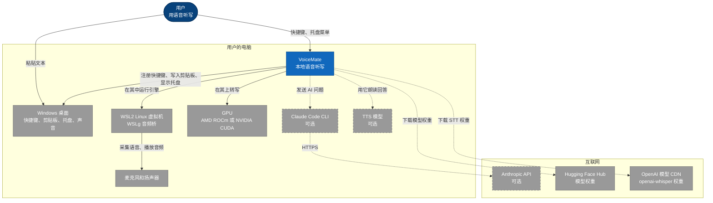
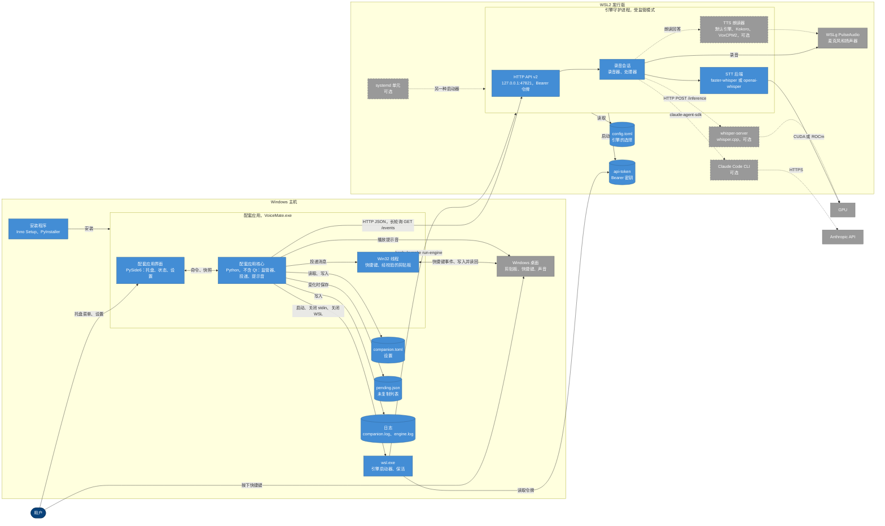
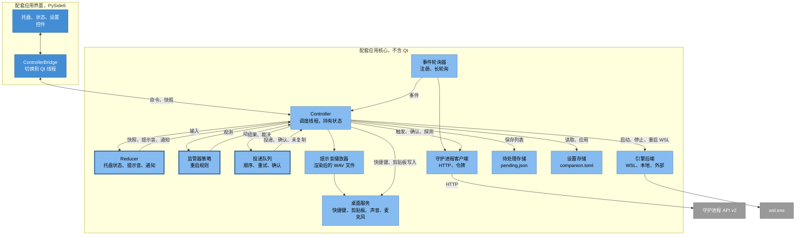
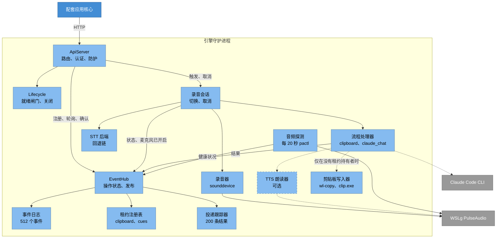
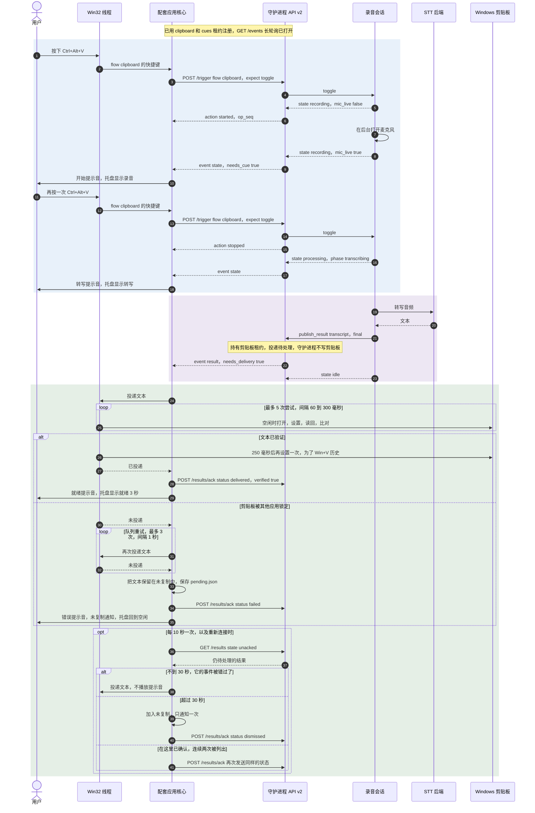
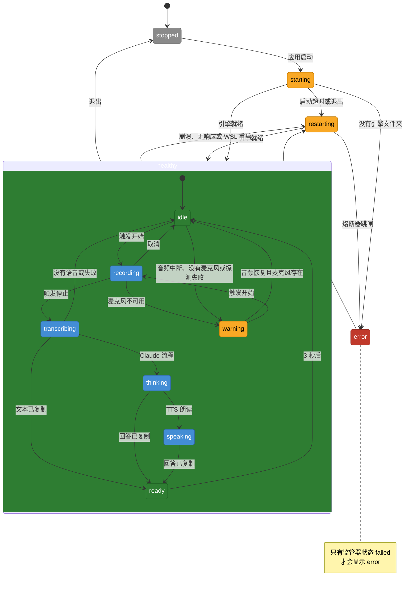
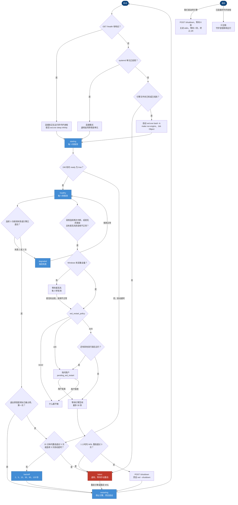
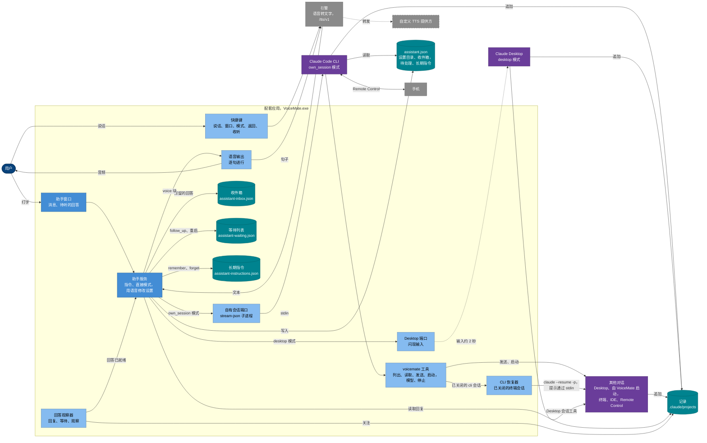

[English](architecture.md) | [Português](architecture.pt-BR.md) | [Español](architecture.es.md) | [Русский](architecture.ru.md) | **简体中文**

# 架构

目的：VoiceMate 是如何构建的，包括每个层级的图表、HTTP API、包结构树，以及主要设计选择背后的理由。返回 [README](../README.zh-CN.md)。

本页描述的是 Windows + WSL2 的部署方式（配套应用在 Windows 上，引擎在 WSL2 内），配套应用就是为这种方式构建的。Linux 的 `local` 模式和命令行模式只在它们有所不同的地方提到。代码变动时，本页会在同一个 pull request 中一起更新。协议约定的完整细节见 [companion-app.md](companion-app.md)。

## 1. 系统上下文



用户在 Windows 上按下全局快捷键，然后把文本粘贴到光标所在的地方。VoiceMate 是一个本地系统，分布在同一台电脑的两半。Windows 桌面提供快捷键、剪贴板、托盘和提示音的声音输出。引擎运行在 WSL2 Linux 虚拟机内，因为在那里可以通过 ROCm 使用 AMD GPU（[wsl2.md](wsl2.md)）。麦克风和扬声器通过 WSLg 的 PulseAudio 桥连接到引擎，引擎每 20 秒用 `pactl info` 探测它一次（`app/platform/audio_probe.py`）。

所有可选的部分都在虚线箭头之后。Claude 流程通过 `claude-agent-sdk` 运行本地的 Claude Code CLI（`app/features/claude/runtime.py`），后者调用 Anthropic API（默认模型 `claude-haiku-5-5`）。TTS 库负责朗读回答（没有保存任何选择时使用默认的本地引擎；`make setup` 推荐 `kokoro`）。模型权重在首次使用时从互联网获取：

| 内容 | 来源 | 何时 |
|---|---|---|
| whisper.cpp 的 GGML 模型、它的 q8 变体、供 whisper.cpp 使用的 Silero VAD | Hugging Face（`ggerganov/whisper.cpp`、`ggml-org/whisper-vad`） | `make setup` 或 `make configure` |
| faster-whisper 模型（默认 `large-v3-turbo`） | Hugging Face，通过 `faster-whisper` 库 | 第一次加载模型时 |
| openai-whisper 模型（WSL2 + AMD 且没有 CTranslate2-ROCm 时常用的后端） | OpenAI 的模型 CDN，通过 `openai-whisper` 库 | 第一次加载模型时 |
| TTS 引擎权重（默认引擎、VoxCPM2 和 Kokoro） | Hugging Face（`openbmb/VoxCPM2`，Kokoro 通过它自己的库，默认引擎自己的仓库） | 第一次加载 TTS 时 |
| PyTorch ROCm 安装包、whisper.cpp 源码、CTranslate2-ROCm 分支 | `repo.radeon.com`、GitHub | `make setup` |

## 2. 容器



两台主机，一份回环约定。在 Windows 上，配套应用（`VoiceMate.exe`，由 Inno Setup 按用户安装到 `%LOCALAPPDATA%\Programs\VoiceMate`）分为不含 Qt 的**核心**和 PySide6 的**界面**。界面只渲染不可变的 `CompanionSnapshot` 对象，并调用 `CompanionController` 的命令（`app/companion/contract.py`）。有一项测试禁止配套应用导入引擎的技术栈（`tests/test_import_boundary.py`）。

在核心内部，一个专用的 **Win32 线程** 掌管 `RegisterHotKey` 以及每一次剪贴板的写入和读回（`app/companion/win/hotkeys_clipboard.py`）。核心用 `wsl.exe -d <distro> -e bash -lc 'cd ... && exec make run-engine ARGS="--daemon-port <port> --transcription-language <code> --output-lang <BCP-47>"'` 启动引擎，放在一个 Job Object 中，stdin 保持打开，输出被导入 `engine.log`（`app/companion/supervisor/wsl.py`、`app/companion/supervisor/backend.py`）。这两个语言参数来自 `dictation_language` 设置（`app/companion/dictation.py`；见 [companion-app.md](companion-app.md)）。`make run-engine` 就是 `voice-mate --supervised --api --api-token`。

在 WSL2 内，**引擎守护进程** 在加载模型之前就在 `127.0.0.1:47821` 上绑定了它的 HTTP API，创建令牌文件 `~/.config/voicemate/api-token`，并启动 stdin 文件末尾的观察器（`app/main.py`）。WSL2 把这个端口转发到 Windows 的回环地址。核心通过 `wsl.exe ... cat` 读取令牌（`app/companion/supervisor/wsl.py`），并用 `urllib` 通过普通的 HTTP JSON 通信，不经过系统代理，对 `GET /events` 使用 25 秒的长轮询（`app/companion/client.py`）。

语音转文字和 TTS 都在守护进程内运行。只有服务器模式的 whisper.cpp（在一个空闲的回环端口上的 `whisper-server`）和 Claude Code CLI（由 `claude-agent-sdk` 启动）是单独的进程。Windows 上的本地状态：`%APPDATA%\VoiceMate` 中的 `companion.toml`，`%LOCALAPPDATA%\VoiceMate` 中的 `pending.json` 和 `logs\`（`app/companion/paths.py`）。也可以改由一个可选的 systemd 用户服务来运行守护进程，此时配套应用会连接到它。

### HTTP API v2

路由在 `app/daemon/server.py`，载荷在 `app/protocol/models.py`：

| 路由 | 用途 |
|---|---|
| `GET /health` | 就绪状态、`api_version`、`instance`、`audio`、`flow_info`。从不需要令牌 |
| `POST /register`、`POST /unregister` | 客户端 id、独占租约 `clipboard` 和 `cues`（10 到 120 秒，默认 40）、快照和游标 |
| `GET /events?client_id&instance&since&wait` | 对一个容纳 512 个事件的环形缓冲进行长轮询（最长 25 秒）：`snapshot`、`state`、`result`、`error`、`warning`、`health`、`shutdown` |
| `POST /trigger`（`expect`：toggle、start、stop）、`POST /cancel` | 驱动录音会话 |
| `POST /results/ack`、`GET /results?state=unacked` 或 `recent` | 对最近 200 条结果进行投递确认和对账 |
| `POST /shutdown` | 正常停止，原因为 `user_quit`、`restart` 或 `supervisor` |
| `/tts/v1/...` | `voicemate-tts` 协议（[tts-provider-protocol.md](tts-provider-protocol.md#the-engine-speaks-the-same-protocol)），只为 Kokoro 和自定义提供方提供服务；配套应用用它来朗读助手的回复 |

旧的 Windows 脚本使用的 v1 路由（`/status`、`/result`、请求体为空的 `/register`、`POST /trigger`）在没有令牌的守护进程上仍然可用。每个请求的防护：任何 `Origin` 头或非回环的 `Host` 返回 `403`，没有 bearer 令牌返回 `401`（`/health` 除外），在就绪之前返回 `503`（`/health`、`/shutdown`、`/unregister` 除外）。

## 3. 组件

### 3.1 配套应用核心



核心被构建成由一个线程驱动的纯状态机。`Dispatcher` 线程持有唯一的 `CoreState`，并按顺序运行被投递的任务和定时器（`app/companion/runtime.py`）。缓慢的工作交给串行执行器（I/O、命令、监管器、探测器、待处理写入器），它们的结果再被投递回来（`app/companion/controller.py`）。

三个纯模块保存规则，不做任何 I/O：**reducer**（`app/companion/model.py`）、**监管器策略**（`app/companion/supervisor/policy.py`）和**投递队列**（`app/companion/delivery.py`）。每一个都返回由控制器执行的效果或动作。`EventPoller` 线程负责注册、对 `/events` 进行长轮询，并在遇到 `410`、实例变化或租约丢失时重新注册（`app/companion/client.py`）。引擎的宿主是可插拔的：`WslBackend`、`LocalBackend`、`ExternalBackend`。操作系统服务位于 `Desktop` 这个组合之后：快捷键、剪贴板、声音、采集设备数量（Windows 上用 Core Audio）、自动启动和托盘提升（`app/companion/desktop.py`）。界面只通过 `ControllerBridge` 接触核心，它把每个回调都移到 Qt 线程上（`app/companion/ui/bridge.py`）。

### 3.2 引擎守护进程



`ApiServer` 只负责把 HTTP 翻译成对 `EventHub` 的调用，`EventHub` 是 API v2 状态的唯一拥有者（`app/daemon/server.py`、`app/daemon/hub.py`）。hub 保存当前的操作，把带类型的事件追加到 `EventJournal`（一个容纳 512 个事件的环形缓冲），在 `DeliveryTracker` 中跟踪结果（最近 200 条，按守护进程的单调时钟计龄），并查询 `LeaseRegistry`。租约的判断在 hub 锁之下每次发布只做一次：同一份持有者快照既设定每个客户端的 `needs_cue` 和 `needs_delivery` 标志，也告诉引擎是由它自己写剪贴板、发出提示音，还是交给客户端。`Lifecycle` 保存就绪闸门和唯一的关闭请求（`app/daemon/lifecycle.py`）。

`RecordingSession` 运行这个操作：它在打开麦克风之前就发布 `recording`，在流真正打开时设置 `mic_live`，并在它自己的线程上转写，第一次时会等待预热完成（`app/core/recording_session.py`）。每个流程各有处理器：`ClipboardHandler` 发布转写文本，并且只在没有人持有租约时才自己写剪贴板（依次通过 `wl-copy`、`pyperclip`，然后在 WSL2 上是 `clip.exe`；`app/core/transcription_handler.py`、`app/platform/clipboard.py`）。`ClaudeChatHandler` 增加了 `thinking` 和 `speaking` 阶段。语音转文字后端在启动时由一条回退链一次性选定（`app/cli/wiring.py`）；在 WSL2 + AMD 上：如果通过了验证就用 CTranslate2-ROCm 的 faster-whisper，然后是 openai-whisper，然后是 whisper.cpp，最后是 CPU。使用 `--stt-engine external` 时，每段录音改为交给遵循 [STT 提供方协议](stt-provider-protocol.zh-CN.md)的服务，那条链则作为回退（`app/features/stt_external/`）。当 WSLg PulseAudio 的状态变化时，`AudioServerProbe` 会发布 `health` 事件。

## 4. 运行时：一次听写



快捷键和 Windows 剪贴板归配套应用掌管，而不是引擎。快捷键从 Win32 线程到达核心。当监管器不健康（或处于降级状态）或引擎尚未就绪时，核心拒绝触发，并改为显示一条通知；否则它发送带有 `expect: "toggle"` 的 `POST /trigger`。会话在打开麦克风之前发布 `recording`，并在流打开之后发布带有 `mic_live: true` 的第二个 `state` 事件，所以开始提示音意味着“现在说话”。

第二次按键让状态转到 `processing`，阶段为 `transcribing`；转写文本作为 `result` 发布。因为配套应用持有 `clipboard` 租约，结果被存为待处理，并且只有那个客户端得到 `needs_delivery: true`；守护进程跳过它自己的剪贴板写入和提示音。投递队列按 `result_seq` 的顺序把文本发给 Win32 线程，后者运行一个由定时器驱动的状态机：另一个进程占用剪贴板时跳过，设置，读回，比对，最多 5 次尝试，然后在 250 毫秒后再设置一次，为了 `Win+V` 历史。一次经过验证的写入会被确认为 `delivered`，并播放 `ready` 提示音。

失败的分支：队列以 1 秒的间隔重试 3 次之后，结果被确认为 `failed`，保留在 **未复制** 中（保存到 `pending.json`），并通过 `error` 提示音和一条通知宣布。对账每 10 秒运行一次，重新连接时也会运行：不到 30 秒的未确认结果会不带提示音地投递；更旧的会被确认为 `dismissed` 并落入 **未复制**。配套应用放弃过的确认，会在连续两次列表仍然显示这条结果时重新发送。守护进程实例变化时仍在等待的投递，同样会进入 **未复制**：它绝不会被迟到地写入。

## 5. 托盘状态



托盘状态不是存储下来的：reducer 在每次变化时，根据监管器状态、引擎的操作和两个定时器推导出它（`app/companion/model.py`）。优先级：先看监管器（`stopped`、`starting`，`restarting` 同时对应 `restarting` 和 `backoff`，`error` 只对应 `failed`，`warning` 对应 `degraded` 或过期的引擎），再看操作（`recording`、`transcribing`、`thinking`、`speaking`），然后是最终结果进入剪贴板之后的 3 秒内为 `ready`，再然后是待处理的警告（没有麦克风、音频中断、麦克风不可用），否则为 `idle`。组合框就是监管器状态 `healthy`。这十一个名称与 `TrayState` 一致（`app/companion/contract.py`）。

提示音遵循同一个 reducer：进入 `transcribing`、`warning` 或 `error` 时播放它的提示音，除非某个事件自己的提示音取代了它，而守护进程事件只有在 `needs_cue` 为 true 时才播放提示音。转写失败或 Claude 请求失败会带着 `error` 提示音回到 `idle`，所以托盘上的 `error` 始终意味着监管器已经放弃。

## 6. Windows 与 WSL2 上的监管器



`SupervisorPolicy` 是一个基于 `SupervisorState`（`stopped`、`starting`、`healthy`、`degraded`、`restarting`、`backoff`、`failed`）的纯状态机；控制器在监管器队列上执行它的动作。启动时优先选择连接：如果 `/health` 有响应，配套应用就连接上去，并保持一个 `wsl.exe ... sleep infinity` 保活，以免 WSL 停掉这个发行版；如果 `voicemate` 这个 systemd 用户服务已启用，它就连接上去，并显示如何停用该服务；否则它会找到引擎文件夹并启动引擎。

探测每 5 秒进行一次：先是 500 毫秒的 TCP 连接，然后是超时 2 秒的 `/health`。阈值：启动宽限期 240 秒，3 次探测失败，退避 2、5、15、30、60 和 120 秒（健康 10 分钟后重置），熔断器在 15 分钟内引擎重启超过 5 次、1 小时内 WSL 重启超过 3 次，或连续 3 次启动超时时触发（`app/companion/supervisor/policy.py`）。以“address in use”退出的引擎会让配套应用转而连接一次，而不是退避。

当 `audio` 连续两次为 `down`，或者在 Windows 有采集设备而音频不为 `ok` 时出现 `mic_unavailable`，就需要重启 WSL；没有采集设备时绝不会重启。`wsl_restart_policy` 设置是 `auto`、`ask` 或 `never`（默认 `auto`）；当有其他发行版在运行时，`auto` 仍会询问，因为 `wsl --shutdown` 会把它们全部停止。重启会最多等待 30 秒让引擎空闲，然后发送 `POST /shutdown`，运行 `wsl --shutdown`，再重新启动。退出只会停止应用自己启动的东西：`POST /shutdown`，等待 8 秒，关闭 stdin，等待 2 秒，终止 job。对已连接的守护进程只会发送 `/unregister`。

### 6.1 语音助手

助手位于配套应用中；引擎只参与转写语音和朗读回复。**流程：请求如何在两种模式下到达中央对话、其他对话如何回答，以及回复如何被朗读。** 从用户一侧一步一步地看同一个流程：[voice-assistant.md](voice-assistant.md)；助手如何运用它（请求的去向、主动性、关注、长期指令）：[assistant.zh-CN.md](assistant.zh-CN.md)。



**模式。** 服务按 `mode` 为中央对话启动一个端口：

- **`own_session`**：`OwnSessionPort` 运行一个持久的 `claude -p --input-format stream-json` 子进程，名为“VoiceMate”，带有 `voicemate` 工具（一个 SDK MCP 服务器，由配套应用通过子进程的 stdio 提供，`mcp_tools.py`）。VoiceMate 是唯一的写入者；Claude Desktop 和手机都是它的 Remote Control 客户端。这些工具从记录中列出并读取对话，向对话发送消息（VoiceMate 自己拥有的对话通过它的 stdin 接收提示，Desktop 的对话得到一次闪现，已关闭的终端、IDE 或 Remote Control 会话由 `CliResumer` 恢复），并启动、更换模型和停止 VoiceMate 所拥有的对话（`conversations.py`：最多同时存活 4 个，仍在启动中的也计入；开启 Remote Control，记录在 `assistant-conversations\conversations.json` 中，并在下次启动时恢复）。
- **`desktop`**：`DesktopConversationPort` 按确切标题找到 Desktop 对话，并通过一次 **闪现** 向它写入（`app/companion/win/claude_desktop.py`）：把 Claude 窗口带到前面，清除草稿，通过剪贴板粘贴（先保存，并且只有在闪现期间没有人复制过任何东西时才恢复：在粘贴之前和按 Enter 之前，都会检查剪贴板序列号），按 Enter，再归还前台，整个过程约 2 秒。每个按键之前都会检查三项防护（每个按键都是单独的一次按下）。Desktop 闪现的失败始终是一个带类型的错误（`DesktopError`）：被其他程序占用的剪贴板变成 `busy`，UI Automation 的失败（窗口正在重新加载或关闭）变成 `unavailable`，所以窗口显示“未发送到 ...”，而不会丢失消息。控件的位置来自一个[配置文件](desktop-profile.md)。中央对话使用 Desktop 自己的会话工具，所以这里没有 `voicemate` 工具。

无论哪种方式，回复都是从磁盘上的记录中读取的，绝不从进程输出中读取，所以在手机或 Claude Desktop 里输入的提示也会显示出来。

**已关闭的终端会话。** `cli_resume.py` 只有在没有任何程序打开某个 `cli` 会话时才会向它写入：它不在活动注册表中，它的记录 120 秒内没有变化，并且 VoiceMate 自己对它的恢复既没有在运行，也不是刚刚结束。它在会话的文件夹中运行 `claude --resume <id> -p --output-format json`，使用清理过的环境，并通过 stdin 传入提示，提示前面有一段头部，说明这段文字来自助手，并且不代表任何批准。

除非用户设置了 `resume_permission_mode`（`default`、`acceptEdits` 或 `plan`；`bypassPermissions` 会被拒绝），否则不会传递 `--permission-mode`。id 必须是 UUID，文本上限为 16,000 个字符，一轮在 30 分钟后会被停止。非零的退出码、超时或管道断开，会恢复之前的关注，并给中央对话发一条消息没有送达的备注。正在使用的会话对 VoiceMate 来说保持只读；当中央对话拥有客户端自己的会话工具时，技能可以通过它们接触该会话。

**其他对话和回答。** 向对话写入的工具从不等待。它们把对话注册到 `AnswerWatcher`（`notifier.py`），后者跟读它的记录，并把已结束的轮次交给服务。关注有三种类型：`reply`（对刚发出消息的回答，只送达一次）、`wait`（下一轮，最长 1 小时）和 `observe`（每一轮，最长 12 小时，通过带 `"watch": true` 的 `follow_up` 要求）。

在 15 秒内结束的被观察轮次会合并成一条备注，中央对话每分钟最多收到 4 条观察备注。被观察对话上的一次回复只送达一次，然后观察继续。“等待中”列表保存在 `assistant-waiting.json` 中，连同每份记录读到的位置，所以在 VoiceMate 关闭期间结束的一轮仍会被报告，时限已到的条目会连同一条备注一起离开。

然后由 `answer_delivery` 决定（观察总是交给中央对话，除非用户正在直接模式下离开，或正在跟随另一个对话，那时它进入收件箱）：

| 值 | 路径 |
|---|---|
| `speak` | 回答立刻作为一条备注交给中央对话（标有 `[voicemate:event]` 的轮次不会显示在窗口里） |
| `announce`、`sound`、`silent` | 回答保留在 `Inbox`（`inbox.py`，50 项，持久保存）中；`announce` 和 `sound` 播放回答提示音，`announce` 还会说一句话 |

保留的回答在录音或语音回答期间绝不会播放通知。“收听已就绪的内容”会给中央对话发一条包含全部回答的摘要备注。直接模式绕过中央对话：服务把用户的文本原样发给某一个对话，直到“回到助手”，然后告诉中央对话那边发生了什么。

**语音路径。** 由说话快捷键停止的录音由引擎转写，它的文本发往服务而不是剪贴板。每条回复的 `<voice>` 块被切成句子，发送到引擎的 `/tts/v1` 端点（`voice.py`）；流式返回的音频在这台电脑上播放，同时合成下一句。引擎只为 Kokoro 或它所转发的自定义提供方提供这个端点。当它无法朗读时，在默认的“自动”语音来源（`assistant.voice_source`）下，由 Windows 已有的声音（`app/companion/win/system_voice.py`，通过 SAPI）朗读回复；如果两者都不行，回复就只保留文字，简短的通知则回退到 Windows 语音。使用“engine”来源时没有回退：一句话会等待（最多 90 秒，每次中断只算一次）仍在加载声音的引擎，简短的通知则留在屏幕上。

**麦克风按钮。** 助手窗口有一个 **说话** 按钮，作用与说话快捷键相同：它开始录音，录音时变成 **停止并发送**，并显示状态窗口的托盘状态（同样的角标和文字，包括已用时间），所以用快捷键开始的录音也会显示在那里。

**设置与动作。** `settings_catalog.py` 是中央对话可以更改的设置清单。VoiceMate 把它连同当前的值一起写入 `assistant.json`；回复中的 `set_setting` 动作会对照它检查，并通过与设置窗口相同的路径应用。`read_inbox` 和 `clear_inbox` 也会被执行。

`follow_up` 添加（或更新）“等待中”列表的一个条目（对话、标题、原因、起始时间，观察时还有 `watch`）；`follow_up_done` 把它移除；`remember` 和 `forget` 添加和移除一条长期指令（`instructions.py`：`assistant-instructions.json` 中最多 40 条、每条最多 300 个字符的规则，并复制到 `assistant.json`），只接受在回应用户本人话语的回复中出现；`focus` 让文字界面跟随那个对话，不带会话 id 的 `focus` 则回到中央对话。`open_conversation` 和 `notify` 只会被解析和记录。

- **一个写入者。** VoiceMate 的进程是它自己对话的唯一写入者。重启时，只有在没有活动进程拥有这个会话时，才按 id（`--resume`）恢复它，否则就启动一个新的。
- **子进程以干净的状态启动。** 环境会去掉 Claude Desktop 为它自己的会话设置的变量，因为继承了它们的子进程在实验中改写了凭据文件（[研究](research/claude-code-client.md#2-authentication-is-the-first-blocker)）。
- **来自其他对话的文本是数据。** 被引用的回答以数据的标记送到中央对话，技能绝不会按其中发现的指令行事。

设计、风险以及尚未完成的故事：[research/voice-assistant-design.md](research/voice-assistant-design.md)。

## 7. 包结构树

```text
app/
├── main.py              引擎入口（`voice-mate`）：把一切连接起来并运行主循环
├── cli/                 argparse 参数、配置构建器、处理器和监听器的接线
├── core/                与操作系统无关的引擎：录音器、录音会话、转写器，
│   │                    处理器、快捷键监听器、保活、看门狗、音频提示
│   └── prompts/         带有 {output_lang} 占位符的标准系统提示词
├── daemon/              HTTP API v2：服务器、事件 hub、事件日志、租约、投递、认证、生命周期
├── features/            可选模块（Poetry 附加组件）
│   ├── claude/          Claude Agent SDK 运行时、聊天处理器、句子缓冲
│   ├── openai_whisper/  openai-whisper 后端和 Silero VAD
│   ├── tts/             TTS 协议、音频播放器、Kokoro、VoxCPM2 和默认朗读器
│   └── whispercpp/      whisper.cpp 的 CLI 和服务器后端
├── platform/            平台检测、剪贴板写入器、WSLg 音频探测
│   └── listeners/       evdev、pynput 和 HTTP socket 触发器
├── protocol/            守护进程和配套应用的通信模型、助手回复解析器（仅用标准库）
├── setup/               make setup / configure（GPU 引导和检测）、make doctor，
│                        CTranslate2-ROCm 构建、~/.config/voicemate/config.toml
├── i18n/                gettext 封装和语言目录（en、pt_BR、es、ru、zh_CN）
└── companion/           托盘应用：控制器、客户端、reducer、投递、设置、路径
    ├── assistant/       语音助手：服务、自有会话、Desktop 端口，
    │   │                voicemate 工具、对话、CLI 恢复器、通知器、收件箱、长期
    │   │                指令、会话读取器、指令检测器、设置目录，
    │   │                个性、技能安装
    │   └── skill/       内置的 voicemate-assistant 技能，位于 en/ 和 pt-BR/
    ├── supervisor/      策略、WSL、本地和外部的引擎后端
    ├── ui/              PySide6：托盘、状态窗口、设置、助手窗口、通知
    ├── win/             Windows：快捷键和剪贴板、Job Object、跳转列表、自动启动，
    │   │                Claude Desktop 驱动（UI Automation）及其配置文件
    │   └── profiles/    内置的 Claude Desktop 配置文件
    └── linux/           Linux：剪贴板工具、声音、自动启动、音频设备
```

## 8. 设计取舍

**为什么 API v2 带令牌和租约。** WSL2 把引擎的端口转发到 Windows 的回环地址，任何网页都能访问到那里。守护进程会拒绝浏览器请求（`Origin` 头）、非回环的 `Host` 头（DNS 重绑定）以及 `GET /trigger`，使用 `--api-token` 时还要求一个保存在 0600 文件中的 bearer 令牌。独占租约决定谁写剪贴板、谁播放提示音：每项工作只有一个持有者。停滞或退出的配套应用会失去它的租约，守护进程会重新写入剪贴板并发出提示音，所以听写绝不会丢失，也绝不会被重复提示。API 在模型加载之前就绑定，所以在 10 到 60 秒的模型加载期间，退出和重启仍然可用。

**为什么配套应用要校验剪贴板。** 在 WSL2 上，WSLg 的剪贴板桥和 `clip.exe` 并不可靠：有时转写文本根本没有到达 Windows。配套应用自己写入 Windows 剪贴板，读回来并比对，确认每一条结果（“最后的状态为准”），对账被错过的事件，绝不用过期的文本覆盖用户的剪贴板，并把每一次失败都保留在一个持久保存的 **未复制** 列表中（原子写入：临时文件、`fsync`、`os.replace`）。

**为什么要有监听器保活。** 在 Windows 上，全局快捷键库使用的底层钩子（`WH_KEYBOARD_LL`、`WH_MOUSE_LL`）在回调超过 `LowLevelHooksTimeout` 时会被操作系统悄悄移除，这在 CPU 负载很高时会发生（[Microsoft Learn](https://learn.microsoft.com/en-us/windows/win32/winmsg/lowlevelkeyboardproc)）。原生引擎每 60 秒重新安装一次它的钩子，所以被丢掉的钩子会在下一个周期恢复。配套应用改用没有这种超时的 `RegisterHotKey`。

**为什么 TTS 可插拔。** `TextToSpeech` 协议（`app/features/tts/base.py`）把 Claude 流程与每个引擎分开。默认引擎、Kokoro 和 VoxCPM2 是放在不同附加组件之后的独立朗读器，TTS 关闭时由 `NullSpeaker` 顶替，而软件包缺失或启动失败会降级为没有 TTS，并给出警告。添加或移除一个引擎只会改动它自己的模块。

**其他原则。**
- 契约优先，写在代码里：`app/protocol/models.py` 由双方共享，每个离散选项都使用 `Literal` 类型；`app/companion/contract.py` 是配套应用核心与它的界面之间唯一的接缝。
- 规则存在于传入时间的纯状态机中，所以每条规则都可以在没有线程、HTTP 或 Win32 的情况下做单元测试。
- 带有限重试的监管：退避、三个熔断器、逐级的优雅停止（HTTP、stdin 文件末尾、终止）、作为安全网的 Job Object，并且不自动执行会让其他发行版措手不及的 `wsl --shutdown`。
- 线程纪律：一个调度器持有状态，绑定线程的 Win32 API 放在一个由定时器驱动的线程上，界面通过信号移到 Qt 线程。
- 时钟纪律：结果的年龄来自守护进程的单调时钟，因为 WSL 虚拟机的时钟在宿主机睡眠之后会漂移。
- 由测试强制的边界：`tests/test_import_boundary.py` 让配套应用保持不依赖引擎的技术栈。
