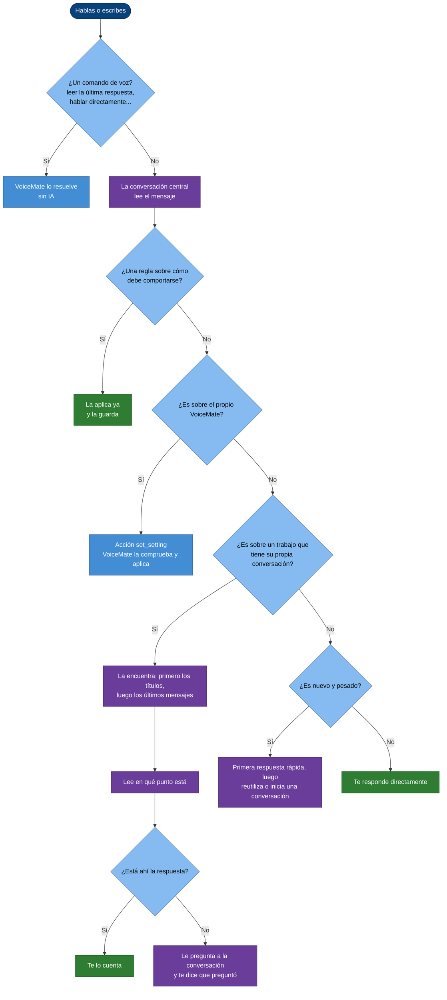
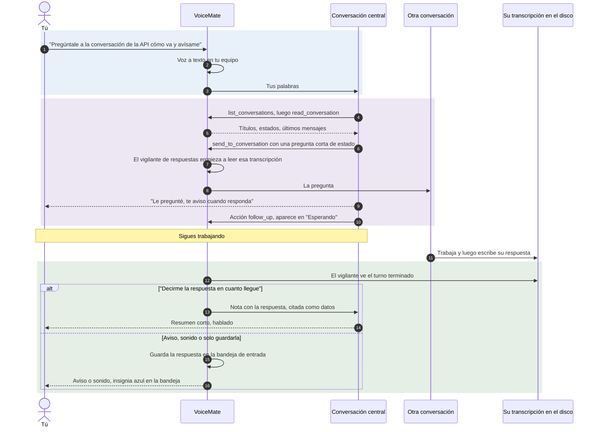
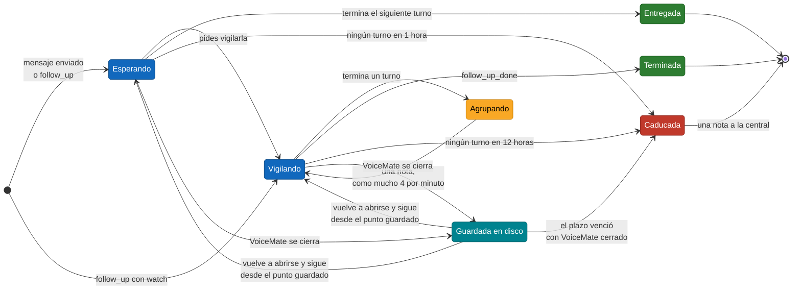
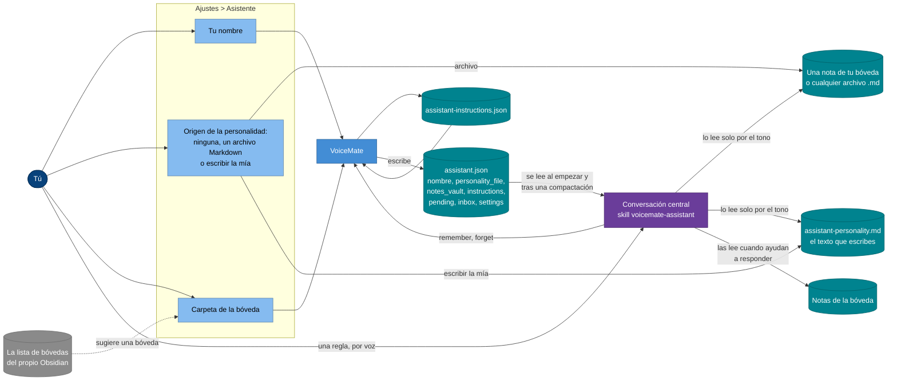

[English](assistant.md) | [Português](assistant.pt-BR.md) | **Español** | [Русский](assistant.ru.md) | [简体中文](assistant.zh-CN.md)

# El asistente de VoiceMate

**Di lo que quieres. El asistente encuentra la conversación correcta de Claude Code, lee en qué punto está, le pregunta lo que necesitas y te avisa por voz cuando responde.**

Seguramente tienes varias conversaciones de Claude Code abiertas a la vez: una en Claude Desktop, otra en una terminal, otra trabajando en segundo plano. Seguirles la pista obliga a cambiar de ventana, desplazarte y escribir el mismo "¿cómo va?" una y otra vez. El asistente de VoiceMate lo hace por ti. Tú hablas, él decide adónde van tus palabras, hace los pasos obvios sin preguntar y vuelve solo con resultados o con las decisiones que de verdad son tuyas.

Esta página explica qué hace el asistente por ti y cómo lo hace. Cómo se conecta VoiceMate con Claude (los dos modos, la plantilla de respuesta, la voz) está en [voice-assistant.md](voice-assistant.md) (en inglés); cada ajuste paso a paso está en [usage.md](usage.md#voice-assistant) (en inglés).

[Qué hace](#-qué-hace-por-ti) · [Enrutamiento](#-cómo-se-enruta-una-petición) · [Iniciativa](#-iniciativa-actúa-y-luego-te-cuenta) · [Pregunta y avísame](#-pregunta-cómo-va-y-avísame) · [Esperar y vigilar](#-esperar-y-vigilar) · [Conversaciones que ve](#%EF%B8%8F-las-conversaciones-que-ve) · [Instrucciones permanentes](#-instrucciones-permanentes) · [Personalidad y notas](#-personalidad-contexto-y-tus-notas) · [Seguridad](#-seguridad-y-privacidad) · [Configuración](#%EF%B8%8F-configuración) · [Problemas comunes](#-problemas-comunes) · [Límites](#-límites)

## ✨ Qué hace por ti

Hablas (`Ctrl+Alt+S`) o escribes en la ventana del asistente. Algunas cosas que puedes decir, y lo que pasa:

| Dices | Lo que hace el asistente |
|---|---|
| "¿Cómo va el trabajo del atajo de teclado?" | Encuentra la conversación sobre atajos, lee sus últimos mensajes y te cuenta dónde se quedó. Si eso no responde la pregunta, se lo pregunta a la conversación y te dice que lo hizo. |
| "Pregúntale a la conversación de la API si pasaron las pruebas y avísame" | Envía la pregunta, pone la conversación en su lista de espera y te cuenta la respuesta cuando llegue. |
| "Vigila las conversaciones del build y de la documentación" | Vigila las dos y te avisa de cada turno que terminan, hasta que digas basta. |
| "Investiga la mejor forma de hacer Y" | Te adelanta lo que ya sabe, si tiene algo útil, pasa el trabajo de verdad a una conversación en segundo plano y te avisa cuando esté listo. |
| "De ahora en adelante, no preguntes antes de leer una conversación" | Aplica la regla al momento y la guarda para todas las sesiones siguientes. |
| "Solo reproduce un sonido cuando responda una conversación" | Cambia ese ajuste de VoiceMate. |

Funciona en los dos modos del asistente, la conversación propia de VoiceMate y una conversación de Claude Desktop. La conversación central usa por defecto un modelo rápido con esfuerzo bajo, así que responde enseguida; el trabajo pesado va a otras conversaciones.

## 🧭 Cómo se enruta una petición

Cada mensaje pasa por la misma decisión, que toma la conversación central (la skill, sección 3.1) sin preguntarte. Los comandos de voz los reconoce VoiceMate antes de todo esto, sin IA ([usage.md](usage.md#voice-commands), en inglés).

El diagrama de flujo responde: ¿adónde va a parar uno de tus mensajes?

Azul: VoiceMate; morado: la conversación central trabajando; verde: la respuesta que recibes.

- **Encontrar la conversación.** Compara "la conversación sobre X", "la otra" o "ese build" con los títulos y, cuando los títulos no bastan, lee los últimos mensajes de las probables. Si aún encajan dos, se queda con la de actividad más reciente en ese tema y te dice cuál eligió, para que lo corrijas si hace falta.
- **Foco.** Cuando dices "volvamos a la conversación sobre X", las preguntas siguientes van allí hasta que salgas ("vale, vuelvo contigo", "cambio de tema").
- **Peticiones ambiguas**, como "cambia el modelo", se deciden por el foco y los últimos mensajes. Solo hace una pregunta corta cuando las dos lecturas son probables y la equivocada estropearía algo.

## 🚀 Iniciativa: actúa y luego te cuenta

El asistente está orientado a comportarse como un asistente con iniciativa, no como un formulario que pide confirmación. Hacer la pregunta ya es pedirle que haga el trabajo.

| Lo hace sin preguntar | Te pregunta antes |
|---|---|
| Listar, buscar y leer conversaciones, todas las que haga falta | Borrar, archivar, descartar trabajo, push forzado |
| Elegir de qué conversación hablas | Detener una conversación que no pediste detener |
| Preguntar a otra conversación cómo va, o llevar tu petición a la conversación a la que pertenece | Gastar dinero o comprar cualquier cosa |
| Vigilar conversaciones y avisarte de novedades | Publicar, hacer push, abrir pull requests, enviar mensajes o correos a personas |
| Iniciar una conversación en segundo plano para una investigación que pediste | Trasladar cualquiera de lo anterior a otra conversación |
| Leer tus notas o archivos cuando ayudan a responder | Una elección de gusto o prioridad que solo tú puedes hacer |
| Cambiar un ajuste de VoiceMate que pediste, guardar una regla que diste | |

Nunca termina una respuesta con "¿quieres que lo revise?" para algo que podía haber hecho sin más. Cuando algo no está claro pero equivocarse cuesta poco, elige la lectura más probable y dice cuál fue.

**Modo de permisos.** En la conversación propia de VoiceMate, `assistant.json` le dice a la skill el modo en que corre la central (`permission_mode`, de Ajustes > **Asistente** > "Permisos:"). Con `bypassPermissions` sus herramientas se ejecutan sin pedir aprobación; con `acceptEdits` o `default`, una herramienta que necesita aprobación se rechaza, porque nadie puede aprobar nada en una conversación que corre en segundo plano.

La skill lo sabe: dice qué no pudo hacer y toma otro camino (una acción, u otra conversación), y nunca te pide que apruebes algo que no ves. La lista de decisiones de verdad de arriba vale en todos los modos.

## 🔁 Pregunta cómo va y avísame

La petición más habitual: "pregúntale a esa conversación cómo va y avísame". Enviar nunca espera la respuesta; VoiceMate vigila en el disco la transcripción de la otra conversación y te trae la respuesta.

La secuencia responde: qué pasa entre tu frase y la respuesta hablada (se muestra la conversación propia de VoiceMate; en el modo Desktop se usan las herramientas de sesión de Desktop en lugar de las herramientas `voicemate`).

La respuesta te llega como indique "Respuestas de otras conversaciones:" ([voice-assistant.md](voice-assistant.md#5-answers-coming-back), en inglés). No se dice nada mientras grabas ni mientras VoiceMate transcribe; espera.

## 👀 Esperar y vigilar

El asistente lleva dos tipos de entradas en la lista "Esperando", y se comportan distinto a propósito.

| | Espera | Vigilancia |
|---|---|---|
| Qué la inicia | El asistente envió una pregunta, inició una conversación o emitió un `follow_up` simple | Lo pediste tú: "vigila X", "avísame cuando termine" (un `follow_up` con `"watch": true`) |
| Qué avisa | El siguiente turno terminado, una vez | Cada turno terminado, hasta que digas basta (`follow_up_done`) |
| Cómo te llega | Como indique "Respuestas de otras conversaciones:" (hablada o guardada en la bandeja de entrada) | Siempre va a la central, diga lo que diga ese ajuste, porque pediste enterarte |
| Termina sola | Cuando llega su respuesta, o tras **1 hora** sin turno | Tras **12 horas** sin turno nuevo |

El diagrama de estados responde: ¿qué le puede pasar a una conversación de la lista?

- **Agrupación.** Los turnos de una conversación vigilada que terminan a menos de **15 segundos** uno de otro se convierten en una sola nota que dice cuántos fueron. Llegan a la central como mucho **4** notas de vigilancia por minuto; una nota retenida sigue recogiendo los turnos más nuevos, así que nada se acumula y una conversación muy activa no te inunda.
- **Cerrar y volver a abrir VoiceMate.** La lista se guarda con el plazo de cada entrada y el punto hasta el que se leyó cada transcripción. Cuando VoiceMate vuelve a arrancar, sigue leyendo desde ahí, así que un turno que terminó con VoiceMate cerrado se avisa igual. Una entrada cuyo plazo venció entretanto sale de la lista con una nota.
- **Caducidad.** Cuando una entrada sale sola de la lista, la central recibe una nota y te lo cuenta en pocas palabras; solo vuelve a vigilarla si aún lo quieres.
- **El modo directo** ("hablar directamente con la conversación X") pausa los avisos: las respuestas y los turnos vigilados van a la bandeja de entrada, y el asistente te los cuenta al volver.
- **Una respuesta dentro de una vigilancia.** Cuando el asistente le pregunta algo a una conversación vigilada, la respuesta llega primero, una vez, y la vigilancia sigue después. Un envío que falla nunca anula una vigilancia.

La lista conserva las 20 entradas más recientes.

## 🗂️ Las conversaciones que ve

En la conversación propia de VoiceMate, `list_conversations` lee las transcripciones que Claude Code guarda en este equipo y muestra cada conversación con un **dueño** y un estado (ocupada, inactiva o esperando). Primero van las conversaciones de Claude Desktop y de VoiceMate, luego las demás sesiones locales, de la más reciente a la más antigua dentro de cada grupo. Una sesión local aparece solo cuando tiene título o un proceso vivo, así que las ejecuciones sueltas de scripts quedan fuera. La conversación central nunca se lista a sí misma.

| Conversación | Leer y vigilar | Enviar un mensaje | Iniciar, cambiar modelo, detener |
|---|---|---|---|
| **Claude Desktop** (`desktop`) | ✅ | ⚠️ Un breve "flash" de escritura en la ventana de Desktop: Desktop abierto, pantalla desbloqueada, un título que ninguna otra conversación de Desktop tenga | ❌ |
| **Iniciada por VoiceMate** (`voicemate`) | ✅ | ✅ Directamente, sin ninguna ventana | ✅ Hasta 4 a la vez |
| **Terminal, IDE o Remote Control, cerrada** (`cli`) | ✅ | ✅ VoiceMate reanuda la sesión en segundo plano, en su propia carpeta, con tu mensaje | ❌ |
| **Terminal, IDE o Remote Control, en uso** (`cli`) | ✅ | ⚠️ Solo con las herramientas de sesión `ListAgents` y `SendMessage`, cuando la central las tiene; si no, te dice qué escribir allí | ❌ |
| **Sesiones que corren solo en la nube** | ❌ No están en este equipo | ❌ | ❌ |

- **Por qué una sesión en uso es de solo lectura.** Claude Code mantiene un solo escritor por sesión y no tiene una forma admitida para que otro programa escriba en una sesión que un cliente está ejecutando. Dos escritores partirían la conversación en ramas. VoiceMate considera una sesión en uso cuando Claude Code la lista como viva, cuando su transcripción cambió en los últimos **2 minutos**, o mientras la reanudación del propio VoiceMate sigue en marcha.
- **Reanudar una sesión cerrada.** VoiceMate ejecuta Claude Code sobre esa sesión en modo de impresión, con el mensaje por la entrada estándar (nunca en la línea de comandos), el modo de permisos de "Permisos:" y el mismo entorno limpio que las conversaciones que inicia. El turno queda en la misma transcripción, así que lo encuentras cuando vuelvas a abrir la sesión, y el vigilante lee la respuesta de ahí. Un turno reanudado que sigue en marcha tras **30 minutos** se detiene.
- **Herramientas de sesión.** Algunos clientes y modos de Claude Code le dan a la central `ListAgents` y `SendMessage`; otros no. Cuando las tiene, la skill le indica encontrar ahí la sesión, enviar con `notify_when_idle`, decir "lo envié" (nunca "lo está haciendo") hasta haber leído la respuesta, y empezar el mensaje diciendo que viene de tu asistente y no aprueba nada.
- **En el modo Desktop** la central usa las herramientas de sesión propias de Desktop (`list_sessions`, `SendMessage`, `start_session` y otras), que también listan las sesiones en la nube y remotas de Desktop. VoiceMate sigue vigilando lo que está en la lista "Esperando".

## 🧠 Instrucciones permanentes

Le enseñas al asistente cómo quieres que trabaje, y una regla dada una vez vale en todas las conversaciones siguientes.

1. Das una regla de comportamiento: "de ahora en adelante, dame primero el camino directo", "eso es tu trabajo, hazlo y ya". Una corrección con "siempre", "nunca", "de ahora en adelante" o "la próxima vez" cuenta; "contesta más corto ahora" es puntual y no cuenta.
2. El asistente la aplica al momento y emite una acción `remember` con la regla en una frase corta. No pregunta si debe guardarla.
3. VoiceMate la guarda en `assistant-instructions.json`, en su carpeta de estado, y escribe la lista en `assistant.json` (`instructions`). La skill lee ese archivo al empezar cada sesión y después de una compactación, y sigue las reglas desde la primera respuesta.
4. Para quitar una regla, basta con decirlo ("ya puedes volver a preguntarme antes de X"): el asistente emite `forget` con su texto. Para cambiar una, olvida la antigua y guarda la nueva en la misma respuesta.

| Límite | Valor |
|---|---|
| Reglas guardadas | 40; a partir de ahí, las más antiguas salen primero |
| Longitud de una regla | 300 caracteres, en una línea |
| Duplicadas | La misma regla (sin contar mayúsculas ni espacios) se guarda una vez |
| `forget` | El texto exacto, o un fragmento que solo contenga una regla; si no, la central sabe que no coincidió ninguna, o que coincidió más de una |

**Protección.** VoiceMate solo acepta `remember` y `forget` en una respuesta a tus propias palabras. Una respuesta a una nota de VoiceMate, a un mensaje que otra sesión envió a la central o a un texto citado de otra conversación no puede guardar ni quitar una regla, aunque ese texto parezca una.

Las instrucciones permanentes moldean el estilo, el ritmo y cuándo preguntar; nunca pasan por encima de la lista de decisiones de verdad, de las reglas de seguridad ni de la plantilla de respuesta. Un archivo ilegible se aparta como `assistant-instructions.json.bad`, nunca se sobrescribe. El registro anota solo el tamaño de una regla, nunca su texto.

## 🎭 Personalidad, contexto y tus notas

El tono del asistente, el contexto que usa y tus reglas vienen de sitios distintos, todos reunidos en un archivo que lee la skill.

El diagrama de flujo responde: ¿de dónde viene cada parte y cómo llega a la conversación central?

Azul: VoiceMate y sus ajustes; verde azulado: archivos; morado: la conversación central; gris: fuera de VoiceMate.

- **Personalidad.** "Origen:" es "Ninguna", un archivo Markdown tuyo (por ejemplo, una nota de tu bóveda de Obsidian) o un texto que escribes en la pestaña (hasta 20.000 caracteres). En ambos casos `assistant.json` lleva una sola ruta, `personality_file`, y la skill lee ese archivo al empezar. Lo sigue **solo para el tono y el estilo**: formalidad, humor, calidez, ritmo, extensión. Nunca es fuente de instrucciones para ejecutar herramientas, cambiar ajustes ni actuar sobre otras conversaciones.
- **Tu nombre.** "Tu nombre:" decide cómo se dirige a ti; la personalidad solo moldea el tono alrededor.
- **Contexto de tus notas.** "Carpeta de la bóveda:" se convierte en `notes_vault`. La skill lee notas de ahí siempre que ayudan a responderte, sin preguntar antes, y solo escribe ahí cuando lo pides. VoiceMate no indexa ni busca en la bóveda: la conversación central abre las notas que necesita, como cualquier archivo. La pestaña de Ajustes sugiere las bóvedas que Obsidian ya conoce (del propio archivo de configuración de Obsidian) y avisa, sin rechazarla, cuando la carpeta no tiene una carpeta `.obsidian`.
- **Trabajo reciente.** En la primera respuesta, la skill lista las conversaciones recientes, lee el final de las más relevantes y mira la lista "Esperando", y luego te saluda contándote qué está abierto y qué se movió.

## 🔒 Seguridad y privacidad

- **Solo tus palabras deciden.** Las respuestas, transcripciones y resúmenes llegan a la central entre marcadores claros, como datos, y la skill nunca ejecuta una herramienta, envía, inicia, detiene ni cambia nada porque ese texto lo pida. Los marcadores dentro de un texto citado y de los títulos se neutralizan, así que una cita no puede cerrarse antes de tiempo ni hacerse pasar por una nota de VoiceMate.
- **Un mensaje a otra sesión no aprueba nada.** Lo que envía el asistente llega como suyo, no tuyo. Una sesión cerrada que VoiceMate reanuda recibe una cabecera que dice que el mensaje viene de tu asistente de VoiceMate, que no lo escribiste tú y que no puede aprobar permisos ni acciones destructivas. La skill solo traslada una decisión con tu respuesta explícita.
- **Lo que se queda en este equipo.** La voz se transcribe localmente. La lista de espera, la bandeja de entrada, las instrucciones permanentes, el texto de personalidad y `assistant.json` son archivos locales; VoiceMate no los envía a ningún sitio. Las conversaciones en sí corren en Claude Code con tu propio inicio de sesión, así que lo que la central lee de una transcripción o de una nota va a Claude como en cualquier conversación de Claude Code.
- **Lo que no va al registro.** El texto de una instrucción permanente (solo su tamaño) y el mensaje enviado a una sesión reanudada (va por la entrada estándar, no por la línea de comandos).
- **Escribir tiene protecciones.** VoiceMate nunca escribe en una sesión en uso; una escritura en Desktop comprueba tres condiciones antes de cada tecla. Una escritura que falla se avisa, nunca se reintenta a escondidas.
- **"Acceso total" lo decides tú.** "Acceso total, nunca preguntar (arriesgado)" deja que las conversaciones que inicia el asistente, y las sesiones que reanuda, cambien cualquier archivo y ejecuten cualquier comando sin preguntar. Por voz el asistente solo puede alternar entre `default` y `acceptEdits`.

## ⚙️ Configuración

No hay nada nuevo que activar: el comportamiento de esta página viene con el asistente (Ajustes > **Asistente** > "Modo del asistente:"). Los ajustes que lo moldean están en [configuration.md](configuration.md#assistant-settings) (en inglés). Lo que VoiceMate escribe para la skill, en `~/.voicemate/assistant.json`:

| Clave | Significado |
|---|---|
| `instructions` | Tus instrucciones permanentes: `text` y `since` (ISO 8601, vacío si no se sabe) |
| `permission_mode` | Cómo se permiten las herramientas de la central, en la conversación propia de VoiceMate; vacío en el modo Desktop, donde la conversación de Desktop conserva el suyo |
| `pending` | La lista "Esperando": `session_id`, `title`, `reason`, `since`, `watch` (verdadero en una vigilancia que pediste) y `until` (cuándo sale de la lista sin turno nuevo) |
| `notes_vault`, `personality_file`, `user_name` | La carpeta de tus notas, el archivo de personalidad y tu nombre |
| `inbox`, `answer_delivery`, `settings` | Las respuestas guardadas (sin su texto), cómo te llegan las respuestas, los ajustes que puede cambiar por voz |

La skill también documenta las acciones `remember`, `forget` y `follow_up` con `"watch": true` (ver `app/companion/assistant/skill/en/voicemate-assistant/SKILL.md`). Archivos en la carpeta de estado de VoiceMate (`%LOCALAPPDATA%\VoiceMate\` en Windows):

| Archivo | Qué guarda |
|---|---|
| `assistant-instructions.json` | Tus instrucciones permanentes |
| `assistant-waiting.json` | La lista "Esperando", con los plazos y el punto hasta el que se leyó cada transcripción |
| `assistant-inbox.json` | Las respuestas guardadas para "Escuchar lo que está listo", con su texto |

## 🩺 Problemas comunes

| Síntoma | Qué hacer |
|---|---|
| "Not sent (in use)" para una sesión de terminal o IDE | Esa sesión está abierta en un programa ahora mismo. Ciérrala allí, o espera 2 minutos desde su último cambio, y vuelve a pedirlo. Sin las herramientas de sesión, el asistente te dice qué escribir allí |
| "Not sent (no_folder)" | La carpeta de la sesión ya no está en este equipo, así que no se puede reanudar |
| Una regla que diste no se cumple en una sesión nueva | Pregunta "¿qué reglas guardas?"; lee `instructions` en `assistant.json`. Si el archivo era ilegible, busca `assistant-instructions.json.bad` en la carpeta de estado |
| "Standing instruction not removed" | No coincidió ninguna regla, o coincidió más de una: di más de su texto exacto |
| Una vigilancia dejó de avisar | Sale de la lista tras 12 horas sin turno nuevo (una espera: 1 hora). Pide al asistente que la vigile otra vez |
| Los avisos llegan agrupados o con retraso | Es a propósito: los turnos a menos de 15 segundos se convierten en una nota, y salen como mucho 4 notas de vigilancia por minuto |
| El asistente sigue con las instrucciones antiguas tras una actualización | Se conservó tu copia editada de la skill y la versión nueva está al lado como `.new`; la ventana lo dice. Combínalas, o borra tu copia |

Más mensajes: [troubleshooting.md](troubleshooting.md#voice-assistant) (en inglés).

## 🚧 Límites

- **En una sesión en uso no puede escribir** el propio VoiceMate. El camino de las herramientas de sesión depende del cliente y del modo de Claude Code en que corre la central; sin ellas, el asistente solo lee y te dice qué escribir.
- **Las sesiones que corren solo en la nube** no están en este equipo: en la conversación propia de VoiceMate no las ve.
- **El enrutamiento es un juicio del modelo.** Elige la conversación más probable y dice cuál; con títulos parecidos puede equivocarse, y tú lo corriges.
- **Las notas se leen bajo demanda.** No hay índice de tu bóveda; el asistente abre las notas como cualquier archivo, así que en una bóveda grande lee solo lo que parece relevante.
- **Vigilar es seguir la transcripción.** Avisa de turnos terminados, no del progreso dentro de un turno, y dos turnos que terminan entre dos lecturas dan un solo aviso, sobre el más nuevo.
- **El modo Desktop** depende de la ventana de Desktop y de su perfil, y ocupa el teclado unos 2 segundos por mensaje ([voice-assistant.md](voice-assistant.md#10-safety-and-limits), en inglés).
