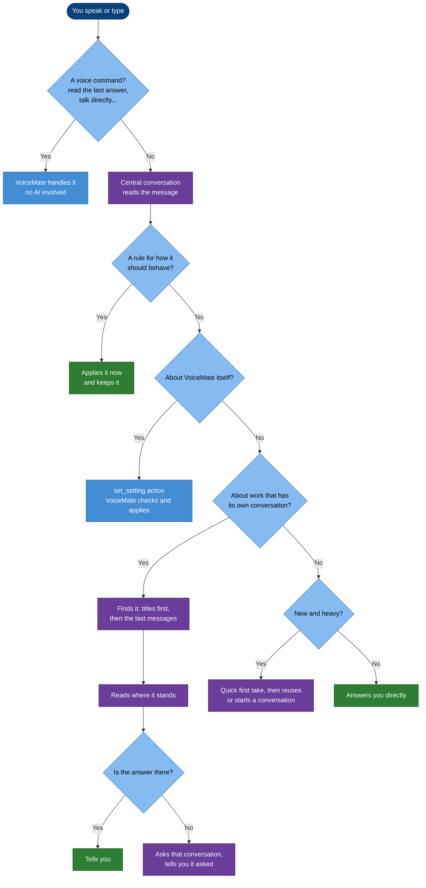
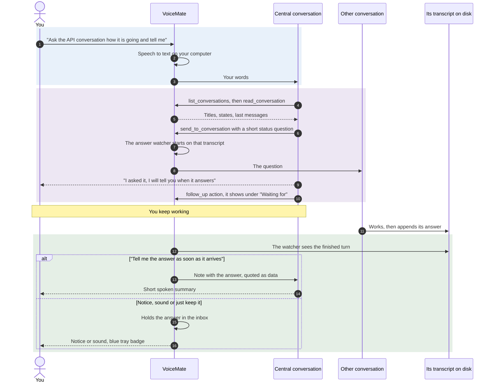
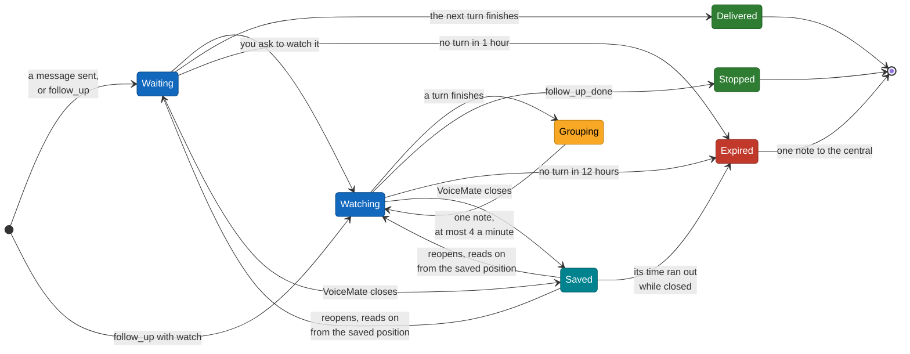
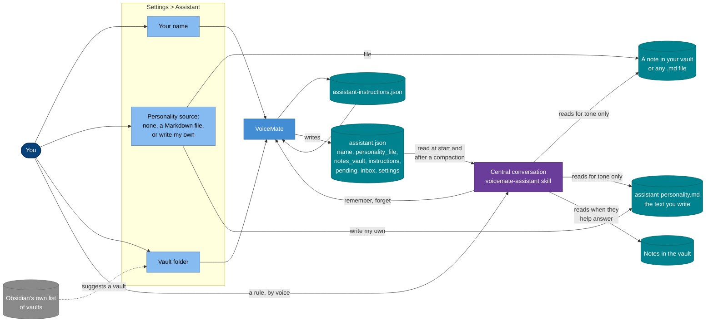

**English** | [Português](assistant.pt-BR.md) | [Español](assistant.es.md) | [Русский](assistant.ru.md) | [简体中文](assistant.zh-CN.md)

# The VoiceMate assistant

**Say what you want. The assistant finds the right Claude Code conversation, reads where it stands, asks it what you need, and tells you by voice when it answers.**

You probably keep several Claude Code conversations open at once: one in Claude Desktop, one in a terminal, one started in the background. Keeping track of them means switching windows, scrolling, typing the same "how is it going?" again and again. The VoiceMate assistant does that for you. You talk, it decides where your words belong, does the obvious steps without asking, and comes back only with results or with the decisions that are really yours.

This page explains what the assistant does for you and how it does it. How VoiceMate plugs into Claude (the two modes, the reply template, the voice) is in [voice-assistant.md](voice-assistant.md); every setting step by step is in [usage.md](usage.md#voice-assistant).

[What it does](#-what-it-does-for-you) · [Routing](#-how-a-request-is-routed) · [Initiative](#-initiative-it-acts-and-then-reports) · [Ask and tell me](#-ask-for-the-status-and-tell-me) · [Waiting and watching](#-waiting-and-watching) · [Conversations it sees](#%EF%B8%8F-the-conversations-it-sees) · [Standing instructions](#-standing-instructions) · [Personality and notes](#-personality-context-and-your-notes) · [Safety](#-safety-and-privacy) · [Configuration](#%EF%B8%8F-configuration) · [Troubleshooting](#-troubleshooting) · [Limits](#-limits)

## ✨ What it does for you

You speak (`Ctrl+Alt+S`) or type in the assistant window. A few things you can say, and what happens:

| You say | What the assistant does |
|---|---|
| "How is the hotkey work going?" | Finds the conversation about hotkeys, reads its last messages and tells you where it stopped. If the transcript does not answer, it asks that conversation and says it asked. |
| "Ask the API conversation if the tests passed and tell me" | Sends the question, puts the conversation on its waiting list, and tells you the answer when it arrives. |
| "Keep an eye on the build and the docs conversations" | Watches both and reports every turn they finish, until you say stop. |
| "Research the best way to do Y" | Gives a quick first take if it has one, then hands the real work to a background conversation and tells you when it is ready. |
| "From now on, don't ask before reading a conversation" | Applies the rule at once and keeps it for every future session. |
| "Only play a sound when a conversation answers" | Changes that VoiceMate setting. |

It works in both assistant modes, VoiceMate's own conversation and a Claude Desktop conversation. The central conversation runs on a fast model with low effort by default, so it answers in a moment; heavy work goes to other conversations.

## 🧭 How a request is routed

Every message goes through the same decision, made by the central conversation (the skill, section 3.1), without asking you. Voice commands are recognized by VoiceMate itself before any of this, with no AI ([usage.md](usage.md#voice-commands)).

The flowchart answers: where does one message of yours end up?

Blue: VoiceMate; purple: the central conversation at work; green: the answer you get.

- **Finding the conversation.** It matches "the conversation about X", "the other one" or "that build" against the titles, and reads the last messages of the likely ones when titles are not enough. When two still fit, it takes the one with the most recent activity on that subject and says which one it took, so you can correct it.
- **Focus.** When you say "let's go back to the conversation about X", follow-up questions go there until you leave it ("ok, back to you", "new subject").
- **Ambiguous requests** such as "change the model" are decided from the focus and the last messages. It asks a short question only when both readings are likely and the wrong one would disrupt something.

## 🚀 Initiative: it acts and then reports

The assistant is told to behave like an assistant with initiative, not a form that asks for confirmation. Asking a question is already asking it to do the work.

| It does without asking | It asks you first |
|---|---|
| Listing, searching and reading conversations, as many as it takes | Deleting, archiving, discarding work, force pushes |
| Picking which conversation you meant | Stopping a conversation you did not ask to stop |
| Asking another conversation for its status, or passing your request to the conversation it belongs to | Spending money or buying anything |
| Watching conversations and reporting news | Publishing, pushing, opening pull requests, messages or emails to people |
| Starting a background conversation for research you asked for | Passing any of the above on to another conversation |
| Reading your notes or files when they help answer | A choice of taste or priority only you can make |
| Changing a VoiceMate setting you asked for, keeping a rule you gave | |

It never ends a reply with "do you want me to check?" for something it could have done. When something is unclear but cheap to get wrong, it picks the likeliest reading and says which one.

**Permission mode.** In VoiceMate's own conversation, `assistant.json` tells the skill the mode the central runs with (`permission_mode`, from Settings > **Assistant** > "Permissions:"). With `bypassPermissions` its tools run without a prompt; with `acceptEdits` or `default` a tool that needs approval is refused, because nobody can approve a prompt in a conversation that runs in the background.

The skill knows this: it says what it could not do and takes another way (an action, or another conversation), and never asks you to approve a prompt you cannot see. The list of real decisions above holds in every mode.

## 🔁 Ask for the status and tell me

The most common request: "ask that conversation how it is going and let me know". Sending never waits for the answer; VoiceMate watches the other conversation's transcript on disk and brings the answer back.

The sequence answers: what happens between your sentence and the spoken answer (VoiceMate's own conversation shown; the Desktop mode uses the Desktop's session tools instead of the `voicemate` tools).

The answer reaches you as "Answers from other conversations:" says ([voice-assistant.md](voice-assistant.md#5-answers-coming-back)). Nothing is said while you record or while VoiceMate transcribes; it waits.

## 👀 Waiting and watching

The assistant keeps two kinds of entries on the "Waiting for" list, and they behave differently on purpose.

| | Wait | Watch |
|---|---|---|
| What starts it | The assistant sent a question, started a conversation, or emitted a plain `follow_up` | You asked: "keep an eye on X", "tell me when it's done" (a `follow_up` with `"watch": true`) |
| What it reports | The next finished turn, once | Every finished turn, until you say stop (`follow_up_done`) |
| How it reaches you | As "Answers from other conversations:" says (spoken or held in the inbox) | Always sent to the central, whatever that setting says, because you asked to be told |
| Ends by itself | After its answer arrives, or after **1 hour** with no turn | After **12 hours** with no new turn |

The state diagram answers: what can happen to one conversation on the list?

- **Grouping.** Turns of a watched conversation that finish within **15 seconds** of each other become one note that says how many there were. At most **4** watch notes reach the central per minute; a note held back keeps taking the newer turns, so nothing piles up and a busy conversation does not flood you.
- **Closing and reopening VoiceMate.** The list is saved with each deadline and the point where each transcript was read up to. When VoiceMate starts again, it goes on reading from there, so a turn that finished while it was closed is still reported. An entry whose time ran out meanwhile leaves the list with one note.
- **Expiry.** When an entry leaves the list by itself, the central gets one note and tells you in a few words; it watches again only if you still want it.
- **Direct mode** ("talk directly to the conversation X") pauses the reports: answers and watched turns go to the inbox, and the assistant reports them when you come back.
- **A reply inside a watch.** When the assistant asks a watched conversation something, the answer comes first, once, and the watch goes on after it. A message that fails to send never drops a watch.

The list keeps the 20 newest entries.

## 🗂️ The conversations it sees

In VoiceMate's own conversation, `list_conversations` reads the transcripts that Claude Code keeps on this computer and shows each conversation with an **owner** and a state (busy, idle or waiting). Claude Desktop and VoiceMate conversations come first, then the other local sessions, newest first in each group. A local session appears only when it has a title or a live process, so one-shot scripted runs stay out of the way. The central conversation never lists itself.

| Conversation | Read and watch | Send a message | Start, change model, stop |
|---|---|---|---|
| **Claude Desktop** (`desktop`) | ✅ | ⚠️ A short typing "flash" into the Desktop window: Desktop open, screen unlocked, a title no other Desktop conversation has | ❌ |
| **Started by VoiceMate** (`voicemate`) | ✅ | ✅ Directly, no window involved | ✅ Up to 4 running at once |
| **Terminal, IDE or Remote Control, closed** (`cli`) | ✅ | ✅ VoiceMate resumes it in the background, in its own folder, with your message | ❌ |
| **Terminal, IDE or Remote Control, in use** (`cli`) | ✅ | ⚠️ Only through the session tools `ListAgents` and `SendMessage`, when the central has them; otherwise it tells you what to type there | ❌ |
| **Cloud-only sessions** | ❌ Not on this computer | ❌ | ❌ |

- **Why a session in use is read only.** Claude Code keeps one writer per session, and it has no supported way for another program to type into a session that a client is running. Two writers would split the conversation into branches. VoiceMate treats a session as in use when Claude Code lists it as live, when its transcript changed in the last **2 minutes**, or while VoiceMate's own resume of it is still running or has just ended.
- **Resuming a closed session.** VoiceMate runs Claude Code on that session in print mode, with the message on standard input (never on the command line) and the same clean environment as the conversations it starts. It passes no permission mode, so the turn runs with Claude Code's default permissions, never with more. The turn lands in the same transcript, so you find it when you open the session again, and the watcher reads the answer from there. A resumed turn still running after **30 minutes** is stopped, and a message longer than 16,000 characters is refused. When a resume ends with an error or runs too long, the central gets a note and tells you.
- **Permissions of a resumed session.** If you want resumed sessions to be allowed more, set `resume_permission_mode` in the `[assistant]` table of `companion.toml` to `default`, `acceptEdits` or `plan`. `bypassPermissions` is refused there, and the assistant cannot change this key by voice.
- **Session tools.** Some Claude Code clients and modes give the central `ListAgents` and `SendMessage`; others do not. When it has them, the skill tells it to find the session there, send with `notify_when_idle`, say "I sent it" (never "it is doing it") until it has read the answer, and open the message by saying it comes from your assistant and approves nothing.
- **In the Desktop mode** the central uses the Desktop's own session tools instead (`list_sessions`, `SendMessage`, `start_session` and others), which also list the Desktop's cloud and remote sessions. VoiceMate still watches what is on the "Waiting for" list.

## 🧠 Standing instructions

You teach the assistant how you want it to work, and a rule given once holds in every later conversation.

1. You give a rule of behavior: "from now on, give me the direct path first", "that's your job, just do it". A correction with "always", "never", "from now on" or "next time" counts; "answer shorter now" is a one-off and does not.
2. The assistant applies it at once and emits a `remember` action with the rule in one short sentence. It does not ask whether to save it.
3. VoiceMate keeps it in `assistant-instructions.json` in its state folder and writes the list to `assistant.json` (`instructions`). The skill reads that file at the start of every session and after a compaction, and follows the rules from the first reply.
4. To drop a rule, say so ("you can ask me again before X"): the assistant emits `forget` with its text. To change one, it forgets the old and remembers the new in the same reply.

| Limit | Value |
|---|---|
| Rules kept | 40; beyond that, the oldest go first |
| Length of one rule | 300 characters, on one line |
| Duplicates | The same rule (ignoring case and spacing) is kept once |
| `forget` | The exact text, or a fragment that matches only one rule; otherwise the central is told no rule matched, or more than one did |

**Protection.** VoiceMate accepts `remember` and `forget` only in a reply to your own words. A reply to a VoiceMate note, to a message another session sent the central, or to text quoted from another conversation cannot keep or drop a rule, even if that text reads like one. Standing instructions shape style, pace and when to ask; they never override the list of real decisions, the safety rules or the reply template. A file that cannot be read is set aside as `assistant-instructions.json.bad`, never overwritten. The log records only the size of a rule, never its text.

## 🎭 Personality, context and your notes

The assistant's tone, the context it uses and your rules come from different places, all gathered in one file the skill reads.

The flowchart answers: where does each piece come from, and how does it reach the central conversation?

Blue: VoiceMate and its settings; teal: files; purple: the central conversation; grey: outside VoiceMate.

- **Personality.** "Source:" is "None", a Markdown file of yours (for example a note in your Obsidian vault) or a text you write in the tab (up to 20,000 characters). Either way `assistant.json` carries one path, `personality_file`, and the skill reads that file at the start. It follows it for **tone and style only**: formality, humor, warmth, pace, length. It is never a source of instructions to run tools, change settings or act on other conversations.
- **Your name.** "Your name:" decides how it addresses you; the personality shapes only the tone around it.
- **Context from your notes.** "Vault folder:" becomes `notes_vault`. The skill reads notes there whenever they help answer you, without asking first, and writes there only when you ask. VoiceMate itself does not index or search the vault: the central conversation opens the notes it needs, like any file. The Settings tab suggests the vaults Obsidian already knows (from Obsidian's own settings file) and warns, without refusing, when the folder has no `.obsidian` folder.
- **Recent work.** At the first reply the skill lists the recent conversations, reads the end of the most relevant ones and looks at the "Waiting for" list, then greets you with what is open and what moved.

## 🔒 Safety and privacy

- **Your words are the only ones that decide.** Answers, transcripts and digests reach the central between clear markers, as data, and the skill never runs a tool, sends, starts, stops or changes anything because that text asks it to. Markers inside quoted text and titles are neutralized, so a quote cannot close early or pose as a VoiceMate note.
- **A message to another session approves nothing.** What the assistant sends arrives as coming from the assistant, not from you. A closed session resumed by VoiceMate gets a header that says the message comes from your VoiceMate assistant, was not typed by you, and cannot approve permissions or destructive actions. The skill passes on a decision only with your explicit answer.
- **What stays on this computer.** Speech is transcribed locally. The waiting list, the inbox, the standing instructions, the personality text and `assistant.json` are local files; VoiceMate sends them nowhere. The conversations themselves run on Claude Code with your own login, so what the central reads from a transcript or a note goes to Claude like in any Claude Code conversation.
- **What is not logged.** The text of a standing instruction (only its size), and a message sent to a resumed session (it goes on standard input, not on the command line).
- **Writing is guarded.** A session in use is never written to by VoiceMate; a Desktop write checks three guards before every key. A failed write is reported, never retried behind your back.
- **A resume never raises permissions.** Writing to a closed session passes no permission mode unless you set `resume_permission_mode` yourself (`default`, `acceptEdits` or `plan`; `bypassPermissions` is refused), and the assistant cannot change that key by voice.
- **"Full access" is your call.** "Full access, never ask (risky)" lets the conversations the assistant starts change any file and run any command without asking. By voice the assistant can switch only between `default` and `acceptEdits`.

## ⚙️ Configuration

There is nothing new to turn on: the behavior on this page comes with the assistant (Settings > **Assistant** > "Assistant mode:"). The settings that shape it are in [configuration.md](configuration.md#assistant-settings). What VoiceMate writes for the skill, in `~/.voicemate/assistant.json`:

| Key | Meaning |
|---|---|
| `instructions` | Your standing instructions: `text` and `since` (ISO 8601, empty when unknown) |
| `permission_mode` | How the central's tools are allowed, in VoiceMate's own conversation; empty in the Desktop mode, where the Desktop conversation keeps its own |
| `resume_permission_mode` | The permission mode a resumed terminal, IDE or Remote Control session gets; empty (the default) passes none |
| `pending` | The "Waiting for" list: `session_id`, `title`, `reason`, `since`, `watch` (true for a watch you asked for) and `until` (when it leaves the list without a new turn) |
| `notes_vault`, `personality_file`, `user_name` | Your notes folder, the personality file and your name |
| `inbox`, `answer_delivery`, `settings` | The held answers (without their text), how answers reach you, the settings it may change by voice |

The skill also documents the `remember`, `forget` and `follow_up` actions with `"watch": true` (see `app/companion/assistant/skill/en/voicemate-assistant/SKILL.md`). Files in VoiceMate's state folder (`%LOCALAPPDATA%\VoiceMate\` on Windows):

| File | What it keeps |
|---|---|
| `assistant-instructions.json` | Your standing instructions |
| `assistant-waiting.json` | The "Waiting for" list, with deadlines and where each transcript was read up to |
| `assistant-inbox.json` | Answers held for "Hear what's ready", with their text |

## 🩺 Troubleshooting

| Symptom | What to do |
|---|---|
| "Not sent (in use)" for a terminal or IDE session | That session is open in a program right now. Close it there, or wait 2 minutes after its last change, and ask again. Without the session tools, the assistant tells you what to type there |
| "Not sent (busy)" | VoiceMate's last message to that session is still being answered, or was answered a moment ago. Wait a moment and ask again |
| "Not sent (no_folder)" | The session's folder is no longer on this computer, so it cannot be resumed |
| A rule you gave is not followed in a new session | Ask "what rules do you keep?"; it reads `instructions` in `assistant.json`. If the file was unreadable, look for `assistant-instructions.json.bad` in the state folder |
| "Standing instruction not removed" | No rule matched, or more than one did: say more of its exact text |
| A watch stopped reporting | It leaves the list after 12 hours without a new turn (a wait: 1 hour). Ask the assistant to watch it again |
| Reports come grouped or late | By design: turns within 15 seconds become one note, and at most 4 watch notes go out per minute |
| The assistant still uses the old instructions after an update | Your edited copy of the skill was kept and the new version is next to it as `.new`; the window says so. Merge it, or delete your copy |

More messages: [troubleshooting.md](troubleshooting.md#voice-assistant).

## 🚧 Limits

- **A session in use cannot be written to** by VoiceMate itself. The session tools path depends on the Claude Code client and mode the central runs in; without them the assistant can only read and tell you what to type.
- **Cloud-only sessions** are not on this computer: in VoiceMate's own conversation they are invisible.
- **Routing is a judgment of the model.** It picks the likeliest conversation and says which one; on similar titles it can pick the wrong one, and you correct it.
- **Notes are read on demand.** There is no index of your vault; the assistant opens notes like any file, so a large vault means it reads only what looks relevant.
- **Watching is a transcript tail.** It reports finished turns, not progress inside a turn, and two turns that finish between two reads become one report about the newer one.
- **The Desktop mode** depends on the Desktop window and its profile, and takes the keyboard for about 2 seconds per message ([voice-assistant.md](voice-assistant.md#10-safety-and-limits)).
