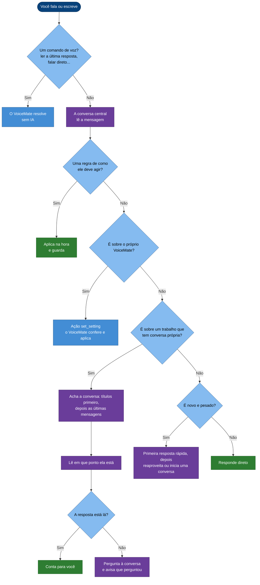
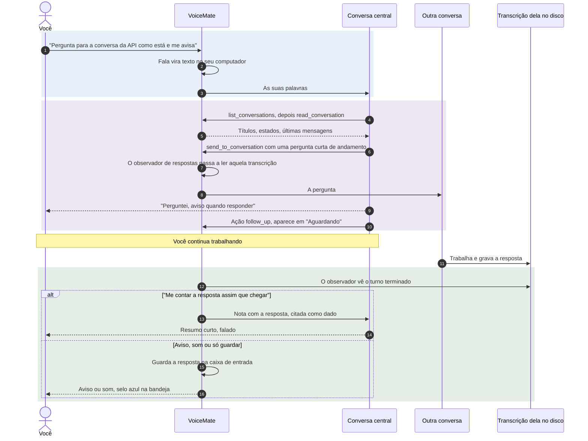
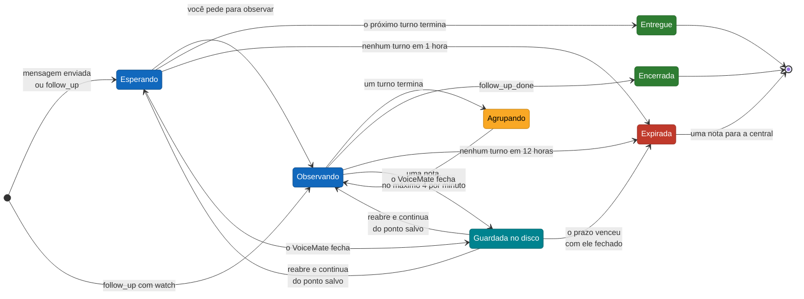
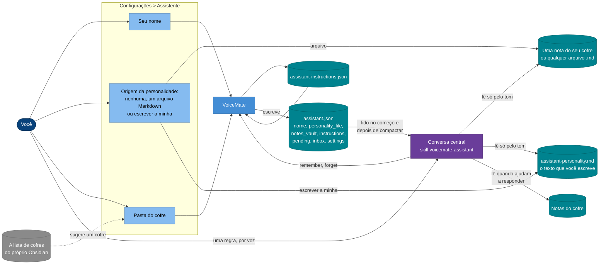

[English](assistant.md) | **Português** | [Español](assistant.es.md) | [Русский](assistant.ru.md) | [简体中文](assistant.zh-CN.md)

# O assistente do VoiceMate

**Fale o que você quer. O assistente acha a conversa certa do Claude Code, lê em que ponto ela está, pergunta o que você precisa e avisa por voz quando ela responde.**

Você provavelmente mantém várias conversas do Claude Code abertas ao mesmo tempo: uma no Claude Desktop, uma no terminal, uma rodando em segundo plano. Acompanhar todas significa trocar de janela, rolar a tela e digitar o mesmo "e aí, como está?" de novo e de novo. O assistente do VoiceMate faz isso por você. Você fala, ele decide para onde as suas palavras vão, faz os passos óbvios sem perguntar e volta só com resultados ou com as decisões que são mesmo suas.

Esta página explica o que o assistente faz por você e como ele faz. Como o VoiceMate se liga ao Claude (os dois modos, o modelo de resposta, a voz) está em [voice-assistant.md](voice-assistant.md) (em inglês); cada configuração passo a passo está em [usage.md](usage.md#voice-assistant) (em inglês).

[O que ele faz](#-o-que-ele-faz-por-você) · [Encaminhamento](#-como-um-pedido-é-encaminhado) · [Iniciativa](#-iniciativa-ele-age-e-depois-conta) · [Pergunte e me avise](#-pergunte-o-andamento-e-me-avise) · [Esperar e observar](#-esperar-e-observar) · [Conversas que ele enxerga](#%EF%B8%8F-as-conversas-que-ele-enxerga) · [Instruções permanentes](#-instruções-permanentes) · [Personalidade e notas](#-personalidade-contexto-e-as-suas-notas) · [Segurança](#-segurança-e-privacidade) · [Configuração](#%EF%B8%8F-configuração) · [Problemas comuns](#-problemas-comuns) · [Limites](#-limites)

## ✨ O que ele faz por você

Você fala (`Ctrl+Alt+S`) ou escreve na janela do assistente. Algumas coisas que você pode dizer, e o que acontece:

| Você diz | O que o assistente faz |
|---|---|
| "Como está o trabalho do atalho de teclado?" | Acha a conversa sobre atalhos, lê as últimas mensagens e conta onde ela parou. Se a conversa não responde isso, ele pergunta a ela e diz que perguntou. |
| "Pergunta para a conversa da API se os testes passaram e me avisa" | Manda a pergunta, coloca a conversa na lista de espera e conta a resposta quando ela chegar. |
| "Fica de olho nas conversas do build e da documentação" | Observa as duas e avisa a cada turno que elas terminam, até você mandar parar. |
| "Pesquisa o melhor jeito de fazer Y" | Adianta o que já sabe, se souber algo útil, passa o trabalho de verdade para uma conversa em segundo plano e avisa quando estiver pronto. |
| "Daqui para a frente, não pergunta antes de ler uma conversa" | Aplica a regra na hora e guarda para todas as próximas sessões. |
| "Só toca um som quando uma conversa responder" | Muda essa configuração do VoiceMate. |

Funciona nos dois modos do assistente, a conversa própria do VoiceMate e uma conversa do Claude Desktop. A conversa central roda por padrão num modelo rápido com esforço baixo, então responde em instantes; o trabalho pesado vai para outras conversas.

## 🧭 Como um pedido é encaminhado

Toda mensagem passa pela mesma decisão, tomada pela conversa central (a skill, seção 3.1), sem perguntar a você. Os comandos de voz são reconhecidos pelo próprio VoiceMate antes disso, sem IA ([usage.md](usage.md#voice-commands), em inglês).

O fluxograma responde: para onde vai uma mensagem sua?

Azul: VoiceMate; roxo: a conversa central trabalhando; verde: a resposta que chega a você.

- **Achar a conversa.** Ele compara "a conversa sobre X", "a outra" ou "aquele build" com os títulos e, quando os títulos não bastam, lê as últimas mensagens das prováveis. Se duas ainda servem, fica com a de atividade mais recente naquele assunto e diz qual escolheu, para você corrigir se for o caso.
- **Foco.** Quando você diz "vamos voltar para a conversa sobre X", as perguntas seguintes vão para lá até você sair ("ok, voltando para você", "novo assunto").
- **Pedidos ambíguos**, como "troca o modelo", são decididos pelo foco e pelas últimas mensagens. Ele faz uma pergunta curta só quando as duas leituras são prováveis e a errada atrapalharia alguma coisa.

## 🚀 Iniciativa: ele age e depois conta

O assistente é orientado a se comportar como um assistente com iniciativa, não como um formulário que pede confirmação. Fazer a pergunta já é pedir que ele faça o trabalho.

| Ele faz sem perguntar | Ele pergunta antes |
|---|---|
| Listar, procurar e ler conversas, quantas forem precisas | Apagar, arquivar, descartar trabalho, push forçado |
| Escolher de qual conversa você está falando | Parar uma conversa que você não mandou parar |
| Perguntar o andamento a outra conversa, ou levar o seu pedido para a conversa a que ele pertence | Gastar dinheiro ou comprar qualquer coisa |
| Observar conversas e avisar novidades | Publicar, fazer push, abrir pull request, mandar mensagem ou e-mail para pessoas |
| Iniciar uma conversa em segundo plano para uma pesquisa que você pediu | Repassar qualquer item acima para outra conversa |
| Ler as suas notas ou arquivos quando ajudam a responder | Uma escolha de gosto ou prioridade que só você pode fazer |
| Mudar uma configuração do VoiceMate que você pediu, guardar uma regra que você deu | |

Ele nunca termina a resposta com "quer que eu confira?" para algo que podia simplesmente ter feito. Quando algo está pouco claro mas é barato de errar, ele escolhe a leitura mais provável e diz qual foi.

**Modo de permissão.** Na conversa própria do VoiceMate, o `assistant.json` diz à skill o modo em que a central roda (`permission_mode`, vindo de Configurações > **Assistente** > "Permissões:"). Com `bypassPermissions` as ferramentas dela rodam sem pedir aprovação; com `acceptEdits` ou `default`, uma ferramenta que precisa de aprovação é recusada, porque ninguém pode aprovar nada numa conversa que roda em segundo plano.

A skill sabe disso: diz o que não conseguiu fazer e segue por outro caminho (uma ação, ou outra conversa), e nunca pede para você aprovar algo que você não está vendo. A lista de decisões de verdade acima vale em todos os modos.

## 🔁 Pergunte o andamento e me avise

O pedido mais comum: "pergunta para aquela conversa como está e me avisa". Enviar nunca espera a resposta; o VoiceMate observa no disco a transcrição da outra conversa e traz a resposta de volta.

A sequência responde: o que acontece entre a sua frase e a resposta falada (mostrando a conversa própria do VoiceMate; no modo Desktop entram as ferramentas de sessão do Desktop no lugar das ferramentas `voicemate`).

A resposta chega a você como "Respostas de outras conversas:" manda ([voice-assistant.md](voice-assistant.md#5-answers-coming-back), em inglês). Nada é falado enquanto você grava ou enquanto o VoiceMate transcreve; espera.

## 👀 Esperar e observar

O assistente guarda dois tipos de item na lista "Aguardando", e eles se comportam de forma diferente de propósito.

| | Espera | Observação |
|---|---|---|
| O que começa | O assistente mandou uma pergunta, iniciou uma conversa ou emitiu um `follow_up` simples | Você pediu: "fica de olho em X", "me avisa quando terminar" (um `follow_up` com `"watch": true`) |
| O que avisa | O próximo turno terminado, uma vez | Cada turno terminado, até você mandar parar (`follow_up_done`) |
| Como chega a você | Como "Respostas de outras conversas:" manda (falada ou guardada na caixa de entrada) | Sempre vai para a central, seja qual for essa configuração, porque você pediu para saber |
| Acaba sozinha | Quando a resposta chega, ou depois de **1 hora** sem turno | Depois de **12 horas** sem turno novo |

O diagrama de estados responde: o que pode acontecer com uma conversa da lista?

- **Agrupamento.** Turnos de uma conversa observada que terminam a até **15 segundos** um do outro viram uma nota só, que diz quantos foram. No máximo **4** notas de observação chegam à central por minuto; uma nota segurada continua pegando os turnos mais novos, então nada se acumula e uma conversa agitada não inunda você.
- **Fechar e reabrir o VoiceMate.** A lista é salva com o prazo de cada item e o ponto até onde cada transcrição foi lida. Quando o VoiceMate abre de novo, continua a leitura dali, então um turno que terminou com ele fechado ainda é avisado. Um item cujo prazo venceu nesse meio-tempo sai da lista com uma nota.
- **Expiração.** Quando um item sai da lista sozinho, a central recebe uma nota e conta em poucas palavras; ela volta a observar só se você ainda quiser.
- **Modo direto** ("falar direto com a conversa X") pausa os avisos: respostas e turnos observados vão para a caixa de entrada, e o assistente conta quando você volta.
- **Uma resposta dentro de uma observação.** Quando o assistente pergunta algo a uma conversa observada, a resposta vem primeiro, uma vez, e a observação continua depois. Um envio que falha nunca derruba uma observação.

A lista guarda os 20 itens mais recentes.

## 🗂️ As conversas que ele enxerga

Na conversa própria do VoiceMate, `list_conversations` lê as transcrições que o Claude Code guarda neste computador e mostra cada conversa com um **dono** e um estado (ocupada, parada ou esperando). As conversas do Claude Desktop e do VoiceMate vêm primeiro, depois as outras sessões locais, das mais recentes para as mais antigas em cada grupo. Uma sessão local aparece só quando tem título ou um processo vivo, então execuções avulsas de scripts ficam de fora. A conversa central nunca lista a si mesma.

| Conversa | Ler e observar | Mandar mensagem | Iniciar, trocar modelo, parar |
|---|---|---|---|
| **Claude Desktop** (`desktop`) | ✅ | ⚠️ Um "flash" rápido de digitação na janela do Desktop: Desktop aberto, tela desbloqueada, um título que nenhuma outra conversa do Desktop tem | ❌ |
| **Iniciada pelo VoiceMate** (`voicemate`) | ✅ | ✅ Direto, sem janela nenhuma | ✅ Até 4 rodando ao mesmo tempo |
| **Terminal, IDE ou Remote Control, fechada** (`cli`) | ✅ | ✅ O VoiceMate retoma a sessão em segundo plano, na pasta dela, com a sua mensagem | ❌ |
| **Terminal, IDE ou Remote Control, em uso** (`cli`) | ✅ | ⚠️ Só pelas ferramentas de sessão `ListAgents` e `SendMessage`, quando a central tem essas ferramentas; senão ele diz o que você deve digitar lá | ❌ |
| **Sessões que rodam só na nuvem** | ❌ Não estão neste computador | ❌ | ❌ |

- **Por que uma sessão em uso é só leitura.** O Claude Code mantém um escritor por sessão e não tem um jeito suportado de outro programa digitar numa sessão que um cliente está rodando. Dois escritores dividiriam a conversa em ramos. O VoiceMate considera uma sessão em uso quando o Claude Code a lista como viva, quando a transcrição mudou nos últimos **2 minutos**, ou enquanto a retomada feita pelo próprio VoiceMate ainda está rodando ou acabou de terminar.
- **Retomar uma sessão fechada.** O VoiceMate roda o Claude Code naquela sessão em modo de impressão, com a mensagem na entrada padrão (nunca na linha de comando) e o mesmo ambiente limpo das conversas que ele inicia. Ele não passa modo de permissão, então o turno roda com as permissões padrão do Claude Code, nunca com mais. O turno entra na mesma transcrição, então você o encontra quando abrir a sessão de novo, e o observador lê a resposta de lá. Um turno retomado que ainda roda depois de **30 minutos** é interrompido, e uma mensagem com mais de 16.000 caracteres é recusada. Quando uma retomada termina com erro ou passa do tempo, a central recebe um aviso e conta para você.
- **Permissões de uma sessão retomada.** Se você quiser liberar mais para as sessões retomadas, defina `resume_permission_mode` na tabela `[assistant]` do `companion.toml` como `default`, `acceptEdits` ou `plan`. `bypassPermissions` é recusado ali, e o assistente não muda essa chave por voz.
- **Ferramentas de sessão.** Alguns clientes e modos do Claude Code dão à central `ListAgents` e `SendMessage`; outros não. Quando ela tem essas ferramentas, a skill manda achar a sessão ali, enviar com `notify_when_idle`, dizer "mandei" (nunca "ela está fazendo") até ler a resposta, e abrir a mensagem dizendo que ela vem do seu assistente e não aprova nada.
- **No modo Desktop** a central usa as ferramentas de sessão do próprio Desktop (`list_sessions`, `SendMessage`, `start_session` e outras), que também listam as sessões na nuvem e remotas do Desktop. O VoiceMate continua observando o que está na lista "Aguardando".

## 🧠 Instruções permanentes

Você ensina ao assistente como quer que ele trabalhe, e uma regra dada uma vez vale em todas as conversas seguintes.

1. Você dá uma regra de comportamento: "daqui para a frente, me dá primeiro o caminho direto", "isso é trabalho seu, só faz". Uma correção com "sempre", "nunca", "daqui para a frente" ou "da próxima vez" conta; "responde mais curto agora" é pontual e não conta.
2. O assistente aplica na hora e emite uma ação `remember` com a regra numa frase curta. Ele não pergunta se deve guardar.
3. O VoiceMate guarda a regra em `assistant-instructions.json`, na pasta de estado dele, e escreve a lista no `assistant.json` (`instructions`). A skill lê esse arquivo no começo de toda sessão e depois de uma compactação, e segue as regras desde a primeira resposta.
4. Para tirar uma regra, é só dizer ("pode voltar a perguntar antes de X"): o assistente emite `forget` com o texto dela. Para mudar uma regra, ele esquece a antiga e guarda a nova na mesma resposta.

| Limite | Valor |
|---|---|
| Regras guardadas | 40; passando disso, as mais antigas saem primeiro |
| Tamanho de uma regra | 300 caracteres, numa linha |
| Repetidas | A mesma regra (sem contar maiúsculas e espaços) é guardada uma vez |
| `forget` | O texto exato, ou um trecho que só uma regra contém; senão a central fica sabendo que nenhuma regra bateu, ou que mais de uma bateu |

**Proteção.** O VoiceMate só aceita `remember` e `forget` numa resposta às suas próprias palavras. Uma resposta a uma nota do VoiceMate, a uma mensagem que outra sessão mandou para a central ou a um texto citado de outra conversa não guarda nem tira regra, mesmo que esse texto pareça uma regra.

As instruções permanentes moldam estilo, ritmo e quando perguntar; nunca passam por cima da lista de decisões de verdade, das regras de segurança nem do modelo de resposta. Um arquivo ilegível é posto de lado como `assistant-instructions.json.bad`, nunca sobrescrito. O log registra só o tamanho de uma regra, nunca o texto.

## 🎭 Personalidade, contexto e as suas notas

O tom do assistente, o contexto que ele usa e as suas regras vêm de lugares diferentes, todos reunidos num arquivo que a skill lê.

O fluxograma responde: de onde vem cada parte, e como ela chega à conversa central?

Azul: o VoiceMate e as configurações dele; verde-azulado: arquivos; roxo: a conversa central; cinza: fora do VoiceMate.

- **Personalidade.** "Origem:" é "Nenhuma", um arquivo Markdown seu (por exemplo, uma nota do seu cofre do Obsidian) ou um texto que você escreve na aba (até 20.000 caracteres). Nos dois casos o `assistant.json` leva um caminho só, `personality_file`, e a skill lê esse arquivo no começo. Ela segue o arquivo **só para tom e estilo**: formalidade, humor, calor, ritmo, tamanho. Ele nunca é fonte de instrução para rodar ferramenta, mudar configuração ou agir sobre outras conversas.
- **Seu nome.** "Seu nome:" decide como ele chama você; a personalidade só molda o tom em volta.
- **Contexto das suas notas.** "Pasta do cofre:" vira `notes_vault`. A skill lê notas de lá sempre que ajudam a responder, sem perguntar antes, e só escreve lá quando você pede. O próprio VoiceMate não indexa nem pesquisa o cofre: a conversa central abre as notas de que precisa, como qualquer arquivo. A aba de Configurações sugere os cofres que o Obsidian já conhece (do arquivo de configuração do próprio Obsidian) e avisa, sem recusar, quando a pasta não tem uma pasta `.obsidian`.
- **Trabalho recente.** Na primeira resposta, a skill lista as conversas recentes, lê o fim das mais relevantes e olha a lista "Aguardando", e então cumprimenta você contando o que está aberto e o que andou.

## 🔒 Segurança e privacidade

- **Só as suas palavras decidem.** Respostas, transcrições e resumos chegam à central entre marcadores claros, como dado, e a skill nunca roda ferramenta, envia, inicia, para ou muda nada porque esse texto pediu. Marcadores dentro de texto citado e de títulos são neutralizados, então uma citação não fecha antes da hora nem se passa por nota do VoiceMate.
- **Uma mensagem para outra sessão não aprova nada.** O que o assistente manda chega como vindo do assistente, não de você. Uma sessão fechada que o VoiceMate retoma recebe um cabeçalho dizendo que a mensagem vem do seu assistente do VoiceMate, não foi digitada por você e não pode aprovar permissões nem ações destrutivas. A skill só repassa uma decisão com a sua resposta explícita.
- **O que fica neste computador.** A fala é transcrita localmente. A lista de espera, a caixa de entrada, as instruções permanentes, o texto de personalidade e o `assistant.json` são arquivos locais; o VoiceMate não manda esses arquivos para lugar nenhum. As conversas em si rodam no Claude Code com o seu próprio login, então o que a central lê de uma transcrição ou de uma nota vai para o Claude como em qualquer conversa do Claude Code.
- **O que não vai para o log.** O texto de uma instrução permanente (só o tamanho dela) e a mensagem enviada a uma sessão retomada (ela vai pela entrada padrão, não pela linha de comando).
- **Escrever tem trava.** O VoiceMate nunca escreve numa sessão em uso; uma escrita no Desktop confere três travas antes de cada tecla. Uma escrita que falha é avisada, nunca repetida escondido.
- **Retomar nunca aumenta permissões.** Escrever numa sessão fechada não passa modo de permissão, a não ser que você defina `resume_permission_mode` (`default`, `acceptEdits` ou `plan`; `bypassPermissions` é recusado), e o assistente não muda essa chave por voz.
- **"Acesso total" é decisão sua.** "Acesso total, nunca perguntar (arriscado)" deixa as conversas que o assistente inicia alterar qualquer arquivo e rodar qualquer comando sem perguntar. Por voz o assistente só alterna entre `default` e `acceptEdits`.

## ⚙️ Configuração

Não há nada novo para ligar: o comportamento desta página vem com o assistente (Configurações > **Assistente** > "Modo do assistente:"). As configurações que o moldam estão em [configuration.md](configuration.md#assistant-settings) (em inglês). O que o VoiceMate escreve para a skill, em `~/.voicemate/assistant.json`:

| Chave | Significado |
|---|---|
| `instructions` | As suas instruções permanentes: `text` e `since` (ISO 8601, vazio quando não se sabe) |
| `permission_mode` | Como as ferramentas da central são liberadas, na conversa própria do VoiceMate; vazio no modo Desktop, onde a conversa do Desktop mantém o dela |
| `resume_permission_mode` | O modo de permissão que uma sessão de terminal, IDE ou Remote Control retomada recebe; vazio (o padrão) não passa nenhum |
| `pending` | A lista "Aguardando": `session_id`, `title`, `reason`, `since`, `watch` (verdadeiro numa observação que você pediu) e `until` (quando sai da lista sem turno novo) |
| `notes_vault`, `personality_file`, `user_name` | A pasta das suas notas, o arquivo de personalidade e o seu nome |
| `inbox`, `answer_delivery`, `settings` | As respostas guardadas (sem o texto), como as respostas chegam a você, as configurações que ele pode mudar por voz |

A skill também documenta as ações `remember`, `forget` e `follow_up` com `"watch": true` (veja `app/companion/assistant/skill/pt-BR/voicemate-assistant/SKILL.md`). Arquivos na pasta de estado do VoiceMate (`%LOCALAPPDATA%\VoiceMate\` no Windows):

| Arquivo | O que guarda |
|---|---|
| `assistant-instructions.json` | As suas instruções permanentes |
| `assistant-waiting.json` | A lista "Aguardando", com os prazos e o ponto até onde cada transcrição foi lida |
| `assistant-inbox.json` | As respostas guardadas para "Ouvir o que está pronto", com o texto |

## 🩺 Problemas comuns

| Sintoma | O que fazer |
|---|---|
| "Not sent (in use)" para uma sessão de terminal ou IDE | A sessão está aberta num programa agora. Feche lá, ou espere 2 minutos depois da última mudança, e peça de novo. Sem as ferramentas de sessão, o assistente diz o que você deve digitar lá |
| "Not sent (busy)" | A última mensagem do VoiceMate para aquela sessão ainda está sendo respondida, ou acabou de ser. Espere um pouco e peça de novo |
| "Not sent (no_folder)" | A pasta da sessão não está mais neste computador, então ela não pode ser retomada |
| Uma regra que você deu não vale numa sessão nova | Pergunte "quais regras você guarda?"; ele lê `instructions` no `assistant.json`. Se o arquivo estava ilegível, procure `assistant-instructions.json.bad` na pasta de estado |
| "Standing instruction not removed" | Nenhuma regra bateu, ou mais de uma bateu: diga mais do texto exato dela |
| Uma observação parou de avisar | Ela sai da lista depois de 12 horas sem turno novo (uma espera: 1 hora). Peça para o assistente observar de novo |
| Os avisos chegam agrupados ou atrasados | É de propósito: turnos a até 15 segundos um do outro viram uma nota, e saem no máximo 4 notas de observação por minuto |
| O assistente continua com as instruções antigas depois de uma atualização | A sua cópia editada da skill foi mantida, e a versão nova está ao lado dela como `.new`; a janela avisa. Junte as duas, ou apague a sua cópia |

Mais mensagens: [troubleshooting.md](troubleshooting.md#voice-assistant) (em inglês).

## 🚧 Limites

- **Uma sessão em uso não recebe escrita** do próprio VoiceMate. O caminho pelas ferramentas de sessão depende do cliente e do modo do Claude Code em que a central roda; sem elas, o assistente só lê e diz o que você deve digitar.
- **Sessões que rodam só na nuvem** não estão neste computador: na conversa própria do VoiceMate, ele não as enxerga.
- **O encaminhamento é um julgamento do modelo.** Ele escolhe a conversa mais provável e diz qual; com títulos parecidos pode escolher errado, e você corrige.
- **As notas são lidas sob demanda.** Não existe índice do seu cofre; o assistente abre notas como qualquer arquivo, então num cofre grande ele lê só o que parece relevante.
- **Observar é acompanhar a transcrição.** Ele avisa turnos terminados, não o progresso dentro de um turno, e dois turnos que terminam entre duas leituras viram um aviso só, sobre o mais novo.
- **O modo Desktop** depende da janela do Desktop e do perfil dela, e toma o teclado por cerca de 2 segundos a cada mensagem ([voice-assistant.md](voice-assistant.md#10-safety-and-limits), em inglês).
