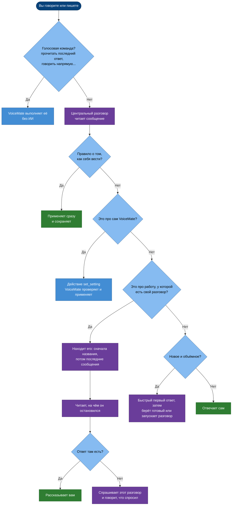
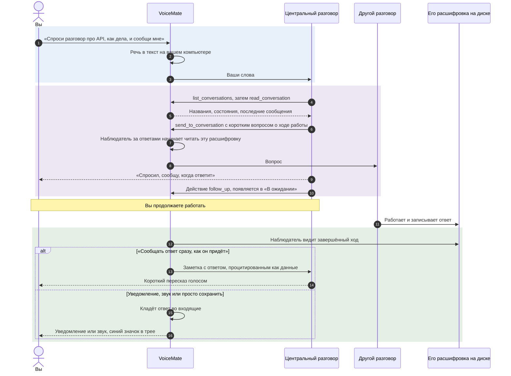
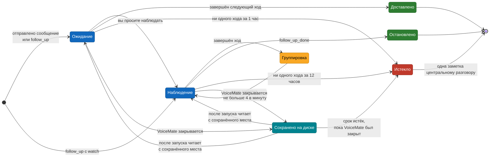
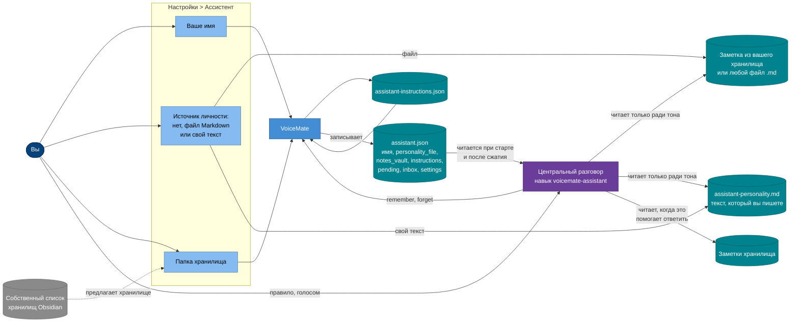

[English](assistant.md) | [Português](assistant.pt-BR.md) | [Español](assistant.es.md) | **Русский** | [简体中文](assistant.zh-CN.md)

# Ассистент VoiceMate

**Скажите, что вам нужно. Ассистент найдёт нужный разговор Claude Code, прочитает, на чём он остановился, спросит у него то, что вам нужно, и голосом сообщит, когда тот ответит.**

Скорее всего, у вас одновременно открыто несколько разговоров Claude Code: один в Claude Desktop, другой в терминале, третий работает в фоне. Чтобы следить за всеми, приходится переключать окна, листать и снова и снова печатать «ну как там?». Ассистент VoiceMate делает это за вас. Вы говорите, он решает, куда относятся ваши слова, сам выполняет очевидные шаги и возвращается только с результатами или с решениями, которые действительно за вами.

Эта страница объясняет, что ассистент делает для вас и как. Как VoiceMate подключается к Claude (два режима, шаблон ответа, голос), описано в [voice-assistant.md](voice-assistant.md) (на английском); каждая настройка по шагам есть в [usage.md](usage.md#voice-assistant) (на английском).

[Что он делает](#-что-он-делает-для-вас) · [Маршрутизация](#-куда-попадает-запрос) · [Инициатива](#-инициатива-сначала-делает-потом-рассказывает) · [Спроси и сообщи](#-спроси-как-дела-и-сообщи-мне) · [Ожидание и наблюдение](#-ожидание-и-наблюдение) · [Какие разговоры он видит](#%EF%B8%8F-какие-разговоры-он-видит) · [Постоянные инструкции](#-постоянные-инструкции) · [Личность и заметки](#-личность-контекст-и-ваши-заметки) · [Безопасность](#-безопасность-и-конфиденциальность) · [Конфигурация](#%EF%B8%8F-конфигурация) · [Решение проблем](#-решение-проблем) · [Ограничения](#-ограничения)

## ✨ Что он делает для вас

Вы говорите (`Ctrl+Alt+S`) или пишете в окне ассистента. Вот что можно сказать и что произойдёт:

| Вы говорите | Что делает ассистент |
|---|---|
| «Как продвигается работа над горячими клавишами?» | Находит разговор про горячие клавиши, читает последние сообщения и рассказывает, где он остановился. Если там нет ответа, спрашивает сам разговор и говорит, что спросил. |
| «Спроси разговор про API, прошли ли тесты, и сообщи мне» | Отправляет вопрос, ставит разговор в список ожидания и пересказывает ответ, когда тот придёт. |
| «Присматривай за разговорами про сборку и про документацию» | Наблюдает за обоими и сообщает о каждом завершённом ходе, пока вы не скажете «хватит». |
| «Найди лучшую библиотеку глобальных горячих клавиш для Windows» | Сразу говорит то, что уже знает (если знает что-то полезное), передаёт настоящую работу фоновому разговору и сообщает, когда всё готово. |
| «Впредь не спрашивай, прежде чем читать разговор» | Сразу применяет правило и сохраняет его для всех будущих сессий. |
| «Когда разговор отвечает, только проигрывай звук» | Меняет эту настройку VoiceMate. |

Через несколько минут его голосом: *«Сборка закончилась, тесты прошли. Осталась только документация.»*

Это работает в обоих режимах ассистента: в собственном разговоре VoiceMate и в разговоре Claude Desktop. Центральный разговор по умолчанию работает на быстрой модели с низким усилием, поэтому отвечает почти сразу; тяжёлая работа уходит в другие разговоры.

## 🧭 Куда попадает запрос

Каждое сообщение проходит через одно и то же решение, которое центральный разговор принимает сам, не спрашивая вас (навык, раздел 3.1). Голосовые команды VoiceMate распознаёт ещё раньше, без ИИ ([usage.md](usage.md#voice-commands), на английском).

Блок-схема отвечает на вопрос: куда попадает одно ваше сообщение?

Синий: VoiceMate; фиолетовый: центральный разговор за работой; зелёный: ответ, который вы получаете.

- **Поиск разговора.** Он сопоставляет «разговор про X», «тот другой» или «ту сборку» с названиями, а если названий мало, читает последние сообщения вероятных кандидатов. Если подходят два, берёт тот, где по этой теме была самая свежая активность, и говорит, какой выбрал, чтобы вы могли поправить.
- **Фокус.** Когда вы говорите «вернёмся к разговору про X», следующие вопросы идут туда, пока вы из него не выйдете («ладно, снова с тобой», «новая тема»).
- **Неоднозначные просьбы** вроде «смени модель» решаются по фокусу и последним сообщениям. Короткий вопрос он задаёт, только если оба толкования вероятны и неверное что-то нарушит.

## 🚀 Инициатива: сначала делает, потом рассказывает

Ассистенту предписано вести себя как помощник с инициативой, а не как анкета, которая просит подтверждений. Задать вопрос уже значит попросить его сделать работу.

| Делает, не спрашивая | Сначала спрашивает вас |
|---|---|
| Перечислять, искать и читать разговоры, сколько потребуется | Удаление, архивирование, отказ от сделанной работы, принудительный push |
| Определять, о каком разговоре речь | Остановку разговора, которую вы не просили |
| Спрашивать другой разговор, как дела, или передавать вашу просьбу тому разговору, к которому она относится | Траты денег и любые покупки |
| Наблюдать за разговорами и сообщать новости | Публикацию, push, открытие pull request, сообщения и письма людям |
| Запускать фоновый разговор для исследования, о котором вы просили | Передачу чего-либо из этого списка другому разговору |
| Читать ваши заметки или файлы, когда они помогают ответить | Выбор по вкусу или приоритету, который можете сделать только вы |
| Менять настройку VoiceMate, о которой вы попросили, сохранять ваше правило | |

Он никогда не заканчивает ответ фразой «хотите, я проверю?» про то, что мог просто сделать. Если что-то неясно, но ошибка стоит дёшево, он выбирает самое вероятное толкование и говорит, какое.

**Режим разрешений.** В собственном разговоре VoiceMate файл `assistant.json` сообщает навыку режим, в котором работает центральный разговор (`permission_mode`, из Настройки > **Ассистент** > «Разрешения:»). С `bypassPermissions` его инструменты работают без запроса подтверждения; с `acceptEdits` или `default` инструмент, которому нужно подтверждение, получает отказ, потому что в разговоре, работающем в фоне, подтвердить некому.

Навык это знает: он говорит, чего не смог сделать, и идёт другим путём (действие или другой разговор), и никогда не просит вас подтвердить то, чего вы не видите. Список настоящих решений выше действует в любом режиме.

## 🔁 Спроси, как дела, и сообщи мне

Самая частая просьба: «спроси у того разговора, как дела, и сообщи мне». Отправка никогда не ждёт ответа; VoiceMate следит за расшифровкой другого разговора на диске и приносит ответ, когда он появится.

Диаграмма последовательности отвечает на вопрос: что происходит между вашей фразой и озвученным ответом (показан собственный разговор VoiceMate; в режиме Desktop вместо инструментов `voicemate` работают инструменты сессий Desktop).

Ответ доходит до вас так, как задано в «Ответы из других разговоров:» ([voice-assistant.md](voice-assistant.md#5-answers-coming-back), на английском). Пока вы записываете или VoiceMate расшифровывает речь, ничего не произносится: всё ждёт.

## 👀 Ожидание и наблюдение

В списке «В ожидании» ассистент держит записи двух видов, и ведут они себя по-разному намеренно.

| | Ожидание | Наблюдение |
|---|---|---|
| С чего начинается | Ассистент отправил вопрос, запустил разговор или выдал простой `follow_up` | Вы попросили: «присматривай за X», «скажи, когда закончит» (`follow_up` с `"watch": true`) |
| О чём сообщает | О следующем завершённом ходе, один раз | О каждом завершённом ходе, пока вы не скажете «хватит» (`follow_up_done`) |
| Как доходит до вас | Как задано в «Ответы из других разговоров:» (голосом или во входящие) | Всегда уходит в центральный разговор, независимо от этой настройки, потому что вы сами попросили сообщать |
| Заканчивается само | Когда пришёл ответ или через **1 час** без хода | Через **12 часов** без нового хода |

Диаграмма состояний отвечает на вопрос: что может произойти с разговором из списка?

- **Группировка.** Ходы наблюдаемого разговора, завершённые в течение **15 секунд** после первого, превращаются в одну заметку с их числом. В минуту центральный разговор получает не больше **4** заметок наблюдения; придержанная заметка продолжает подхватывать более новые ходы, так что ничего не копится и активный разговор вас не заваливает.
- **Закрытие и повторный запуск VoiceMate.** Список сохраняется вместе со сроком каждой записи и местом, до которого прочитана каждая расшифровка. При следующем запуске VoiceMate продолжает чтение оттуда, поэтому о ходе, завершённом, пока он был закрыт, вы всё равно узнаете. Запись, срок которой за это время истёк, уходит из списка с одной заметкой.
- **Истечение срока.** Когда запись уходит из списка сама, центральный разговор получает одну заметку и коротко говорит вам об этом; снова наблюдать он начнёт, только если вы этого ещё хотите.
- **Прямой режим** («говорить напрямую с разговором X») приостанавливает сообщения: ответы и наблюдаемые ходы уходят во входящие, и ассистент рассказывает о них, когда вы вернётесь.
- **Ответ внутри наблюдения.** Когда ассистент спрашивает что-то у наблюдаемого разговора, сначала один раз приходит ответ, а затем наблюдение продолжается. Неудачная отправка никогда не отменяет наблюдение.

Список хранит 20 самых новых записей.

## 🗂️ Какие разговоры он видит

В собственном разговоре VoiceMate инструмент `list_conversations` читает расшифровки, которые Claude Code хранит на этом компьютере, и показывает каждый разговор с **владельцем** и состоянием (занят, свободен или ждёт). Сначала идут разговоры Claude Desktop и VoiceMate, затем остальные локальные сессии, в каждой группе от новых к старым. Локальная сессия попадает в список, только если у неё есть название или живой процесс, поэтому разовые запуски из скриптов не мешают. Центральный разговор никогда не показывает сам себя.

| Разговор | Читать и наблюдать | Отправить сообщение | Запустить, сменить модель, остановить |
|---|---|---|---|
| **Claude Desktop** (`desktop`) | ✅ | ⚠️ Короткая «вспышка» ввода в окно Desktop: Desktop открыт, экран разблокирован, название не совпадает ни с одним другим разговором Desktop | ❌ |
| **Запущен VoiceMate** (`voicemate`) | ✅ | ✅ Напрямую, без всяких окон | ✅ До 4 одновременно |
| **Терминал, IDE или Remote Control, закрыт** (`cli`) | ✅ | ✅ VoiceMate возобновляет сессию в фоне, в её собственной папке, с вашим сообщением | ❌ |
| **Терминал, IDE или Remote Control, используется** (`cli`) | ✅ | ⚠️ Только через инструменты сессий `ListAgents` и `SendMessage`, если они есть у центрального разговора; иначе он подскажет, что там напечатать | ❌ |
| **Сессии, работающие только в облаке** | ❌ Их нет на этом компьютере | ❌ | ❌ |

- **Почему используемая сессия доступна только для чтения.** Claude Code допускает одного пишущего на сессию и не даёт поддерживаемого способа другой программе печатать в сессию, которую сейчас ведёт клиент. Два пишущих разбили бы разговор на ветки. VoiceMate считает сессию используемой, если Claude Code показывает её как живую, если её расшифровка менялась за последние **2 минуты** или пока её возобновление самим VoiceMate ещё идёт или только что закончилось.
- **Возобновление закрытой сессии.** VoiceMate запускает Claude Code на этой сессии в режиме печати: сообщение подаётся через стандартный ввод (никогда в командной строке), окружение такое же чистое, как у разговоров, которые он запускает. Режим разрешений не передаётся, поэтому ход идёт со стандартными разрешениями Claude Code и никогда с большими. Ход попадает в ту же расшифровку, так что вы увидите его, когда снова откроете сессию, а наблюдатель прочитает ответ оттуда. Возобновлённый ход, который идёт дольше **30 минут**, останавливается, а сообщение длиннее 16 000 символов отклоняется. Если возобновление завершилось ошибкой или заняло слишком много времени, центральный разговор получает уведомление и сообщает вам.
- **Разрешения возобновлённой сессии.** Если вы хотите разрешить возобновлённым сессиям больше, задайте `resume_permission_mode` в таблице `[assistant]` файла `companion.toml`: `default`, `acceptEdits` или `plan`. `bypassPermissions` там отклоняется, а голосом ассистент этот ключ изменить не может.
- **Инструменты сессий.** Некоторые клиенты и режимы Claude Code дают центральному разговору `ListAgents` и `SendMessage`, другие нет. Если они есть, навык велит найти там сессию, отправить с `notify_when_idle`, говорить «я отправил» (а не «он это делает»), пока ответ не прочитан, и начинать сообщение с того, что оно от вашего ассистента и ничего не одобряет.
- **В режиме Desktop** центральный разговор пользуется собственными инструментами сессий Desktop (`list_sessions`, `SendMessage`, `start_session` и другими), которые показывают и облачные, и удалённые сессии Desktop. VoiceMate по-прежнему следит за тем, что есть в списке «В ожидании».

## 🧠 Постоянные инструкции

Вы учите ассистента, как с вами работать, и правило, данное один раз, действует во всех следующих разговорах.

1. Вы даёте правило поведения: «впредь сначала давай прямой путь», «это твоя работа, просто делай». Считается поправка со словами «всегда», «никогда», «впредь» или «в следующий раз»; «ответь сейчас покороче» разовая просьба и не считается.
2. Ассистент сразу применяет правило и выдаёт действие `remember` с правилом в одной короткой фразе. Он не спрашивает, сохранять ли его.
3. VoiceMate хранит правило в `assistant-instructions.json` в своей папке состояния и записывает список в `assistant.json` (`instructions`). Навык читает этот файл в начале каждой сессии и после сжатия контекста и следует правилам с первого ответа.
4. Чтобы убрать правило, просто скажите об этом («можешь снова спрашивать перед X»): ассистент выдаст `forget` с его текстом. Чтобы изменить правило, он в том же ответе забудет старое и запомнит новое.

| Ограничение | Значение |
|---|---|
| Сколько правил хранится | 40; сверх этого первыми уходят самые старые |
| Длина одного правила | 300 символов, в одну строку |
| Повторы | Одно и то же правило (без учёта регистра и пробелов) хранится один раз |
| `forget` | Точный текст или фрагмент, который есть только в одном правиле; иначе центральный разговор узнаёт, что не подошло ни одно или подошло больше одного |

**Защита.** VoiceMate принимает `remember` и `forget` только в ответе на ваши собственные слова. Ответ на заметку VoiceMate, на сообщение, которое другая сессия прислала центральному разговору, или на текст, процитированный из другого разговора, не может ни сохранить, ни убрать правило, даже если этот текст на правило похож.

Постоянные инструкции задают стиль, темп и то, когда спрашивать; они никогда не перекрывают список настоящих решений, правила безопасности и шаблон ответа. Нечитаемый файл откладывается как `assistant-instructions.json.bad` и никогда не перезаписывается. В журнал попадает только длина правила, но не его текст.

## 🎭 Личность, контекст и ваши заметки

Тон ассистента, контекст, которым он пользуется, и ваши правила приходят из разных мест, а собираются в одном файле, который читает навык.

Блок-схема отвечает на вопрос: откуда берётся каждая часть и как она попадает в центральный разговор?

Синий: VoiceMate и его настройки; бирюзовый: файлы; фиолетовый: центральный разговор; серый: вне VoiceMate.

- **Личность.** В «Источник:» можно выбрать отсутствие личности, ваш файл Markdown (например, заметку из вашего хранилища Obsidian) или текст, который вы пишете прямо на вкладке (до 20 000 символов). В любом случае в `assistant.json` попадает один путь, `personality_file`, и навык читает этот файл при старте. Он следует ему **только в тоне и стиле**: формальность, юмор, теплота, темп, длина. Это никогда не источник указаний запускать инструменты, менять настройки или что-то делать с другими разговорами.
- **Ваше имя.** «Ваше имя:» определяет, как он к вам обращается; личность лишь задаёт тон вокруг.
- **Контекст из ваших заметок.** «Папка хранилища:» становится `notes_vault`. Навык читает оттуда заметки всякий раз, когда они помогают вам ответить, не спрашивая заранее, а пишет туда только по вашей просьбе. Сам VoiceMate хранилище не индексирует и не ищет по нему: центральный разговор открывает нужные заметки как обычные файлы. Вкладка настроек предлагает хранилища, которые уже знает Obsidian (из его собственного файла настроек), и предупреждает, но не отказывает, если в папке нет папки `.obsidian`.
- **Недавняя работа.** В первом ответе навык перечисляет недавние разговоры, читает концовки самых важных и смотрит список «В ожидании», а затем здоровается и рассказывает, что открыто и что сдвинулось.

## 🔒 Безопасность и конфиденциальность

- **Решают только ваши слова.** Ответы, расшифровки и сводки приходят в центральный разговор между явными маркерами, как данные, и навык никогда не запускает инструмент, не отправляет, не запускает, не останавливает и не меняет ничего потому, что об этом просит такой текст. Маркеры внутри цитаты и в названиях обезвреживаются, так что цитата не может закрыться раньше времени или выдать себя за заметку VoiceMate.
- **Сообщение другой сессии ничего не одобряет.** То, что отправляет ассистент, приходит от ассистента, а не от вас. Закрытая сессия, которую возобновляет VoiceMate, получает заголовок: сообщение пришло от вашего ассистента VoiceMate, вы его не печатали, и оно не может одобрять разрешения или разрушительные действия. Навык передаёт решение дальше только с вашим явным ответом.
- **Что остаётся на этом компьютере.** Речь расшифровывается локально. Список ожидания, входящие, постоянные инструкции, текст личности и `assistant.json` это локальные файлы; VoiceMate никуда их не отправляет. Сами разговоры работают в Claude Code под вашим собственным входом, поэтому то, что центральный разговор читает из расшифровки или заметки, уходит в Claude, как в любом разговоре Claude Code.
- **Что не попадает в журнал.** Текст постоянной инструкции (только её длина) и сообщение, отправленное возобновлённой сессии (оно идёт через стандартный ввод, а не через командную строку).
- **Запись защищена.** VoiceMate никогда не пишет в используемую сессию; запись в Desktop проверяет три условия перед каждой клавишей. О неудачной записи вы узнаете, и тайком она не повторяется.
- **Возобновление никогда не повышает разрешения.** При записи в закрытую сессию режим разрешений не передаётся, если только вы сами не задали `resume_permission_mode` (`default`, `acceptEdits` или `plan`; `bypassPermissions` отклоняется), а голосом ассистент этот ключ изменить не может.
- **«Полный доступ» решаете вы.** «Полный доступ, никогда не спрашивать (рискованно)» позволяет разговорам, которые запускает ассистент, менять любые файлы и выполнять любые команды без вопросов. Голосом ассистент может переключаться только между `default` и `acceptEdits`.

## ⚙️ Конфигурация

Включать ничего нового не нужно: всё описанное здесь работает вместе с ассистентом (Настройки > **Ассистент** > «Режим ассистента:»). Настройки, которые на это влияют, описаны в [configuration.md](configuration.md#assistant-settings) (на английском). Что VoiceMate записывает для навыка в `~/.voicemate/assistant.json`:

| Ключ | Значение |
|---|---|
| `instructions` | Ваши постоянные инструкции: `text` и `since` (ISO 8601, пусто, если время неизвестно) |
| `permission_mode` | Как разрешены инструменты центрального разговора в собственном разговоре VoiceMate; пусто в режиме Desktop, где разговор Desktop сохраняет свой режим |
| `resume_permission_mode` | Режим разрешений, который получает возобновлённая сессия терминала, IDE или Remote Control; пусто (по умолчанию) значит, что режим не передаётся |
| `pending` | Список «В ожидании»: `session_id`, `title`, `reason`, `since`, `watch` (true для наблюдения, о котором вы просили) и `until` (когда запись уйдёт из списка без нового хода) |
| `notes_vault`, `personality_file`, `user_name` | Папка ваших заметок, файл личности и ваше имя |
| `inbox`, `answer_delivery`, `settings` | Сохранённые ответы (без текста), как до вас доходят ответы, настройки, которые он может менять голосом |

Навык также описывает действия `remember`, `forget` и `follow_up` с `"watch": true` (см. `app/companion/assistant/skill/en/voicemate-assistant/SKILL.md`). Файлы в папке состояния VoiceMate (`%LOCALAPPDATA%\VoiceMate\` в Windows):

| Файл | Что хранит |
|---|---|
| `assistant-instructions.json` | Ваши постоянные инструкции |
| `assistant-waiting.json` | Список «В ожидании» со сроками и местом, до которого прочитана каждая расшифровка |
| `assistant-inbox.json` | Ответы, отложенные для «Прослушать готовое», вместе с текстом |

## 🩺 Решение проблем

| Симптом | Что делать |
|---|---|
| Ассистент сообщает, что не смог отправить в сессию терминала или IDE, потому что она используется (центральный разговор получает `not sent (in use)`) | Эта сессия сейчас открыта в программе. Закройте её там или подождите 2 минуты после её последнего изменения и попросите снова. Без инструментов сессий ассистент подскажет, что там напечатать |
| Ассистент сообщает, что сессия занята (`not sent (busy)`) | На последнее сообщение VoiceMate этой сессии ещё отвечают или только что ответили. Подождите немного и попросите снова |
| Ассистент сообщает, что папки сессии больше нет (`not sent (no_folder)`) | Папки сессии больше нет на этом компьютере, поэтому её нельзя возобновить |
| Ваше правило не соблюдается в новой сессии | Спросите «какие правила ты хранишь?»; он прочитает `instructions` в `assistant.json`. Если файл был нечитаемым, найдите `assistant-instructions.json.bad` в папке состояния |
| «Standing instruction not removed» | Не подошло ни одно правило или подошло несколько: назовите больше точного текста |
| Наблюдение перестало присылать новости | Запись уходит из списка через 12 часов без нового хода (ожидание: через 1 час). Попросите ассистента снова понаблюдать |
| Новости приходят пачками или с задержкой | Так задумано: ходы, завершённые в течение 15 секунд после первого, объединяются в одну заметку, и в минуту уходит не больше 4 заметок наблюдения |
| После обновления ассистент работает по старым инструкциям | Ваша изменённая копия навыка сохранена, а новая версия лежит рядом как `.new`; окно об этом сообщает. Объедините их или удалите свою копию |

Другие сообщения: [troubleshooting.md](troubleshooting.md#voice-assistant) (на английском).

## 🚧 Ограничения

- **В используемую сессию сам VoiceMate не пишет.** Путь через инструменты сессий зависит от клиента и режима Claude Code, в которых работает центральный разговор; без них ассистент может только читать и подсказывать, что напечатать.
- **Сессии, работающие только в облаке,** не находятся на этом компьютере: в собственном разговоре VoiceMate он их не видит.
- **Маршрутизация это суждение модели.** Она выбирает самый вероятный разговор и называет его; при похожих названиях может ошибиться, и вы её поправите.
- **Заметки читаются по требованию.** Индекса вашего хранилища нет; ассистент открывает заметки как обычные файлы, поэтому в большом хранилище читает только то, что выглядит относящимся к делу.
- **Наблюдение это чтение хвоста расшифровки.** Оно сообщает о завершённых ходах, а не о прогрессе внутри хода, и два хода, завершённые между двумя чтениями, дают одно сообщение, о более новом.
- **Режим Desktop** зависит от окна Desktop и его профиля и занимает клавиатуру примерно на 2 секунды на каждое сообщение ([voice-assistant.md](voice-assistant.md#10-safety-and-limits), на английском).
