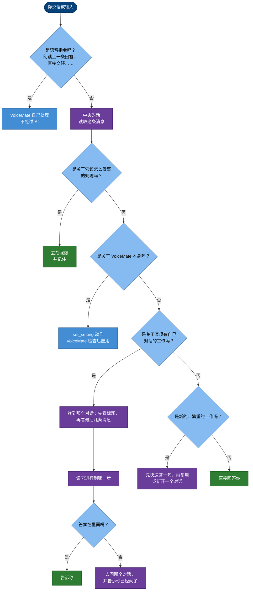
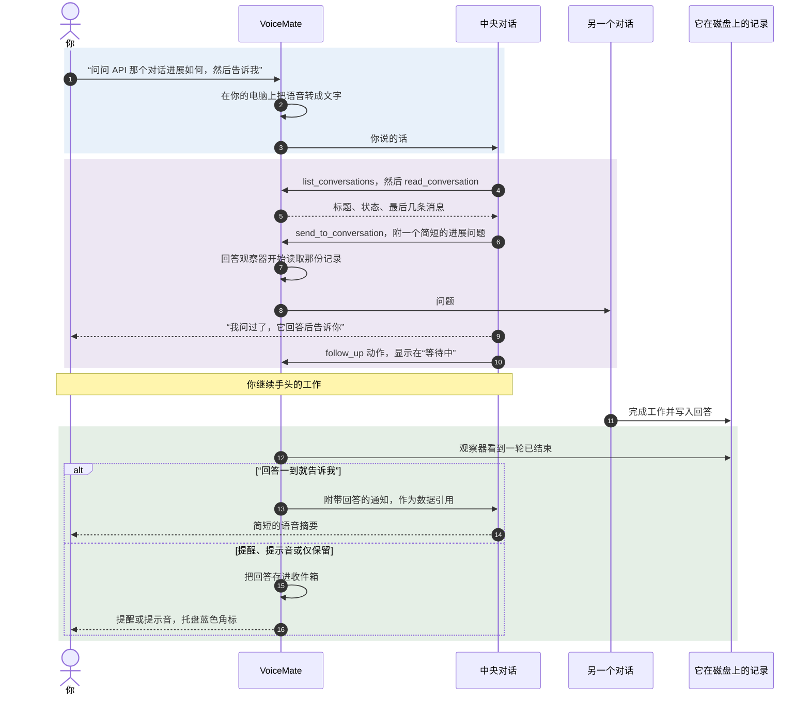
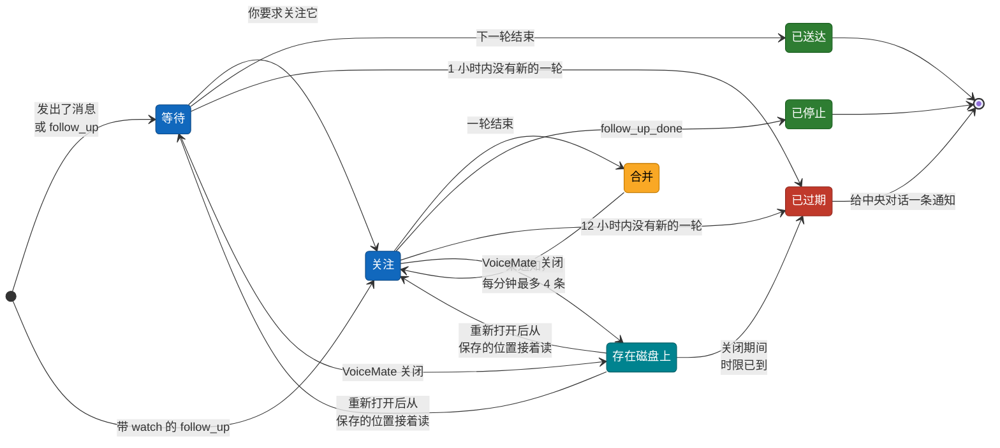
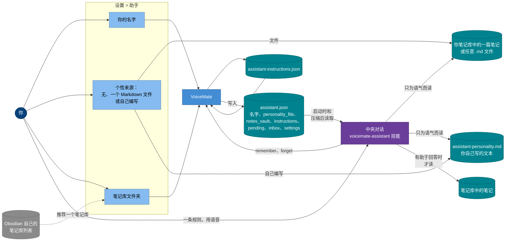

[English](assistant.md) | [Português](assistant.pt-BR.md) | [Español](assistant.es.md) | [Русский](assistant.ru.md) | **简体中文**

# VoiceMate 助手

**说出你想要的。助手会找到对应的 Claude Code 对话，读出它进行到哪一步，替你问它需要问的事，并在它回答时用语音告诉你。**

你很可能同时开着好几个 Claude Code 对话：一个在 Claude Desktop 里，一个在终端里，还有一个在后台运行。要跟上它们，就得来回切换窗口、翻看记录，一遍又一遍地输入“进展如何？”。VoiceMate 助手替你做这些事。你开口，它判断你的话该去哪里，不用问就把显而易见的步骤做完，回来时只带着结果，或者只带着真正需要你来做的决定。

本页说明助手能为你做什么，以及它是怎么做的。VoiceMate 如何接入 Claude（两种模式、回复模板、语音）见 [voice-assistant.md](voice-assistant.md)（英文）；每项设置的逐步说明见 [usage.md](usage.md#voice-assistant)（英文）。

[它能做什么](#-它能为你做什么) · [请求的去向](#-一条请求去往哪里) · [主动性](#-主动做事事后汇报) · [问进展并告诉我](#-问一下进展然后告诉我) · [等待与关注](#-等待与关注) · [它能看到的对话](#%EF%B8%8F-它能看到的对话) · [长期指令](#-长期指令) · [个性与笔记](#-个性上下文与你的笔记) · [安全](#-安全与隐私) · [配置](#%EF%B8%8F-配置) · [故障排查](#-故障排查) · [限制](#-限制)

## ✨ 它能为你做什么

你说话（`Ctrl+Alt+S`）或在助手窗口里输入文字。下面是一些可以说的话，以及会发生什么：

| 你说 | 助手会做什么 |
|---|---|
| “快捷键那件事进展怎么样？” | 找到关于快捷键的对话，读最后几条消息，告诉你它停在哪里。如果记录里没有答案，就去问那个对话，并告诉你已经问了。 |
| “问一下 API 那个对话测试过了没有，然后告诉我” | 发出问题，把这个对话放进等待列表，回答一到就告诉你。 |
| “帮我盯着构建和文档这两个对话” | 同时关注两个对话，它们每完成一轮都告诉你，直到你说停。 |
| “研究一下做 Y 的最好办法” | 如果已经知道一些有用的东西，先简单说说，然后把真正的工作交给一个后台对话，完成后告诉你。 |
| “以后读对话之前不用问我” | 立刻照做，并在以后的每次会话中都记住这条规则。 |
| “有对话回答时只播放提示音” | 修改 VoiceMate 的这项设置。 |

它在助手的两种模式下都能用：VoiceMate 自己的对话，以及一个 Claude Desktop 对话。中央对话默认使用快速模型和低投入度，所以回答很快；繁重的工作交给其他对话。

## 🧭 一条请求去往哪里

每条消息都经过同一套判断，由中央对话自己完成（技能第 3.1 节），不会问你。在此之前，语音指令由 VoiceMate 自己识别，不经过 AI（[usage.md](usage.md#voice-commands)，英文）。

这张流程图回答的是：你说的一句话最终去了哪里？

蓝色：VoiceMate；紫色：工作中的中央对话；绿色：你得到的回答。

- **找到对话。** 它把“关于 X 的那个对话”“另一个”“那个构建”与标题对照；标题不够用时，就读几个可能对话的最后几条消息。如果仍有两个都符合，就选在这个话题上最近有活动的那个，并告诉你选了哪个，方便你纠正。
- **焦点。** 当你说“回到关于 X 的那个对话”，接下来的追问都会发到那里，直到你离开（“好，回到你这儿”“换个话题”）。
- **含糊的请求**，比如“换个模型”，会根据焦点和最近几条消息来判断。只有当两种理解都说得通、而理解错会打乱某件事时，它才会简短地问一句。

## 🚀 主动做事，事后汇报

助手被要求像一个有主动性的助理那样做事，而不是一张不停要求确认的表单。你提出问题，本身就是在请它去做。

| 不问就做 | 会先问你 |
|---|---|
| 列出、搜索和阅读对话，需要多少读多少 | 删除、归档、丢弃工作成果、强制推送 |
| 判断你指的是哪个对话 | 停止一个你没让停的对话 |
| 向另一个对话询问进展，或把你的请求转给它所属的对话 | 花钱或购买任何东西 |
| 关注对话并告诉你新进展 | 发布、推送、开 pull request、给别人发消息或邮件 |
| 为你要求的研究启动一个后台对话 | 把上面任何一项转交给另一个对话 |
| 在有助于回答时阅读你的笔记或文件 | 只有你能做的、关于偏好或优先级的选择 |
| 修改你要求的 VoiceMate 设置，记住你给的规则 | |

它不会在回复末尾问“要我去看看吗？”，如果那件事它本可以直接做。事情不太清楚、但弄错代价很小时，它会选最可能的理解，并说明选了哪一种。

**权限模式。** 在 VoiceMate 自己的对话中，`assistant.json` 会告诉技能中央对话以什么模式运行（`permission_mode`，来自 设置 > **助手** > “权限：”）。在 `bypassPermissions` 下，它的工具无需确认即可运行；在 `acceptEdits` 或 `default` 下，需要确认的工具会被拒绝，因为在后台运行的对话里没有人能点确认。

技能知道这一点：它会说明哪件事没能做成，然后换一条路（一个动作，或另一个对话），绝不会让你去批准一个你看不到的提示。上面那份“真正的决定”清单在所有模式下都有效。

## 🔁 问一下进展，然后告诉我

最常见的请求是：“问问那个对话进展如何，然后告诉我”。发送从不等待回答；VoiceMate 在磁盘上关注另一个对话的记录，回答出现后再带回来。

这张时序图回答的是：从你说出这句话到听到语音回答，中间发生了什么（图中是 VoiceMate 自己的对话；在 Desktop 模式下，用的是 Desktop 的会话工具而不是 `voicemate` 工具）。

回答按照“其他对话的回答：”的设置送到你面前（[voice-assistant.md](voice-assistant.md#5-answers-coming-back)，英文）。你录音时或 VoiceMate 转写时，它什么都不会说，会先等着。

## 👀 等待与关注

助手在“等待中”列表里放两种条目，它们的行为有意设计得不同。

| | 等待 | 关注 |
|---|---|---|
| 怎么开始 | 助手发出了问题、启动了对话，或给出了普通的 `follow_up` | 你要求的：“帮我盯着 X”“完成了告诉我”（带 `"watch": true` 的 `follow_up`） |
| 报告什么 | 下一轮结束，只报一次 | 每一轮结束都报，直到你说停（`follow_up_done`） |
| 怎么送到你面前 | 按“其他对话的回答：”的设置（语音播报或存进收件箱） | 总是发给中央对话，不管那项设置是什么，因为是你要求被告知的 |
| 自动结束 | 回答到达后，或 **1 小时** 内没有新的一轮 | **12 小时** 内没有新的一轮 |

这张状态图回答的是：列表里的一个对话可能经历什么？

- **合并。** 被关注的对话中，相隔不到 **15 秒** 结束的几轮会合并成一条通知，并注明有几轮。中央对话每分钟最多收到 **4** 条关注通知；被暂缓的通知会继续吸收更新的轮次，所以不会堆积，忙碌的对话也不会把你淹没。
- **关闭再打开 VoiceMate。** 列表会连同每个条目的时限、以及每份记录读到的位置一起保存。VoiceMate 再次启动时从那里接着读，所以在它关闭期间结束的一轮仍会被报告。在此期间时限已到的条目会离开列表，并发出一条通知。
- **过期。** 条目自动离开列表时，中央对话会收到一条通知，并用几句话告诉你；只有你仍然需要时，它才会重新关注。
- **直接模式**（“直接和对话 X 交谈”）会暂停报告：回答和被关注对话的新一轮都进收件箱，等你回来时助手再告诉你。
- **关注中的一次提问。** 助手向被关注的对话提问时，回答会先单独送达一次，之后关注继续。发送失败绝不会取消关注。

列表保留最新的 20 个条目。

## 🗂️ 它能看到的对话

在 VoiceMate 自己的对话中，`list_conversations` 读取 Claude Code 保存在这台电脑上的记录，并为每个对话标出**归属**和状态（忙碌、空闲或等待中）。Claude Desktop 和 VoiceMate 的对话排在前面，其他本地会话排在后面，每组内按从新到旧排列。本地会话只有在有标题或有活着的进程时才会列出，所以脚本里一次性的运行不会混进来。中央对话从不列出自己。

| 对话 | 读取和关注 | 发送消息 | 启动、换模型、停止 |
|---|---|---|---|
| **Claude Desktop**（`desktop`） | ✅ | ⚠️ 向 Desktop 窗口短暂“闪现”输入：Desktop 已打开、屏幕未锁定、标题与其他 Desktop 对话都不同 | ❌ |
| **由 VoiceMate 启动**（`voicemate`） | ✅ | ✅ 直接发送，不涉及任何窗口 | ✅ 最多同时运行 4 个 |
| **终端、IDE 或 Remote Control，已关闭**（`cli`） | ✅ | ✅ VoiceMate 在后台、在它自己的文件夹里带着你的消息恢复这个会话 | ❌ |
| **终端、IDE 或 Remote Control，正在使用**（`cli`） | ✅ | ⚠️ 只能通过会话工具 `ListAgents` 和 `SendMessage`，前提是中央对话有这两个工具；否则它会告诉你在那里输入什么 | ❌ |
| **只在云端运行的会话** | ❌ 不在这台电脑上 | ❌ | ❌ |

- **为什么正在使用的会话只能读。** Claude Code 每个会话只允许一个写入者，也没有受支持的方式让另一个程序往客户端正在运行的会话里输入。两个写入者会让对话分叉。以下情况 VoiceMate 都视为正在使用：Claude Code 把它列为活动会话；它的记录在最近 **2 分钟** 内有变化；或者 VoiceMate 自己对它的恢复仍在运行。
- **恢复已关闭的会话。** VoiceMate 以打印模式在这个会话上运行 Claude Code：消息通过标准输入传入（绝不放在命令行上），权限模式取自“权限：”，环境和它启动的对话一样干净。这一轮会写进同一份记录，你下次打开这个会话时就能看到，观察器也从那里读取回答。恢复后运行超过 **30 分钟** 的一轮会被停止。
- **会话工具。** 有些 Claude Code 客户端和模式会给中央对话提供 `ListAgents` 和 `SendMessage`，有些不会。有这两个工具时，技能会让它在那里找到会话，用 `notify_when_idle` 发送，在读到回答之前只说“我发过去了”（而不是“它正在做”），并在消息开头说明这条消息来自你的助手，不代表任何批准。
- **在 Desktop 模式下**，中央对话使用 Desktop 自己的会话工具（`list_sessions`、`SendMessage`、`start_session` 等），这些工具也会列出 Desktop 的云端和远程会话。VoiceMate 仍会关注“等待中”列表里的条目。

## 🧠 长期指令

你可以教助手按你想要的方式做事，一条规则说一次，之后所有对话都有效。

1. 你给出一条行为规则：“以后先给我最直接的办法”“这是你的活，直接做”。带有“总是”“从不”“以后”“下次”的纠正算规则；“这次答短一点”是一次性的，不算。
2. 助手立刻照做，并发出一个 `remember` 动作，用一句简短的话写下这条规则。它不会问要不要保存。
3. VoiceMate 把规则存进其状态文件夹里的 `assistant-instructions.json`，并把列表写进 `assistant.json`（`instructions`）。技能在每次会话开始时和每次上下文压缩之后读取这个文件，从第一条回复起就遵守这些规则。
4. 想去掉一条规则，直接说就行（“X 之前你可以再问我了”）：助手会带着规则文本发出 `forget`。要修改一条规则，它会在同一条回复里忘掉旧的、记住新的。

| 限制 | 数值 |
|---|---|
| 保存的规则数 | 40 条；超过时最早的先被移除 |
| 单条规则长度 | 300 个字符，单行 |
| 重复 | 同一条规则（忽略大小写和空白）只保存一次 |
| `forget` | 完整文本，或只在一条规则中出现的片段；否则中央对话会得知没有匹配的规则，或匹配到不止一条 |

**保护。** VoiceMate 只在回应你本人话语的回复中接受 `remember` 和 `forget`。对 VoiceMate 通知的回复、对其他会话发给中央对话的消息的回复，或对从其他对话引用来的文本的回复，都不能保存或删除规则，即使那段文本看起来像一条规则。

长期指令影响风格、节奏和什么时候提问；它们绝不会凌驾于“真正的决定”清单、安全规则和回复模板之上。无法读取的文件会被改名为 `assistant-instructions.json.bad` 留存，绝不会被覆盖。日志只记录规则的长度，从不记录内容。

## 🎭 个性、上下文与你的笔记

助手的语气、它使用的上下文以及你的规则来自不同的地方，最终汇总在技能读取的同一个文件里。

这张流程图回答的是：每一部分从哪里来，又是怎么进入中央对话的？

蓝色：VoiceMate 及其设置；青色：文件；紫色：中央对话；灰色：VoiceMate 之外。

- **个性。** “来源：”可以是“无”、你自己的 Markdown 文件（例如 Obsidian 笔记库中的一篇笔记），或你直接在选项卡里写的文本（最多 20,000 个字符）。无论哪种，`assistant.json` 里都只有一个路径 `personality_file`，技能在启动时读取这个文件。它**只在语气和风格上**遵循该文件：正式程度、幽默、温度、节奏、长度。它绝不是运行工具、修改设置或操作其他对话的指令来源。
- **你的名字。** “你的名字：”决定它怎么称呼你；个性只影响称呼周围的语气。
- **来自笔记的上下文。** “笔记库文件夹：”会成为 `notes_vault`。只要笔记有助于回答你，技能就会去读，事先不问；只有在你要求时才会往里写。VoiceMate 本身不为笔记库建索引，也不在里面搜索：中央对话像打开普通文件一样打开它需要的笔记。设置选项卡会推荐 Obsidian 已经知道的笔记库（来自 Obsidian 自己的设置文件），如果文件夹里没有 `.obsidian` 文件夹，会给出提醒，但不会拒绝。
- **最近的工作。** 第一次回复时，技能会列出最近的对话，读最相关几个对话的结尾，看一眼“等待中”列表，然后跟你打招呼，告诉你哪些还开着、哪些有了进展。

## 🔒 安全与隐私

- **只有你说的话才算数。** 回答、记录和汇总都以数据的形式、夹在清晰的标记之间送到中央对话；技能绝不会因为这些文本的要求而运行工具、发送、启动、停止或修改任何东西。引用文本和标题中出现的标记会被中和，所以引用不会提前结束，也无法冒充 VoiceMate 的通知。
- **发给其他会话的消息不代表任何批准。** 助手发出的内容以助手的身份到达，而不是以你的身份。VoiceMate 恢复的已关闭会话会收到一段开头说明：这条消息来自你的 VoiceMate 助手，不是你亲手输入的，不能批准权限或破坏性操作。只有得到你明确的答复，技能才会转达一个决定。
- **留在这台电脑上的东西。** 语音在本地转写。等待列表、收件箱、长期指令、个性文本和 `assistant.json` 都是本地文件，VoiceMate 不会把它们发往任何地方。对话本身在 Claude Code 中用你自己的登录运行，因此中央对话从记录或笔记里读到的内容，会像任何 Claude Code 对话一样发送给 Claude。
- **不写进日志的东西。** 长期指令的内容（只记录长度），以及发给被恢复会话的消息（它通过标准输入传入，不在命令行上）。
- **写入有防护。** VoiceMate 绝不写入正在使用的会话；向 Desktop 写入时，每按一个键之前都会检查三项条件。写入失败会告诉你，绝不会在背后悄悄重试。
- **“完全访问”由你决定。** “完全访问，从不询问（有风险）”会让助手启动的对话以及它恢复的会话不经询问就修改任何文件、运行任何命令。通过语音，助手只能在 `default` 和 `acceptEdits` 之间切换。

## ⚙️ 配置

不需要开启任何新东西：本页描述的行为随助手一起提供（设置 > **助手** > “助手模式：”）。影响这些行为的设置见 [configuration.md](configuration.md#assistant-settings)（英文）。VoiceMate 为技能写入 `~/.voicemate/assistant.json` 的内容：

| 键 | 含义 |
|---|---|
| `instructions` | 你的长期指令：`text` 和 `since`（ISO 8601，时间未知时为空） |
| `permission_mode` | 在 VoiceMate 自己的对话中，中央对话的工具如何被允许；在 Desktop 模式下为空，Desktop 对话保留自己的设置 |
| `pending` | “等待中”列表：`session_id`、`title`、`reason`、`since`、`watch`（你要求的关注为 true）和 `until`（没有新一轮时何时离开列表） |
| `notes_vault`、`personality_file`、`user_name` | 你的笔记文件夹、个性文件和你的名字 |
| `inbox`、`answer_delivery`、`settings` | 保存的回答（不含正文）、回答如何送到你面前、它能用语音修改的设置 |

技能还说明了 `remember`、`forget` 以及带 `"watch": true` 的 `follow_up` 这几个动作（见 `app/companion/assistant/skill/en/voicemate-assistant/SKILL.md`）。VoiceMate 状态文件夹中的文件（Windows 上为 `%LOCALAPPDATA%\VoiceMate\`）：

| 文件 | 保存的内容 |
|---|---|
| `assistant-instructions.json` | 你的长期指令 |
| `assistant-waiting.json` | “等待中”列表，包括时限以及每份记录读到的位置 |
| `assistant-inbox.json` | 为“收听已就绪的内容”保存的回答，含正文 |

## 🩺 故障排查

| 现象 | 怎么办 |
|---|---|
| 终端或 IDE 会话显示“Not sent (in use)” | 这个会话此刻正在某个程序中打开。在那里关掉它，或者在它最后一次变化后等 2 分钟，再让助手试一次。没有会话工具时，助手会告诉你在那里输入什么 |
| “Not sent (no_folder)” | 这个会话的文件夹已经不在这台电脑上，所以无法恢复 |
| 你给的规则在新会话里没有生效 | 问它“你记着哪些规则？”；它会读取 `assistant.json` 里的 `instructions`。如果文件无法读取，到状态文件夹里找 `assistant-instructions.json.bad` |
| “Standing instruction not removed” | 没有匹配的规则，或匹配到不止一条：多说一点那条规则的原文 |
| 关注不再报告了 | 12 小时内没有新的一轮，条目就会离开列表（等待：1 小时）。请助手重新关注 |
| 报告被合并或有延迟 | 这是有意的设计：相隔 15 秒内的几轮合并成一条通知，每分钟最多发出 4 条关注通知 |
| 更新后助手仍在使用旧的指令 | 你修改过的技能副本被保留了，新版本放在旁边，名为 `.new`；窗口里会有提示。把两者合并，或删除你的副本 |

更多消息：[troubleshooting.md](troubleshooting.md#voice-assistant)（英文）。

## 🚧 限制

- **VoiceMate 自己无法写入正在使用的会话。** 通过会话工具的途径取决于中央对话所在的 Claude Code 客户端和模式；没有这些工具时，助手只能读取，并告诉你该输入什么。
- **只在云端运行的会话**不在这台电脑上：在 VoiceMate 自己的对话中看不到它们。
- **请求的去向是模型的判断。** 它会选最可能的对话并说出是哪个；标题相近时可能选错，由你来纠正。
- **笔记按需读取。** 没有笔记库索引；助手像打开普通文件一样打开笔记，所以在很大的笔记库里，它只读看起来相关的内容。
- **关注是在跟读记录的末尾。** 它报告已结束的轮次，而不是一轮之中的进度；在两次读取之间结束的两轮只会产生一条关于较新那一轮的报告。
- **Desktop 模式**依赖 Desktop 窗口及其配置文件，每条消息大约占用键盘 2 秒（[voice-assistant.md](voice-assistant.md#10-safety-and-limits)，英文）。
