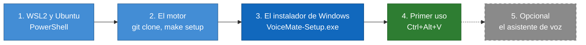
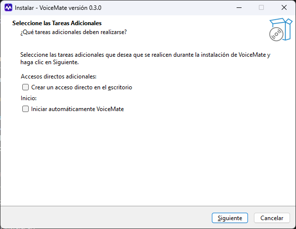
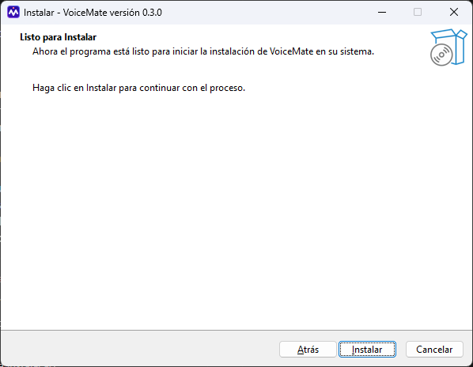
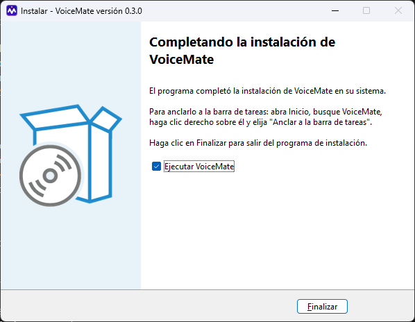
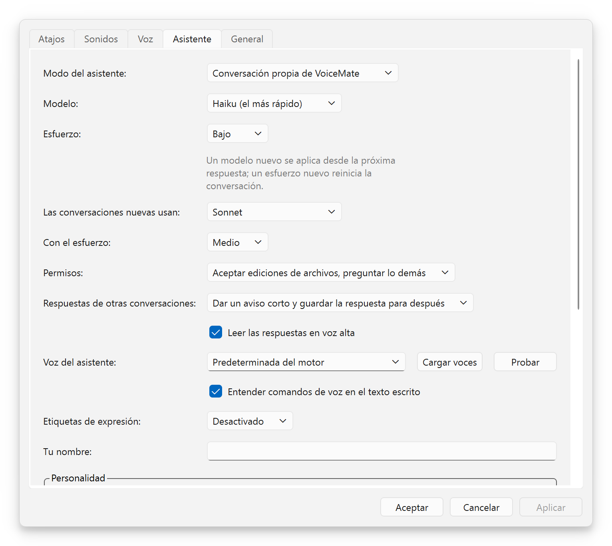

# Guía de instalación

[English](install-guide.md) | [Português](install-guide.pt-BR.md) | **Español** | [Русский](install-guide.ru.md) | [简体中文](install-guide.zh-CN.md)

Propósito: un recorrido paso a paso desde un PC con Windows limpio hasta tu primer dictado, con capturas del instalador. Aquí está cada comando y no se da nada por supuesto. La referencia técnica completa (todas las rutas, todas las opciones) es [installation.md](installation.md) (en inglés). Volver al [README](../README.es.md).

## 🎯 Qué vas a instalar

Escribí esta guía para quien quiere que VoiceMate funcione y no quiere leer toda la documentación. Son unos cuatro pasos, y lo más largo es la primera descarga del modelo de voz.

VoiceMate tiene dos piezas. El **motor** es la parte que escucha y convierte la voz en texto: funciona en tu propia computadora, dentro de un pequeño Linux que Windows ya sabe ejecutar (WSL2). El **companion** es la aplicación de Windows que ves: el icono de la bandeja, los atajos, la configuración y la ventana del asistente. El companion viene en un instalador; el motor viene de GitHub.



Azul: los pasos que instalan algo; verde: el momento en que funciona; línea discontinua: opcional.

## 📋 Requisitos

| Qué | Necesitas |
|---|---|
| Windows | Windows 10 versión 1809 o posterior, o Windows 11, de 64 bits |
| Un micrófono | Cualquier micrófono que Windows pueda usar |
| WSL2 con Ubuntu | Se instala en el paso 1 (Ubuntu 24.04 trae Python 3.12, que el motor necesita) |
| Una tarjeta gráfica | Opcional. Funcionan tarjetas NVIDIA y AMD; sin una, VoiceMate transcribe con el procesador |
| Internet, una vez | Para descargar Ubuntu, el motor y el modelo de voz Whisper (el modelo se descarga en el primer inicio) |
| Para el asistente de voz | Claude Code instalado y con la sesión iniciada (paso 5). El dictado no lo necesita |

No necesitas una cuenta de administrador para VoiceMate en sí. Instalar WSL2 en el paso 1 puede pedirla, según decida Windows.

## 🐧 Paso 1. WSL2 y Ubuntu

1. Abre **PowerShell** (Inicio, escribe PowerShell, ábrelo) y ejecuta:
   ```powershell
   wsl --install -d Ubuntu-24.04
   wsl --update
   ```
2. Reinicia Windows si lo pide. Luego abre **Ubuntu** desde el menú Inicio. La primera vez te pide un nombre de usuario y una contraseña: son solo para este Ubuntu.
3. Si ya tenías otra distro de WSL, haz que Ubuntu sea la predeterminada: `wsl --set-default Ubuntu-24.04` en PowerShell. O conserva la tuya y define "Distro de WSL:" en Configuración más adelante.
4. En la ventana de Ubuntu, instala las herramientas que necesita el motor:
   ```bash
   sudo apt update
   sudo apt install -y libportaudio2 libasound2-plugins pulseaudio-utils wl-clipboard git make curl python3-venv
   ```
5. Instala [Poetry](https://python-poetry.org/docs/#installation), la herramienta que prepara el entorno de Python del motor, y cierra y vuelve a abrir Ubuntu para que quede en el `PATH`:
   ```bash
   curl -sSL https://install.python-poetry.org | python3 -
   echo 'export PATH="$HOME/.local/bin:$PATH"' >> ~/.profile
   ```

> [!NOTE]
> VoiceMate inicia el motor mediante un *shell de login*, así que Poetry y `make` también deben encontrarse ahí. Si `poetry --version` funciona en una ventana nueva de Ubuntu, todo está listo.

Con una tarjeta gráfica AMD, instala también el controlador de AMD para Windows y ROCm dentro de WSL: los pasos están en [wsl2.md](wsl2.md#prerequisites) (en inglés). Se probó en una Radeon RX 9070 XT con ROCm 7.2.

## ⚙️ Paso 2. El motor

Aún en Ubuntu:

```bash
git clone https://github.com/nano-br/voice-mate.git ~/voice-mate
cd ~/voice-mate
make setup
make doctor
```

`make setup` es un instalador guiado. Encuentra tu tarjeta gráfica, instala las herramientas de reconocimiento de voz que le corresponden y hace unas preguntas:

| Pregunta | Qué responder |
|---|---|
| Tu tarjeta gráfica | Pulsa Intro para aceptar la detectada |
| "¿Qué flujo principal?" | `1` (clipboard): dictado, y es también todo lo que necesita el asistente de voz |
| Texto a voz (solo si eliges el flujo de Claude) | Sáltalo. El asistente habla con las voces de Windows sin ninguna configuración |

`make doctor` comprueba el micrófono, el audio, los atajos y la tarjeta gráfica. Cada línea debe mostrar una marca ✓; para cada problema imprime la solución.

El motor vive en `~/voice-mate`, que es el primer lugar donde lo busca el companion. Cualquier otro sitio también sirve: define "Carpeta del motor:" en Configuración. [La lista completa de carpetas](installation.md#2-install-the-engine).

<details>
<summary>Recomendado: descarga el modelo de voz ahora</summary>

El primer inicio descarga el modelo Whisper, y el companion le da al motor 240 segundos para iniciar antes de rendirse (tras 3 tiempos de espera agotados seguidos deja de intentarlo). Una conexión lenta puede tardar más. Por eso, ejecuta el motor una vez a mano:

```bash
cd ~/voice-mate
make run
```

Espera a que termine de cargar y detenlo con `Ctrl+C`. El siguiente inicio es rápido.

</details>

## 🪟 Paso 3. El instalador de Windows

1. Descarga `VoiceMate-Setup-x.y.z.exe` desde la [última versión](https://github.com/nano-br/voice-mate/releases/latest) y ábrelo.
2. El instalador no tiene firma de código, así que Windows SmartScreen puede avisarte. Elige **Más información** y luego **Ejecutar de todas formas**.
3. Sigue las páginas de abajo. Se instala solo para tu usuario, en `%LOCALAPPDATA%\Programs\VoiceMate`, sin pedir permisos de administrador.

### Página 1. El idioma

<p align="center"></p>

"Seleccione el Idioma de la Instalación": elige el idioma del instalador (inglés, portugués de Brasil, español, ruso o chino simplificado) y pulsa **Aceptar**. Este diálogo solo aparece cuando Windows está en un idioma que el instalador no tiene: se abre en inglés, con English seleccionado (por eso la captura está en inglés). Si tu Windows está en inglés, portugués, español, ruso o chino simplificado, no lo ves: el instalador se abre en ese idioma y va directo a las tareas adicionales (página 2).

### Página 2. Las tareas adicionales

<p align="center"></p>

"Seleccione las Tareas Adicionales" tiene dos casillas opcionales, ambas desmarcadas por defecto:

| Casilla | Qué hace |
|---|---|
| "Crear un acceso directo en el escritorio" (bajo "Accesos directos adicionales:") | Pone un icono de VoiceMate en el escritorio |
| "Iniciar automáticamente VoiceMate" (bajo "Inicio:") | Inicia VoiceMate cuando inicias sesión en Windows. Se ofrece solo en la primera instalación; después, Configuración tiene "Iniciar VoiceMate al iniciar sesión" |

Pulsa **Siguiente**.

### Página 3. Listo para instalar

<p align="center"></p>

"Listo para Instalar" dice "Ahora el programa está listo para iniciar la instalación de VoiceMate en su sistema." No hay carpeta que elegir, porque VoiceMate siempre se instala en `%LOCALAPPDATA%\Programs\VoiceMate`. Pulsa **Instalar** ("Haga clic en Instalar para continuar con el proceso."). Tarda unos segundos ("Instalando").

### Página 4. Finalizado

<p align="center"></p>

"Completando la instalación de VoiceMate" explica cómo anclar VoiceMate a la barra de tareas, porque Windows no permite que lo hagan los instaladores: abre Inicio, busca VoiceMate, haz clic derecho sobre él y elige **Anclar a la barra de tareas**. Deja marcada "Ejecutar VoiceMate" y pulsa **Finalizar**.

## 🚀 Paso 4. Primer uso

<p align="center"></p>

1. El icono de la bandeja muestra "Iniciando el motor..." mientras carga el modelo (de 10 a 60 segundos una vez descargado el modelo). Luego muestra "Esperando Ctrl+Alt+V".
2. Haz clic en cualquier cuadro de texto, presiona `Ctrl+Alt+V`, espera la señal de inicio, habla y vuelve a presionar `Ctrl+Alt+V`.
3. Tras la señal que avisa de que el texto está copiado, pégalo con `Ctrl+V`.

<p align="center"></p>

Haz clic derecho en el icono de la bandeja para ver el menú, y abre Configuración para cambiar los atajos, los sonidos, el idioma y el modo de transcripción (CPU o GPU). Si una notificación dice "No se encontró la carpeta del motor", define "Carpeta del motor:" en Configuración > **General** y VoiceMate lo intenta de nuevo.

## 🎙️ Paso 5. El asistente de voz (opcional)

El asistente es una conversación de Claude con la que hablas por voz, en el mismo Claude Code y Claude Desktop que ya usas. Necesita Claude Code en Windows y un inicio de sesión de Claude en este equipo:

1. Instala [Claude Code](https://docs.claude.com/en/docs/claude-code) y ejecuta `claude auth login` una vez en un terminal. El inicio de sesión de Claude Desktop no cuenta.
2. En la ventana de estado, pulsa **Asistente**, o abre Configuración > **Asistente** y elige "Modo del asistente:".
3. Presiona `Ctrl+Alt+S` y habla, y vuelve a presionarlo. O haz clic en **Hablar** en la ventana del asistente; pasa a **Detener y enviar** mientras graba.

<p align="center"></p>

**Su voz no necesita nada instalado.** Sin un motor de voz configurado, el asistente habla con las voces que Windows ya tiene, para cada idioma instalado en Configuración de Windows > Hora e idioma > Voz. En Configuración > **Asistente**, "Origen de la voz:" decide quién habla:

| "Origen de la voz:" | Quién habla |
|---|---|
| "Automática" (por defecto) | La voz del motor cuando puede hablar, las voces de Windows en caso contrario |
| "La voz del motor" | Solo el motor |
| "Las voces de Windows" | Solo las voces de Windows |

**Cargar voces** enumera las voces del origen que elegiste y **Probar** reproduce una frase corta. El asistente nunca habla encima de una grabación: espera mientras grabas y mientras se transcribe la grabación.

<p align="center"></p>

Todas las opciones del asistente: [voice-assistant.md](voice-assistant.md) (en inglés).

## 🔄 Actualizar

- **El companion:** ejecuta el nuevo `VoiceMate-Setup-x.y.z.exe`. Si VoiceMate está en ejecución, el instalador pregunta antes: "VoiceMate se está ejecutando. El instalador lo cerrará, junto con el motor que inició, antes de instalar. ¿Continuar?" Confirma y cierra VoiceMate junto con su motor, y luego instala. Tu configuración se conserva. La casilla "Iniciar automáticamente VoiceMate" no vuelve a aparecer: se ofrece solo en la primera instalación, y tu elección anterior se mantiene.
- **El motor:** en Ubuntu, `cd ~/voice-mate`, y luego `git pull` y `make setup` (tus respuestas anteriores son los valores por defecto). En el menú de la bandeja, **Motor** > **Reiniciar el motor**.

## 🗑️ Desinstalar

- **El companion:** Configuración de Windows > Aplicaciones, elige VoiceMate y desinstálalo. Tu configuración en `%APPDATA%\VoiceMate` se conserva; borra esa carpeta para quitarla también.
- **El motor:** borra la carpeta `~/voice-mate` en Ubuntu, y `~/.config/voicemate` y `~/.cache/voicemate`. Los modelos descargados están en `~/.cache/huggingface` y `~/.cache/whisper` (la parte grande).
- **Los archivos del asistente:** el desinstalador los deja. La lista está en [installation.md](installation.md#uninstalling) (en inglés).

## 🩺 Si algo sale mal

| Síntoma | Qué hacer |
|---|---|
| SmartScreen bloquea el instalador | **Más información**, y luego **Ejecutar de todas formas**. El instalador no tiene firma de código |
| "Iniciando el motor..." durante mucho tiempo | El primer inicio descarga el modelo. Ejecuta `make run` una vez en Ubuntu (mira el Paso 2) |
| "No se encontró la carpeta del motor" | Define "Carpeta del motor:" en Configuración > **General** |
| El asistente no suena | Configuración > **Asistente**, "Origen de la voz:" = "Las voces de Windows", y luego **Probar** |
| Cualquier cosa del lado del motor | `make doctor` en `~/voice-mate` imprime una solución para cada comprobación fallida |

Más problemas y los mensajes exactos: [troubleshooting.md](troubleshooting.md) (en inglés).

## 📚 Qué leer después

- [usage.md](usage.md): atajos, el icono de la bandeja, modos de transcripción y modelos.
- [voice-assistant.md](voice-assistant.md): el asistente, sus dos modos y cómo dirige tus otras conversaciones.
- [installation.md](installation.md): todas las vías de instalación, desde el código fuente y en Linux.
