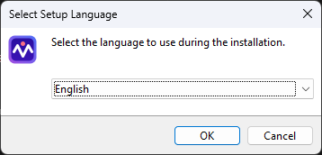
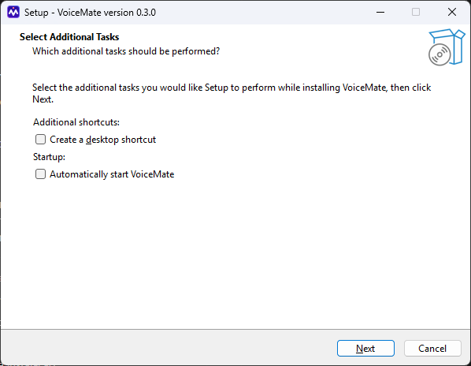
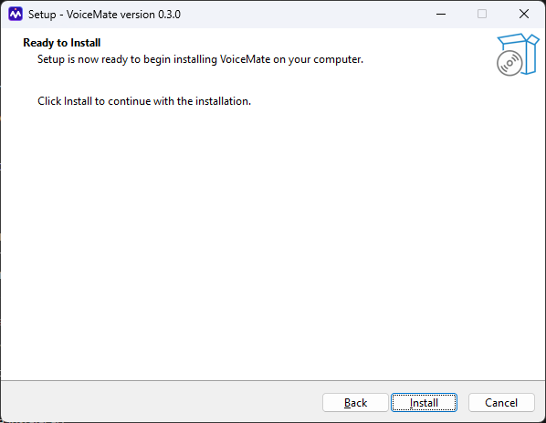
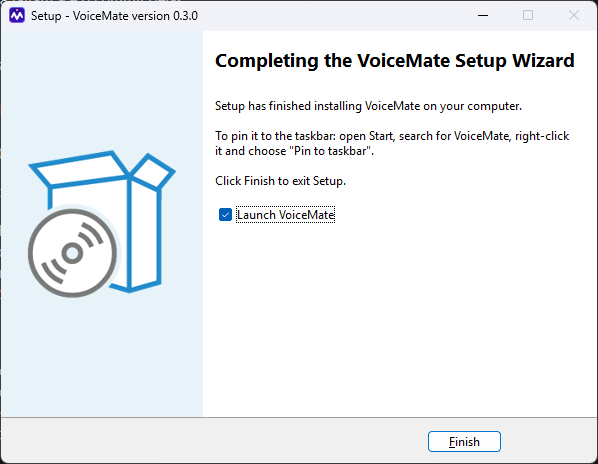
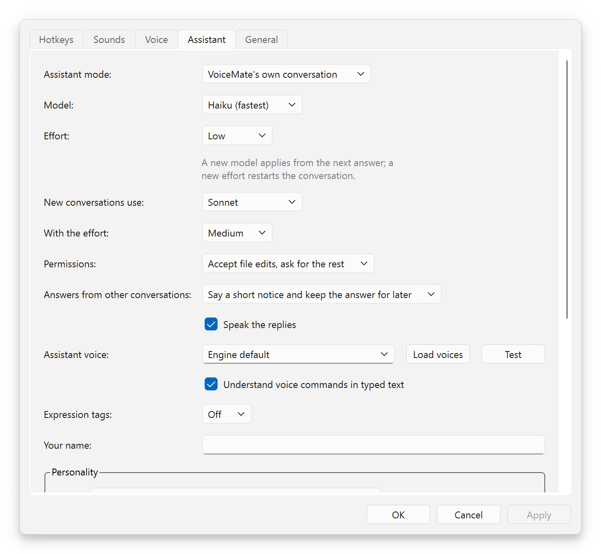

# Installation guide

**English** | [Português](install-guide.pt-BR.md) | [Español](install-guide.es.md) | [Русский](install-guide.ru.md) | [简体中文](install-guide.zh-CN.md)

Purpose: a step-by-step walk from a clean Windows PC to your first dictation, with screenshots of the installer. Every command is here and nothing is assumed. The full technical reference (every path, every option) is [installation.md](installation.md). Back to the [README](../README.md).

## 🎯 What you are installing

I wrote this guide for the person who wants VoiceMate working and does not want to read the whole documentation. It takes about four steps, and the longest is the first download of the speech model.

VoiceMate has two pieces. The **engine** is the part that listens and turns speech into text: it runs on your own computer, inside a small Linux that Windows already knows how to run (WSL2). The **companion** is the Windows app you see: the tray icon, the hotkeys, the settings and the assistant window. The companion comes in an installer; the engine comes from GitHub.


Blue: the steps that install something; green: the moment it works; dashed: optional.

## 📋 Requirements

| What | You need |
|---|---|
| Windows | Windows 10 version 1809 or newer, or Windows 11, 64-bit |
| A microphone | Any microphone Windows can use |
| WSL2 with Ubuntu | Installed in step 1 (Ubuntu 24.04 brings Python 3.12, which the engine needs) |
| A graphics card | Optional. NVIDIA and AMD cards work; without one VoiceMate transcribes on the processor |
| Internet, once | To download Ubuntu, the engine and the Whisper speech model (the model is downloaded on the first start) |
| For the voice assistant | Claude Code installed and signed in (step 5). Dictation does not need it |

You do not need an administrator account for VoiceMate itself. Installing WSL2 in step 1 may ask for one, as Windows decides.

## 🐧 Step 1. WSL2 and Ubuntu

1. Open **PowerShell** (Start, type PowerShell, open it) and run:
   ```powershell
   wsl --install -d Ubuntu-24.04
   wsl --update
   ```
2. Restart Windows if it asks. Then open **Ubuntu** from the Start menu. The first time, it asks for a user name and a password: they are only for this Ubuntu.
3. If you already had another WSL distro, make Ubuntu the default: `wsl --set-default Ubuntu-24.04` in PowerShell. Or keep yours and set "WSL distro:" in Settings later.
4. In the Ubuntu window, install the tools the engine needs:
   ```bash
   sudo apt update
   sudo apt install -y libportaudio2 libasound2-plugins pulseaudio-utils wl-clipboard git make curl python3-venv
   ```
5. Install [Poetry](https://python-poetry.org/docs/#installation), the tool that sets up the engine's Python environment, and close and reopen Ubuntu so it is on the `PATH`:
   ```bash
   curl -sSL https://install.python-poetry.org | python3 -
   echo 'export PATH="$HOME/.local/bin:$PATH"' >> ~/.profile
   ```

> [!NOTE]
> VoiceMate starts the engine through a *login shell*, so Poetry and `make` must be found there too. If `poetry --version` works in a new Ubuntu window, you are set.

With an AMD graphics card, also install the AMD driver for Windows and ROCm inside WSL: the steps are in [wsl2.md](wsl2.md#prerequisites). It was tested on a Radeon RX 9070 XT with ROCm 7.2.

## ⚙️ Step 2. The engine

Still in Ubuntu:

```bash
git clone https://github.com/nano-br/voice-mate.git ~/voice-mate
cd ~/voice-mate
make setup
make doctor
```

`make setup` is a guided installer. It finds your graphics card, installs the matching speech-to-text tools and asks a few questions:

| Question | What to answer |
|---|---|
| Your graphics card | Press Enter to accept the detected one |
| "Which main flow?" | `1` (clipboard): dictation, and it is also all the voice assistant needs |
| Text to speech (only if you pick the Claude flow) | Skip it. The assistant speaks with the voices of Windows without any setup |

`make doctor` checks the microphone, the audio, the hotkeys and the graphics card. Every line should show a check mark; for each problem it prints the fix.

The engine lives in `~/voice-mate`, which is the first place the companion looks. Anywhere else works too: set "Engine folder:" in Settings. [The full list of folders](installation.md#2-install-the-engine).

<details>
<summary>Recommended: download the speech model now</summary>

The very first start downloads the Whisper model, and the companion waits 240 seconds for the engine before it gives up (after 3 timeouts in a row it stops trying). A slow connection can take longer. So run the engine once by hand:

```bash
cd ~/voice-mate
make run
```

Wait until it has loaded, then stop it with `Ctrl+C`. The next start is fast.

</details>

## 🪟 Step 3. The Windows installer

1. Download `VoiceMate-Setup-x.y.z.exe` from the [latest release](https://github.com/nano-br/voice-mate/releases/latest) and open it.
2. The installer is not code-signed, so Windows SmartScreen may warn you. Choose **More info**, then **Run anyway**.
3. Follow the pages below. It installs only for your user, into `%LOCALAPPDATA%\Programs\VoiceMate`, with no administrator prompt.

### Page 1. The language

<p align="center"></p>

"Select Setup Language": pick the language of the installer (English, Brazilian Portuguese, Spanish, Russian or Simplified Chinese) and press **OK**. You only see this window when Windows is set to a language the installer does not have: it opens in English, with English selected. If Windows is in English, Portuguese, Spanish, Russian or Simplified Chinese, you do not see it: the installer starts in that language and goes straight to the additional tasks (page 2).

### Page 2. The additional tasks

<p align="center"></p>

"Select Additional Tasks" has two optional boxes, both off by default:

| Box | What it does |
|---|---|
| "Create a desktop shortcut" (under "Additional shortcuts:") | Puts a VoiceMate icon on the desktop |
| "Automatically start VoiceMate" (under "Startup:") | Starts VoiceMate when you sign in to Windows. Offered on the first install only; later, Settings has "Start VoiceMate when I sign in" |

Press **Next**.

### Page 3. Ready to install

<p align="center"></p>

"Ready to Install" says "Setup is now ready to begin installing VoiceMate on your computer." It has no folder to pick, because VoiceMate always installs into `%LOCALAPPDATA%\Programs\VoiceMate`. Press **Install** ("Click Install to continue with the installation."). It takes a few seconds ("Installing").

### Page 4. Finished

<p align="center"></p>

"Completing the VoiceMate Setup Wizard" says how to pin VoiceMate to the taskbar, because Windows does not let installers do it: open Start, search for VoiceMate, right-click it and choose **Pin to taskbar**. Leave "Launch VoiceMate" checked and press **Finish**.

## 🚀 Step 4. First run

<p align="center"></p>

1. The tray icon shows "Starting engine..." while the model loads (10 to 60 seconds once the model is downloaded). Then it shows "Listening for Ctrl+Alt+V".
2. Click in any text box, press `Ctrl+Alt+V`, wait for the start cue, speak, and press `Ctrl+Alt+V` again.
3. After the cue that says the text is copied, paste it with `Ctrl+V`.

<p align="center"></p>

Right-click the tray icon for the menu, and open Settings to change the hotkeys, the sounds, the language and the transcription mode (CPU or GPU). If a notification says "Engine folder not found", set "Engine folder:" in Settings > **General** and VoiceMate tries again.

## 🎙️ Step 5. The voice assistant (optional)

The assistant is a Claude conversation you talk to by voice, in the same Claude Code and Claude Desktop you already use. It needs Claude Code on Windows and a Claude login on this computer:

1. Install [Claude Code](https://docs.claude.com/en/docs/claude-code) and run `claude auth login` once in a terminal. The login of Claude Desktop does not count.
2. In the status window, press **Assistant**, or open Settings > **Assistant** and choose "Assistant mode:".
3. Press `Ctrl+Alt+S` and speak, then press it again. Or click **Talk** in the assistant window; it turns into **Stop and send** while it records.

<p align="center"></p>

**Its voice needs nothing installed.** With no voice engine set up, the assistant speaks with the voices Windows already has, for every language installed under Windows Settings > Time and language > Speech. In Settings > **Assistant**, "Voice source:" decides who speaks:

| "Voice source:" | Who speaks |
|---|---|
| "Automatic" (default) | The engine's voice when it can speak, the voices of Windows otherwise |
| "The engine's voice" | Only the engine |
| "The voices of Windows" | Only the voices of Windows |

**Load voices** lists the voices of the source you picked and **Test** plays a short sentence. The assistant never speaks over a recording: it waits while you record and while the recording is transcribed.

<p align="center"></p>

All the assistant's options: [voice-assistant.md](voice-assistant.md).

## 🔄 Updating

- **The companion:** run the newer `VoiceMate-Setup-x.y.z.exe`. If VoiceMate is running, the installer first asks "VoiceMate is running. Setup will close it, and the engine it started, before installing. Continue?" Confirm, and it closes VoiceMate together with its engine, then installs. Your settings are kept. The box "Automatically start VoiceMate" does not appear again: it is offered on the first install only, and your earlier choice stays as it is.
- **The engine:** in Ubuntu, `cd ~/voice-mate`, then `git pull` and `make setup` (your earlier answers are the defaults). In the tray menu, **Engine** > **Restart engine**.

## 🗑️ Uninstalling

- **The companion:** Windows Settings > Apps, choose VoiceMate and uninstall it. Your settings in `%APPDATA%\VoiceMate` stay; delete that folder to remove them too.
- **The engine:** delete the `~/voice-mate` folder in Ubuntu, and `~/.config/voicemate` and `~/.cache/voicemate`. The downloaded models are in `~/.cache/huggingface` and `~/.cache/whisper` (the large part).
- **The assistant's files:** the uninstaller leaves them. The list is in [installation.md](installation.md#uninstalling).

## 🩺 If something goes wrong

| Symptom | What to do |
|---|---|
| SmartScreen blocks the installer | **More info**, then **Run anyway**. The installer is not code-signed |
| "Starting engine..." for a long time | The first start downloads the model. Run `make run` once in Ubuntu (see Step 2) |
| "Engine folder not found" | Set "Engine folder:" in Settings > **General** |
| No sound from the assistant | Settings > **Assistant**, "Voice source:" = "The voices of Windows", then **Test** |
| Anything on the engine side | `make doctor` in `~/voice-mate` prints a fix for each failed check |

More problems and the exact messages: [troubleshooting.md](troubleshooting.md).

## 📚 What to read next

- [usage.md](usage.md): hotkeys, the tray icon, transcription modes and models.
- [voice-assistant.md](voice-assistant.md): the assistant, its two modes and how it conducts your other conversations.
- [installation.md](installation.md): every install path, from source and on Linux.
