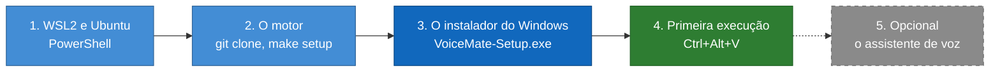
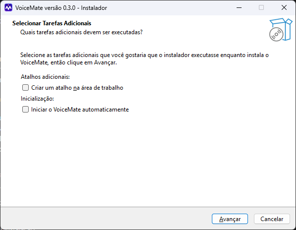
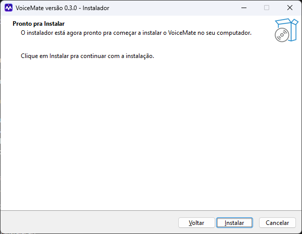
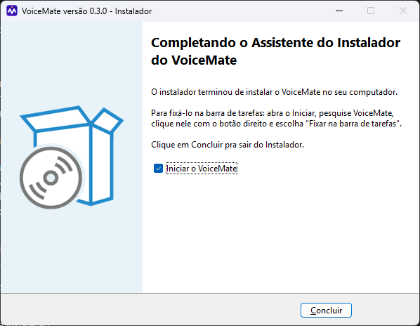
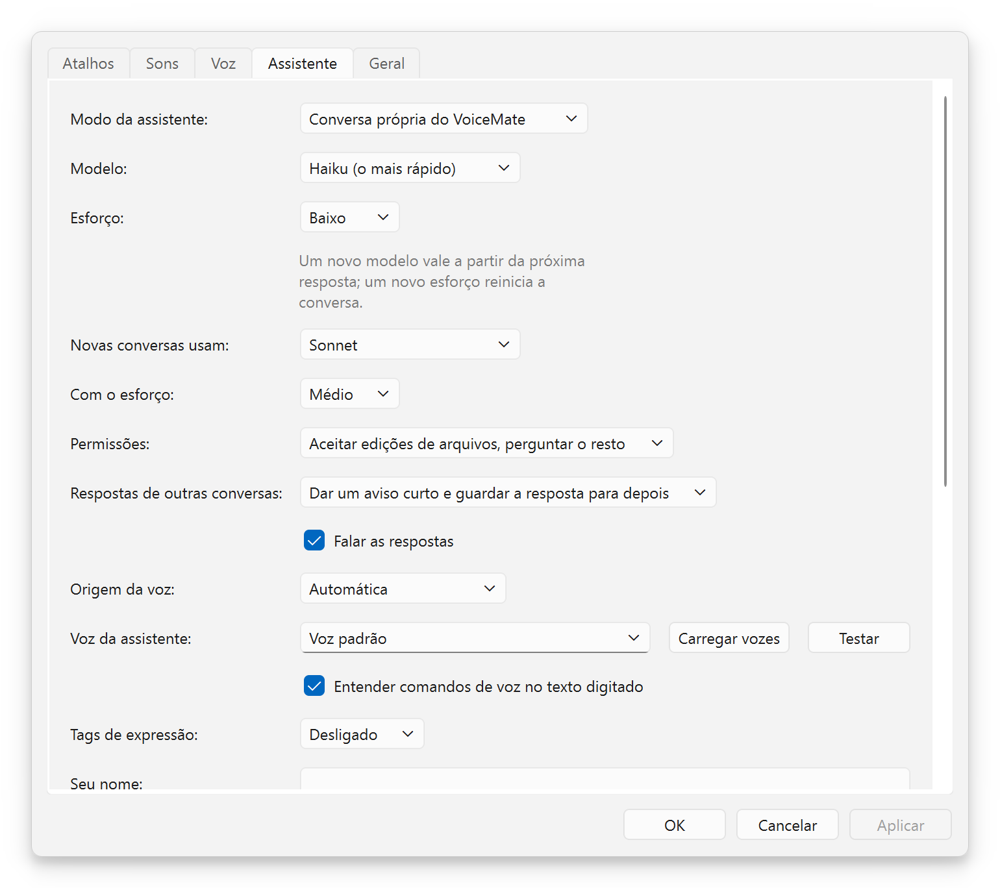

# Guia de instalação

[English](install-guide.md) | **Português** | [Español](install-guide.es.md) | [Русский](install-guide.ru.md) | [简体中文](install-guide.zh-CN.md)

Objetivo: um passo a passo de um PC Windows limpo até o seu primeiro ditado, com capturas de tela do instalador. Todos os comandos estão aqui e nada é presumido. A referência técnica completa (cada caminho, cada opção) é a [installation.md](installation.md) (em inglês). Voltar ao [README](../README.pt-BR.md).

## 🎯 O que você está instalando

Escrevi este guia para quem quer o VoiceMate funcionando e não quer ler a documentação inteira. São cerca de quatro passos, e o mais demorado é o primeiro download do modelo de fala.

O VoiceMate tem duas peças. O **motor** é a parte que escuta e transforma fala em texto: ele roda no seu próprio computador, dentro de um pequeno Linux que o Windows já sabe executar (o WSL2). O **companion** é o aplicativo do Windows que você vê: o ícone da bandeja, os atalhos, as configurações e a janela do assistente. O companion vem num instalador; o motor vem do GitHub.



Azul: os passos que instalam algo; verde: o momento em que funciona; tracejado: opcional.

## 📋 Requisitos

| O quê | O que você precisa |
|---|---|
| Windows | Windows 10 versão 1809 ou mais novo, ou Windows 11, 64 bits |
| Um microfone | Qualquer microfone que o Windows consiga usar |
| WSL2 com Ubuntu | Instalado no passo 1 (o Ubuntu 24.04 traz o Python 3.12, que o motor exige) |
| Uma placa de vídeo | Opcional. Placas NVIDIA e AMD funcionam; sem uma, o VoiceMate transcreve no processador |
| Internet, uma vez | Para baixar o Ubuntu, o motor e o modelo de fala Whisper (o modelo é baixado na primeira inicialização) |
| Para o assistente de voz | Claude Code instalado e com login feito (passo 5). O ditado não precisa disso |

Você não precisa de conta de administrador para o VoiceMate em si. Instalar o WSL2 no passo 1 pode pedir uma, conforme o Windows decidir.

## 🐧 Passo 1. WSL2 e Ubuntu

1. Abra o **PowerShell** (Iniciar, digite PowerShell, abra) e rode:
   ```powershell
   wsl --install -d Ubuntu-24.04
   wsl --update
   ```
2. Reinicie o Windows se ele pedir. Depois abra o **Ubuntu** pelo menu Iniciar. Na primeira vez, ele pede um nome de usuário e uma senha: valem só para este Ubuntu.
3. Se você já tinha outra distro do WSL, deixe o Ubuntu como padrão: `wsl --set-default Ubuntu-24.04` no PowerShell. Ou mantenha a sua e defina "Distro do WSL:" em Configurações depois.
4. Na janela do Ubuntu, instale as ferramentas de que o motor precisa:
   ```bash
   sudo apt update
   sudo apt install -y libportaudio2 libasound2-plugins pulseaudio-utils wl-clipboard git make curl python3-venv
   ```
5. Instale o [Poetry](https://python-poetry.org/docs/#installation), a ferramenta que prepara o ambiente Python do motor, e feche e reabra o Ubuntu para ele entrar no `PATH`:
   ```bash
   curl -sSL https://install.python-poetry.org | python3 -
   echo 'export PATH="$HOME/.local/bin:$PATH"' >> ~/.profile
   ```

> [!NOTE]
> O VoiceMate inicia o motor por um *shell de login*, então o Poetry e o `make` precisam ser encontrados lá também. Se `poetry --version` funciona numa janela nova do Ubuntu, está tudo certo.

Com uma placa de vídeo AMD, instale também o driver da AMD para Windows e o ROCm dentro do WSL: os passos estão em [wsl2.md](wsl2.md#prerequisites). Foi testado numa Radeon RX 9070 XT com ROCm 7.2.

## ⚙️ Passo 2. O motor

Ainda no Ubuntu:

```bash
git clone https://github.com/nano-br/voice-mate.git ~/voice-mate
cd ~/voice-mate
make setup
make doctor
```

O `make setup` é um instalador guiado. Ele encontra a sua placa de vídeo, instala as ferramentas de reconhecimento de fala correspondentes e faz algumas perguntas:

| Pergunta | O que responder |
|---|---|
| A sua placa de vídeo | Aperte Enter para aceitar a detectada |
| "Which main flow?" | `1` (área de transferência): ditado, e é também tudo de que o assistente de voz precisa |
| Texto para fala (só se você escolher o fluxo do Claude) | Pule. O assistente fala com as vozes do Windows sem nenhuma configuração |

O `make doctor` confere o microfone, o áudio, os atalhos e a placa de vídeo. Toda linha deve mostrar um visto; para cada problema, ele imprime a correção.

O motor fica em `~/voice-mate`, que é o primeiro lugar onde o companion procura. Qualquer outro lugar também serve: defina "Pasta do motor:" em Configurações. [A lista completa de pastas](installation.md#2-install-the-engine).

<details>
<summary>Recomendado: baixe o modelo de fala agora</summary>

A primeiríssima inicialização baixa o modelo Whisper, e o companion espera 240 segundos pelo motor antes de desistir (depois de 3 esperas esgotadas seguidas, ele para de tentar). Uma conexão lenta pode levar mais tempo. Por isso, rode o motor uma vez à mão:

```bash
cd ~/voice-mate
make run
```

Espere até ele terminar de carregar e então pare com `Ctrl+C`. As próximas inicializações são rápidas.

</details>

## 🪟 Passo 3. O instalador do Windows

1. Baixe o `VoiceMate-Setup-x.y.z.exe` da [última versão](https://github.com/nano-br/voice-mate/releases/latest) e abra.
2. O instalador não tem assinatura de código, então o Windows SmartScreen pode avisar. Escolha **Mais informações** e depois **Executar assim mesmo**.
3. Siga as páginas abaixo. Ele instala só para o seu usuário, em `%LOCALAPPDATA%\Programs\VoiceMate`, sem pedir permissão de administrador.

### Página 1. O idioma

<p align="center"></p>

"Selecione o Idioma do Instalador": escolha o idioma do instalador (inglês, português do Brasil, espanhol, russo ou chinês simplificado) e clique em **OK**. Esta janela só aparece quando o Windows está num idioma que o instalador não tem: ela abre em inglês, com English selecionado (por isso o print está em inglês). Se o seu Windows está em inglês, português, espanhol, russo ou chinês simplificado, você não vê a janela: o instalador abre nesse idioma e vai direto para as tarefas adicionais (página 2).

### Página 2. As tarefas adicionais

<p align="center"></p>

"Selecionar Tarefas Adicionais" tem duas caixas opcionais, ambas desmarcadas por padrão:

| Caixa | O que faz |
|---|---|
| "Criar um atalho na área de trabalho" (em "Atalhos adicionais:") | Coloca um ícone do VoiceMate na área de trabalho |
| "Iniciar o VoiceMate automaticamente" (em "Inicialização:") | Inicia o VoiceMate quando você entra no Windows. Oferecida só na primeira instalação; depois, as Configurações têm "Iniciar o VoiceMate ao fazer login" |

Clique em **Avançar**.

### Página 3. Pronto para instalar

<p align="center"></p>

"Pronto pra Instalar" diz "O instalador está agora pronto pra começar a instalar o VoiceMate no seu computador." Não há pasta para escolher, porque o VoiceMate sempre é instalado em `%LOCALAPPDATA%\Programs\VoiceMate`. Clique em **Instalar** ("Clique em Instalar pra continuar com a instalação."). Leva alguns segundos ("Instalando").

### Página 4. Concluído

<p align="center"></p>

"Completando o Assistente do Instalador do VoiceMate" explica como fixar o VoiceMate na barra de tarefas, porque o Windows não deixa os instaladores fazerem isso: abra o Iniciar, pesquise VoiceMate, clique nele com o botão direito e escolha **Fixar na barra de tarefas**. Deixe "Iniciar o VoiceMate" marcado e clique em **Concluir**.

## 🚀 Passo 4. Primeira execução

<p align="center"></p>

1. O ícone da bandeja mostra "Iniciando o motor..." enquanto o modelo carrega (10 a 60 segundos depois que o modelo foi baixado). Depois mostra "Aguardando Ctrl+Alt+V".
2. Clique em qualquer caixa de texto, aperte `Ctrl+Alt+V`, espere o sinal de início, fale e aperte `Ctrl+Alt+V` de novo.
3. Depois do sinal que avisa que o texto foi copiado, cole com `Ctrl+V`.

<p align="center"></p>

Clique com o botão direito no ícone da bandeja para ver o menu, e abra Configurações para mudar os atalhos, os sons, o idioma e o modo de transcrição (CPU ou GPU). Se uma notificação disser "Pasta do motor não encontrada", defina "Pasta do motor:" em Configurações > **Geral** e o VoiceMate tenta de novo.

## 🎙️ Passo 5. O assistente de voz (opcional)

O assistente é uma conversa do Claude com a qual você fala por voz, no mesmo Claude Code e Claude Desktop que você já usa. Ele precisa do Claude Code no Windows e de um login do Claude neste computador:

1. Instale o [Claude Code](https://docs.claude.com/en/docs/claude-code) e rode `claude auth login` uma vez num terminal. O login do Claude Desktop não conta.
2. Na janela de status, clique em **Assistente**, ou abra Configurações > **Assistente** e escolha "Modo do assistente:".
3. Aperte `Ctrl+Alt+S` e fale, depois aperte de novo. Ou clique em **Falar** na janela do assistente; o botão vira **Parar e enviar** enquanto grava.

<p align="center"></p>

**A voz dele não precisa de nada instalado.** Sem nenhum motor de voz configurado, o assistente fala com as vozes que o Windows já tem, para cada idioma instalado em Configurações do Windows > Hora e idioma > Fala. Em Configurações > **Assistente**, "Origem da voz:" decide quem fala:

| "Origem da voz:" | Quem fala |
|---|---|
| "Automática" (padrão) | A voz do motor quando ele consegue falar, as vozes do Windows caso contrário |
| "A voz do motor" | Só o motor |
| "As vozes do Windows" | Só as vozes do Windows |

**Carregar vozes** lista as vozes da origem escolhida e **Testar** toca uma frase curta. O assistente nunca fala por cima de uma gravação: ele espera enquanto você grava e enquanto a gravação é transcrita.

<p align="center"></p>

Todas as opções do assistente: [voice-assistant.md](voice-assistant.md) (em inglês).

## 🔄 Atualizando

- **O companion:** rode o `VoiceMate-Setup-x.y.z.exe` mais novo. Se o VoiceMate estiver rodando, o instalador pergunta antes: "O VoiceMate está em execução. O instalador vai fechá-lo, junto com o motor que ele iniciou, antes de instalar. Continuar?" Confirme e ele fecha o VoiceMate junto com o motor e depois instala. Suas configurações são mantidas. A caixa "Iniciar o VoiceMate automaticamente" não aparece de novo: ela é oferecida só na primeira instalação, e a sua escolha anterior continua como está.
- **O motor:** no Ubuntu, `cd ~/voice-mate`, depois `git pull` e `make setup` (as suas respostas anteriores são o padrão). No menu da bandeja, **Motor** > **Reiniciar o motor**.

## 🗑️ Desinstalando

- **O companion:** Configurações do Windows > Aplicativos, escolha o VoiceMate e desinstale. Suas configurações em `%APPDATA%\VoiceMate` ficam; apague essa pasta para removê-las também.
- **O motor:** apague a pasta `~/voice-mate` no Ubuntu, e `~/.config/voicemate` e `~/.cache/voicemate`. Os modelos baixados ficam em `~/.cache/huggingface` e `~/.cache/whisper` (a parte grande).
- **Os arquivos do assistente:** o desinstalador os deixa. A lista está em [installation.md](installation.md#uninstalling).

## 🩺 Se algo der errado

| Sintoma | O que fazer |
|---|---|
| O SmartScreen bloqueia o instalador | **Mais informações** e depois **Executar assim mesmo**. O instalador não tem assinatura de código |
| "Iniciando o motor..." por muito tempo | A primeira inicialização baixa o modelo. Rode `make run` uma vez no Ubuntu (veja o Passo 2) |
| "Pasta do motor não encontrada" | Defina "Pasta do motor:" em Configurações > **Geral** |
| Sem som do assistente | Configurações > **Assistente**, "Origem da voz:" = "As vozes do Windows", depois **Testar** |
| Qualquer coisa do lado do motor | `make doctor` em `~/voice-mate` imprime uma correção para cada verificação que falhou |

Mais problemas e as mensagens exatas: [troubleshooting.md](troubleshooting.md) (em inglês).

## 📚 O que ler em seguida

- [usage.md](usage.md): atalhos, o ícone da bandeja, modos de transcrição e modelos (em inglês).
- [voice-assistant.md](voice-assistant.md): o assistente, os dois modos e como ele conduz as suas outras conversas (em inglês).
- [installation.md](installation.md): todos os caminhos de instalação, a partir do código-fonte e no Linux (em inglês).
