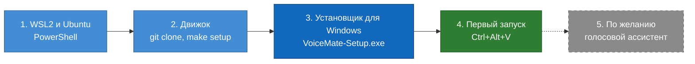
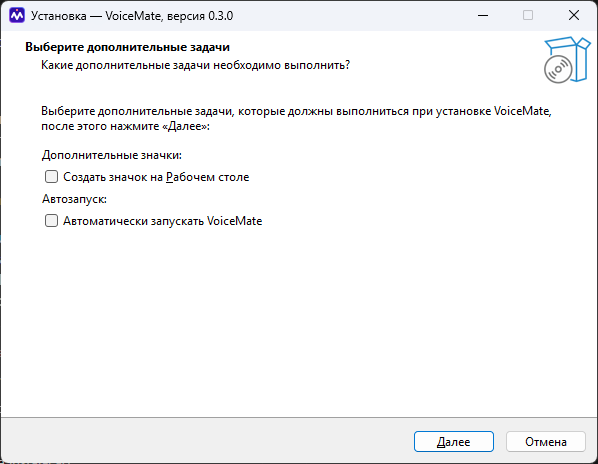
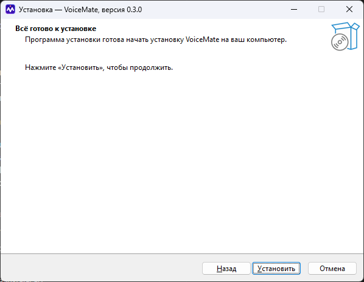
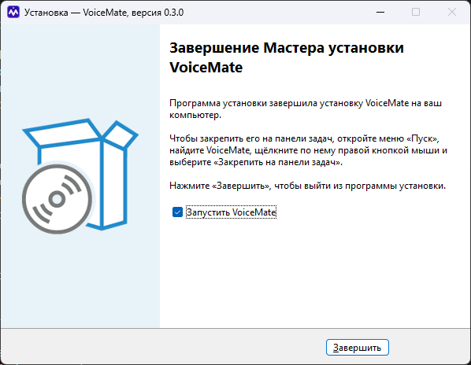
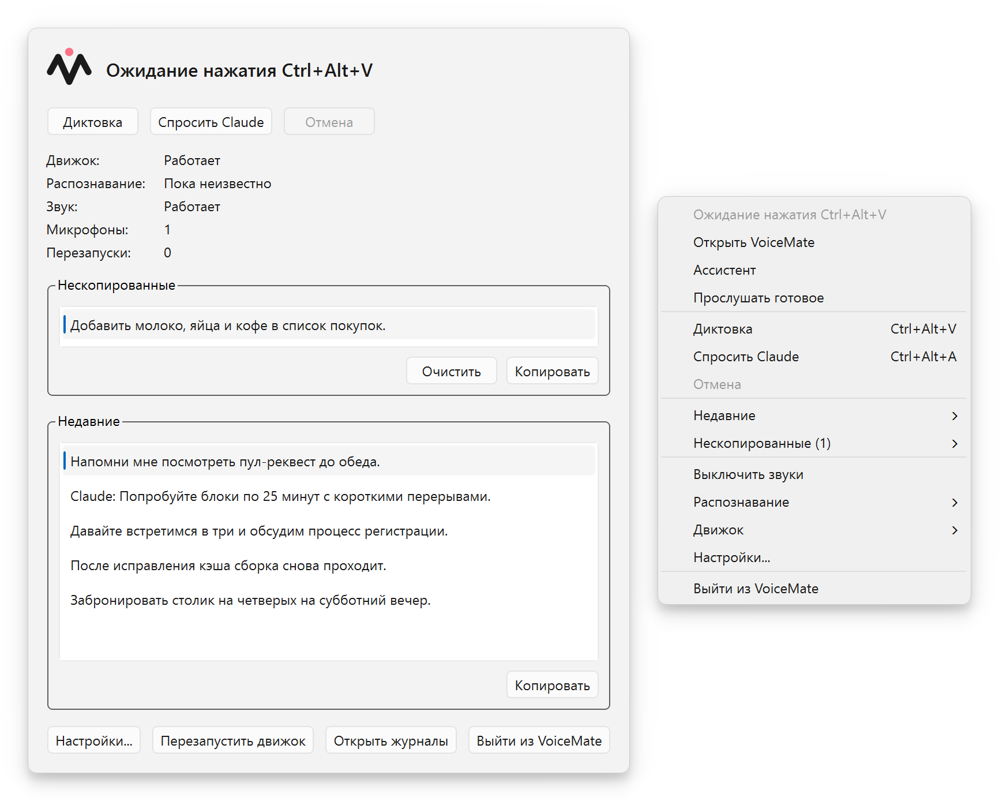
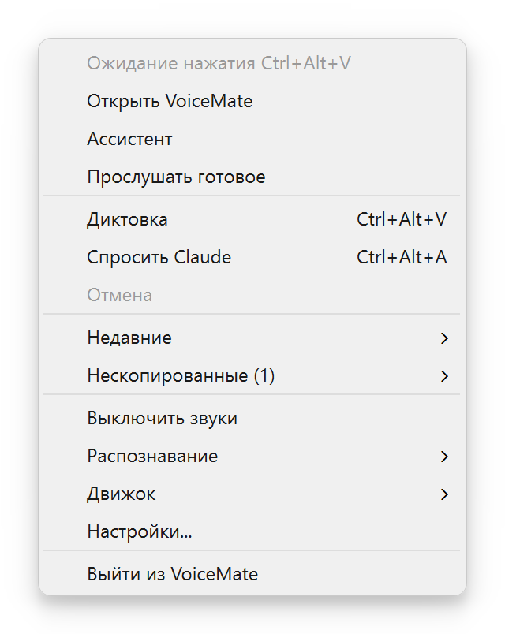
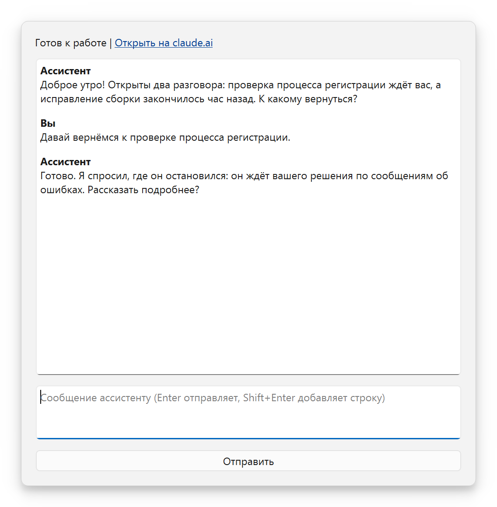
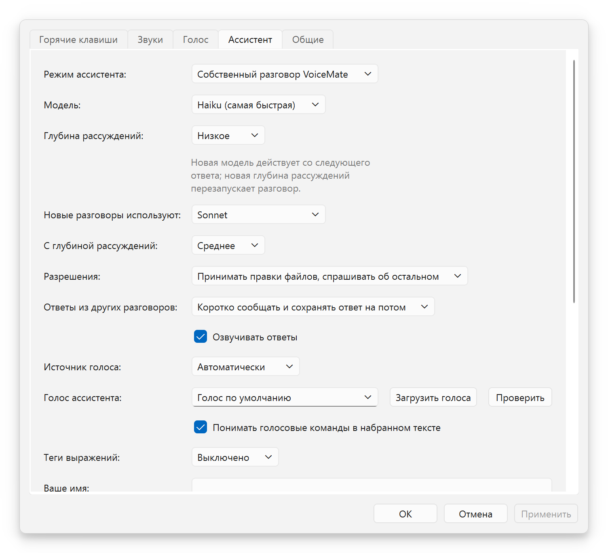

# Руководство по установке

[English](install-guide.md) | [Português](install-guide.pt-BR.md) | [Español](install-guide.es.md) | **Русский** | [简体中文](install-guide.zh-CN.md)

Назначение: пошаговый путь от чистого ПК с Windows до первой диктовки, со скриншотами установщика. Здесь есть все команды, и ничего не предполагается заранее. Полное техническое описание (все пути, все параметры) находится в [installation.md](installation.md) (на английском). Вернуться в [README](../README.ru.md).

## 🎯 Что вы устанавливаете

Я написал это руководство для тех, кто хочет, чтобы VoiceMate заработал, и не хочет читать всю документацию. Всё займёт около четырёх шагов, а дольше всего длится первая загрузка модели распознавания речи.

VoiceMate состоит из двух частей. **Движок** слушает и превращает речь в текст: он работает на вашем компьютере, внутри небольшого Linux, который Windows умеет запускать сама (WSL2). **Компаньон** это приложение для Windows, которое вы видите: значок в области уведомлений, горячие клавиши, настройки и окно ассистента. Компаньон поставляется в установщике, движок берётся с GitHub.



Синий: шаги, которые что-то устанавливают; зелёный: момент, когда всё работает; пунктир: по желанию.

## 📋 Требования

| Что | Что нужно |
|---|---|
| Windows | Windows 10 версии 1809 или новее, либо Windows 11, 64-разрядная |
| Микрофон | Любой микрофон, который может использовать Windows |
| WSL2 с Ubuntu | Устанавливается на шаге 1 (в Ubuntu 24.04 есть Python 3.12, он нужен движку) |
| Видеокарта | Необязательно. Работают карты NVIDIA и AMD; без неё VoiceMate расшифровывает речь на процессоре |
| Интернет, один раз | Чтобы скачать Ubuntu, движок и модель распознавания речи Whisper (модель скачивается при первом запуске) |
| Для голосового ассистента | Установленный Claude Code с выполненным входом (шаг 5). Для диктовки он не нужен |

Для самого VoiceMate учётная запись администратора не нужна. Установка WSL2 на шаге 1 может её потребовать: это решает Windows.

## 🐧 Шаг 1. WSL2 и Ubuntu

1. Откройте **PowerShell** (меню «Пуск», введите PowerShell, откройте) и выполните:
   ```powershell
   wsl --install -d Ubuntu-24.04
   wsl --update
   ```
2. Если Windows попросит, перезагрузите компьютер. Затем откройте **Ubuntu** из меню «Пуск». При первом запуске она спросит имя пользователя и пароль: они нужны только для этой Ubuntu.
3. Если у вас уже был другой дистрибутив WSL, сделайте Ubuntu дистрибутивом по умолчанию: `wsl --set-default Ubuntu-24.04` в PowerShell. Либо оставьте свой и позже задайте «Дистрибутив WSL:» в настройках.
4. В окне Ubuntu установите инструменты, которые нужны движку:
   ```bash
   sudo apt update
   sudo apt install -y libportaudio2 libasound2-plugins pulseaudio-utils wl-clipboard git make curl python3-venv
   ```
5. Установите [Poetry](https://python-poetry.org/docs/#installation), инструмент, который готовит окружение Python для движка, а затем закройте и снова откройте Ubuntu, чтобы он оказался в `PATH`:
   ```bash
   curl -sSL https://install.python-poetry.org | python3 -
   echo 'export PATH="$HOME/.local/bin:$PATH"' >> ~/.profile
   ```

> [!NOTE]
> VoiceMate запускает движок через *login-оболочку*, поэтому Poetry и `make` должны находиться и в ней. Если `poetry --version` работает в новом окне Ubuntu, всё в порядке.

С видеокартой AMD установите также драйвер AMD для Windows и ROCm внутри WSL: шаги описаны в [wsl2.md](wsl2.md#prerequisites). Проверено на Radeon RX 9070 XT с ROCm 7.2.

## ⚙️ Шаг 2. Движок

Всё ещё в Ubuntu:

```bash
git clone https://github.com/nano-br/voice-mate.git ~/voice-mate
cd ~/voice-mate
make setup
make doctor
```

`make setup` это пошаговый установщик. Он находит вашу видеокарту, устанавливает подходящие инструменты распознавания речи и задаёт несколько вопросов:

| Вопрос | Что ответить |
|---|---|
| Ваша видеокарта | Нажмите Enter, чтобы принять найденную |
| «Какой основной режим?» | `1` (clipboard): диктовка, и этого же достаточно для голосового ассистента |
| Синтез речи (только если выбран режим Claude) | Пропустите. Ассистент говорит голосами Windows без всякой настройки |

`make doctor` проверяет микрофон, звук, горячие клавиши и видеокарту. Рядом с каждой строкой должна стоять галочка; для каждой проблемы он выводит способ исправления.

Движок лежит в `~/voice-mate`: это первое место, где его ищет компаньон. Подойдёт и любое другое: задайте «Папка движка:» в настройках. [Полный список папок](installation.md#2-install-the-engine).

<details>
<summary>Рекомендуется: скачайте модель распознавания речи сейчас</summary>

При самом первом запуске скачивается модель Whisper, а компаньон ждёт движок 240 секунд, после чего сдаётся (после 3 тайм-аутов подряд он перестаёт пробовать). При медленном соединении этого может не хватить. Поэтому один раз запустите движок вручную:

```bash
cd ~/voice-mate
make run
```

Дождитесь, пока он загрузится, и остановите его через `Ctrl+C`. Следующий запуск будет быстрым.

</details>

## 🪟 Шаг 3. Установщик для Windows

1. Скачайте `VoiceMate-Setup-x.y.z.exe` со [страницы последнего релиза](https://github.com/nano-br/voice-mate/releases/latest) и откройте его.
2. Установщик не имеет цифровой подписи, поэтому Windows SmartScreen может выдать предупреждение. Выберите **Подробнее**, затем **Выполнить в любом случае**.
3. Пройдите страницы ниже. Установка идёт только для вашего пользователя, в `%LOCALAPPDATA%\Programs\VoiceMate`, без запроса прав администратора.

### Страница 1. Язык

<p align="center"></p>

«Выберите язык установки»: выберите язык установщика (английский, бразильский португальский, испанский, русский или упрощённый китайский) и нажмите **OK**. Если Windows уже работает на одном из этих языков, установщик может пропустить этот диалог.

### Страница 2. Дополнительные задачи

<p align="center"></p>

На странице «Выберите дополнительные задачи» два необязательных флажка, оба по умолчанию сняты:

| Флажок | Что делает |
|---|---|
| «Создать значок на Рабочем столе» (в группе «Дополнительные значки:») | Помещает значок VoiceMate на рабочий стол |
| «Автоматически запускать VoiceMate» (в группе «Автозапуск:») | Запускает VoiceMate при входе в Windows. Предлагается только при первой установке; позже в настройках есть пункт «Запускать VoiceMate при входе в систему» |

Нажмите **Далее >**.

### Страница 3. Всё готово к установке

<p align="center"></p>

Страница «Всё готово к установке» повторяет, куда будет выполнена установка и какие задачи вы выбрали. Нажмите **Установить**. Это занимает несколько секунд («Установка»).

### Страница 4. Завершение

<p align="center"></p>

Страница «Завершение Мастера установки VoiceMate» объясняет, как закрепить VoiceMate на панели задач, потому что Windows не позволяет установщикам делать это самим: откройте меню «Пуск», найдите VoiceMate, щёлкните по нему правой кнопкой мыши и выберите **Закрепить на панели задач**. Оставьте флажок «Запустить VoiceMate» и нажмите **Завершить**.

## 🚀 Шаг 4. Первый запуск

<p align="center"></p>

1. Пока загружается модель, значок в области уведомлений показывает «Запуск движка...» (от 10 до 60 секунд после того, как модель скачана). Затем он показывает «Ожидание нажатия Ctrl+Alt+V».
2. Щёлкните в любом текстовом поле, нажмите `Ctrl+Alt+V`, дождитесь сигнала начала записи, говорите и снова нажмите `Ctrl+Alt+V`.
3. После сигнала, сообщающего, что текст скопирован, вставьте его через `Ctrl+V`.

<p align="center"></p>

Щёлкните правой кнопкой мыши по значку в области уведомлений, чтобы открыть меню, и откройте настройки, чтобы изменить горячие клавиши, звуки, язык и режим распознавания (CPU или GPU). Если уведомление сообщает «Папка движка не найдена», задайте «Папка движка:» в «Настройки» > **Общие**, и VoiceMate попробует снова.

## 🎙️ Шаг 5. Голосовой ассистент (по желанию)

Ассистент это разговор с Claude, с которым вы общаетесь голосом, в тех же Claude Code и Claude Desktop, которыми вы уже пользуетесь. Ему нужны Claude Code в Windows и вход в Claude на этом компьютере:

1. Установите [Claude Code](https://docs.claude.com/en/docs/claude-code) и один раз выполните `claude auth login` в терминале. Вход в Claude Desktop не считается.
2. В окне состояния нажмите **Ассистент** или откройте «Настройки» > **Ассистент** и выберите «Режим ассистента:».
3. Нажмите `Ctrl+Alt+S`, говорите, затем нажмите её ещё раз. Или нажмите **Говорить** в окне ассистента; во время записи кнопка превращается в **Остановить и отправить**.

<p align="center"></p>

**Для его голоса ничего не нужно устанавливать.** Если движок голоса не настроен, ассистент говорит голосами, которые уже есть в Windows, для каждого языка, установленного в «Параметры Windows» > «Время и язык» > «Речь». В «Настройки» > **Ассистент** пункт «Источник голоса:» определяет, кто говорит:

| «Источник голоса:» | Кто говорит |
|---|---|
| «Автоматически» (по умолчанию) | Голос движка, если он может говорить, иначе голоса Windows |
| «Голос движка» | Только движок |
| «Голоса Windows» | Только голоса Windows |

**Загрузить голоса** выводит список голосов выбранного источника, а **Проверить** проигрывает короткую фразу. Ассистент никогда не говорит поверх записи: он ждёт, пока вы записываете и пока запись расшифровывается.

<p align="center"></p>

Все параметры ассистента: [voice-assistant.md](voice-assistant.md).

## 🔄 Обновление

- **Компаньон:** запустите более новый `VoiceMate-Setup-x.y.z.exe`. Если VoiceMate запущен, установщик спросит и затем закроет его вместе с движком. Ваши настройки сохраняются.
- **Движок:** в Ubuntu выполните `cd ~/voice-mate`, затем `git pull` и `make setup` (ваши прежние ответы подставляются по умолчанию). В меню в области уведомлений выберите **Движок** > **Перезапустить движок**.

## 🗑️ Удаление

- **Компаньон:** «Параметры Windows» > «Приложения», выберите VoiceMate и удалите его. Ваши настройки в `%APPDATA%\VoiceMate` остаются; удалите эту папку, чтобы убрать и их.
- **Движок:** удалите папку `~/voice-mate` в Ubuntu, а также `~/.config/voicemate` и `~/.cache/voicemate`. Скачанные модели лежат в `~/.cache/huggingface` и `~/.cache/whisper` (это самая большая часть).
- **Файлы ассистента:** программа удаления их не трогает. Список в [installation.md](installation.md#uninstalling).

## 🩺 Если что-то пошло не так

| Симптом | Что делать |
|---|---|
| SmartScreen блокирует установщик | **Подробнее**, затем **Выполнить в любом случае**. Установщик не имеет цифровой подписи |
| «Запуск движка...» длится долго | Первый запуск скачивает модель. Один раз выполните `make run` в Ubuntu (см. шаг 2) |
| «Папка движка не найдена» | Задайте «Папка движка:» в «Настройки» > **Общие** |
| Ассистент не издаёт звука | «Настройки» > **Ассистент**, «Источник голоса:» = «Голоса Windows», затем **Проверить** |
| Что угодно на стороне движка | `make doctor` в `~/voice-mate` выводит способ исправления для каждой непройденной проверки |

Другие проблемы и точные тексты сообщений: [troubleshooting.md](troubleshooting.md).

## 📚 Что читать дальше

- [usage.md](usage.md): горячие клавиши, значок в области уведомлений, режимы распознавания и модели.
- [voice-assistant.md](voice-assistant.md): ассистент, его два режима и то, как он ведёт ваши остальные разговоры.
- [installation.md](installation.md): все способы установки, из исходников и в Linux.
