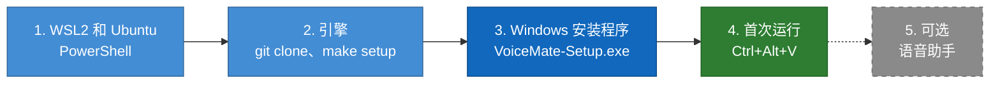
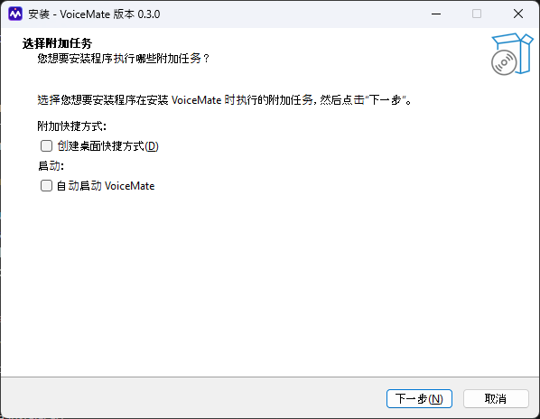
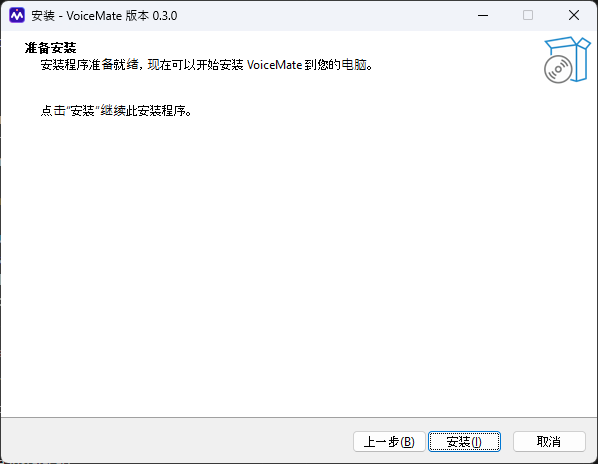
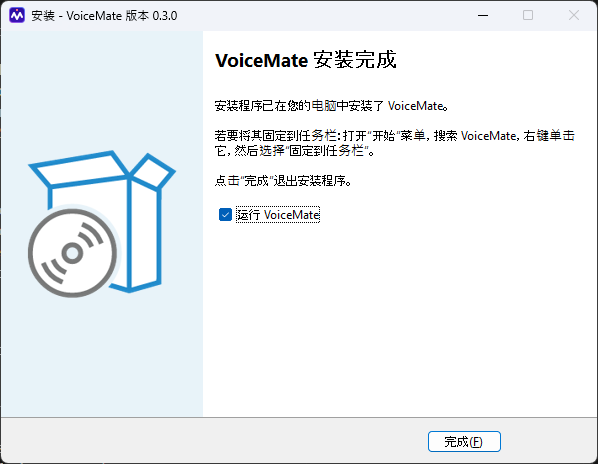
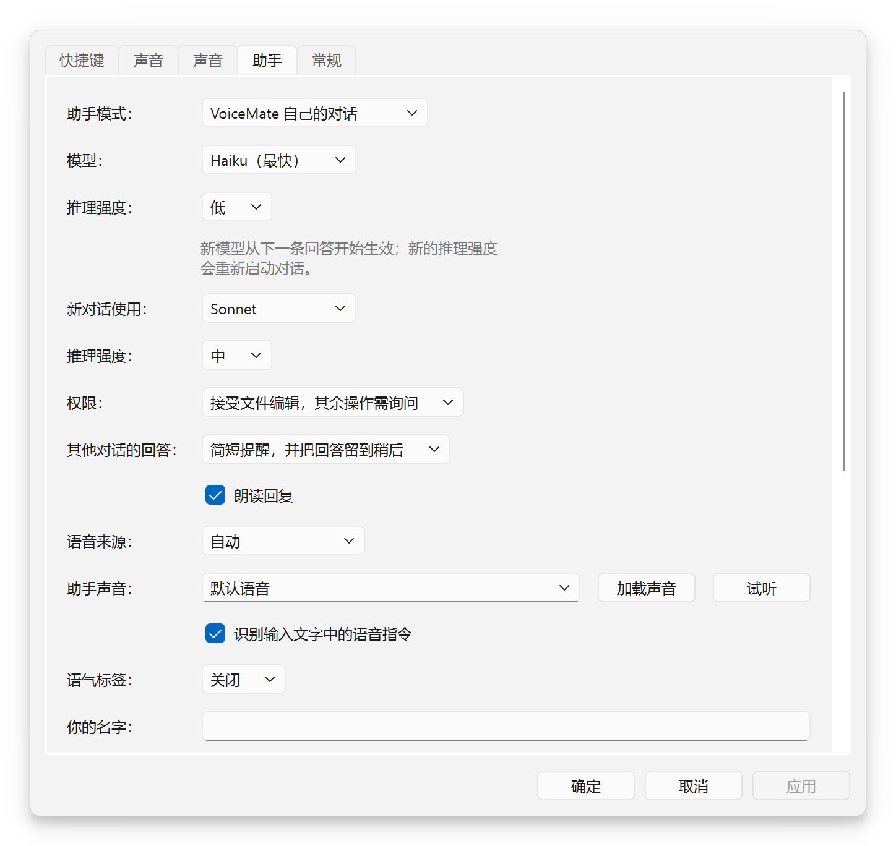

# 安装指南

[English](install-guide.md) | [Português](install-guide.pt-BR.md) | [Español](install-guide.es.md) | [Русский](install-guide.ru.md) | **简体中文**

目的：从一台干净的 Windows 电脑出发，一步一步走到第一次听写，并附有安装程序的截图。所有命令都在这里，不需要任何预备知识。完整的技术参考（所有路径、所有选项）见 [installation.md](installation.md)（英文）。返回 [README](../README.zh-CN.md)。

## 🎯 你要安装什么

我写这份指南，是为了那些想让 VoiceMate 尽快用起来、又不想读完全部文档的人。大约四步，其中最久的是第一次下载语音模型。

VoiceMate 有两个部分。**引擎**负责聆听并把语音转成文字：它运行在你自己的电脑上，在 Windows 本来就能运行的一个小型 Linux（WSL2）里。**配套应用**是你看得到的 Windows 应用：托盘图标、快捷键、设置和助手窗口。配套应用以安装程序提供；引擎来自 GitHub。



蓝色：安装内容的步骤；绿色：开始能用的时刻；虚线：可选。

## 📋 要求

| 项目 | 你需要 |
|---|---|
| Windows | Windows 10 1809 版或更新版本，或 Windows 11，64 位 |
| 麦克风 | Windows 能使用的任何麦克风 |
| 带 Ubuntu 的 WSL2 | 在第 1 步安装（Ubuntu 24.04 自带引擎需要的 Python 3.12） |
| 显卡 | 可选。NVIDIA 和 AMD 显卡都可以；没有显卡时，VoiceMate 用处理器转写 |
| 联网，一次即可 | 用于下载 Ubuntu、引擎和 Whisper 语音模型（模型在第一次启动时下载） |
| 语音助手 | 已安装并登录的 Claude Code（第 5 步）。听写不需要它 |

VoiceMate 本身不需要管理员账户。第 1 步安装 WSL2 时可能会要求管理员权限，这由 Windows 决定。

## 🐧 第 1 步：WSL2 和 Ubuntu

1. 打开 **PowerShell**（点“开始”，输入 PowerShell，打开它），运行：
   ```powershell
   wsl --install -d Ubuntu-24.04
   wsl --update
   ```
2. 如果提示，请重启 Windows。然后从“开始”菜单打开 **Ubuntu**。第一次打开时，它会要求设置用户名和密码：它们只用于这个 Ubuntu。
3. 如果你原来就有别的 WSL 发行版，请把 Ubuntu 设为默认：在 PowerShell 中运行 `wsl --set-default Ubuntu-24.04`。或者保留你的发行版，稍后在设置中指定“WSL 发行版：”。
4. 在 Ubuntu 窗口中，安装引擎需要的工具：
   ```bash
   sudo apt update
   sudo apt install -y libportaudio2 libasound2-plugins pulseaudio-utils wl-clipboard git make curl python3-venv
   ```
5. 安装 [Poetry](https://python-poetry.org/docs/#installation)（用来配置引擎 Python 环境的工具），然后关闭并重新打开 Ubuntu，让它进入 `PATH`：
   ```bash
   curl -sSL https://install.python-poetry.org | python3 -
   echo 'export PATH="$HOME/.local/bin:$PATH"' >> ~/.profile
   ```

> [!NOTE]
> VoiceMate 通过*登录 shell* 启动引擎，所以 Poetry 和 `make` 在那里也必须能找到。如果在新的 Ubuntu 窗口里 `poetry --version` 能运行，就没问题了。

使用 AMD 显卡时，还要安装适用于 Windows 的 AMD 驱动和 WSL 内的 ROCm：步骤见 [wsl2.md](wsl2.md#prerequisites)（英文）。已在 Radeon RX 9070 XT 和 ROCm 7.2 上测试。

## ⚙️ 第 2 步：引擎

仍在 Ubuntu 中：

```bash
git clone https://github.com/nano-br/voice-mate.git ~/voice-mate
cd ~/voice-mate
make setup
make doctor
```

`make setup` 是引导式安装程序。它会找到你的显卡，安装匹配的语音转文字工具，并问几个问题：

| 问题 | 怎么回答 |
|---|---|
| 你的显卡 | 按回车接受检测到的结果 |
| “选择哪个主流程？” | `1`（clipboard）：听写，语音助手也只需要它 |
| 文字转语音（仅在选择 Claude 流程时） | 跳过。助手用 Windows 的语音朗读，无需任何设置 |

`make doctor` 会检查麦克风、音频、快捷键和显卡。每一行都应显示对勾；每个问题它都会给出修复方法。

引擎位于 `~/voice-mate`，这是配套应用最先查找的位置。放在别处也可以：在设置中指定“引擎文件夹：”。[所有文件夹的列表](installation.md#2-install-the-engine)（英文）。

<details>
<summary>推荐：现在就下载语音模型</summary>

第一次启动会下载 Whisper 模型，而配套应用只等引擎 240 秒就放弃（连续 3 次超时后就不再重试）。网速慢的话可能需要更久。所以请先手动运行一次引擎：

```bash
cd ~/voice-mate
make run
```

等它加载完成，然后用 `Ctrl+C` 停止。之后的启动就很快。

</details>

## 🪟 第 3 步：Windows 安装程序

1. 从[最新发布版](https://github.com/nano-br/voice-mate/releases/latest)下载 `VoiceMate-Setup-x.y.z.exe` 并打开。
2. 安装程序没有代码签名，所以 Windows SmartScreen 可能会发出警告。选择 **更多信息**，然后选择 **仍要运行**。
3. 按下面的页面操作。它只为当前用户安装，位置是 `%LOCALAPPDATA%\Programs\VoiceMate`，不会弹出管理员权限提示。

### 第 1 页：语言

<p align="center"></p>

“选择安装语言”：选择安装程序使用的语言（英语、巴西葡萄牙语、西班牙语、俄语或简体中文），然后点 **确定**。只有当 Windows 使用的语言不在安装程序的语言之列时，才会出现这个窗口：它以英文打开，并选中 English（所以截图是英文的）。如果 Windows 使用英语、葡萄牙语、西班牙语、俄语或简体中文，你不会看到它：安装程序直接以该语言打开，并跳到附加任务（第 2 页）。

### 第 2 页：附加任务

<p align="center"></p>

“选择附加任务”有两个可选的复选框，默认都不勾选：

| 复选框 | 作用 |
|---|---|
| “创建桌面快捷方式”（在“附加快捷方式：”下） | 在桌面放一个 VoiceMate 图标 |
| “自动启动 VoiceMate”（在“启动：”下） | 登录 Windows 时启动 VoiceMate。只在第一次安装时提供；之后可在设置中使用“登录时启动 VoiceMate” |

点 **下一步**。

### 第 3 页：准备安装

<p align="center"></p>

“准备安装”显示“安装程序准备就绪，现在可以开始安装 VoiceMate 到您的电脑。”这里没有要选的文件夹，因为 VoiceMate 总是安装到 `%LOCALAPPDATA%\Programs\VoiceMate`。点 **安装**（“点击“安装”继续此安装程序。”）。需要几秒钟（“正在安装”）。

### 第 4 页：完成

<p align="center"></p>

“VoiceMate 安装完成”会说明如何把 VoiceMate 固定到任务栏，因为 Windows 不允许安装程序代劳：打开“开始”菜单，搜索 VoiceMate，右键单击它并选择 **固定到任务栏**。保持勾选“运行 VoiceMate”，然后点 **完成**。

## 🚀 第 4 步：首次运行

<p align="center"></p>

1. 模型加载期间，托盘图标显示“正在启动引擎...”（模型下载完成后需要 10 到 60 秒）。然后显示“等待按下 Ctrl+Alt+V”。
2. 点击任意文本框，按下 `Ctrl+Alt+V`，等开始提示音，说话，再按一次 `Ctrl+Alt+V`。
3. 听到表示文本已复制的提示音后，用 `Ctrl+V` 粘贴。

<p align="center"></p>

右键单击托盘图标打开菜单，打开设置可以修改快捷键、提示音、语言和转写模式（CPU 或 GPU）。如果通知提示“未找到引擎文件夹”，请在设置 > **常规** 中指定“引擎文件夹：”，VoiceMate 会再试一次。

## 🎙️ 第 5 步：语音助手（可选）

助手是一个你用语音与之交谈的 Claude 对话，就在你已经在用的 Claude Code 和 Claude Desktop 里。它需要 Windows 上的 Claude Code，以及这台电脑上的 Claude 登录：

1. 安装 [Claude Code](https://docs.claude.com/en/docs/claude-code)，并在终端里运行一次 `claude auth login`。Claude Desktop 的登录不算。
2. 在状态窗口中点 **助手**，或打开设置 > **助手** 并选择“助手模式：”。
3. 按 `Ctrl+Alt+S` 说话，再按一次结束。或者在助手窗口里点 **说话**；录音时它会变成 **停止并发送**。

<p align="center"></p>

**它的声音不需要安装任何东西。** 没有设置语音引擎时，助手会用 Windows 自带的语音朗读，覆盖 Windows 设置 > 时间和语言 > 语音 中已安装的每一种语言。在设置 > **助手** 中，“语音来源：”决定由谁来朗读：

| “语音来源：” | 谁来朗读 |
|---|---|
| “自动”（默认） | 引擎能朗读时用引擎的语音，否则用 Windows 的语音 |
| “引擎的语音” | 只用引擎 |
| “Windows 的语音” | 只用 Windows 的语音 |

**加载声音** 会列出你所选来源的声音，**试听** 会播放一句简短的话。助手绝不会在你录音时说话：它会在你录音和录音转写期间等待。

<p align="center"></p>

助手的所有选项：[voice-assistant.md](voice-assistant.md)（英文）。

## 🔄 更新

- **配套应用：**运行更新的 `VoiceMate-Setup-x.y.z.exe`。如果 VoiceMate 正在运行，安装程序会先询问：“VoiceMate 正在运行。安装程序将在安装前关闭它及其启动的引擎。是否继续？”确认后，它会把 VoiceMate 连同引擎一起关闭，然后安装。你的设置会保留。“自动启动 VoiceMate”复选框不会再出现：它只在第一次安装时提供，你之前的选择保持不变。
- **引擎：**在 Ubuntu 中运行 `cd ~/voice-mate`，然后 `git pull` 和 `make setup`（你之前的回答会作为默认值）。在托盘菜单中选择 **引擎** > **重启引擎**。

## 🗑️ 卸载

- **配套应用：**Windows 设置 > 应用，选择 VoiceMate 并卸载。`%APPDATA%\VoiceMate` 中的设置会保留；想一并删除，请删掉那个文件夹。
- **引擎：**在 Ubuntu 中删除 `~/voice-mate` 文件夹，以及 `~/.config/voicemate` 和 `~/.cache/voicemate`。下载的模型在 `~/.cache/huggingface` 和 `~/.cache/whisper`（占空间最大的部分）。
- **助手的文件：**卸载程序不会删除它们。清单见 [installation.md](installation.md#uninstalling)（英文）。

## 🩺 出问题时

| 现象 | 怎么办 |
|---|---|
| SmartScreen 拦截了安装程序 | 选择 **更多信息**，然后选择 **仍要运行**。安装程序没有代码签名 |
| “正在启动引擎...”持续很久 | 第一次启动要下载模型。在 Ubuntu 中运行一次 `make run`（见第 2 步） |
| “未找到引擎文件夹” | 在设置 > **常规** 中指定“引擎文件夹：” |
| 助手没有声音 | 设置 > **助手**，“语音来源：”选“Windows 的语音”，然后点 **试听** |
| 引擎一侧的任何问题 | 在 `~/voice-mate` 中运行 `make doctor`，每一项未通过的检查它都会给出修复方法 |

更多问题和确切的消息文本：[troubleshooting.md](troubleshooting.md)（英文）。

## 📚 接下来读什么

- [usage.md](usage.md)：快捷键、托盘图标、转写模式和模型（英文）。
- [voice-assistant.md](voice-assistant.md)：助手、它的两种模式，以及它如何统筹你的其他对话（英文）。
- [installation.md](installation.md)：所有安装方式，包括从源码安装和在 Linux 上安装（英文）。
