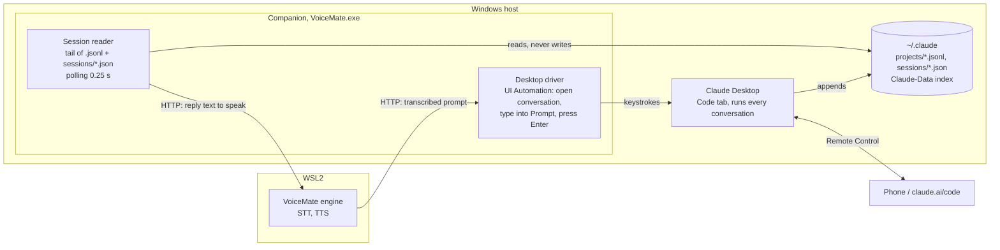

# Research: VoiceMate as a Claude Code client

Purpose: lab notes and measurements on turning VoiceMate into a third Claude Code client (next to the Claude Desktop app and the phone), with a recommended architecture. Research only: nothing here is wired into the production flow yet. Back to the [README](../../README.md).

Lab date: 2026-10-28. Versions seen: Claude Desktop 4.29.0 (its bundled CLI 2.1.309), `claude-agent-sdk` 0.2.174 (bundled CLI 2.1.310), `claude` on the Windows `PATH` 2.1.143. Prototypes live in [`tools/lab/claude_client/`](../../tools/lab/claude_client/).

## 1. Questions and short answers

| Question | Answer | Evidence |
|---|---|---|
| Does `ClaudeSDKClient` keep one process alive across turns? | Yes. The CLI child keeps the same PID for every turn until `disconnect()`. | §3, same PID on every turn |
| How much does a persistent process save? | About 1.7 s per turn: 1.4 s to the first token instead of 3.1 s. Model time is the same. | §3 |
| Do Desktop Code tab sessions use `~/.claude/projects/*.jsonl`? | Yes, the same files (`entrypoint: "claude-desktop"`). | §4 |
| Does an SDK session show up in the Desktop sidebar? | Not by default: the sidebar reads the Desktop's own index, not the projects folder. With Remote Control turned on it does, and the Desktop can type into it (§6.1). | §5, §6.1 |
| What puts a session on the phone? | Remote Control on the process that runs the session. The Desktop turns it on per running session (`bridge-session` lines in the transcript). | §6 |
| Does `resume` write to the same file? | Yes. `--resume <id>` and `resume=<id>` append to the same `<id>.jsonl` and keep the id; `fork_session` writes a new id with the history copied. | §7 |
| Can two writers share a session? | They do not corrupt the file, but each process only knows its own in-memory history: the conversation splits into branches and a later resume follows one branch and silently drops the other. One writer per session. | §7 |
| Can VoiceMate type into a conversation the Desktop is running, so it shows in the Desktop and on the phone? | Yes, through Windows UI Automation: find the prompt box, type, press Enter. Tested end to end; the text arrives as a normal user prompt. The local messaging pipe works on CLI sessions but did not deliver into a Desktop session. | §8 |
| Can VoiceMate put its own session on the phone? | Yes, through an undocumented `remote_control` control request on the `stream-json` protocol (the one the Desktop uses). The session appeared in the phone app and a prompt the person sent from the phone was answered by the VoiceMate process (§6.1). | §6 |
| Can the reader stay off the SDK/CLI? | Yes. Transcripts plus `~/.claude/sessions/<pid>.json` give messages, turn ends and busy/idle. Works from WSL through `/mnt/c`. | §4, §9 |
| Windows or WSL for the persistent core? | Windows (companion side), next to the Desktop. | §10 |

## 2. Authentication is the first blocker

The Desktop app authenticates its own sessions: it starts the CLI with `CLAUDE_CODE_SDK_HAS_HOST_AUTH_REFRESH=1` and hands tokens over the SDK control channel. Nothing is stored for other clients. On this machine:

- `claude auth status` (Windows, outside the Desktop environment) reports `loggedIn: false`; `~/.claude/.credentials.json` holds empty tokens.
- The WSL distro has its own `~/.claude` with a token that expired in July, and no `claude` on `PATH`. The engine venv in WSL does not have `claude-agent-sdk` installed.

So a VoiceMate client needs its own login: `claude auth login` once on the side that runs it, or `claude setup-token` for a long-lived token passed as `CLAUDE_CODE_OAUTH_TOKEN`.

**Pitfall found in the lab.** A CLI started from inside a Desktop session inherits the Desktop host variables (`CLAUDECODE`, `CLAUDE_CODE_ENTRYPOINT`, `CLAUDE_CODE_SDK_HAS_HOST_AUTH_REFRESH`, `CLAUDE_CODE_MESSAGING_*`, ...). The first lab run did exactly that and the child rewrote `~/.claude/.credentials.json` with empty tokens (the file's mtime matches the first lab session to the second). The prototypes now drop every `CLAUDE_CODE_*` variable plus `CLAUDECODE` and `CLAUDE_PID`, keeping only `CLAUDE_CODE_OAUTH_TOKEN`, `CLAUDE_CONFIG_DIR` and `CLAUDE_CODE_GIT_BASH_PATH` (`scrub_host_env()` in `persistent_client.py`; there is no flag to turn it off). The overwrite is inferred from the file mtimes, not traced to one variable. Production code that may be started from a Claude session (tests, dev runs) must do the same.

After the incident the person logged in again outside the lab. The tests with a login (§3, second table) used the refreshed `~/.claude/.credentials.json`, without `CLAUDE_CODE_OAUTH_TOKEN`.

## 3. Latency: persistent process vs one process per message

Strategies measured by [`bench_latency.py`](../../tools/lab/claude_client/bench_latency.py), model `claude-haiku-5-5`, no tools, one short prompt per turn:

- **sdk-persistent**: one `ClaudeSDKClient`, N turns over the same process (what `app/features/claude/runtime.py` already does).
- **sdk-query**: `claude_agent_sdk.query()` per message with `resume`, a new process each time.
- **cli-resume**: `claude -p --resume <id>` per message.
- **cli-stream**: one `claude -p --input-format stream-json --output-format stream-json` process fed turn by turn on stdin.

Process overhead only. These runs were made before the login was restored; without a valid login they return a local error, so this is spawn + init, no API time:

| Strategy | First turn | Next turns | PIDs over 4 turns |
|---|---|---|---|
| sdk-persistent | 0.63 to 2.15 s (connect) | 0.04 to 0.06 s | 1 |
| cli-stream | 0.98 s (spawn) | 0.02 s | 1 |

With a logged-in CLI, Windows 11, `claude-haiku-5-5`, 3 runs of 5 turns each, all strategies on the SDK's bundled CLI 2.1.310. TTFT is the time to the first text delta; "end" is when the process reports the result (for one-shot strategies it includes the process exit, about 1.2 s after the text ends). Median, with min to max in brackets:

| Strategy | Turn 1 TTFT | Turn 1 end | Turns 2 to 5 TTFT | Turns 2 to 5 end | Processes |
|---|---|---|---|---|---|
| sdk-persistent | 5.12 s (2.11 to 6.46) | 5.22 s | **1.37 s** (1.06 to 2.89) | **1.56 s** | 1 |
| cli-stream | 1.93 s (1.83 to 3.35) | 2.09 s | **1.53 s** (1.25 to 2.89) | **1.59 s** | 1 |
| sdk-query | 2.13 s (2.05 to 2.14) | 3.46 s | 3.22 s (2.15 to 5.06) | 4.44 s | 1 per turn |
| cli-resume | 4.45 s (2.09 to 6.81) | 5.64 s | 2.91 s (2.72 to 5.20) | 4.17 s | 1 per turn |

Reading:

- A persistent process answers follow-up turns in about **1.4 to 1.5 s to the first token**, against about **2.9 to 3.2 s** when every message starts a process (`query()` or `claude -p --resume`). The saving is about 1.7 s per turn, all of it process start, init and transcript reload; the model time is the same.
- The SDK and the raw `stream-json` CLI perform the same once warm: the SDK is a thin wrapper over that exact process and protocol.
- The first turn of a persistent process is the slow one (`connect()` took 0.8 to 1.3 s in the logged-in runs, against 0.63 to 2.15 s in the first table, which came from the runs without a login; then a cold prompt cache). In the published measurements `sdk-persistent` always ran first, so its first turn includes a cold prompt cache that the other strategies did not pay; the later turns are not affected. `bench_latency.py --rounds N` now rotates the order each round. Connect when the app starts, not when the person speaks, and the person never pays it.
- The current VoiceMate runtime (`app/features/claude/runtime.py`) already keeps one `ClaudeSDKClient` alive for the life of the engine, so its voice chat is on the fast path. What it lacks is choosing *which* session to talk to and sharing it with the other clients.

## 4. Transcript format (`~/.claude/projects/<slug>/<session-id>.jsonl`)

**Folder slug.** The working directory with every non-alphanumeric character replaced by `-` (`C:\Users\allit\workspace\voice-mate` gives `C--Users-allit-workspace-voice-mate`). Paths longer than 200 characters are cut and get a base36 hash suffix (a port of the CLI hash is in `session_watch.py`). The drive letter keeps the case the client saw: both `C--Users-...` and `c--Users-...` exist side by side, so look the folder up case-insensitively. `CLAUDE_CONFIG_DIR` moves the whole `~/.claude`.

**One JSON object per line, append-only.** Line types seen across 767 local transcripts (1.5 GB):

| `type` | What it is | Reader use |
|---|---|---|
| `user` | Prompt typed by the person, or a `tool_result` block list | New prompt when `content` is text and `isMeta` is not set |
| `assistant` | One content block of an API reply (`text`, `thinking`, `tool_use`). Lines of the same reply share `message.id`. | Assistant text; `message.stop_reason == "end_turn"` closes the turn |
| `system` | `stop_hook_summary` (after a turn), `api_error`, `compact_boundary`, `informational` | Turn end, errors, compaction |
| `queue-operation` | `enqueue`/`dequeue`/`remove` of a prompt typed while the session was busy | Input from another client (Desktop, phone) |
| `custom-title`, `ai-title`, `agent-name` | Session title, rewritten every turn | Display name |
| `bridge-session` | Remote Control binding (`bridgeSessionId`) | Session is on the phone |
| `attachment`, `api-request*`, `file-history-*`, `last-prompt`, `mode`, `cost-state`, `pr-link`, `frame-link`, `atis-latch` | Client internals | Ignore |

Common fields on message lines: `uuid`, `parentUuid` (the conversation is a tree, resumes and forks branch it), `sessionId`, `timestamp` (UTC), `cwd`, `gitBranch`, `version`, `entrypoint` (`claude-desktop`, `sdk-py`, `sdk-cli`, `cli`), `isSidechain` (subagent traffic).

**Turn end.** Three signals, from cheapest to most reliable:

1. An `assistant` line with `stop_reason: "end_turn"` (9,256 of 92,427 assistant lines; `tool_use` means the turn continues).
2. A `system`/`stop_hook_summary` line, written after the turn when hooks are configured.
3. The live registry `~/.claude/sessions/<pid>.json` (one file per running client) switching `status` from `busy` to `idle`. It also carries `sessionId`, `cwd`, `name`, `entrypoint`, `bridgeSessionId` and the Desktop messaging pipe.

**Compaction.** A `system`/`compact_boundary` line with `parentUuid: null` and `logicalParentUuid`, followed by a `user` line with `isCompactSummary: true`. A reader that shows history should restart from the boundary.

**Latest assistant reply.** Walk back from the end to the last `assistant` line with `stop_reason: "end_turn"`, then join the `text` blocks of the lines that share its `message.id`.

## 5. Where the Desktop keeps its sessions

The Desktop is an MSIX app, but its user data moved out of the package container: `%LOCALAPPDATA%\Packages\Claude_pzs8sxrjxfjjc\LocalCache\Roaming\Claude` holds only a `.user-data-left` marker, and the live data is in `%LOCALAPPDATA%\Claude-Data\claude_pzs8sxrjxfjjc\`.

- `claude-code-sessions\<account>\<org>\local_<uuid>.json`: one file per sidebar entry. It maps the Desktop id (`local_...`) to `cliSessionId` (the `.jsonl` name) and stores title, cwd, worktree, branch, model, effort, permission mode, archive flag and `bridgeSessionIds`.
- `claude-code\<version>\`: the CLI builds the Desktop runs.
- The transcript itself is the normal `~/.claude/projects/...jsonl`.

An SDK session has no `local_*.json`, so it does not show in the sidebar as a local session (checked: the four lab sessions are missing from the Desktop's session list). With Remote Control on it shows anyway, as a remote session (§6.1). Writing that index file by hand would be an undocumented, fragile hack. The Desktop opens a known session from a deep link: `claude://claude.ai/epitaxy/local_<uuid>`.

## 6. Phone and Remote Control

A session reaches the phone (and claude.ai/code) through Remote Control, served by the process that runs the session. The Desktop enables it per running session and the transcript records a `bridge-session` line with the `bridgeSessionId`; the session stays on the phone while its process runs.

For a session VoiceMate runs itself:

- `claude --remote-control [name]` is documented, but for interactive mode only. With `-p` the flag is accepted and ignored (tested: no bridge, no `bridge-session` line).
- The Python SDK has no Remote Control option.
- The `stream-json` protocol has an undocumented control request, the one the Desktop sends. Tested on a throwaway session:

```json
{"type": "control_request", "request_id": "rc1", "request": {"subtype": "remote_control", "enabled": true}}
```

The CLI answered with `session_url` (`https://claude.ai/code/session_...`), `bridge_session_id` and system events `bridge_state: ready` then `connected`; the next turn kept working. After the switch the session also loaded the account's claude.ai connectors as tools, even with `--tools ""`, so a VoiceMate session with Remote Control on is not tool-free any more.

The transcript of that session got the same `bridge-session` lines the Desktop sessions have. In this first run the phone was not checked. In the §6.1 run the session appeared in the phone app (checked by the person). A prompt typed on the phone also reached the VoiceMate process in that run (§6.1).


### 6.1 A VoiceMate-owned session in the Desktop (tested, works)

Test on 2026-10-28 with [`rc_session_lab.py`](../../tools/lab/claude_client/rc_session_lab.py): a `stream-json` CLI started by the lab (the transport the SDK uses), named `VoiceMate RC probe 1657`, one turn, then the `remote_control` request, then a second turn, kept alive for 15 minutes.

- **It shows in the Desktop sidebar.** About 15 s after the request the entry appeared in the Code tab's sidebar with its own "more options" menu, and it was absent before (checked through UI Automation).
- **The whole history shows.** Opening it in the Desktop showed both turns, including the one sent before Remote Control was turned on.
- **The Desktop can write into it.** A prompt typed into that conversation in the Desktop (through the UI Automation lab) was delivered to the lab's process, which answered; the answer showed in the Desktop and in the lab's `stdout`. The process VoiceMate runs stays the only writer: the Desktop and the phone are remote clients of it, like the phone is for a Desktop session.
- **Phone:** the session "VoiceMate RC probe 1657" appeared in the phone app, checked by the person at 17:05 on 2026-10-28. At about 17:12 the person sent "Oi" from the phone and the lab's process answered it ("Oi! Em que posso ajudar?" on its stdout). The stream-json output carried the answer but did not echo the remote user's prompt, so a reader that needs the prompt text should take it from the transcript on disk.
- **Not checked:** what the Desktop shows after the process exits, and whether the entry comes back when VoiceMate resumes the same session id later with Remote Control on again.

This changes the recommendation (§11): VoiceMate can own its main conversation and still meet the "visible in the Desktop and on the phone" requirement.

## 7. Resume, fork and two writers

Run by [`resume_lab.py`](../../tools/lab/claude_client/resume_lab.py) on throwaway sessions only. Writer A is a persistent `ClaudeSDKClient`; writer B is `claude -p --resume <id>`, a second process on the same session while A stays open.

1. A creates the session and is told the secret word BANANA.
2. B resumes the same id and is told the secret number 42. B appends to the **same file** and reports the **same session id**.
3. A is asked what it knows: "BANANA, I don't have a secret number". A never reloads the file, so B's turn does not exist for it.
4. A and B send a turn at the same time. Both finish; B even reads A's half-written turn and answers it ("No response requested.") before its own.
5. A fresh resume, after both closed, is asked to list everything: it sees BANANA and "A here", not 42 and not "B here".
6. `fork_session=True` on that id returns a new id and a new file holding only the branch that resume follows.

The transcript explains it. Every line has `uuid` and `parentUuid`; A's turn after B points to the same parent as B's turn, so the file holds two sibling branches. Resume follows the most recent leaf and drops the other branch, silently. All 103 lines still parse: there is no corruption, only divergence.

Consequences:

- **One writer per session at a time.** VoiceMate must never `resume` a session that the Desktop (or the phone through the Desktop) is running. `~/.claude/sessions/<pid>.json` tells whether a process owns that session id right now; refuse, or `fork_session`, when one does.
- **Joining a running Desktop session means going through its owner.** Remote Control (claude.ai/code on the phone or the browser) is the supported way to type into a session the Desktop runs. The Desktop also has an internal per-session messaging pipe (`messagingSocketPath` and a token in `~/.claude/sessions/<pid>.json`), used for session-to-session messages; it is undocumented and token-gated, so it is not a base for VoiceMate.
- **Taking over an idle session works at the file level.** When no process owns a session, resuming it appends a clean, linear continuation (step 2 above, with A idle). The Desktop reads the same transcript when it starts that session again, so it should show those turns; this lab did not open a Desktop session to confirm it, because it only touched throwaway sessions and the Desktop lists only sessions it created.
- The CLI help says `claude --bg --resume <id>` "starts a copy and says so when the session is already running": the CLI itself avoids the second writer for background sessions. Plain `-p --resume` and the SDK do not check.

## 8. Typing into a conversation the Desktop is running

Requirement from the person: every conversation VoiceMate opens or talks to must be visible in the Desktop app and therefore on the phone. A session VoiceMate runs itself meets it once Remote Control is on (§6.1). This section covers the other case: feeding a conversation the Desktop already runs, the way the phone does, without a second writer (§7). Three routes were tried, only on throwaway sessions or on the lab's own session.

### 8.1 Windows UI Automation (tested, works)

The Desktop is an Electron app, so Chromium exposes the page to UI Automation, the API screen readers use. The tree is empty on the first query and fills in on the next one (Chromium turns accessibility on when a client asks). [`desktop_uia_lab.py`](../../tools/lab/claude_client/desktop_uia_lab.py):

- The window is the top-level `Chrome_WidgetWin_1` named `Claude`. The open conversation is the `Document` with `AutomationId == "RootWebArea"`; its name is `<title> - Claude Code`.
- The prompt box is an `Edit` control of class `tiptap ProseMirror`, named `Prompt`. It has no Value pattern; its text is in its `Text` children.
- Writing: bring the window forward (`SetActive`), focus the editor, send the keystrokes, then Enter. Keystrokes go to the foreground window, so skipping `SetActive` sends them to whatever app has focus. The first attempt without it typed nothing into the box.
- Result: a prompt typed this way into the lab session arrived as a normal user prompt (a `queue-operation` `enqueue` while the session was busy, then delivered as the person's own message), so it also shows on the phone through the Desktop's Remote Control. Typing and sending took about 2.1 s, most of it the per-key typing delay; pasting from the clipboard would be faster.
- Reading the answer through UI Automation works (the conversation text is exposed as `Text` controls) but is noisy: tool output, side panels and hidden screen-reader strings are mixed in. Reading the transcript on disk is cleaner (§9). The Desktop index (§5) maps the conversation (`local_<uuid>`, title) to the `.jsonl` file.
- Opening a given conversation first: the deep link `claude://claude.ai/epitaxy/local_<uuid>` (not exercised in this lab).

Side note: the same tree shows a "press and hold to record" button next to the prompt box, so the Desktop has its own dictation; VoiceMate's value there is its hotkey, its STT quality and speaking the answer back.

Limits: the Desktop window must be open, it takes focus while VoiceMate types, the UI tree changes with Desktop releases (class names, labels in the UI language), and it only drives the conversation shown in the window.

### 8.2 Local messaging pipe (tested, works on CLI sessions only)

Every Claude Code process binds `\\.\pipe\LOCAL\cc-msg-<hex>`, listed as `messagingSocketPath` in `~/.claude/sessions/<pid>.json`, with a `<pid>.<hash>.key` file holding `peerToken`. A peer connects and writes two JSON lines: `{"type": "auth", "token": <peerToken>}` then `{"type": "user", "message": {"role": "user", "content": "..."}}`. [`pipe_inject_lab.py`](../../tools/lab/claude_client/pipe_inject_lab.py):

- Into a throwaway `stream-json` CLI session: without the auth line nothing happens; with it the prompt runs and the reply is in the transcript ("pipe ok").
- The prompt is delivered as a peer message, wrapped in "Another Claude session sent a message ... not typed by your user". The model treats it as a teammate's request, not as the person: it cannot approve permissions, for example.
- Into the lab's own Desktop session (tested by hand, not by the script: connecting to the `messagingSocketPath` of that session's `<pid>.json` and sending the same two lines): the write succeeded but nothing was delivered after several minutes (no `queue-operation` line). The Desktop appears to hold or filter peer messages for its sessions. Not a route for Desktop conversations.

### 8.3 claude.ai session API (not tested, by design)

The phone talks to the session through claude.ai, and the CLI binary contains the endpoints it uses (`/v1/code/sessions/{id}/events`, `/events/stream`, `/bridge`, ...). Using them from VoiceMate would mean taking the person's OAuth token out of `~/.claude/.credentials.json` and calling an undocumented API as if VoiceMate were a first-party client. That was not done: it is fragile, and handling the token by hand is not acceptable for a lab. If Anthropic documents a Remote Control client API, this becomes the cleanest route.

### 8.4 What UI Automation can do while the person works in another app

Scenario: the person is typing in a spreadsheet and presses the VoiceMate hotkey. Tested with Notepad as the stand-in app ([`desktop_background_lab.py`](../../tools/lab/claude_client/desktop_background_lab.py)):

- **Reading works in the background and minimized.** The whole tree (conversation text, prompt box, sidebar) stays readable with the Desktop minimized; no focus change.
- **Buttons work in the background and minimized.** Invoking a sidebar entry switched the open conversation with the window minimized and Notepad in front; the time from `Invoke()` until the document name changed was about 0.8 s. This and the 2.2 s below were measured with an earlier version of the script, before the foreground, title and focus guards; they were not measured again, and the script now prints that interval. Other invokable controls seen: the `Claude`/`Code` tabs, the session panes (`Terminal`, `Alterações`, `Navegador`, `Arquivos`), `Nova sessão em <project>` per project, the send button (not exercised: the lab sends with Enter). Sidebar labels change with state (the title plus a running suffix, or `Mensagem recebida de <title>`), so the lab matches the title exactly or followed by a separator and re-reads after each action. A `Mensagem recebida de <title>` label does not match that rule: the lab then reports the button as not found, and step 4 still refuses to type unless the open conversation is the lab's. Production code should match on the conversation id from the Desktop index (§5), not on labels.
- **Typing does not work without focus.** Posting `WM_CHAR` messages to the Desktop's web view, in the background or minimized, put nothing in the prompt box. The ProseMirror editor only takes real keyboard input, and that goes to the foreground window.
- **"Flash" mode works.** Bring the Desktop forward, focus the prompt, type, press Enter, give the foreground back to the previous window. Notepad got the focus back and kept receiving the person's typing; the prompt arrived in the Desktop as a normal message. The run took 2.2 s, most of it walking the accessibility tree from scratch; the part where the Desktop holds the focus is the typing itself. Pasting instead of typing and caching the prompt element should bring it to a few hundred milliseconds. Keystrokes the person makes during that window go to the Desktop, so VoiceMate should do it in one short burst (or ask the person to pause).
- **Guards in the labs.** `desktop_uia_lab.py` `type`/`send` require `--expect-title`; both UI Automation labs share `uia_common.py`, which matches the window by class (`Chrome_WidgetWin*`) and exact name `Claude`, not by process (a Chrome or Edge tab on claude.ai has a longer title), and aborts unless that window is the foreground, the open conversation's title is exactly the expected one and the keyboard focus is in the prompt box, checked right before the keys and again before Enter.
- **Lesson from an incident in the lab.** After a conversation switch the lab typed into the wrong conversation (text only, not sent, then removed), because it checked the open conversation once at the start. Check the open conversation's title immediately before every keystroke burst and refuse to type when it does not match.

## 9. Disk reader prototype

[`session_watch.py`](../../tools/lab/claude_client/session_watch.py), standard library only:

```bash
python tools/lab/claude_client/session_watch.py list
python tools/lab/claude_client/session_watch.py follow <session-id>
```

It keeps a byte offset per file, holds back an unfinished last line until its newline arrives, maps lines to events (`user`, `assistant_text`, `tool_use`, `turn_end`, `compact`, `queued`, `error`, `title`) and polls `~/.claude/sessions/*.json` for busy/idle. Polling every 0.25 s was chosen over file-system events because it works the same on NTFS, on `/mnt/c` from WSL (no inotify over 9p) and on `\\wsl.localhost` from Windows. From WSL with `CLAUDE_CONFIG_DIR=/mnt/c/Users/<user>/.claude`, one `stat` costs about 1.8 ms and following a session works unchanged; listing all 767 transcripts takes 1.7 s, so the list should be cached.

## 10. Windows or WSL for the core

- The Desktop, its sessions, `~/.claude` and the projects the person works on are on Windows. A core in WSL would need its own login, would see Windows projects only as `/mnt/c/...` (a different slug, `-mnt-c-...`, so a different session folder) and would cross the 9p bridge for every read.
- The engine in WSL only needs text in and text out for voice chat; it already talks HTTP to the companion.

Recommendation: the persistent Claude core runs on the Windows companion side, with the Windows `claude` login; the WSL engine asks the companion over the existing local HTTP channel. If it ever has to run in WSL, set `CLAUDE_CONFIG_DIR` to the Windows `~/.claude` only for reading, never for a second writer.

## 11. Recommended architecture

> Update after §6.1: there are two complementary roles. (1) VoiceMate's own main conversation runs in a persistent `stream-json` process owned by the companion, with Remote Control on, so it shows in the Desktop and in the phone app and can be continued from the Desktop and from the phone. (2) Other conversations the Desktop runs are driven as described below (UI Automation in, disk reader out). The diagram covers role 2.

The person's requirement (everything visible in the Desktop and on the phone) decides it: the Desktop stays the only process that runs the conversations, and VoiceMate is a voice front end for it, like the phone is.



1. **Input through the Desktop.** A companion hotkey (or the voice flow) sends the transcribed text to the chosen conversation: UI Automation switches to it if needed (works in the background), takes the focus for a short burst, pastes into the `Prompt` box, presses Enter and gives the focus back to the app the person was using (§8.4). Optionally a "fill only" mode leaves the text in the box for the person to review and send. The conversation then shows in the Desktop and on the phone like any typed prompt.
2. **Output from disk.** The session reader maps the open conversation to its `.jsonl` (Desktop index, §5), follows it and emits the assistant text at `turn_end` (or as it arrives) for the engine to speak. No SDK or CLI process is spawned to read.
3. **Picking a conversation.** The reader lists conversations with title and busy/idle; VoiceMate opens one by invoking its sidebar entry (tested, works minimized) or with the deep link `claude://claude.ai/epitaxy/local_<uuid>`.
4. **SDK core only as an option.** A persistent `ClaudeSDKClient` (§3, about 1.5 s to the first token) stays useful for quick voice questions that do not need to be in the Desktop. It must never resume a conversation the Desktop is running (§7). With the requirement above, it is a secondary mode, not the base.
5. **Windows side.** Both pieces live in the companion, next to the Desktop window and `~/.claude`; the WSL engine keeps doing speech and talks to the companion over the existing local HTTP channel.

Suggested order for the production work: (a) session reader in the companion (list, follow, speak the last answer); (b) "send to Claude" hotkey with UI Automation, fill-only first, then fill and send; (c) opening a chosen conversation by deep link; (d) the SDK quick-question mode if still wanted.

## 12. Risks

- **Undocumented formats.** The `.jsonl` line types, `~/.claude/sessions/<pid>.json` and the Desktop index are internal. New line types appear often (this lab saw 22). Parse defensively: ignore unknown types, never fail on a missing field, pin the tested CLI version in a test fixture.
- **Auth coupling.** The Desktop's host auth is not reusable. VoiceMate needs its own login and must scrub the Desktop variables when started from a Claude session.
- **Version drift.** Three CLI versions coexist on this machine (2.1.143 on `PATH`, 2.1.309 in the Desktop, 2.1.310 in the SDK). Use the SDK's bundled CLI and record its version.
- **UI Automation is a UI contract, not an API.** Class names (`tiptap ProseMirror`), the `Prompt` label (it follows the UI language) and the layout can change with any Desktop release. Match on several properties, check the conversation title before typing, and fail loudly instead of typing into the wrong place.
- **Focus.** Typing needs the Desktop window in the foreground; VoiceMate takes focus for about a second each time. Never send keystrokes without confirming the focused element is the prompt box.
- **Clock skew.** WSL and Windows clocks differed by about 20 s during the lab; compare transcript `timestamp` values, not file mtimes across the boundary.
