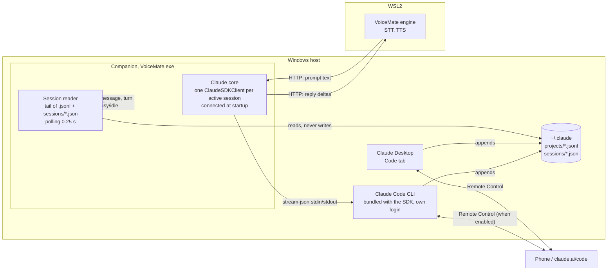

# Research: VoiceMate as a Claude Code client

Purpose: lab notes and measurements on turning VoiceMate into a third Claude Code client (next to the Claude Desktop app and the phone), with a recommended architecture. Research only: nothing here is wired into the production flow yet. Back to the [README](../../README.md).

Lab date: 2026-10-28. Versions seen: Claude Desktop 4.29.0 (its bundled CLI 2.1.309), `claude-agent-sdk` 0.2.174 (bundled CLI 2.1.310), `claude` on the Windows `PATH` 2.1.143. Prototypes live in [`tools/lab/claude_client/`](../../tools/lab/claude_client/).

## 1. Questions and short answers

| Question | Answer | Evidence |
|---|---|---|
| Does `ClaudeSDKClient` keep one process alive across turns? | Yes. The CLI child keeps the same PID for every turn until `disconnect()`. | §3, same PID on every turn |
| How much does a persistent process save? | About 1.7 s per turn: 1.4 s to the first token instead of 3.1 s. Model time is the same. | §3 |
| Do Desktop Code tab sessions use `~/.claude/projects/*.jsonl`? | Yes, the same files (`entrypoint: "claude-desktop"`). | §4 |
| Does an SDK session show up in the Desktop sidebar? | No. The sidebar reads the Desktop's own index, not the projects folder. | §5 |
| What puts a session on the phone? | Remote Control on the process that runs the session. The Desktop turns it on per running session (`bridge-session` lines in the transcript). | §6 |
| Does `resume` write to the same file? | Yes. `--resume <id>` and `resume=<id>` append to the same `<id>.jsonl` and keep the id; `fork_session` writes a new id with the history copied. | §7 |
| Can two writers share a session? | They do not corrupt the file, but each process only knows its own in-memory history: the conversation splits into branches and a later resume follows one branch and silently drops the other. One writer per session. | §7 |
| Can VoiceMate put its own session on the phone? | Yes, through an undocumented `remote_control` control request on the `stream-json` protocol (the one the Desktop uses). | §6 |
| Can the reader stay off the SDK/CLI? | Yes. Transcripts plus `~/.claude/sessions/<pid>.json` give messages, turn ends and busy/idle. Works from WSL through `/mnt/c`. | §4, §8 |
| Windows or WSL for the persistent core? | Windows (companion side). | §9 |

## 2. Authentication is the first blocker

The Desktop app authenticates its own sessions: it starts the CLI with `CLAUDE_CODE_SDK_HAS_HOST_AUTH_REFRESH=1` and hands tokens over the SDK control channel. Nothing is stored for other clients. On this machine:

- `claude auth status` (Windows, outside the Desktop environment) reports `loggedIn: false`; `~/.claude/.credentials.json` holds empty tokens.
- The WSL distro has its own `~/.claude` with a token that expired in July, and no `claude` on `PATH`. The engine venv in WSL does not have `claude-agent-sdk` installed.

So a VoiceMate client needs its own login: `claude auth login` once on the side that runs it, or `claude setup-token` for a long-lived token passed as `CLAUDE_CODE_OAUTH_TOKEN`.

**Pitfall found in the lab.** A CLI started from inside a Desktop session inherits the Desktop host variables (`CLAUDECODE`, `CLAUDE_CODE_ENTRYPOINT`, `CLAUDE_CODE_SDK_HAS_HOST_AUTH_REFRESH`, `CLAUDE_CODE_MESSAGING_*`, ...). The first lab run did exactly that and the child rewrote `~/.claude/.credentials.json` with empty tokens (the file's mtime matches the first lab session to the second). The prototypes now drop those variables (`scrub_host_env()` in `persistent_client.py`). Production code that may be started from a Claude session (tests, dev runs) must do the same.

## 3. Latency: persistent process vs one process per message

Strategies measured by [`bench_latency.py`](../../tools/lab/claude_client/bench_latency.py), model `claude-haiku-5-5`, no tools, one short prompt per turn:

- **sdk-persistent**: one `ClaudeSDKClient`, N turns over the same process (what `app/features/claude/runtime.py` already does).
- **sdk-query**: `claude_agent_sdk.query()` per message with `resume`, a new process each time.
- **cli-resume**: `claude -p --resume <id>` per message.
- **cli-stream**: one `claude -p --input-format stream-json --output-format stream-json` process fed turn by turn on stdin.

Process overhead only (runs without a valid login return a local error, so this is spawn + init, no API time):

| Strategy | First turn | Next turns | PIDs over 4 turns |
|---|---|---|---|
| sdk-persistent | 0.63 to 2.15 s (connect) | 0.04 to 0.06 s | 1 |
| cli-stream | 0.98 s (spawn) | 0.02 s | 1 |

With a logged-in CLI, Windows 11, `claude-haiku-5-5`, 3 runs of 5 turns each, all strategies on the SDK's bundled CLI 2.1.310. TTFT is the time to the first text delta; "end" is when the process reports the result (for one-shot strategies it includes the process exit, about 1.2 s after the text ends). Median, with min to max in brackets:

| Strategy | Turn 1 TTFT | Turn 1 end | Turns 2 to 5 TTFT | Turns 2 to 5 end | Processes |
|---|---|---|---|---|---|
| sdk-persistent | 5.12 s (2.11 to 6.46) | 5.22 s | **1.37 s** (1.06 to 2.89) | **1.56 s** | 1 |
| cli-stream | 1.93 s (1.83 to 3.35) | 2.09 s | **1.53 s** (1.25 to 2.89) | **1.59 s** | 1 |
| sdk-query | 2.13 s (2.05 to 2.14) | 3.46 s | 3.22 s (2.15 to 5.06) | 4.44 s | 1 per turn |
| cli-resume | 4.45 s (2.09 to 6.81) | 5.64 s | 2.91 s (2.72 to 5.20) | 4.17 s | 1 per turn |

Reading:

- A persistent process answers follow-up turns in about **1.4 to 1.5 s to the first token**, against about **2.9 to 3.2 s** when every message starts a process (`query()` or `claude -p --resume`). The saving is about 1.7 s per turn, all of it process start, init and transcript reload; the model time is the same.
- The SDK and the raw `stream-json` CLI perform the same once warm: the SDK is a thin wrapper over that exact process and protocol.
- The first turn of a persistent process is the slow one (`connect()` took 0.8 to 1.3 s, then a cold prompt cache). Connect when the app starts, not when the person speaks, and the person never pays it.
- The current VoiceMate runtime (`app/features/claude/runtime.py`) already keeps one `ClaudeSDKClient` alive for the life of the engine, so its voice chat is on the fast path. What it lacks is choosing *which* session to talk to and sharing it with the other clients.

## 4. Transcript format (`~/.claude/projects/<slug>/<session-id>.jsonl`)

**Folder slug.** The working directory with every non-alphanumeric character replaced by `-` (`C:\Users\allit\workspace\voice-mate` gives `C--Users-allit-workspace-voice-mate`). Paths longer than 200 characters are cut and get a base36 hash suffix (a port of the CLI hash is in `session_watch.py`). The drive letter keeps the case the client saw: both `C--Users-...` and `c--Users-...` exist side by side, so look the folder up case-insensitively. `CLAUDE_CONFIG_DIR` moves the whole `~/.claude`.

**One JSON object per line, append-only.** Line types seen across 767 local transcripts (1.5 GB):

| `type` | What it is | Reader use |
|---|---|---|
| `user` | Prompt typed by the person, or a `tool_result` block list | New prompt when `content` is text and `isMeta` is not set |
| `assistant` | One content block of an API reply (`text`, `thinking`, `tool_use`). Lines of the same reply share `message.id`. | Assistant text; `message.stop_reason == "end_turn"` closes the turn |
| `system` | `stop_hook_summary` (after a turn), `api_error`, `compact_boundary`, `informational` | Turn end, errors, compaction |
| `queue-operation` | `enqueue`/`dequeue`/`remove` of a prompt typed while the session was busy | Input from another client (Desktop, phone) |
| `custom-title`, `ai-title`, `agent-name` | Session title, rewritten every turn | Display name |
| `bridge-session` | Remote Control binding (`bridgeSessionId`) | Session is on the phone |
| `attachment`, `api-request*`, `file-history-*`, `last-prompt`, `mode`, `cost-state`, `pr-link`, `frame-link`, `atis-latch` | Client internals | Ignore |

Common fields on message lines: `uuid`, `parentUuid` (the conversation is a tree, resumes and forks branch it), `sessionId`, `timestamp` (UTC), `cwd`, `gitBranch`, `version`, `entrypoint` (`claude-desktop`, `sdk-py`, `sdk-cli`, `cli`), `isSidechain` (subagent traffic).

**Turn end.** Three signals, from cheapest to most reliable:

1. An `assistant` line with `stop_reason: "end_turn"` (9,256 of 92,427 assistant lines; `tool_use` means the turn continues).
2. A `system`/`stop_hook_summary` line, written after the turn when hooks are configured.
3. The live registry `~/.claude/sessions/<pid>.json` (one file per running client) switching `status` from `busy` to `idle`. It also carries `sessionId`, `cwd`, `name`, `entrypoint`, `bridgeSessionId` and the Desktop messaging pipe.

**Compaction.** A `system`/`compact_boundary` line with `parentUuid: null` and `logicalParentUuid`, followed by a `user` line with `isCompactSummary: true`. A reader that shows history should restart from the boundary.

**Latest assistant reply.** Walk back from the end to the last `assistant` line with `stop_reason: "end_turn"`, then join the `text` blocks of the lines that share its `message.id`.

## 5. Where the Desktop keeps its sessions

The Desktop is an MSIX app, but its user data moved out of the package container: `%LOCALAPPDATA%\Packages\Claude_pzs8sxrjxfjjc\LocalCache\Roaming\Claude` holds only a `.user-data-left` marker, and the live data is in `%LOCALAPPDATA%\Claude-Data\claude_pzs8sxrjxfjjc\`.

- `claude-code-sessions\<account>\<org>\local_<uuid>.json`: one file per sidebar entry. It maps the Desktop id (`local_...`) to `cliSessionId` (the `.jsonl` name) and stores title, cwd, worktree, branch, model, effort, permission mode, archive flag and `bridgeSessionIds`.
- `claude-code\<version>\`: the CLI builds the Desktop runs.
- The transcript itself is the normal `~/.claude/projects/...jsonl`.

An SDK session has no `local_*.json`, so it never shows in the sidebar (checked: the four lab sessions are missing from the Desktop's session list). Writing that index file by hand would be an undocumented, fragile hack. The Desktop opens a known session from a deep link: `claude://claude.ai/epitaxy/local_<uuid>`.

## 6. Phone and Remote Control

A session reaches the phone (and claude.ai/code) through Remote Control, served by the process that runs the session. The Desktop enables it per running session and the transcript records a `bridge-session` line with the `bridgeSessionId`; the session stays on the phone while its process runs.

For a session VoiceMate runs itself:

- `claude --remote-control [name]` is documented, but for interactive mode only. With `-p` the flag is accepted and ignored (tested: no bridge, no `bridge-session` line).
- The Python SDK has no Remote Control option.
- The `stream-json` protocol has an undocumented control request, the one the Desktop sends. Tested on a throwaway session:

```json
{"type": "control_request", "request_id": "rc1", "request": {"subtype": "remote_control", "enabled": true}}
```

The CLI answered with `session_url` (`https://claude.ai/code/session_...`), `bridge_session_id` and system events `bridge_state: ready` then `connected`; the next turn kept working. After the switch the session also loaded the account's claude.ai connectors as tools, even with `--tools ""`, so a VoiceMate session with Remote Control on is not tool-free any more.

The transcript of that session got the same `bridge-session` lines the Desktop sessions have. Not verified: whether a prompt typed on the phone reaches the VoiceMate process. The test session stayed open for seven minutes with nobody typing on the phone, and the lab's browser pane is not signed in to claude.ai. Confirm it before building on it: start a session with `remote_control` on, type on the phone, and look for a `user` message on the process's stdout.


## 7. Resume, fork and two writers

Run by [`resume_lab.py`](../../tools/lab/claude_client/resume_lab.py) on throwaway sessions only. Writer A is a persistent `ClaudeSDKClient`; writer B is `claude -p --resume <id>`, a second process on the same session while A stays open.

1. A creates the session and is told the secret word BANANA.
2. B resumes the same id and is told the secret number 42. B appends to the **same file** and reports the **same session id**.
3. A is asked what it knows: "BANANA, I don't have a secret number". A never reloads the file, so B's turn does not exist for it.
4. A and B send a turn at the same time. Both finish; B even reads A's half-written turn and answers it ("No response requested.") before its own.
5. A fresh resume, after both closed, is asked to list everything: it sees BANANA and "A here", not 42 and not "B here".
6. `fork_session=True` on that id returns a new id and a new file holding only the branch that resume follows.

The transcript explains it. Every line has `uuid` and `parentUuid`; A's turn after B points to the same parent as B's turn, so the file holds two sibling branches. Resume follows the most recent leaf and drops the other branch, silently. All 103 lines still parse: there is no corruption, only divergence.

Consequences:

- **One writer per session at a time.** VoiceMate must never `resume` a session that the Desktop (or the phone through the Desktop) is running. `~/.claude/sessions/<pid>.json` tells whether a process owns that session id right now; refuse, or `fork_session`, when one does.
- **Joining a running Desktop session means going through its owner.** Remote Control (claude.ai/code on the phone or the browser) is the supported way to type into a session the Desktop runs. The Desktop also has an internal per-session messaging pipe (`messagingSocketPath` and a token in `~/.claude/sessions/<pid>.json`), used for session-to-session messages; it is undocumented and token-gated, so it is not a base for VoiceMate.
- **Taking over an idle session works at the file level.** When no process owns a session, resuming it appends a clean, linear continuation (step 2 above, with A idle). The Desktop reads the same transcript when it starts that session again, so it should show those turns; this lab did not open a Desktop session to confirm it, because it only touched throwaway sessions and the Desktop lists only sessions it created.
- The CLI help says `claude --bg --resume <id>` "starts a copy and says so when the session is already running": the CLI itself avoids the second writer for background sessions. Plain `-p --resume` and the SDK do not check.

## 8. Disk reader prototype

[`session_watch.py`](../../tools/lab/claude_client/session_watch.py), standard library only:

```bash
python tools/lab/claude_client/session_watch.py list
python tools/lab/claude_client/session_watch.py follow <session-id>
```

It keeps a byte offset per file, holds back an unfinished last line until its newline arrives, maps lines to events (`user`, `assistant_text`, `tool_use`, `turn_end`, `compact`, `queued`, `error`, `title`) and polls `~/.claude/sessions/*.json` for busy/idle. Polling every 0.25 s was chosen over file-system events because it works the same on NTFS, on `/mnt/c` from WSL (no inotify over 9p) and on `\\wsl.localhost` from Windows. From WSL with `CLAUDE_CONFIG_DIR=/mnt/c/Users/<user>/.claude`, one `stat` costs about 1.8 ms and following a session works unchanged; listing all 767 transcripts takes 1.7 s, so the list should be cached.

## 9. Windows or WSL for the core

- The Desktop, its sessions, `~/.claude` and the projects the person works on are on Windows. A core in WSL would need its own login, would see Windows projects only as `/mnt/c/...` (a different slug, `-mnt-c-...`, so a different session folder) and would cross the 9p bridge for every read.
- The engine in WSL only needs text in and text out for voice chat; it already talks HTTP to the companion.

Recommendation: the persistent Claude core runs on the Windows companion side, with the Windows `claude` login; the WSL engine asks the companion over the existing local HTTP channel. If it ever has to run in WSL, set `CLAUDE_CONFIG_DIR` to the Windows `~/.claude` only for reading, never for a second writer.

## 10. Recommended architecture



1. **Claude core in the companion (Windows).** One `ClaudeSDKClient` per session VoiceMate is talking to, opened at startup or when the person picks a session, kept open, closed after a long idle period. This keeps follow-up turns at about 1.5 s to the first token. Scrub the Desktop host variables before starting it. The WSL engine sends the transcribed prompt to the companion over the existing local HTTP channel and receives text deltas to speak.
2. **Session reader in the companion.** Standard library, polling (`session_watch.py` is the seed): lists sessions with titles and busy/idle, follows one session and emits `user`, `assistant_text`, `turn_end`, `queued`, `compact`. This is how VoiceMate shows or speaks what happens in a Desktop or phone conversation without running anything.
3. **Writing rules.** VoiceMate writes only to sessions it owns: new sessions it creates (optionally with Remote Control on, so they appear on the phone), or idle sessions it resumes. A session another process owns is read-only for VoiceMate; to say something into it, the person uses the Desktop or the phone, or VoiceMate forks it.
4. **Phone.** For VoiceMate's own sessions, send the `remote_control` control request after connecting (see §6). It is undocumented, so keep it behind a setting and fall back to "not on the phone" if the request fails.
5. **Desktop sidebar.** VoiceMate's sessions do not appear there and should not be forced in (writing the Desktop index is a private format). The Desktop can still open any transcript later through its own resume, and the reader shows them in VoiceMate.

Suggested order for the production work: (a) session reader in the companion with a session picker; (b) move the Claude core from the WSL engine to the companion, keyed by session id, with the one-writer check; (c) optional Remote Control for VoiceMate's sessions.

## 11. Risks

- **Undocumented formats.** The `.jsonl` line types, `~/.claude/sessions/<pid>.json` and the Desktop index are internal. New line types appear often (this lab saw 22). Parse defensively: ignore unknown types, never fail on a missing field, pin the tested CLI version in a test fixture.
- **Auth coupling.** The Desktop's host auth is not reusable. VoiceMate needs its own login and must scrub the Desktop variables when started from a Claude session.
- **Version drift.** Three CLI versions coexist on this machine (2.1.143 on `PATH`, 2.1.309 in the Desktop, 2.1.310 in the SDK). Use the SDK's bundled CLI and record its version.
- **Clock skew.** WSL and Windows clocks differed by about 20 s during the lab; compare transcript `timestamp` values, not file mtimes across the boundary.
