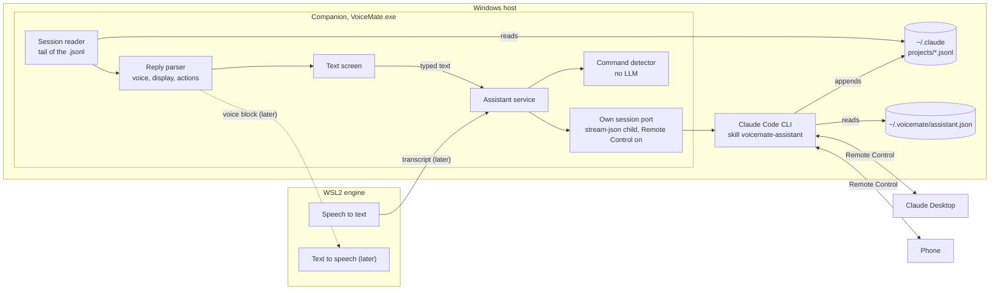

# Voice assistant: integration design

Design for turning the Claude Code client lab ([claude-code-client.md](claude-code-client.md)) into a VoiceMate feature: a voice-first personal assistant whose main conversation is a Claude Code conversation visible in the Claude Desktop and on the phone, and which conducts the person's other conversations. Back to the [README](../../README.md).

## Status

What this design started with has grown. The sections below keep the original MVP reasoning; this list says where the code is now.

| Part | State |
|---|---|
| Own session mode (`own_session`), skill, text window, reply parser, command detector | Shipped, as designed below |
| Desktop mode (`desktop`): the central is a Claude Desktop conversation, written by a brief UI Automation "flash" and read from its transcript (this is the "UI Automation mode" of the later stories) | Shipped, Windows only. See [claude-code-client.md](claude-code-client.md) sections 5 to 8 and [desktop-profile.md](../desktop-profile.md) |
| The `voicemate` tools of the own mode (list, read, send, start, set the model of one, stop) and the conversations the assistant starts (at most 4, Remote Control on) | Shipped. The assistant no longer needs the Desktop's session tools in the own mode, and VoiceMate does type into Desktop conversations, by a flash, to deliver a message |
| Spoken input (the talk hotkey) and spoken replies (the engine's voice through `/tts/v1`, with the short notices falling back to Windows speech) | Shipped |
| Actions | `set_setting`, `read_inbox` and `clear_inbox` are carried out; the others are still logged only |
| Direct mode, answer delivery (`speak`, `announce`, `sound`, `silent`), the inbox and "Hear what's ready" | Shipped |
| Settings by voice (the catalog), personality (none, file or written), notes vault, skill language and custom skill, permission mode | Shipped |

## 1. What the lab proved

- A `stream-json` session VoiceMate starts, with Remote Control on, shows in the Desktop sidebar and in the phone app with its full history, and prompts typed in either reach VoiceMate's process (report §6.1).
- A Claude Code conversation in the Desktop, on Haiku with low effort, can list the person's recent conversations, find one by title, send it a question with the app's session tools and read the answer in under a minute (test of 2026-10-28, sessions "VoiceMate lab central" and "VoiceMate lab target").
- The `voicemate-assistant` skill ([`tools/lab/assistant_skill/en/voicemate-assistant/SKILL.md`](../../tools/lab/assistant_skill/en/voicemate-assistant/SKILL.md)) makes Haiku answer in the configured language and in the three-block template, even with a personal CLAUDE.md that asks for another reply format.

## 2. Shape



The companion owns the conversation (the WSL engine has no Windows login, report §10). VoiceMate is the only writer of its session; the Desktop and the phone are remote clients of it. Other conversations are conducted by the assistant itself through the Desktop session tools, so VoiceMate never types into them in the MVP (the later Desktop mode and the delivery of a message to a Desktop conversation do, by a flash; see Status).

## 3. Modules

| Path | Content |
|---|---|
| `app/protocol/assistant_reply.py` | `parse_reply(text) -> ParsedReply`, `strip_expressions(voice)`; stdlib only, importable by the engine. |
| `app/companion/assistant/contract.py` | `AssistantService` and `ConversationPort` protocols, `AssistantSnapshot`, `ChatMessage`, `PortStatus`, the state and error `Literal`s. |
| `app/companion/assistant/session_reader.py` | Productized `session_watch.py`: Claude home (honours `CLAUDE_CONFIG_DIR`), project slug and long-path hash, `Tail`, `parse_line`, `last_messages`, `list_conversations`, `live_sessions`. |
| `app/companion/assistant/commands.py` | Voice command detector (section 6). |
| `app/companion/assistant/skill_install.py` | Skill install and the settings file the skill reads (section 5). |
| `app/companion/assistant/own_session.py` | `OwnSessionPort`: persistent `stream-json` child, `remote_control` request, resume by session id with the one-writer check. |
| `app/companion/assistant/service.py` | Wires port, reader, parser, detector; one worker thread; publishes snapshots. |
| `app/companion/assistant/skill/{en,pt-BR}/voicemate-assistant/` | Packaged copies of the skill, one per language. The lab copies in `tools/lab/assistant_skill/{en,pt-BR}/` must stay identical; a test compares them. |
| `app/companion/ui/assistant_window.py` | Text screen. |
| `app/companion/{contract,settings_store,controller,paths}.py`, `ui/{shell,tray,settings_window,demo_controller}.py` | Settings, wiring, tray entry, settings tab, demo fake. |
| `app/i18n/locales/*` | Every new UI string in all catalogs. |

Added since: `app/companion/win/claude_desktop.py` (the UI Automation port, from `uia_common.py`), `desktop_port.py`, `mcp_tools.py`, `conversations.py`, `notifier.py`, `inbox.py`, `settings_catalog.py`, `personality.py` and `app/companion/voice.py` (the voice, through the engine's `/tts/v1` endpoint instead of the `POST /speak` imagined here).

## 4. Settings

`[assistant]` table in `companion.toml`, frozen dataclass in `contract.py`, every choice a `Literal`:

```python
AssistantMode = Literal["off", "own_session", "desktop"]
AssistantModel = Literal["haiku", "sonnet", "opus"]
AssistantEffort = Literal["low", "medium", "high"]
ExpressionsMode = Literal["off", "on"]

@dataclass(frozen=True)
class AssistantSettings:
    mode: AssistantMode = "off"
    model: AssistantModel = "haiku"
    effort: AssistantEffort = "low"
    voice_commands: bool = True
    expressions: ExpressionsMode = "off"
    user_name: str = ""
    personality_file: str = ""   # optional .md, for example in an Obsidian vault
```

The session id is runtime state in the companion's state dir, not a setting. The assistant's language follows the interface language, not the dictation language.

## 5. Skill install and the settings file

1. Copy the packaged skill to `<claude_home>/skills/voicemate-assistant/` with a sidecar holding a hash per file; a file the person edited is not overwritten (the new one is written next to it as `.new`).
2. Write `~/.voicemate/assistant.json` (`version`, `language`, `user_name`, `personality_file`, `expressions`) whenever the assistant settings or the interface language change, and on every start. VoiceMate never reads the personality file itself.
3. Own session: start the CLI with the model and effort from the settings, a stable `cwd` under the companion's data dir, the host variables scrubbed (lab §2), first prompt `/voicemate-assistant`, then the `remote_control` request, title "VoiceMate".

## 6. Command detector

Pure function, no LLM: normalized text (case, accents, punctuation), a trigger phrase anchored at the start, at most about 12 words. Commands: read the last answer, switch the conversation the text screen follows, send to a conversation (delegated to the assistant as a prompt, so VoiceMate never becomes a second writer), stop speaking. Triggers per language (pt-BR, en, es) are data, not UI strings. Conversation titles are matched fuzzily with a minimum score and a margin over the second best; otherwise the result is "ambiguous" and nothing is done. Anything else goes to the assistant as a normal prompt.

## 7. Reply parsing

The template is defined by the skill (`<voice>`, optional `<display>`, `<actions>` with one JSON object). Parsing never raises. A reply without `<voice>` (typed in the Desktop, or a model slip) is shown, not spoken. Expression tags are stripped before text to speech and kept for later synthesis. Actions are parsed and logged; none is wired in the MVP.

## 8. MVP stories

- **E-1 Reply parser:** full template, missing display, missing voice (degraded), truncated last tag, bad or unknown-version actions, unknown action types, expression tags; never raises.
- **E-2 Session reader:** last N messages from fixture transcripts, skips meta, tool results, sidechains and unknown types, restarts after compaction, holds back a partial last line, case-insensitive slug and long-path hash, `CLAUDE_CONFIG_DIR`, busy or idle from `sessions/*.json`; following a growing file emits each event once.
- **E-3 Settings:** round trip through `companion.toml`, invalid enum falls back with a log line, assistant off by default, settings tab.
- **E-4 Skill install:** idempotent copy, edited files kept, `assistant.json` with the skill's exact keys and the interface language.
- **E-5 Own session:** child started with the configured model and effort, `/voicemate-assistant` first, Remote Control on, session id stored, resume only when no live process owns it. Manual check: visible and writable in the Desktop and on the phone.
- **E-6 Text screen:** tray entry, last 30 messages (display text, or voice when there is no display), live updates including replies to prompts typed elsewhere, input disabled with a localized reason when off, logged out or busy.
- **E-7 Command detector:** the four commands in pt-BR, en and es, accent and case insensitive, fuzzy titles with "ambiguous", no match on a trigger word in the middle of a sentence.

Done since: E-8 (the Desktop mode), E-9 (the talk hotkey sends the dictation to the assistant), E-10 (streaming voice), E-12 (personality and vault). E-11, dispatch of the actions other than `set_setting`, `read_inbox` and `clear_inbox`, is still to do.

## 9. Risks

- Undocumented formats and the `remote_control` request can change: parse defensively and fall back to a local session when Remote Control fails.
- With Remote Control on, the session loads the account's claude.ai connectors as tools (report §6); the skill keeps the central conversation light.
- One writer per session: never resume an id a live process owns.
- VoiceMate needs a Claude login on Windows; a missing or expired one is reported, not silent.
- Not checked yet: what the Desktop shows after the process exits, and whether the entry returns after a resume.
