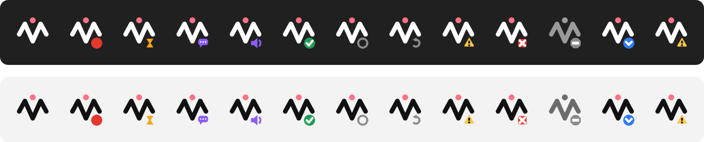
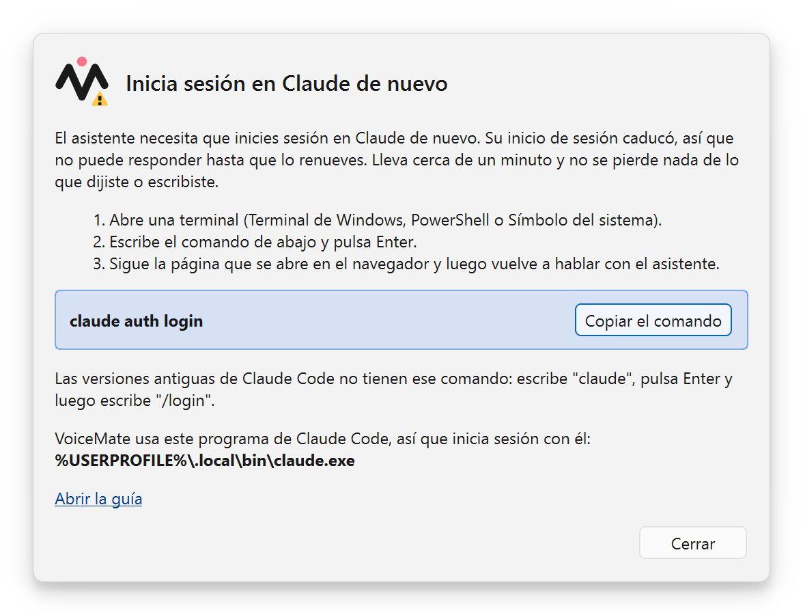

[English](sign-in-again.md) | [Português](sign-in-again.pt-BR.md) | **Español** | [Русский](sign-in-again.ru.md) | [简体中文](sign-in-again.zh-CN.md)

# Inicia sesión en Claude de nuevo

Esta página es para cuando el asistente de VoiceMate avisa de que su inicio de sesión de Claude caducó. Lleva cerca de un minuto, y no se pierde nada de lo que dijiste o escribiste.

## 🔎 Qué pasó

El asistente ejecuta el programa Claude Code (`claude`) en segundo plano, y ese programa necesita tu inicio de sesión en Claude. La sesión caduca de vez en cuando, y cerrar sesión en cualquier sitio también la termina. Mientras no inicies sesión de nuevo, el asistente no puede responder.

VoiceMate te avisa de varias maneras:

- Una insignia de aviso (un triángulo amarillo) en el icono de la bandeja, y la línea "El inicio de sesión de Claude caducó: haz clic para renovarlo" en su descripción emergente.
- Una notificación y una frase hablada.
- Un mensaje sencillo en la ventana del asistente, en lugar del error en bruto de Claude, con un botón "Cómo iniciar sesión".
- "Iniciar sesión en Claude de nuevo..." en el menú de la bandeja.

<p align="center"><br><sub>El último icono, con el triángulo amarillo, es el que debes buscar.</sub></p>

El dictado sigue funcionando: solo el asistente necesita el inicio de sesión de Claude.

## 🔑 Iniciar sesión de nuevo

1. Haz clic en el icono de la bandeja. La notificación, el elemento "Iniciar sesión en Claude de nuevo..." del menú de la bandeja y el botón "Cómo iniciar sesión" de la ventana del asistente abren la misma ventana:

   <p align="center"></p>

2. Abre una terminal: pulsa la tecla Windows, escribe `PowerShell` y pulsa Enter. Terminal de Windows y Símbolo del sistema también sirven.
3. Escribe el comando de abajo y pulsa Enter. El botón "Copiar el comando" de la ventana lo copia; pégalo en la terminal con clic derecho o `Ctrl+V`.

   ```powershell
   claude auth login
   ```

   Un Claude Code antiguo no tiene ese comando: escribe `claude`, pulsa Enter y luego escribe `/login`.
4. Sigue la página que se abre en el navegador e inicia sesión con tu cuenta de Claude.
5. Vuelve y habla con el asistente de nuevo.

La insignia desaparece sola con la primera respuesta que funcione.

## 🧭 ¿Qué `claude`?

La ventana muestra el programa exacto que ejecuta VoiceMate, por ejemplo `%USERPROFILE%\.local\bin\claude.exe` (`%USERPROFILE%` es tu carpeta de usuario). Inicia sesión con ese.

- Si la terminal dice que no conoce `claude`, ejecútalo con su ruta completa. Copia la ruta de la ventana, ponla entre comillas y añade `auth login`:

  ```powershell
  & "$env:USERPROFILE\.local\bin\claude.exe" auth login
  ```

- Si tienes más de una copia (por ejemplo otra dentro de WSL), iniciar sesión con la otra copia no sirve: usa la que muestra la ventana.
- Si la ventana dice que VoiceMate no encontró el programa Claude Code, instala Claude Code primero y luego reinicia el asistente. `VOICEMATE_CLAUDE_CLI` define qué programa usa VoiceMate ([configuración](configuration.es.md)).

## 🛠️ ¿Sigue sin responder?

- Pulsa Reiniciar en la ventana del asistente. Inicia el asistente de nuevo con el inicio de sesión nuevo.
- Iniciar sesión en la app Claude Desktop o en claude.ai no cuenta: tienen su propio inicio de sesión. El asistente necesita el del programa `claude`.
- Si la página del navegador no se abrió, la terminal muestra un enlace: ábrelo a mano.
- El registro del asistente dice qué respondió Claude. Una sesión caducada aparece como `Failed to authenticate. API Error: 401` o pide `/login`.

Más: [la guía del asistente](assistant.es.md) y [solución de problemas](troubleshooting.es.md#asistente-de-voz).
