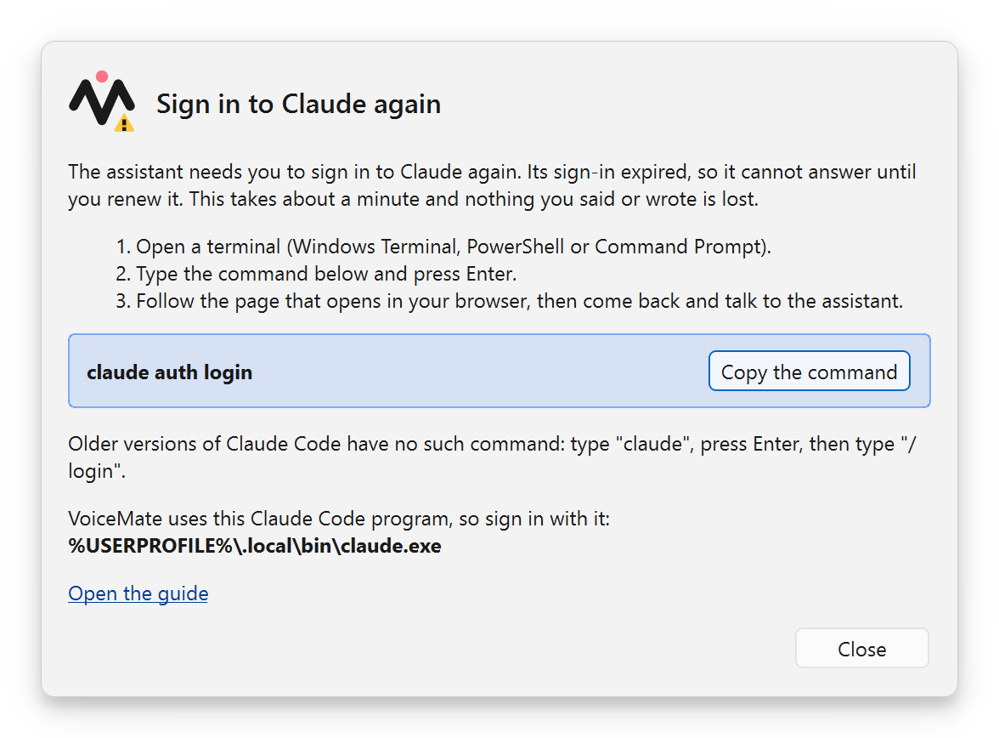

**English** | [Português](sign-in-again.pt-BR.md) | [Español](sign-in-again.es.md) | [Русский](sign-in-again.ru.md) | [简体中文](sign-in-again.zh-CN.md)

# Sign in to Claude again

This page is for when the VoiceMate assistant says its Claude sign-in expired. It takes about a minute, and nothing you said or wrote is lost.

## 🔎 What happened

The assistant runs the Claude Code program (`claude`) in the background, and that program needs your Claude sign-in. Sign-ins expire from time to time, and signing out anywhere also ends it. Until you sign in again, the assistant cannot answer.

VoiceMate tells you in several ways:

- A warning badge (a yellow triangle) on the tray icon, and the tooltip line "Claude sign-in expired: click to renew it".
- One notification, and a spoken line.
- A plain message in the assistant window instead of Claude's raw error, with a "How to sign in" button.
- "Sign in to Claude again..." in the tray menu.

<p align="center"><br><sub>The last icon, with the yellow triangle, is the one to look for.</sub></p>

Dictation keeps working: only the assistant needs the Claude sign-in.

## 🔑 Sign in again

1. Click the tray icon. The notification, the tray menu item "Sign in to Claude again..." and the "How to sign in" button in the assistant window open the same window:

   <p align="center"></p>

2. Open a terminal: press the Windows key, type `PowerShell` and press Enter. Windows Terminal and Command Prompt work too.
3. Type the command below and press Enter. The window's "Copy the command" button copies it; paste it in the terminal with a right click or `Ctrl+V`.

   ```powershell
   claude auth login
   ```

   An older Claude Code has no such command: type `claude`, press Enter, then type `/login`.
4. Follow the page that opens in your browser and sign in with your Claude account.
5. Come back and talk to the assistant again.

The badge goes away by itself with the first answer that works.

## 🧭 Which `claude`?

The window shows the exact program VoiceMate runs, for example `%USERPROFILE%\.local\bin\claude.exe` (`%USERPROFILE%` is your user folder). Sign in with that one.

- If the terminal says it does not know `claude`, run it by its full path. Copy the path from the window, put it in quotes and add `auth login`:

  ```powershell
  & "$env:USERPROFILE\.local\bin\claude.exe" auth login
  ```

- If you have more than one copy (for example another one inside WSL), signing in with the other copy does not help: use the one the window shows.
- If the window says VoiceMate did not find the Claude Code program, install Claude Code first, then restart the assistant. `VOICEMATE_CLAUDE_CLI` sets which program VoiceMate uses ([configuration](configuration.md)).

## 🛠️ Still not answering?

- Press Restart in the assistant window. It starts the assistant again with the new sign-in.
- Signing in to the Claude Desktop app or to claude.ai does not count: they keep their own sign-in. The assistant needs the one of the `claude` program.
- If the browser page did not open, the terminal prints a link: open it by hand.
- The assistant's log tells what Claude answered. An expired sign-in reads `Failed to authenticate. API Error: 401` or asks for `/login`.

More: [the assistant guide](assistant.md) and [troubleshooting](troubleshooting.md#voice-assistant).
