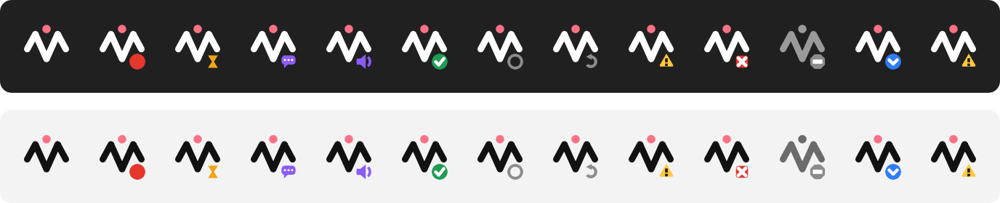
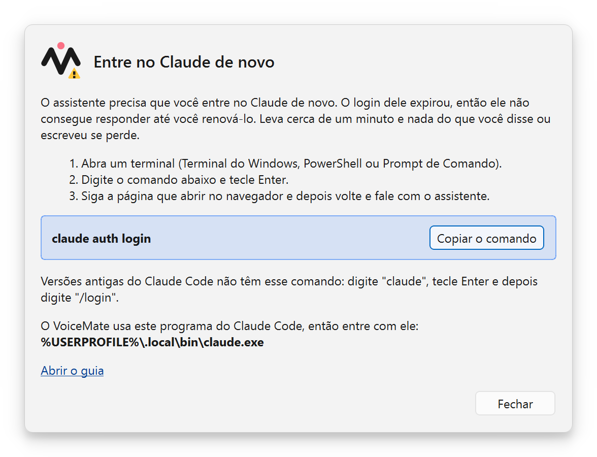

[English](sign-in-again.md) | **Português** | [Español](sign-in-again.es.md) | [Русский](sign-in-again.ru.md) | [简体中文](sign-in-again.zh-CN.md)

# Entre no Claude de novo

Esta página é para quando o assistente do VoiceMate avisa que o login dele no Claude expirou. Leva cerca de um minuto, e nada do que você falou ou escreveu se perde.

## 🔎 O que aconteceu

O assistente roda o programa Claude Code (`claude`) em segundo plano, e esse programa precisa do seu login no Claude. O login expira de tempos em tempos, e sair da conta em qualquer lugar também o encerra. Enquanto você não entrar de novo, o assistente não consegue responder.

O VoiceMate avisa de vários jeitos:

- Um selo de aviso (um triângulo amarelo) no ícone da bandeja, e a linha "Login do Claude expirou: clique para renovar" na dica dele.
- Uma notificação e uma frase falada.
- Uma mensagem simples na janela do assistente, no lugar do erro cru do Claude, com um botão "Como entrar".
- "Entrar no Claude de novo..." no menu da bandeja.

<p align="center"><br><sub>O último ícone, com o triângulo amarelo, é o que você deve procurar.</sub></p>

O ditado continua funcionando: só o assistente precisa do login no Claude.

## 🔑 Entrar de novo

1. Clique no ícone da bandeja. A notificação, o item "Entrar no Claude de novo..." do menu da bandeja e o botão "Como entrar" na janela do assistente abrem a mesma janela:

   <p align="center"></p>

2. Abra um terminal: aperte a tecla Windows, digite `PowerShell` e tecle Enter. O Terminal do Windows e o Prompt de Comando também servem.
3. Digite o comando abaixo e tecle Enter. O botão "Copiar o comando" da janela o copia; cole no terminal com o botão direito do mouse ou `Ctrl+V`.

   ```powershell
   claude auth login
   ```

   Um Claude Code antigo não tem esse comando: digite `claude`, tecle Enter e depois digite `/login`.
4. Siga a página que abrir no navegador e entre com a sua conta do Claude.
5. Volte e fale com o assistente de novo.

O selo some sozinho na primeira resposta que funcionar.

## 🧭 Qual `claude`?

A janela mostra o programa exato que o VoiceMate roda, por exemplo `%USERPROFILE%\.local\bin\claude.exe` (`%USERPROFILE%` é a sua pasta de usuário). Entre com esse.

- Se o terminal disser que não conhece o `claude`, rode-o pelo caminho completo. Copie o caminho da janela, ponha-o entre aspas e acrescente `auth login`:

  ```powershell
  & "$env:USERPROFILE\.local\bin\claude.exe" auth login
  ```

- Se você tem mais de uma cópia (por exemplo outra dentro do WSL), entrar com a outra cópia não adianta: use a que a janela mostra.
- Se a janela disser que o VoiceMate não encontrou o programa Claude Code, instale o Claude Code primeiro e depois reinicie o assistente. `VOICEMATE_CLAUDE_CLI` define qual programa o VoiceMate usa ([configuração](configuration.pt-BR.md)).

## 🛠️ Ainda não responde?

- Aperte Reiniciar na janela do assistente. Ele inicia o assistente de novo com o login novo.
- Entrar no app Claude Desktop ou no claude.ai não conta: eles têm o próprio login. O assistente precisa do login do programa `claude`.
- Se a página do navegador não abriu, o terminal mostra um link: abra-o à mão.
- O log do assistente diz o que o Claude respondeu. Um login expirado aparece como `Failed to authenticate. API Error: 401` ou pede `/login`.

Mais: [o guia do assistente](assistant.pt-BR.md) e [solução de problemas](troubleshooting.pt-BR.md#assistente-de-voz).
