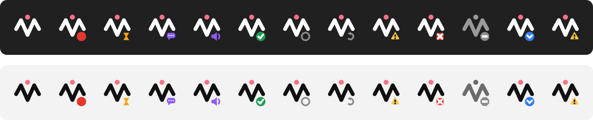
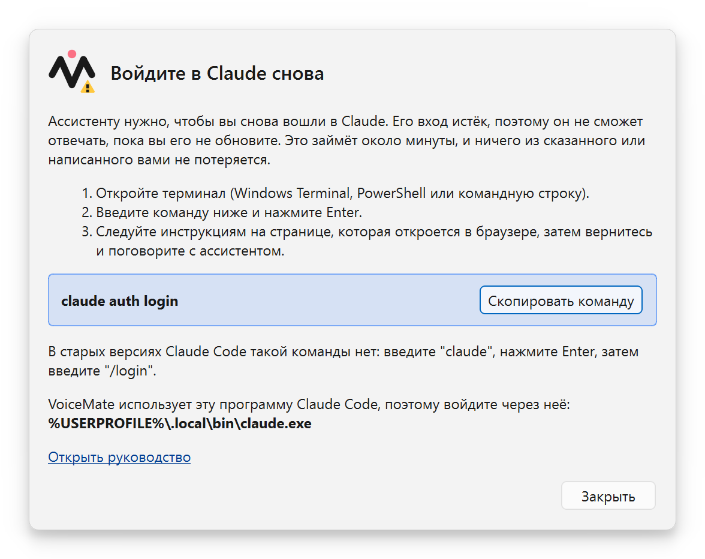

[English](sign-in-again.md) | [Português](sign-in-again.pt-BR.md) | [Español](sign-in-again.es.md) | **Русский** | [简体中文](sign-in-again.zh-CN.md)

# Войдите в Claude снова

Эта страница нужна, когда ассистент VoiceMate сообщает, что его вход в Claude истёк. Это занимает около минуты, и всё, что вы сказали или написали, сохраняется.

## 🔎 Что произошло

Ассистент запускает в фоне программу Claude Code (`claude`), и ей нужен ваш вход в Claude. Вход время от времени истекает, а выход из аккаунта где угодно тоже его завершает. Пока вы не войдёте снова, ассистент не может отвечать.

VoiceMate сообщает об этом несколькими способами:

- Значок предупреждения (жёлтый треугольник) на иконке в трее и строка «Вход в Claude истёк: нажмите, чтобы обновить» в её подсказке.
- Одно уведомление и произнесённая фраза.
- Понятное сообщение в окне ассистента вместо «сырой» ошибки Claude, с кнопкой «Как войти».
- Пункт «Войти в Claude снова...» в меню трея.

<p align="center"><br><sub>Последняя иконка, с жёлтым треугольником, та, которую нужно искать.</sub></p>

Диктовка продолжает работать: вход в Claude нужен только ассистенту.

## 🔑 Войти снова

1. Нажмите на иконку в трее. Уведомление, пункт «Войти в Claude снова...» в меню трея и кнопка «Как войти» в окне ассистента открывают одно и то же окно:

   <p align="center"></p>

2. Откройте терминал: нажмите клавишу Windows, введите `PowerShell` и нажмите Enter. Подойдут также Windows Terminal и командная строка.
3. Введите команду ниже и нажмите Enter. Кнопка «Скопировать команду» в окне копирует её; вставьте в терминал правой кнопкой мыши или `Ctrl+V`.

   ```powershell
   claude auth login
   ```

   В старом Claude Code такой команды нет: введите `claude`, нажмите Enter, затем введите `/login`.
4. Следуйте инструкциям на странице, которая откроется в браузере, и войдите в свой аккаунт Claude.
5. Вернитесь и снова поговорите с ассистентом.

Значок исчезнет сам после первого успешного ответа.

## 🧭 Какой `claude`?

В окне показана точная программа, которую запускает VoiceMate, например `%USERPROFILE%\.local\bin\claude.exe` (`%USERPROFILE%` это ваша папка пользователя). Входите через неё.

- Если терминал сообщает, что не знает `claude`, запустите его по полному пути. Скопируйте путь из окна, возьмите его в кавычки и добавьте `auth login`:

  ```powershell
  & "$env:USERPROFILE\.local\bin\claude.exe" auth login
  ```

- Если у вас несколько копий (например, ещё одна внутри WSL), вход через другую копию не поможет: используйте ту, что показана в окне.
- Если в окне написано, что VoiceMate не нашёл программу Claude Code, сначала установите Claude Code, затем перезапустите ассистента. Переменная `VOICEMATE_CLAUDE_CLI` задаёт, какую программу использует VoiceMate ([настройка](configuration.ru.md)).

## 🛠️ Всё ещё не отвечает?

- Нажмите «Перезапустить» в окне ассистента. Ассистент запустится снова с новым входом.
- Вход в приложение Claude Desktop или на claude.ai не считается: у них свой вход. Ассистенту нужен вход программы `claude`.
- Если страница в браузере не открылась, терминал выводит ссылку: откройте её вручную.
- Журнал ассистента показывает, что ответил Claude. Истёкший вход выглядит как `Failed to authenticate. API Error: 401` или просьба выполнить `/login`.

Ещё: [руководство по ассистенту](assistant.ru.md) и [решение проблем](troubleshooting.ru.md#голосовой-ассистент).
