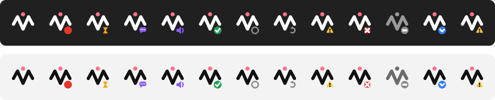
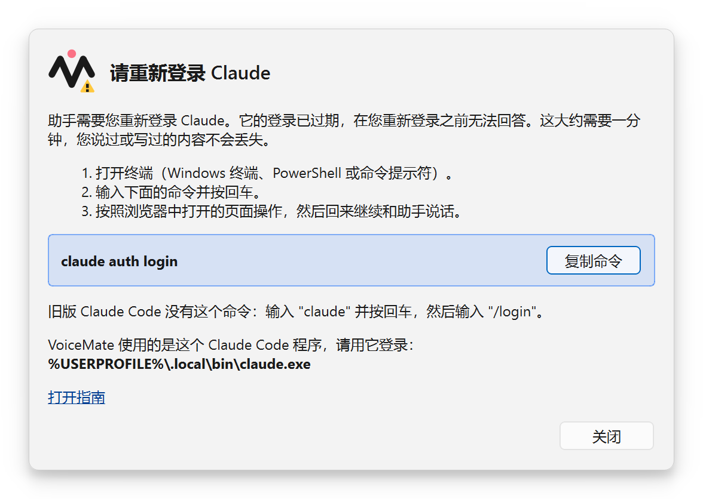

[English](sign-in-again.md) | [Português](sign-in-again.pt-BR.md) | [Español](sign-in-again.es.md) | [Русский](sign-in-again.ru.md) | **简体中文**

# 请重新登录 Claude

当 VoiceMate 助手提示它的 Claude 登录已过期时，请看这一页。大约一分钟就能完成，您说过或写过的内容都不会丢失。

## 🔎 发生了什么

助手在后台运行 Claude Code 程序（`claude`），这个程序需要您的 Claude 登录。登录会不时过期，在任何地方退出账号也会让它失效。在您重新登录之前，助手无法回答。

VoiceMate 会用多种方式提醒您：

- 托盘图标上的警告角标（黄色三角形），提示文字里有一行“Claude 登录已过期：点击以重新登录”。
- 一条通知和一句语音。
- 助手窗口里一条通俗的消息（代替 Claude 的原始错误），带有“如何登录”按钮。
- 托盘菜单里的“重新登录 Claude...”。

<p align="center"><br><sub>最后一个带黄色三角形的图标，就是要找的那个。</sub></p>

听写照常可用：只有助手需要 Claude 登录。

## 🔑 重新登录

1. 点击托盘图标。通知、托盘菜单里的“重新登录 Claude...”以及助手窗口里的“如何登录”按钮，打开的是同一个窗口：

   <p align="center"></p>

2. 打开终端：按 Windows 键，输入 `PowerShell`，按回车。Windows 终端和命令提示符也可以。
3. 输入下面的命令并按回车。窗口里的“复制命令”按钮可以复制它；在终端里用鼠标右键或 `Ctrl+V` 粘贴。

   ```powershell
   claude auth login
   ```

   较旧的 Claude Code 没有这个命令：输入 `claude`，按回车，然后输入 `/login`。
4. 按照浏览器中打开的页面操作，用您的 Claude 账号登录。
5. 回来继续和助手说话。

第一次成功回答后，角标会自动消失。

## 🧭 用的是哪个 `claude`？

窗口里会显示 VoiceMate 实际运行的程序，例如 `%USERPROFILE%\.local\bin\claude.exe`（`%USERPROFILE%` 是您的用户文件夹）。请用它来登录。

- 如果终端提示不认识 `claude`，请用完整路径运行它。从窗口里复制路径，加上引号，再加上 `auth login`：

  ```powershell
  & "$env:USERPROFILE\.local\bin\claude.exe" auth login
  ```

- 如果您有多个副本（例如 WSL 里还有一个），用另一个副本登录没有用：请使用窗口里显示的那个。
- 如果窗口提示 VoiceMate 没有找到 Claude Code 程序，请先安装 Claude Code，然后重新启动助手。`VOICEMATE_CLAUDE_CLI` 可以设置 VoiceMate 使用哪个程序（[配置](configuration.zh-CN.md)）。

## 🛠️ 还是不回答？

- 在助手窗口里点击“重新启动”。它会用新的登录重新启动助手。
- 在 Claude Desktop 应用或 claude.ai 里登录不算数：它们有各自的登录。助手需要的是 `claude` 程序的登录。
- 如果浏览器页面没有打开，终端会打印一个链接：请手动打开。
- 助手的日志会记录 Claude 的回答。登录过期时会显示 `Failed to authenticate. API Error: 401`，或要求执行 `/login`。

更多内容：[助手指南](assistant.zh-CN.md)和[问题排查](troubleshooting.zh-CN.md#语音助手)。
