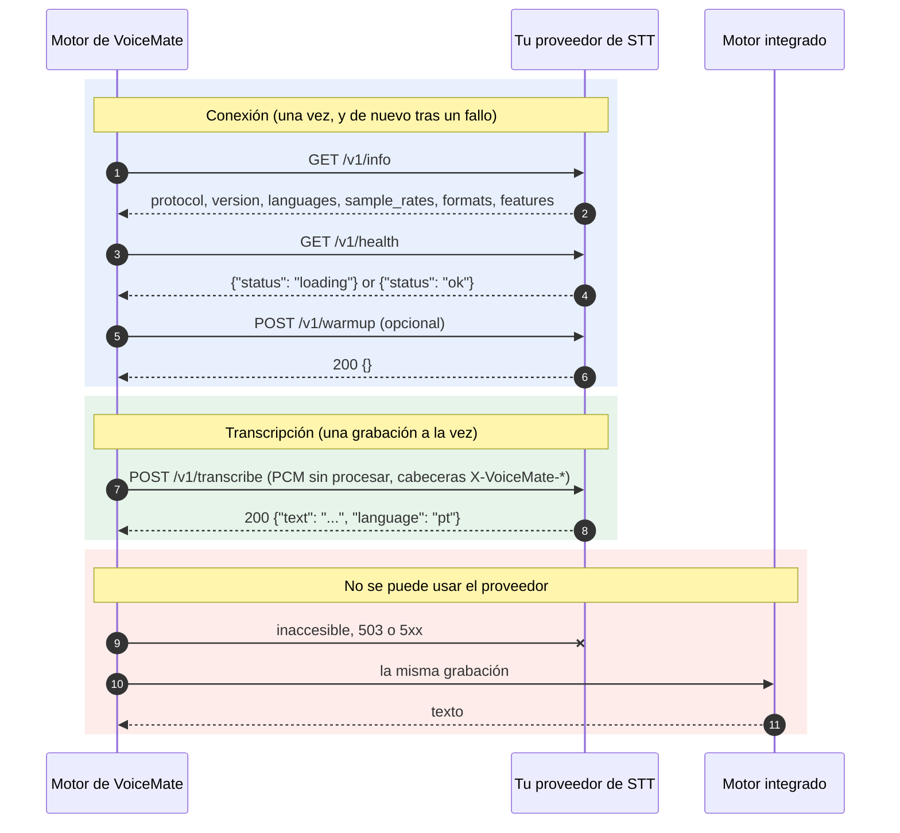

[English](stt-provider-protocol.md) | [Português](stt-provider-protocol.pt-BR.md) | **Español** | [Русский](stt-provider-protocol.ru.md) | [简体中文](stt-provider-protocol.zh-CN.md)

# Protocolo de proveedor de STT externo

VoiceMate puede transcribir lo que dices con un servicio de reconocimiento de voz que ejecutas tú. Esta página es el contrato: si tu servicio responde a estos endpoints, VoiceMate puede usarlo como su motor de transcripción. Nada de aquí depende de una pila de STT concreta, y VoiceMate no incluye ningún proveedor aparte de una referencia de prueba. Volver al [README](../README.es.md).

El protocolo se llama `voicemate-stt`, versión 1. Es el hermano de reconocimiento de voz del [protocolo de proveedor de TTS](tts-provider-protocol.md) y comparte su transporte.

## Cómo encaja



## Transporte

- HTTP/1.1. URL base por defecto: `http://127.0.0.1:8766` (configurable).
- Autenticación opcional: cuando VoiceMate tiene un token, cada petición lleva `Authorization: Bearer <token>`. Un proveedor que exige un token responde `401` sin él.
- Escucha solo en loopback, salvo que quieras deliberadamente que el proveedor sea accesible desde otras máquinas.
- La URL base puede llevar un prefijo de ruta (`http://127.0.0.1:9000/stt`): los endpoints de abajo quedan entonces bajo él (`/stt/v1/info` y así sucesivamente).
- Un mismo servicio puede implementar `voicemate-tts` y `voicemate-stt`; dale a cada uno su propia URL base, por ejemplo el mismo host y puerto con prefijos de ruta distintos (`http://127.0.0.1:9000/tts` y `http://127.0.0.1:9000/stt`).

### Dónde corre el proveedor (WSL2 y localhost)

El motor de VoiceMate suele correr dentro de WSL2, así que `127.0.0.1` en la dirección del proveedor significa el lado de WSL.

- Proveedor dentro de WSL: `http://127.0.0.1:8766` funciona.
- Proveedor en Windows: con la red espejada de WSL (`networkingMode=mirrored` en `.wslconfig`), `127.0.0.1` lo alcanza desde WSL. En otro caso, enlaza el proveedor a una dirección que el lado de WSL pueda alcanzar y usa esa dirección.
- El registro del motor dice qué dirección probó cuando el proveedor no responde.

## Endpoints

### `GET /v1/info`

```json
{
  "protocol": "voicemate-stt",
  "version": 1,
  "name": "My STT",
  "languages": ["pt", "en"],
  "sample_rates": [16000],
  "formats": ["pcm_s16le"],
  "max_seconds": 600,
  "features": []
}
```

- `name`: lo que el motor informa como su modelo de transcripción (`/health` y la ventana de estado del companion).
- `languages`: códigos ISO 639-1 que transcribe el proveedor. Vacío o ausente significa cualquier idioma. Cuando el idioma de transcripción de VoiceMate no está en la lista, VoiceMate no envía grabaciones al proveedor (mira los errores más abajo).
- `sample_rates`: al menos un entero positivo. VoiceMate graba a 16000 Hz y envía 16000 cuando está en la lista; en otro caso remuestrea a la primera frecuencia de la lista.
- `formats`: debe incluir `pcm_s16le` (mono, little endian), el único formato que VoiceMate envía en la versión 1.
- `max_seconds` (opcional): la grabación más larga que acepta el proveedor. VoiceMate nunca envía una más larga.
- `features`: reservado para versiones posteriores. VoiceMate ignora los valores que no conoce.

### `GET /v1/health`

`200 {"status": "ok"}` cuando está listo para transcribir, `200 {"status": "loading"}` mientras cargan los modelos. VoiceMate espera en `loading` (hasta tres minutos) antes de la primera petición y registra que está esperando.

### `POST /v1/transcribe`

El cuerpo es la grabación como PCM sin procesar, `Content-Type: application/octet-stream`, descrita por las cabeceras de la petición:

| Cabecera | Valor |
|---|---|
| `X-VoiceMate-Sample-Rate` | La frecuencia de muestreo, una de `sample_rates` (`16000`) |
| `X-VoiceMate-Channels` | `1` |
| `X-VoiceMate-Format` | `pcm_s16le` |
| `X-VoiceMate-Language` | Código ISO 639-1 (`pt`). Ausente cuando el ajuste de idioma es `auto`: el proveedor lo detecta |
| `X-VoiceMate-Request-Id` | Un id para los registros, único por petición |
| `X-VoiceMate-Options` | Opcional. Un objeto JSON ASCII compacto (`{"beam_size":5}`): los parámetros libres del proveedor que configuró la persona. VoiceMate lo pasa y nunca lo interpreta |

VoiceMate envía una grabación por petición, cuando la persona deja de grabar, y nunca tiene dos peticiones abiertas a la vez.

Respuesta `200`:

```json
{"text": "Hello, how are you?", "language": "pt"}
```

- `text`: la transcripción. Un `text` vacío significa que no se oyó nada (VoiceMate informa entonces "No se detectó voz en la grabación.").
- `language` (opcional): el idioma que oyó el proveedor.

Los errores usan un cuerpo JSON `{"error": {"code": "...", "message": "..."}}`:

| Estado | Códigos |
|---|---|
| 400 | `bad_request`, `audio_too_long`, `unsupported_format`, `unsupported_language` |
| 401 | `unauthorized` |
| 409 | `busy` |
| 503 | `not_ready` |
| 500 | `internal` |

### `POST /v1/warmup` (opcional)

`{}` responde `200 {}` después de cargar lo que necesita la primera petición. VoiceMate lo llama una vez tras conectarse, cuando arranca el motor. Un proveedor sin él puede responder `404`; VoiceMate registra "warmup skipped" y continúa.

### Iniciar el proveedor con VoiceMate

VoiceMate nunca necesita iniciar el proveedor: solo conoce su URL. Si además le das el comando que lo inicia, en la variable de entorno `VOICEMATE_STT_START_COMMAND` del motor, VoiceMate inicia el proveedor por ti, exactamente igual que con un [proveedor de TTS](tts-provider-protocol.md#starting-the-provider-with-voicemate):

- El motor lo ejecuta a través del shell, en su propio lado (dentro de WSL cuando el motor corre ahí), siempre que nada escuche en la dirección del proveedor (conexión rechazada): cuando el motor arranca, y de nuevo cuando el proveedor se cae más tarde. Un proveedor que responde, incluso con un error, o que solo tarda en responder, no se vuelve a iniciar. El comando no hereda el entorno virtual del motor ni el ajuste de la GPU que el motor define para sí.
- Se ejecuta como máximo una vez cada 60 segundos, y nunca mientras el último proceso que inició siga en ejecución. Abre primero el puerto y responde `/v1/health` con `loading` mientras cargan los modelos.
- El proceso queda desacoplado del motor. VoiceMate nunca lo detiene.
- La variable se elimina del entorno del motor una vez leída, y el comando nunca se escribe en el registro.

## Configuración

El proveedor externo se define con opciones del motor o con la configuración guardada (`~/.config/voicemate/config.toml`); una opción tiene prioridad sobre el valor guardado. La ventana de configuración del companion aún no tiene campos para ello.

| Opción | Clave guardada | Por defecto | Significado |
|---|---|---|---|
| `--stt-engine {builtin,external}` | `stt_engine` | `builtin` | `external` envía cada grabación al proveedor |
| `--stt-url URL` | `stt_external_url` | `http://127.0.0.1:8766` | La URL base del proveedor (se admite un prefijo de ruta) |
| `--stt-options JSON` | `stt_external_options` | ninguno | Un objeto JSON enviado como `X-VoiceMate-Options` |
| `--no-stt-fallback` | `stt_fallback = false` | respaldo activado | Sin transcripción integrada cuando el proveedor falla (mira más abajo) |
| (entorno) `VOICEMATE_STT_TOKEN` | `stt_external_token` | ninguno | El token bearer. Nunca como opción; la variable tiene prioridad sobre la clave guardada |

```bash
make run ARGS="--stt-engine external --stt-url http://127.0.0.1:8766"
```

Una URL no válida se informa en el registro y se usa el motor integrado.

## Qué hace VoiceMate con los errores

- Inaccesible, `503 not_ready` y `5xx`: esa grabación la transcribe el motor integrado de VoiceMate (el que usaría sin un proveedor, cargado la primera vez que hace falta y conservado para fallos posteriores). El proveedor se deja en paz unos 10 segundos y luego se vuelve a probar. Solo se registra el primer episodio de una caída, así que una caída larga no inunda el registro.
- `401`, `unsupported_format` y `unsupported_language` no mejoran reintentando, así que VoiceMate los informa una vez y usa el motor integrado hasta que cambie la configuración.
- Un `4xx` en `GET /v1/info` significa "no es un proveedor `voicemate-stt`" (o no es la versión 1). Es permanente hasta que cambie la configuración.
- `409 busy`, `audio_too_long` y `bad_request` afectan solo a esa grabación: la transcribe el motor integrado, y la siguiente vuelve a ir al proveedor.
- Con `--no-stt-fallback`, el motor integrado no transcribe nada: la grabación falla con el error del proveedor, igual que fallaría un motor integrado defectuoso, y la siguiente grabación vuelve a preguntarle al proveedor.
- El token nunca se escribe en el registro.

El `/health` del motor informa el proveedor como `"backend": "external"`, con su `name` como `model`.

## Conformidad

Un proveedor es compatible cuando:

1. `/v1/info` informa `protocol` `voicemate-stt` y `version` 1, al menos una frecuencia de muestreo y `pcm_s16le`.
2. `/v1/transcribe` acepta `pcm_s16le` mono a una frecuencia anunciada y responde `{"text": ...}`, con un texto vacío para el silencio.
3. Una petición que no puede aceptar se rechaza con la envoltura de error y los códigos de arriba.

Comprueba el tuyo:

```bash
make stt-provider-check URL=http://127.0.0.1:8766
make stt-provider-check URL=http://127.0.0.1:8766 WAV=me.wav ARGS="--language pt"
VOICEMATE_STT_TOKEN=secret make stt-provider-check URL=http://127.0.0.1:8766
```

Un proveedor que necesita un token lo lee de `VOICEMATE_STT_TOKEN`, así que no aparece en la lista de procesos.

La comprobación llama a info y health, transcribe un tono corto y un segundo de silencio (imprimiendo la latencia de cada uno), transcribe tu propio WAV de 16 bits cuando das uno, y envía una frecuencia de muestreo que el proveedor no listó, que debe rechazarse con `400 unsupported_format`. Solo necesita la biblioteca estándar de Python.

Para probar VoiceMate antes de escribir un proveedor, ejecuta el de referencia. Responde cuánto duró cada grabación ("I heard 2.0 seconds of audio."), no oye nada en el silencio y sigue todas las reglas de arriba:

```bash
make stt-provider-example ARGS="--port 8766"
```

Su código fuente, `tools/examples/stt_provider_reference.py`, usa solo `http.server` y es un punto de partida corto para el tuyo.
