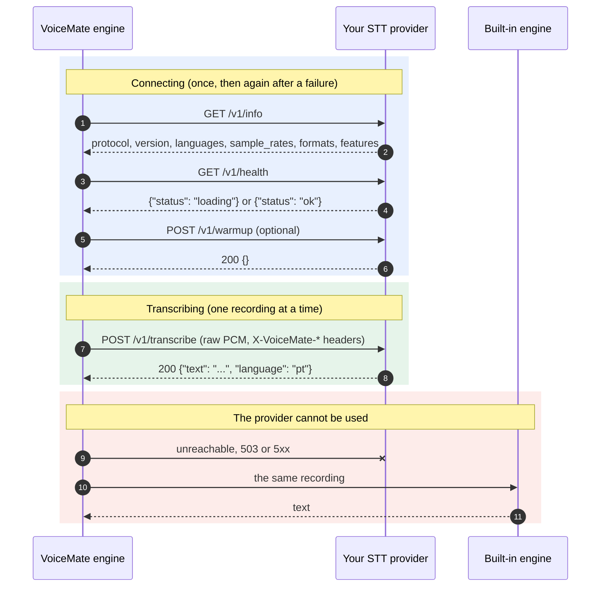

# External STT provider protocol

VoiceMate can transcribe what you say with a speech-to-text service you run yourself. This page is the contract: if your service answers these endpoints, VoiceMate can use it as its transcription engine. Nothing here depends on a particular STT stack, and VoiceMate ships no provider other than a test reference. Back to the [README](../README.md).

The protocol is called `voicemate-stt`, version 1. It is the speech-to-text sibling of the [TTS provider protocol](tts-provider-protocol.md) and shares its transport.

## How it fits



## Transport

- HTTP/1.1. Default base URL: `http://127.0.0.1:8766` (configurable).
- Optional authentication: when VoiceMate has a token, every request carries `Authorization: Bearer <token>`. A provider that requires a token answers `401` without it.
- Listen on loopback only, unless you deliberately want the provider reachable from other machines.
- The base URL may carry a path prefix (`http://127.0.0.1:9000/stt`): the endpoints below are then under it (`/stt/v1/info` and so on).
- A single service may implement both `voicemate-tts` and `voicemate-stt`; give each its own base URL, for example the same host and port with different path prefixes (`http://127.0.0.1:9000/tts` and `http://127.0.0.1:9000/stt`).

### Where the provider runs (WSL2 and localhost)

The VoiceMate engine usually runs inside WSL2, so `127.0.0.1` in the provider address means the WSL side.

- Provider inside WSL: `http://127.0.0.1:8766` works.
- Provider on Windows: with WSL mirrored networking (`networkingMode=mirrored` in `.wslconfig`) `127.0.0.1` reaches it from WSL. Otherwise bind the provider to an address the WSL side can reach and use that address.
- The engine log says which address it tried when the provider does not answer.

## Endpoints

### `GET /v1/info`

```json
{
  "protocol": "voicemate-stt",
  "version": 1,
  "name": "My STT",
  "languages": ["pt", "en"],
  "sample_rates": [16000],
  "formats": ["pcm_s16le"],
  "max_seconds": 600,
  "features": []
}
```

- `name`: what the engine reports as its transcription model (`/health` and the companion's status window).
- `languages`: ISO 639-1 codes the provider transcribes. Empty or missing means any language. When VoiceMate's transcription language is not listed, VoiceMate does not send recordings to the provider (see the errors below).
- `sample_rates`: at least one positive integer. VoiceMate records at 16000 Hz and sends 16000 when it is listed; otherwise it resamples to the first rate of the list.
- `formats`: must include `pcm_s16le` (mono, little endian), the only format VoiceMate sends in version 1.
- `max_seconds` (optional): the longest recording the provider takes. VoiceMate never sends a longer one.
- `features`: reserved for later versions. VoiceMate ignores the values it does not know.

### `GET /v1/health`

`200 {"status": "ok"}` when ready to transcribe, `200 {"status": "loading"}` while models load. VoiceMate waits on `loading` (up to three minutes) before the first request and logs that it is waiting.

### `POST /v1/transcribe`

The body is the recording as raw PCM, `Content-Type: application/octet-stream`, described by request headers:

| Header | Value |
|---|---|
| `X-VoiceMate-Sample-Rate` | The sample rate, one of `sample_rates` (`16000`) |
| `X-VoiceMate-Channels` | `1` |
| `X-VoiceMate-Format` | `pcm_s16le` |
| `X-VoiceMate-Language` | ISO 639-1 code (`pt`). Absent when the language setting is `auto`: the provider detects it |
| `X-VoiceMate-Request-Id` | An id for logs, unique per request |
| `X-VoiceMate-Options` | Optional. A compact ASCII JSON object (`{"beam_size":5}`): the free provider knobs the person configured. VoiceMate passes it and never interprets it |

VoiceMate sends one recording per request, once the person stops recording, and never has two requests open at once.

Response `200`:

```json
{"text": "Hello, how are you?", "language": "pt"}
```

- `text`: the transcription. An empty `text` means nothing was heard (VoiceMate then reports "No speech detected").
- `language` (optional): the language the provider heard.

Errors use a JSON body `{"error": {"code": "...", "message": "..."}}`:

| Status | Codes |
|---|---|
| 400 | `bad_request`, `audio_too_long`, `unsupported_format`, `unsupported_language` |
| 401 | `unauthorized` |
| 409 | `busy` |
| 503 | `not_ready` |
| 500 | `internal` |

### `POST /v1/warmup` (optional)

`{}` answers `200 {}` after loading what the first request needs. VoiceMate calls it once after it connects, when the engine starts. A provider without it may answer `404`; VoiceMate logs "warmup skipped" and goes on.

### Starting the provider with VoiceMate

VoiceMate never needs to start the provider: it only knows its URL. If you also give the command that starts it, in the `VOICEMATE_STT_START_COMMAND` environment variable of the engine, VoiceMate starts the provider for you, exactly as it does for a [TTS provider](tts-provider-protocol.md#starting-the-provider-with-voicemate):

- The engine runs it through the shell, on its own side (inside WSL when the engine runs there), whenever nothing listens at the provider's address (connection refused): when the engine starts, and again when the provider goes down later. A provider that answers, even with an error, or that is only slow to answer, is not started again. The command does not inherit the engine's virtual environment or the GPU tuning the engine sets for itself.
- It runs at most once every 60 seconds, and never while the process it started last is still running. Open the port first and answer `/v1/health` with `loading` while the models load.
- The process is detached from the engine. VoiceMate never stops it.
- The variable is removed from the engine's environment once read, and the command is never written to the log.

## Configuration

The external provider is set with engine flags or with the saved config (`~/.config/voicemate/config.toml`); a flag wins over the saved value. The companion's settings window has no fields for it yet.

| Flag | Saved key | Default | Meaning |
|---|---|---|---|
| `--stt-engine {builtin,external}` | `stt_engine` | `builtin` | `external` sends each recording to the provider |
| `--stt-url URL` | `stt_external_url` | `http://127.0.0.1:8766` | The provider's base URL (a path prefix is allowed) |
| `--stt-options JSON` | `stt_external_options` | none | A JSON object sent as `X-VoiceMate-Options` |
| `--no-stt-fallback` | `stt_fallback = false` | fallback on | No built-in transcription when the provider fails (see below) |
| (environment) `VOICEMATE_STT_TOKEN` | `stt_external_token` | none | The bearer token. Never a flag; the variable wins over the saved key |

```bash
make run ARGS="--stt-engine external --stt-url http://127.0.0.1:8766"
```

An invalid URL is reported in the log and the built-in engine is used.

## What VoiceMate does with errors

- Unreachable, `503 not_ready` and `5xx`: that recording is transcribed by VoiceMate's built-in engine (the one it would use without a provider, loaded the first time it is needed and kept for later failures). The provider is left alone for about 10 seconds, then tried again. Only the first episode of an outage is logged, so a long outage does not flood the log.
- `401`, `unsupported_format` and `unsupported_language` do not get better by retrying, so VoiceMate reports them once and uses the built-in engine until the settings change.
- A `4xx` on `GET /v1/info` means "not a `voicemate-stt` provider" (or not version 1). It is permanent until the settings change.
- `409 busy`, `audio_too_long` and `bad_request` affect only that recording: it is transcribed by the built-in engine, and the next one goes to the provider again.
- With `--no-stt-fallback`, nothing is transcribed by the built-in engine: the recording fails with the provider's error, the way a failing built-in engine fails, and the next recording asks the provider again.
- The token is never written to the log.

The engine's `/health` reports the provider as `"backend": "external"`, with its `name` as the `model`.

## Conformance

A provider is compatible when:

1. `/v1/info` reports `protocol` `voicemate-stt` and `version` 1, at least one sample rate, and `pcm_s16le`.
2. `/v1/transcribe` takes mono `pcm_s16le` at an advertised rate and answers `{"text": ...}`, with an empty text for silence.
3. A request it cannot take is refused with the error envelope and the codes above.

Check yours:

```bash
make stt-provider-check URL=http://127.0.0.1:8766
make stt-provider-check URL=http://127.0.0.1:8766 WAV=me.wav ARGS="--language pt"
VOICEMATE_STT_TOKEN=secret make stt-provider-check URL=http://127.0.0.1:8766
```

A provider that needs a token reads it from `VOICEMATE_STT_TOKEN`, so it does not show up in the process list.

The check calls info and health, transcribes a short tone and a second of silence (printing the latency of each), transcribes your own 16-bit WAV when you give one, and sends a sample rate the provider did not list, which must be refused with `400 unsupported_format`. It needs only the Python standard library.

To try VoiceMate before writing a provider, run the reference one. It answers how long each recording was ("I heard 2.0 seconds of audio."), hears nothing in silence, and follows every rule above:

```bash
make stt-provider-example ARGS="--port 8766"
```

Its source, `tools/examples/stt_provider_reference.py`, uses only `http.server` and is a short starting point for your own.
