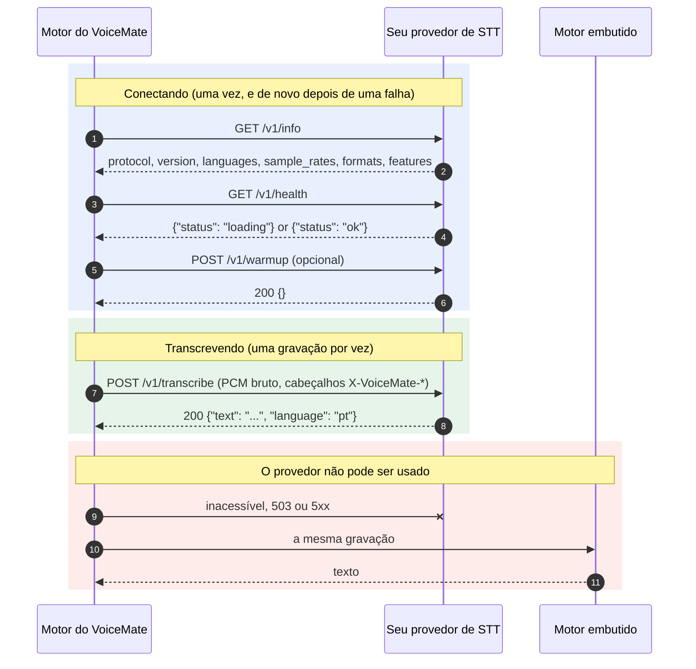

[English](stt-provider-protocol.md) | **Português** | [Español](stt-provider-protocol.es.md) | [Русский](stt-provider-protocol.ru.md) | [简体中文](stt-provider-protocol.zh-CN.md)

# Protocolo de provedor de STT externo

O VoiceMate pode transcrever o que você diz com um serviço de fala para texto que você mesmo roda. Esta página é o contrato: se o seu serviço responder a estes endpoints, o VoiceMate pode usá-lo como motor de transcrição. Nada aqui depende de uma pilha de STT específica, e o VoiceMate não traz nenhum provedor além de uma referência de teste. Voltar ao [README](../README.pt-BR.md).

O protocolo se chama `voicemate-stt`, versão 1. Ele é o irmão de fala para texto do [protocolo de provedor TTS](tts-provider-protocol.md) e compartilha o transporte dele.

## Como ele se encaixa



## Transporte

- HTTP/1.1. URL base padrão: `http://127.0.0.1:8766` (configurável).
- Autenticação opcional: quando o VoiceMate tem um token, toda requisição leva `Authorization: Bearer <token>`. Um provedor que exige token responde `401` sem ele.
- Escute só no loopback, a menos que você queira de propósito que o provedor seja acessível a partir de outras máquinas.
- A URL base pode ter um prefixo de caminho (`http://127.0.0.1:9000/stt`): os endpoints abaixo ficam então sob ele (`/stt/v1/info` e assim por diante).
- Um único serviço pode implementar `voicemate-tts` e `voicemate-stt`; dê a cada um a própria URL base, por exemplo o mesmo host e a mesma porta com prefixos de caminho diferentes (`http://127.0.0.1:9000/tts` e `http://127.0.0.1:9000/stt`).

### Onde o provedor roda (WSL2 e localhost)

O motor do VoiceMate costuma rodar dentro do WSL2, então `127.0.0.1` no endereço do provedor significa o lado do WSL.

- Provedor dentro do WSL: `http://127.0.0.1:8766` funciona.
- Provedor no Windows: com a rede espelhada do WSL (`networkingMode=mirrored` no `.wslconfig`), `127.0.0.1` chega até ele a partir do WSL. Caso contrário, associe o provedor a um endereço que o lado do WSL alcance e use esse endereço.
- O log do motor diz qual endereço ele tentou quando o provedor não responde.

## Endpoints

### `GET /v1/info`

```json
{
  "protocol": "voicemate-stt",
  "version": 1,
  "name": "My STT",
  "languages": ["pt", "en"],
  "sample_rates": [16000],
  "formats": ["pcm_s16le"],
  "max_seconds": 600,
  "features": []
}
```

- `name`: o que o motor informa como modelo de transcrição (`/health` e a janela de status do companion).
- `languages`: códigos ISO 639-1 que o provedor transcreve. Vazio ou ausente significa qualquer idioma. Quando o idioma de transcrição do VoiceMate não está na lista, o VoiceMate não envia gravações ao provedor (veja os erros abaixo).
- `sample_rates`: pelo menos um inteiro positivo. O VoiceMate grava a 16000 Hz e envia 16000 quando ele está na lista; caso contrário, reamostra para a primeira taxa da lista.
- `formats`: precisa incluir `pcm_s16le` (mono, little endian), o único formato que o VoiceMate envia na versão 1.
- `max_seconds` (opcional): a gravação mais longa que o provedor aceita. O VoiceMate nunca envia uma mais longa.
- `features`: reservado para versões futuras. O VoiceMate ignora os valores que não conhece.

### `GET /v1/health`

`200 {"status": "ok"}` quando está pronto para transcrever, `200 {"status": "loading"}` enquanto os modelos carregam. O VoiceMate espera em `loading` (até três minutos) antes da primeira requisição e registra no log que está esperando.

### `POST /v1/transcribe`

O corpo é a gravação como PCM bruto, `Content-Type: application/octet-stream`, descrita por cabeçalhos da requisição:

| Cabeçalho | Valor |
|---|---|
| `X-VoiceMate-Sample-Rate` | A taxa de amostragem, uma de `sample_rates` (`16000`) |
| `X-VoiceMate-Channels` | `1` |
| `X-VoiceMate-Format` | `pcm_s16le` |
| `X-VoiceMate-Language` | Código ISO 639-1 (`pt`). Ausente quando a configuração de idioma é `auto`: o provedor o detecta |
| `X-VoiceMate-Request-Id` | Um id para logs, único por requisição |
| `X-VoiceMate-Options` | Opcional. Um objeto JSON ASCII compacto (`{"beam_size":5}`): os ajustes livres do provedor que a pessoa configurou. O VoiceMate o repassa e nunca o interpreta |

O VoiceMate envia uma gravação por requisição, quando a pessoa para de gravar, e nunca tem duas requisições abertas ao mesmo tempo.

Resposta `200`:

```json
{"text": "Hello, how are you?", "language": "pt"}
```

- `text`: a transcrição. Um `text` vazio significa que nada foi ouvido (o VoiceMate então informa "Nenhuma fala detectada").
- `language` (opcional): o idioma que o provedor ouviu.

Os erros usam um corpo JSON `{"error": {"code": "...", "message": "..."}}`:

| Status | Códigos |
|---|---|
| 400 | `bad_request`, `audio_too_long`, `unsupported_format`, `unsupported_language` |
| 401 | `unauthorized` |
| 409 | `busy` |
| 503 | `not_ready` |
| 500 | `internal` |

### `POST /v1/warmup` (opcional)

`{}` responde `200 {}` depois de carregar o que a primeira requisição precisa. O VoiceMate o chama uma vez depois de se conectar, quando o motor inicia. Um provedor sem ele pode responder `404`; o VoiceMate registra "warmup skipped" e segue em frente.

### Iniciar o provedor com o VoiceMate

O VoiceMate nunca precisa iniciar o provedor: ele só conhece a URL. Se você também informar o comando que o inicia, na variável de ambiente `VOICEMATE_STT_START_COMMAND` do motor, o VoiceMate inicia o provedor para você, exatamente como faz com um [provedor de TTS](tts-provider-protocol.md#starting-the-provider-with-voicemate):

- O motor o executa pelo shell, do lado dele (dentro do WSL quando o motor roda lá), sempre que nada escuta no endereço do provedor (conexão recusada): quando o motor inicia, e de novo quando o provedor cai mais tarde. Um provedor que responde, mesmo com um erro, ou que só demora para responder, não é iniciado de novo. O comando não herda o ambiente virtual do motor nem o ajuste de GPU que o motor define para si.
- Ele roda no máximo uma vez a cada 60 segundos, e nunca enquanto o último processo que iniciou ainda está rodando. Abra a porta primeiro e responda `/v1/health` com `loading` enquanto os modelos carregam.
- O processo fica desacoplado do motor. O VoiceMate nunca o para.
- A variável é removida do ambiente do motor depois de lida, e o comando nunca é escrito no log.

## Configuração

O provedor externo é definido com opções do motor ou com a configuração salva (`~/.config/voicemate/config.toml`); uma opção vale mais do que o valor salvo. A janela de configurações do companion ainda não tem campos para ele.

| Opção | Chave salva | Padrão | Significado |
|---|---|---|---|
| `--stt-engine {builtin,external}` | `stt_engine` | `builtin` | `external` envia cada gravação ao provedor |
| `--stt-url URL` | `stt_external_url` | `http://127.0.0.1:8766` | A URL base do provedor (um prefixo de caminho é permitido) |
| `--stt-options JSON` | `stt_external_options` | nenhum | Um objeto JSON enviado como `X-VoiceMate-Options` |
| `--no-stt-fallback` | `stt_fallback = false` | alternativa ligada | Sem transcrição embutida quando o provedor falha (veja abaixo) |
| (ambiente) `VOICEMATE_STT_TOKEN` | `stt_external_token` | nenhum | O token bearer. Nunca uma opção; a variável vale mais do que a chave salva |

```bash
make run ARGS="--stt-engine external --stt-url http://127.0.0.1:8766"
```

Uma URL inválida é registrada no log e o motor embutido é usado.

## O que o VoiceMate faz com os erros

- Inacessível, `503 not_ready` e `5xx`: essa gravação é transcrita pelo motor embutido do VoiceMate (o que ele usaria sem um provedor, carregado na primeira vez que é preciso e mantido para as falhas seguintes). O provedor fica em paz por cerca de 10 segundos e depois é tentado de novo. Só o primeiro episódio de uma queda é registrado no log, então uma queda longa não inunda o log.
- `401`, `unsupported_format` e `unsupported_language` não melhoram ao tentar de novo, então o VoiceMate os informa uma vez e usa o motor embutido até as configurações mudarem.
- Um `4xx` em `GET /v1/info` significa "não é um provedor `voicemate-stt`" (ou não é a versão 1). É permanente até as configurações mudarem.
- `409 busy`, `audio_too_long` e `bad_request` afetam só essa gravação: ela é transcrita pelo motor embutido, e a seguinte vai ao provedor de novo.
- Com `--no-stt-fallback`, nada é transcrito pelo motor embutido: a gravação falha com o erro do provedor, do jeito que um motor embutido com defeito falha, e a gravação seguinte pergunta ao provedor de novo.
- O token nunca é escrito no log.

O `/health` do motor informa o provedor como `"backend": "external"`, com o `name` dele como `model`.

## Conformidade

Um provedor é compatível quando:

1. `/v1/info` informa `protocol` `voicemate-stt` e `version` 1, pelo menos uma taxa de amostragem e `pcm_s16le`.
2. `/v1/transcribe` aceita `pcm_s16le` mono numa taxa anunciada e responde `{"text": ...}`, com um texto vazio para silêncio.
3. Uma requisição que ele não pode aceitar é recusada com o envelope de erro e os códigos acima.

Confira o seu:

```bash
make stt-provider-check URL=http://127.0.0.1:8766
make stt-provider-check URL=http://127.0.0.1:8766 WAV=me.wav ARGS="--language pt"
VOICEMATE_STT_TOKEN=secret make stt-provider-check URL=http://127.0.0.1:8766
```

Um provedor que precisa de token o lê de `VOICEMATE_STT_TOKEN`, para que ele não apareça na lista de processos.

A verificação chama info e health, transcreve um tom curto e um segundo de silêncio (mostrando a latência de cada um), transcreve o seu próprio WAV de 16 bits quando você informa um e envia uma taxa de amostragem que o provedor não listou, que precisa ser recusada com `400 unsupported_format`. Ela só precisa da biblioteca padrão do Python.

Para experimentar o VoiceMate antes de escrever um provedor, rode o de referência. Ele responde quanto tempo durou cada gravação ("I heard 2.0 seconds of audio."), não ouve nada no silêncio e segue todas as regras acima:

```bash
make stt-provider-example ARGS="--port 8766"
```

O código-fonte dele, `tools/examples/stt_provider_reference.py`, usa só `http.server` e é um ponto de partida curto para o seu.
