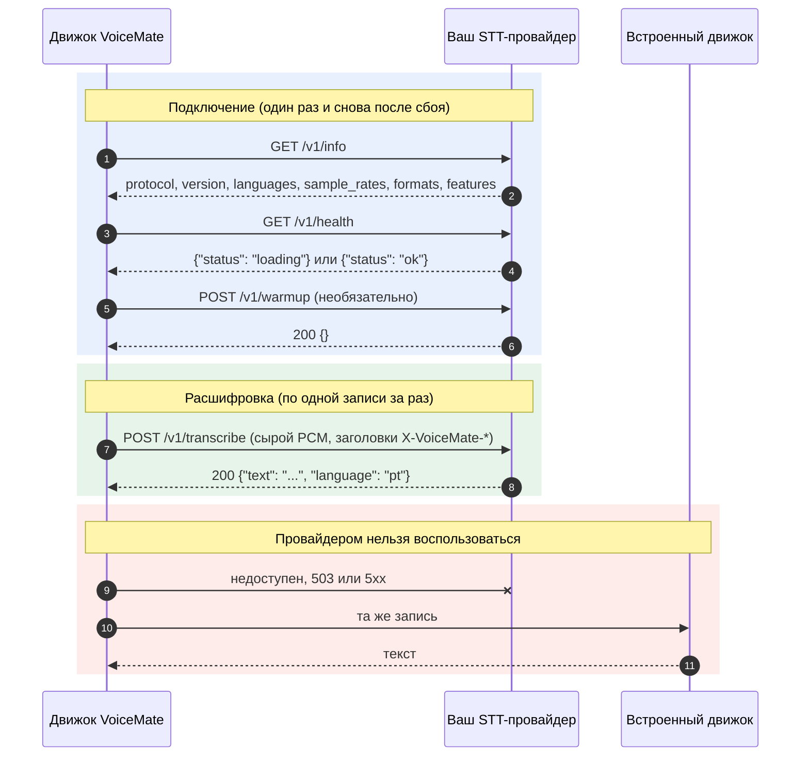

[English](stt-provider-protocol.md) | [Português](stt-provider-protocol.pt-BR.md) | [Español](stt-provider-protocol.es.md) | **Русский** | [简体中文](stt-provider-protocol.zh-CN.md)

# Протокол внешнего STT-провайдера

VoiceMate может расшифровывать вашу речь сервисом распознавания речи (speech-to-text), который вы запускаете сами. Эта страница описывает контракт: если ваш сервис отвечает на эти эндпоинты, VoiceMate может использовать его как движок распознавания. Здесь ничего не привязано к конкретному STT-стеку, а VoiceMate не поставляет провайдеров, кроме тестового эталонного. Назад к [README](../README.ru.md).

Протокол называется `voicemate-stt`, версия 1. Это родственник [протокола TTS-провайдера](tts-provider-protocol.md) для распознавания речи, и транспорт у них общий.

## Как это устроено



## Транспорт

- HTTP/1.1. Базовый URL по умолчанию: `http://127.0.0.1:8766` (настраивается).
- Необязательная аутентификация: если у VoiceMate есть токен, каждый запрос несёт `Authorization: Bearer <token>`. Провайдер, которому нужен токен, отвечает `401` на запрос без него.
- Слушайте только loopback, если только вы намеренно не хотите, чтобы провайдер был доступен с других машин.
- Базовый URL может содержать префикс пути (`http://127.0.0.1:9000/stt`): тогда эндпоинты ниже находятся под ним (`/stt/v1/info` и так далее).
- Один сервис может реализовать и `voicemate-tts`, и `voicemate-stt`; дайте каждому свой базовый URL, например тот же хост и порт с разными префиксами пути (`http://127.0.0.1:9000/tts` и `http://127.0.0.1:9000/stt`).

### Где работает провайдер (WSL2 и localhost)

Движок VoiceMate обычно работает внутри WSL2, поэтому `127.0.0.1` в адресе провайдера означает сторону WSL.

- Провайдер внутри WSL: `http://127.0.0.1:8766` работает.
- Провайдер в Windows: при зеркальной сети WSL (`networkingMode=mirrored` в `.wslconfig`) `127.0.0.1` доходит до него из WSL. Иначе привяжите провайдер к адресу, который доступен со стороны WSL, и используйте этот адрес.
- Если провайдер не отвечает, журнал движка сообщает, какой адрес был опробован.

## Эндпоинты

### `GET /v1/info`

```json
{
  "protocol": "voicemate-stt",
  "version": 1,
  "name": "My STT",
  "languages": ["pt", "en"],
  "sample_rates": [16000],
  "formats": ["pcm_s16le"],
  "max_seconds": 600,
  "features": []
}
```

- `name`: то, что движок сообщает как свою модель распознавания (`/health` и окно состояния компаньона).
- `languages`: коды ISO 639-1, которые провайдер расшифровывает. Пустое или отсутствующее значение означает любой язык. Если язык распознавания VoiceMate в списке не указан, VoiceMate не отправляет записи провайдеру (см. ошибки ниже).
- `sample_rates`: хотя бы одно положительное целое число. VoiceMate записывает на 16000 Гц и отправляет 16000, если эта частота в списке; иначе он пересэмплирует звук на первую частоту из списка.
- `formats`: должен включать `pcm_s16le` (моно, little endian), единственный формат, который VoiceMate отправляет в версии 1.
- `max_seconds` (необязательно): самая длинная запись, которую принимает провайдер. VoiceMate никогда не отправляет более длинную.
- `features`: зарезервировано для следующих версий. VoiceMate игнорирует значения, которых не знает.

### `GET /v1/health`

`200 {"status": "ok"}`, когда провайдер готов расшифровывать, и `200 {"status": "loading"}`, пока загружаются модели. На `loading` VoiceMate ждёт (до трёх минут) перед первым запросом и записывает в журнал, что он ждёт.

### `POST /v1/transcribe`

Тело запроса: запись в виде сырого PCM, `Content-Type: application/octet-stream`; её описывают заголовки запроса:

| Заголовок | Значение |
|---|---|
| `X-VoiceMate-Sample-Rate` | Частота дискретизации, одно из значений `sample_rates` (`16000`) |
| `X-VoiceMate-Channels` | `1` |
| `X-VoiceMate-Format` | `pcm_s16le` |
| `X-VoiceMate-Language` | Код ISO 639-1 (`pt`). Отсутствует, если для языка выбрано `auto`: провайдер определяет его сам |
| `X-VoiceMate-Request-Id` | Идентификатор для журналов, уникальный для каждого запроса |
| `X-VoiceMate-Options` | Необязательно. Компактный JSON-объект в ASCII (`{"beam_size":5}`): свободные параметры провайдера, которые настроил человек. VoiceMate передаёт его и никогда не интерпретирует |

VoiceMate отправляет одну запись на запрос, когда человек останавливает запись, и никогда не держит два запроса открытыми одновременно.

Ответ `200`:

```json
{"text": "Hello, how are you?", "language": "pt"}
```

- `text`: расшифровка. Пустой `text` означает, что ничего не было слышно (тогда VoiceMate сообщает «Речь не обнаружена»).
- `language` (необязательно): язык, который услышал провайдер.

Ошибки приходят в теле JSON `{"error": {"code": "...", "message": "..."}}`:

| Статус | Коды |
|---|---|
| 400 | `bad_request`, `audio_too_long`, `unsupported_format`, `unsupported_language` |
| 401 | `unauthorized` |
| 409 | `busy` |
| 503 | `not_ready` |
| 500 | `internal` |

### `POST /v1/warmup` (необязательно)

Запрос `{}` получает ответ `200 {}` после загрузки всего, что нужно первому запросу. VoiceMate вызывает его один раз после подключения, когда запускается движок. Провайдер без этого эндпоинта может ответить `404`; VoiceMate запишет в журнал «прогрев пропущен» и продолжит работу.

### Запуск провайдера вместе с VoiceMate

VoiceMate никогда не обязан запускать провайдер: он знает только его URL. Если вы дополнительно задаёте команду запуска в переменной окружения `VOICEMATE_STT_START_COMMAND` движка, VoiceMate запускает провайдер за вас, так же как для [TTS-провайдера](tts-provider-protocol.md#starting-the-provider-with-voicemate):

- Движок выполняет её через оболочку, на своей стороне (внутри WSL, если движок работает там), всякий раз, когда по адресу провайдера никто не слушает (соединение отклонено): при запуске движка и снова, если позже провайдер упал. Провайдер, который отвечает, пусть даже ошибкой, или просто медленно отвечает, повторно не запускается. Команда не наследует виртуальное окружение движка и настройки GPU, которые движок задаёт для себя.
- Она выполняется не чаще одного раза в 60 секунд и никогда, пока ещё работает процесс, запущенный ею в прошлый раз. Сначала откройте порт и отвечайте на `/v1/health` значением `loading`, пока загружаются модели.
- Процесс отсоединён от движка. VoiceMate никогда его не останавливает.
- Переменная удаляется из окружения движка после чтения, а сама команда никогда не записывается в журнал.

## Конфигурация

Внешний провайдер задаётся флагами движка или сохранённой конфигурацией (`~/.config/voicemate/config.toml`); флаг важнее сохранённого значения. В окне настроек компаньона полей для него пока нет.

| Флаг | Сохранённый ключ | По умолчанию | Описание |
|---|---|---|---|
| `--stt-engine {builtin,external}` | `stt_engine` | `builtin` | `external` отправляет каждую запись провайдеру |
| `--stt-url URL` | `stt_external_url` | `http://127.0.0.1:8766` | Базовый URL провайдера (префикс пути допускается) |
| `--stt-options JSON` | `stt_external_options` | нет | JSON-объект, который отправляется как `X-VoiceMate-Options` |
| `--no-stt-fallback` | `stt_fallback = false` | резервный вариант включён | Никакого встроенного распознавания, когда провайдер сбоит (см. ниже) |
| (окружение) `VOICEMATE_STT_TOKEN` | `stt_external_token` | нет | Bearer-токен. Никогда не флаг; переменная важнее сохранённого ключа |

```bash
make run ARGS="--stt-engine external --stt-url http://127.0.0.1:8766"
```

Недопустимый URL фиксируется в журнале, и используется встроенный движок.

## Что VoiceMate делает при ошибках

- Провайдер недоступен, `503 not_ready` и `5xx`: эту запись расшифровывает встроенный движок VoiceMate (тот, который использовался бы без провайдера; он загружается при первой необходимости и остаётся для последующих сбоев). Провайдера оставляют в покое примерно на 10 секунд, затем пробуют снова. В журнал попадает только первый эпизод сбоя, поэтому долгий сбой не засоряет журнал.
- `401`, `unsupported_format` и `unsupported_language` от повторных попыток не проходят, поэтому VoiceMate сообщает о них один раз и пользуется встроенным движком, пока не изменятся настройки.
- `4xx` на `GET /v1/info` означает «это не провайдер `voicemate-stt`» (или не версия 1). Это постоянно, пока не изменятся настройки.
- `409 busy`, `audio_too_long` и `bad_request` касаются только этой записи: её расшифровывает встроенный движок, а следующая снова идёт к провайдеру.
- С `--no-stt-fallback` встроенный движок ничего не расшифровывает: запись завершается ошибкой провайдера, так же как завершается ошибкой сбойный встроенный движок, а следующая запись снова обращается к провайдеру.
- Токен никогда не записывается в журнал.

`/health` движка показывает провайдера как `"backend": "external"`, а его `name` как `model`.

## Соответствие протоколу

Провайдер совместим, когда:

1. `/v1/info` сообщает `protocol` `voicemate-stt` и `version` 1, хотя бы одну частоту дискретизации и `pcm_s16le`.
2. `/v1/transcribe` принимает моно `pcm_s16le` на заявленной частоте и отвечает `{"text": ...}`, с пустым текстом для тишины.
3. Запрос, который он принять не может, отклоняется с конвертом ошибки и кодами выше.

Проверьте свой:

```bash
make stt-provider-check URL=http://127.0.0.1:8766
make stt-provider-check URL=http://127.0.0.1:8766 WAV=me.wav ARGS="--language pt"
VOICEMATE_STT_TOKEN=secret make stt-provider-check URL=http://127.0.0.1:8766
```

Провайдер, которому нужен токен, читает его из `VOICEMATE_STT_TOKEN`, поэтому он не виден в списке процессов.

Проверка вызывает info и health, расшифровывает короткий тон и секунду тишины (выводя задержку каждой расшифровки), расшифровывает ваш собственный 16-битный WAV, если вы его указали, и отправляет частоту дискретизации, которой нет в списке провайдера: она должна быть отклонена с `400 unsupported_format`. Ей нужна только стандартная библиотека Python.

Чтобы попробовать VoiceMate до написания провайдера, запустите эталонный. Он отвечает, какой длины была каждая запись («I heard 2.0 seconds of audio.»), ничего не слышит в тишине и соблюдает все правила выше:

```bash
make stt-provider-example ARGS="--port 8766"
```

Его исходный код, `tools/examples/stt_provider_reference.py`, использует только `http.server` и служит коротким отправным пунктом для вашего собственного.
