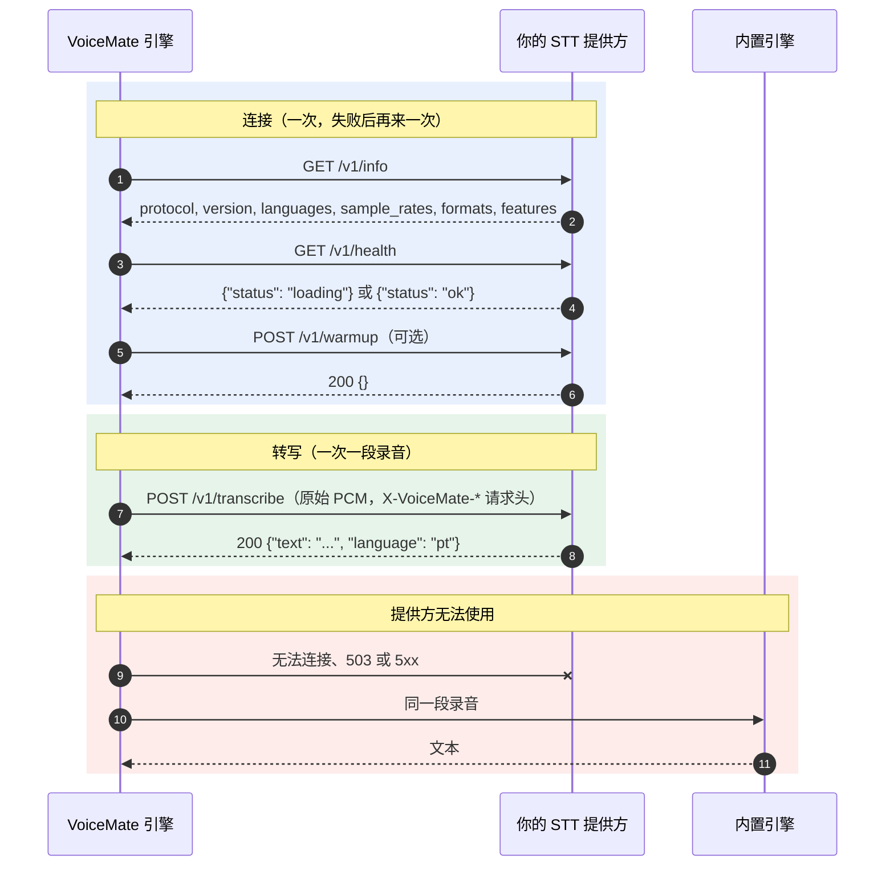

[English](stt-provider-protocol.md) | [Português](stt-provider-protocol.pt-BR.md) | [Español](stt-provider-protocol.es.md) | [Русский](stt-provider-protocol.ru.md) | **简体中文**

# 外部 STT 提供方协议

VoiceMate 可以用你自己运行的语音转文字服务来转写你说的话。本页就是这份约定：只要你的服务能响应这些端点，VoiceMate 就能把它当作转写引擎来用。这里的一切都不依赖某个特定的 STT 技术栈，VoiceMate 除了一个测试用的参考实现之外，不附带任何提供方。返回 [README](../README.zh-CN.md)。

这个协议叫 `voicemate-stt`，版本 1。它是 [TTS 提供方协议](tts-provider-protocol.md)在语音转文字方向上的“兄弟”，并共用同样的传输方式。

## 它如何配合工作



## 传输

- HTTP/1.1。默认基础 URL：`http://127.0.0.1:8766`（可配置）。
- 可选的认证：当 VoiceMate 有令牌时，每个请求都带有 `Authorization: Bearer <token>`。要求令牌的提供方在没有令牌时返回 `401`。
- 只监听回环地址，除非你有意让其他机器也能访问这个提供方。
- 基础 URL 可以带路径前缀（`http://127.0.0.1:9000/stt`）：下面的端点就位于它之下（`/stt/v1/info` 等等）。
- 一个服务可以同时实现 `voicemate-tts` 和 `voicemate-stt`；给每个协议各自的基础 URL，例如同一个主机和端口，用不同的路径前缀（`http://127.0.0.1:9000/tts` 和 `http://127.0.0.1:9000/stt`）。

### 提供方在哪里运行（WSL2 与 localhost）

VoiceMate 引擎通常运行在 WSL2 内，所以提供方地址中的 `127.0.0.1` 指的是 WSL 一侧。

- 提供方在 WSL 内：`http://127.0.0.1:8766` 可用。
- 提供方在 Windows 上：使用 WSL 镜像网络（`.wslconfig` 中的 `networkingMode=mirrored`）时，从 WSL 用 `127.0.0.1` 就能访问到它。否则请把提供方绑定到 WSL 一侧能访问到的地址，并使用那个地址。
- 提供方没有响应时，引擎日志会说明它尝试了哪个地址。

## 端点

### `GET /v1/info`

```json
{
  "protocol": "voicemate-stt",
  "version": 1,
  "name": "My STT",
  "languages": ["pt", "en"],
  "sample_rates": [16000],
  "formats": ["pcm_s16le"],
  "max_seconds": 600,
  "features": []
}
```

- `name`：引擎把它报告为转写模型的名字（`/health` 和配套应用的状态窗口）。
- `languages`：提供方能转写的 ISO 639-1 代码。为空或缺失表示任何语言。当 VoiceMate 的转写语言不在列表中时，VoiceMate 不会把录音发给提供方（见下面的错误）。
- `sample_rates`：至少一个正整数。VoiceMate 以 16000 Hz 录音，列表里有 16000 时就发送 16000；否则它会重采样到列表中的第一个采样率。
- `formats`：必须包含 `pcm_s16le`（单声道，小端序），这是 VoiceMate 在版本 1 中唯一发送的格式。
- `max_seconds`（可选）：提供方接受的最长录音。VoiceMate 绝不会发送更长的。
- `features`：为以后的版本保留。VoiceMate 会忽略它不认识的值。

### `GET /v1/health`

准备好转写时返回 `200 {"status": "ok"}`，模型加载期间返回 `200 {"status": "loading"}`。VoiceMate 在第一次请求之前会等待 `loading`（最多三分钟），并记录它正在等待。

### `POST /v1/transcribe`

请求体是原始 PCM 格式的录音，`Content-Type: application/octet-stream`，由请求头描述：

| 请求头 | 值 |
|---|---|
| `X-VoiceMate-Sample-Rate` | 采样率，`sample_rates` 中的一个（`16000`） |
| `X-VoiceMate-Channels` | `1` |
| `X-VoiceMate-Format` | `pcm_s16le` |
| `X-VoiceMate-Language` | ISO 639-1 代码（`pt`）。当语言设置为 `auto` 时不带这一项：由提供方自己检测 |
| `X-VoiceMate-Request-Id` | 用于日志的 id，每个请求唯一 |
| `X-VoiceMate-Options` | 可选。一个紧凑的 ASCII JSON 对象（`{"beam_size":5}`）：使用者配置的自由的提供方选项。VoiceMate 只负责传递，从不解释它 |

VoiceMate 在用户停止录音之后，每个请求发送一段录音，并且从不同时打开两个请求。

响应 `200`：

```json
{"text": "Hello, how are you?", "language": "pt"}
```

- `text`：转写文本。空的 `text` 表示什么也没听到（VoiceMate 随后会报告“未检测到语音”）。
- `language`（可选）：提供方听到的语言。

错误使用 JSON 请求体 `{"error": {"code": "...", "message": "..."}}`：

| 状态 | 代码 |
|---|---|
| 400 | `bad_request`、`audio_too_long`、`unsupported_format`、`unsupported_language` |
| 401 | `unauthorized` |
| 409 | `busy` |
| 503 | `not_ready` |
| 500 | `internal` |

### `POST /v1/warmup`（可选）

`{}` 在加载完第一个请求所需的东西之后返回 `200 {}`。VoiceMate 在引擎启动、连接上之后调用它一次。没有这个端点的提供方可以返回 `404`；VoiceMate 会记录“已跳过预热”并继续。

### 随 VoiceMate 启动提供方

VoiceMate 从来不需要启动提供方：它只知道提供方的 URL。如果你还通过引擎的 `VOICEMATE_STT_START_COMMAND` 环境变量给出了启动它的命令，VoiceMate 就会替你启动提供方，做法与对待 [TTS 提供方](tts-provider-protocol.md#starting-the-provider-with-voicemate)完全一样：

- 每当提供方的地址上没有任何服务在监听（连接被拒绝）时，引擎就在它自己的一侧（引擎在 WSL 内运行时，就是在 WSL 内）通过 shell 运行这个命令：在引擎启动时，以及提供方之后掉线时再次运行。能响应的提供方，即使响应的是错误，或者只是响应得慢，都不会被再次启动。这个命令不会继承引擎的虚拟环境，也不会继承引擎为自己设置的 GPU 调优。
- 它最多每 60 秒运行一次，并且在它上一次启动的进程仍在运行时绝不会运行。请先打开端口，并在模型加载期间让 `/v1/health` 返回 `loading`。
- 这个进程与引擎分离。VoiceMate 从不停止它。
- 这个变量在被读取之后会从引擎的环境中移除，命令也绝不会写入日志。

## 配置

外部提供方通过引擎参数或已保存的配置（`~/.config/voicemate/config.toml`）来设置；参数优先于已保存的值。配套应用的设置窗口目前还没有对应的字段。

| 参数 | 保存的键 | 默认值 | 含义 |
|---|---|---|---|
| `--stt-engine {builtin,external}` | `stt_engine` | `builtin` | `external` 把每段录音发送给提供方 |
| `--stt-url URL` | `stt_external_url` | `http://127.0.0.1:8766` | 提供方的基础 URL（允许带路径前缀） |
| `--stt-options JSON` | `stt_external_options` | 无 | 作为 `X-VoiceMate-Options` 发送的 JSON 对象 |
| `--no-stt-fallback` | `stt_fallback = false` | 回退开启 | 提供方失败时不使用内置转写（见下文） |
| （环境变量）`VOICEMATE_STT_TOKEN` | `stt_external_token` | 无 | Bearer 令牌。绝不是命令行参数；环境变量优先于保存的键 |

```bash
make run ARGS="--stt-engine external --stt-url http://127.0.0.1:8766"
```

无效的 URL 会被记入日志，并改用内置引擎。

## VoiceMate 如何处理错误

- 无法连接、`503 not_ready` 和 `5xx`：这段录音由 VoiceMate 的内置引擎转写（也就是没有提供方时会使用的那一个，在第一次需要时加载，并保留下来应对以后的失败）。提供方会被搁置约 10 秒，然后再次尝试。一次故障只会记录第一个事件，所以长时间的故障不会把日志刷满。
- `401`、`unsupported_format` 和 `unsupported_language` 重试也不会变好，所以 VoiceMate 只报告一次，并在设置更改之前一直使用内置引擎。
- `GET /v1/info` 上的 `4xx` 表示“不是 `voicemate-stt` 提供方”（或者不是版本 1）。在设置更改之前，这是永久的。
- `409 busy`、`audio_too_long` 和 `bad_request` 只影响那一段录音：它由内置引擎转写，下一段仍然交给提供方。
- 使用 `--no-stt-fallback` 时，内置引擎不会转写任何东西：这段录音带着提供方的错误失败，就像内置引擎失败时那样，下一段录音会再次询问提供方。
- 令牌绝不会写入日志。

引擎的 `/health` 把提供方报告为 `"backend": "external"`，并把它的 `name` 作为 `model`。

## 一致性

满足以下条件的提供方就是兼容的：

1. `/v1/info` 报告 `protocol` 为 `voicemate-stt`、`version` 为 1，至少有一个采样率，并且支持 `pcm_s16le`。
2. `/v1/transcribe` 接受公布的采样率下的单声道 `pcm_s16le`，并返回 `{"text": ...}`，静音时 text 为空。
3. 无法接受的请求，用错误信封和上面的代码拒绝。

检查你的提供方：

```bash
make stt-provider-check URL=http://127.0.0.1:8766
make stt-provider-check URL=http://127.0.0.1:8766 WAV=me.wav ARGS="--language pt"
VOICEMATE_STT_TOKEN=secret make stt-provider-check URL=http://127.0.0.1:8766
```

需要令牌的提供方从 `VOICEMATE_STT_TOKEN` 读取它，这样它就不会出现在进程列表中。

这个检查会调用 info 和 health，转写一段短音调和一秒的静音（打印每一次的延迟），在你给出一个 16 位 WAV 时转写它，并发送一个提供方没有列出的采样率，这必须被 `400 unsupported_format` 拒绝。它只需要 Python 标准库。

想在编写提供方之前先试用 VoiceMate，可以运行参考实现。它会回答每段录音有多长（“I heard 2.0 seconds of audio.”），在静音中什么也听不到，并且遵循上面的每一条规则：

```bash
make stt-provider-example ARGS="--port 8766"
```

它的源码 `tools/examples/stt_provider_reference.py` 只用了 `http.server`，是你自己动手的一个简短起点。
