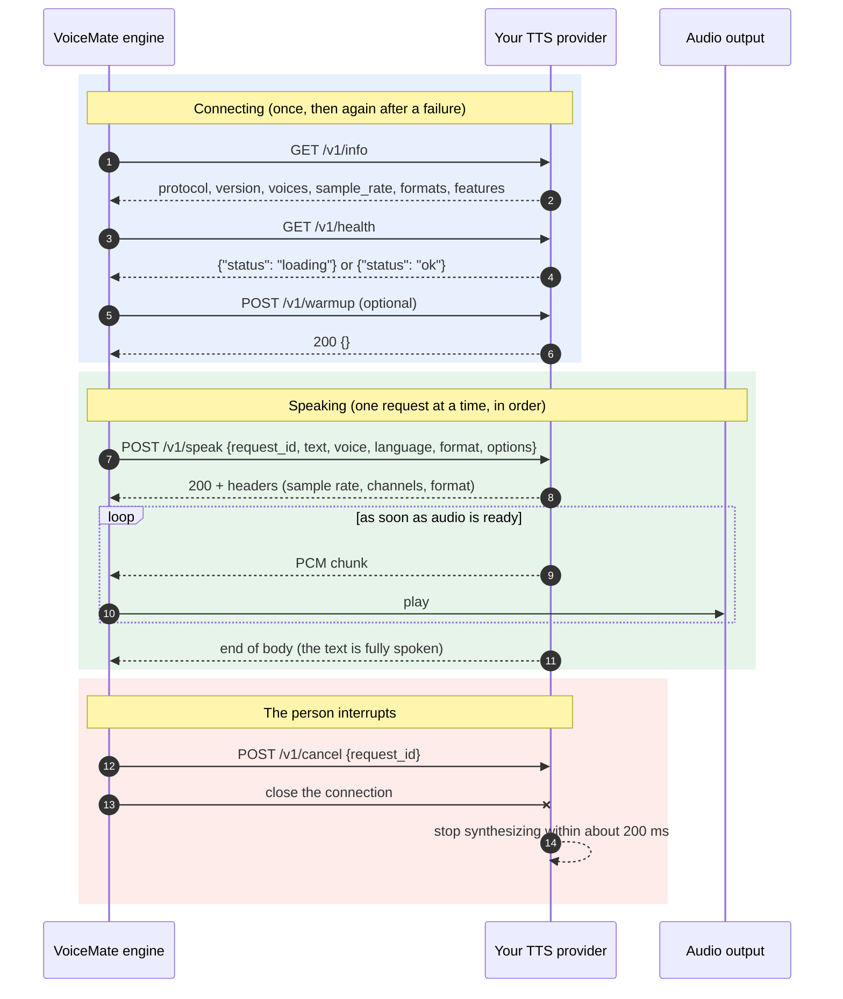

# External TTS provider protocol

VoiceMate can speak its answers (the Claude flow) with a text-to-speech service you run yourself. This page is the contract: if your service answers these endpoints, VoiceMate can use it as **Custom provider (HTTP)**. Nothing here depends on a particular TTS stack, and VoiceMate ships no provider other than a test-tone reference.

The protocol is called `voicemate-tts`, version 1.

## How it fits



## Transport

- HTTP/1.1 with UTF-8 JSON bodies. Default base URL: `http://127.0.0.1:8765` (configurable).
- Optional authentication: when VoiceMate has a token, every request carries `Authorization: Bearer <token>`. A provider that requires a token answers `401` without it.
- Listen on loopback only, unless you deliberately want the provider reachable from other machines.

### Where the provider runs (WSL2 and localhost)

The VoiceMate engine usually runs inside WSL2, so `127.0.0.1` in the **Provider address** means the WSL side. The companion app (on Windows) uses the same address for "Load voices" and "Test voice", so a Windows-only address can work in one place and not the other.

- Provider inside WSL: `http://127.0.0.1:8765` works for both the engine and, through WSL localhost forwarding, for the companion.
- Provider on Windows: with WSL mirrored networking (`networkingMode=mirrored` in `.wslconfig`) `127.0.0.1` reaches it from WSL. Otherwise bind the provider to an address the WSL side can reach and use that address.
- If "Test voice" works but the engine stays silent (or the other way round), the address is not valid on both sides. The engine log says which address it tried.

## Endpoints

### `GET /v1/info`

```json
{
  "protocol": "voicemate-tts",
  "version": 1,
  "name": "My TTS",
  "voices": [
    {"id": "narrator", "name": "Narrator", "languages": ["pt-BR", "en"], "default": true}
  ],
  "sample_rate": 24000,
  "formats": ["pcm_s16le"],
  "max_chars": 2000,
  "features": ["streaming", "expression_tags"]
}
```

- `voices`: what the voice picker shows. Ids are opaque to VoiceMate.
- `formats`: at least `pcm_s16le` (mono, little endian). `pcm_f32le` is optional.
- `max_chars`: VoiceMate never sends a longer text; it splits at sentence boundaries first.
- `features`: `streaming` when audio starts before the whole text is synthesized. `expression_tags` when the text may carry `[laugh]`, `[chuckle]`, `[sigh]`, `[pause]` and `[whisper]...[/whisper]`. Without it, VoiceMate strips those tags before sending.

### `GET /v1/health`

`200 {"status": "ok"}` when ready to speak, `200 {"status": "loading"}` while models load. VoiceMate waits on `loading` (up to three minutes) before the first request and logs that it is waiting.

### `POST /v1/speak`

```json
{
  "request_id": "6f1c...",
  "text": "Hello, how can I help?",
  "voice": "narrator",
  "language": "pt-BR",
  "format": "pcm_s16le",
  "options": {}
}
```

- `voice` is `null` for the provider default.
- `language` is `null` when the language setting is `auto`.
- `options` is a free object for provider knobs (speed, style). VoiceMate passes the JSON the person configured and never interprets it.
- VoiceMate sends one sentence, or a short group of sentences, per request, in order while the answer streams. It never has two requests open at once.

Response `200` with headers:

- `Content-Type: application/octet-stream`
- `X-VoiceMate-Sample-Rate: 24000`
- `X-VoiceMate-Channels: 1`
- `X-VoiceMate-Format: pcm_s16le`

The body is raw PCM, sent chunked as soon as audio is ready (any chunk size). It ends when the text is fully spoken.

Errors use a JSON body `{"error": {"code": "...", "message": "..."}}`:

| Status | Codes |
|---|---|
| 400 | `bad_request`, `text_too_long`, `unknown_voice`, `unsupported_format` |
| 401 | `unauthorized` |
| 409 | `busy` |
| 503 | `not_ready` |
| 500 | `internal` |

### `POST /v1/cancel`

`{"request_id": "6f1c..."}` answers `200 {}`. VoiceMate calls it and closes the connection when the person interrupts. The provider stops synthesizing that request. Closing the connection alone must also stop it.

On the VoiceMate side, stopping the speech returns at once (under 200 ms), for chunked and for close-delimited responses alike. The connection is closed on a helper thread, so a slow provider cannot hold the stop.

### `POST /v1/warmup` (optional)

`{}` answers `200 {}` after loading what the first request needs. VoiceMate calls it once after it connects. A provider without it may answer `404`; VoiceMate logs "warmup skipped" and goes on.

On the engine's own endpoint, the engine warms its text to speech once at its own start, and only when a chat flow is on (the built-in Kokoro voice is not warmed up otherwise). The companion calls `/tts/v1/warmup` on demand, when `health` says `loading`.

## What VoiceMate does with errors

- Unreachable, `503 not_ready` and `5xx`: speech is off for about 10 seconds (`RETRY_AFTER_SECONDS`), then VoiceMate tries again. Only the first episode of an outage is logged, so a long outage does not flood the log. It never crashes.
- `401`, `unknown_voice` and `unsupported_format` do not get better by retrying, so VoiceMate reports them once and stays quiet until the settings change.
- A `4xx` on `GET /v1/info` means "not a `voicemate-tts` provider" (or not version 1). It is permanent until the settings change.
- `409 busy` or another `4xx` on a speak does not take the speaker down, and it does not hide a later outage from the log.
- The token is never written to the log.

## The engine speaks the same protocol

The VoiceMate engine also serves this protocol, under `/tts` on its own HTTP API (`http://127.0.0.1:47821/tts/v1/info`
and so on, with the API token as the bearer token). The companion uses it to speak the assistant's replies with the
voice configured in the engine, wherever the engine runs (WSL2 included), and plays the audio itself.

- The audio comes from the engine's voice engine: the built-in Kokoro voice, or the custom provider, which the engine
  relays (its voices, its features and its errors). Other voice engines answer `503 not_ready` with
  "engine not supported for the assistant voice"; with text to speech off, `503 not_ready` too.
- One voice at a time: while the engine itself speaks a Claude answer, `/v1/speak` answers `409 busy`, and a stream
  in flight ends early when the engine starts speaking.
- `/v1/speak` streams `pcm_s16le` or `pcm_f32le`; closing the connection or `/v1/cancel` stops the synthesis.
- `/tts/v1/speak` answers with HTTP/1.1 chunked transfer, and a cut stream has no terminating chunk, so a failure is never mistaken for the end of the speech.
- The engine ignores `language` and `options`. The `default` voice maps only when the provider lists no voices. `text_too_long` applies to the relay.

```bash
VOICEMATE_TTS_TOKEN=<api token> make tts-provider-check URL=http://127.0.0.1:47821/tts
```

This checks it like any provider.

## Conformance

A provider is compatible when:

1. `/v1/info` reports `protocol` `voicemate-tts` and `version` 1.
2. `/v1/speak` streams `pcm_s16le` mono at the advertised rate.
3. Cancel stops audio within about 200 ms, and closing the connection without a cancel stops it too.

Check yours:

```bash
make tts-provider-check URL=http://127.0.0.1:8765
VOICEMATE_TTS_TOKEN=secret make tts-provider-check URL=http://127.0.0.1:8765 ARGS="--voice narrator"
```

A provider that needs a token reads it from `VOICEMATE_TTS_TOKEN`, so it does not show up in the process list.

The check calls info and health, speaks a sentence (printing the time to first byte and saving a `.wav`), asks for an unknown voice, cancels a request in flight, and closes the connection without a cancel (step 6). It needs only the Python standard library.

To try VoiceMate before writing a provider, run the reference one. It speaks a tone per word and follows every rule above:

```bash
make tts-provider-example ARGS="--port 8765"
```

Its source, `tools/examples/tts_provider_reference.py`, uses only `http.server` and is a short starting point for your own.
