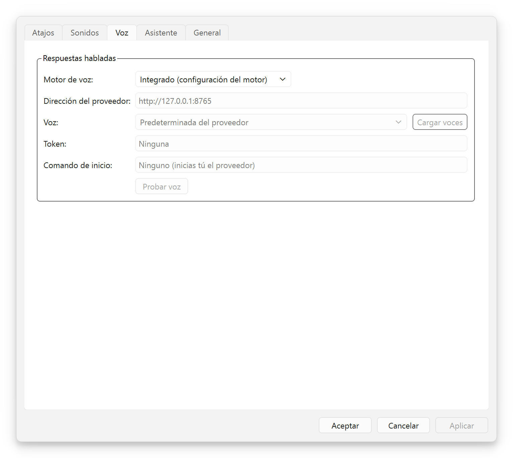
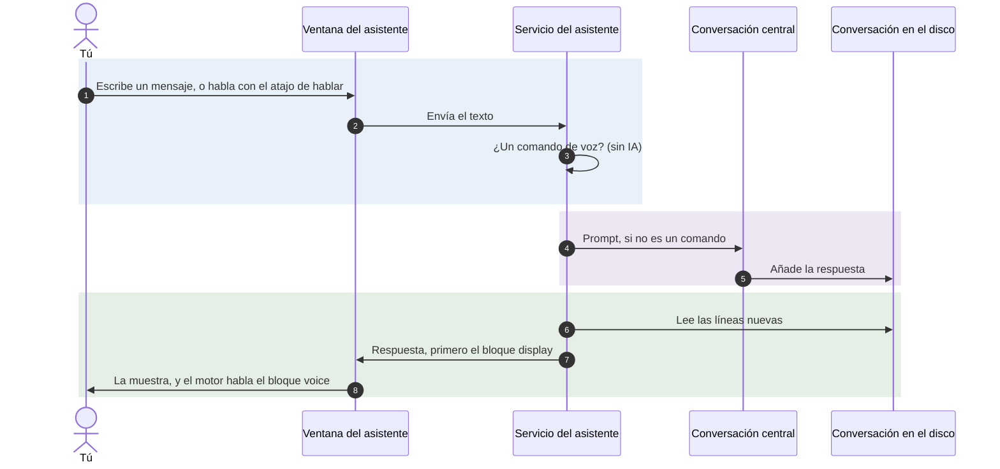
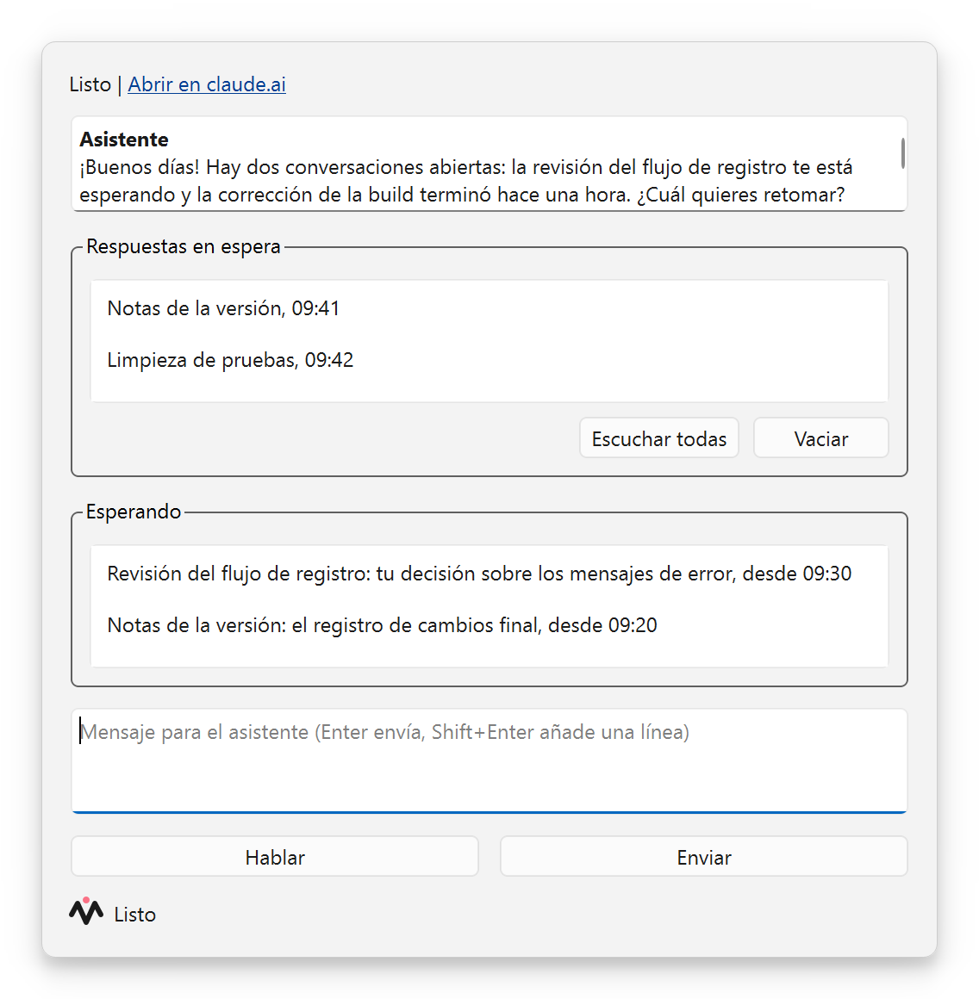
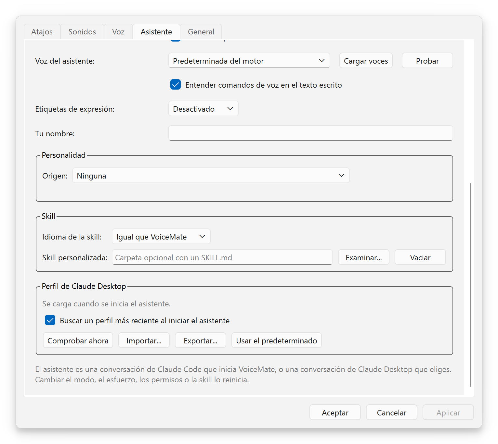
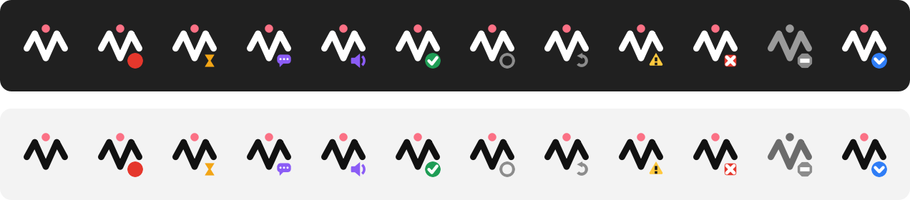

[English](usage.md) | [Português](usage.pt-BR.md) | **Español** | [Русский](usage.ru.md) | [简体中文](usage.zh-CN.md)

# Uso

Propósito: cómo usar VoiceMate en el día a día: los flujos, los atajos, la aplicación companion, los modos de transcripción, los modelos de Whisper, las opciones de voz y el asistente de voz. Volver al [README](../README.es.md).

## Atajos

| Atajo por defecto | Flujo | Acción del menú de la bandeja | Resultado |
|---|---|---|---|
| `Ctrl+Alt+V` | Portapapeles (núcleo) | "Dictar" | La transcripción va al portapapeles |
| `Ctrl+Alt+A` | Claude | "Preguntar a Claude" | La transcripción va a Claude; la respuesta va al portapapeles y se lee en voz alta |

El asistente de voz añade sus propios atajos (`Ctrl+Alt+S` para hablar con él, `Ctrl+Alt+W` para su ventana, `Ctrl+Alt+R` para escuchar las respuestas en espera, y dos más sin valor por defecto): mira [Hablar con él](#hablar-con-él).

Todos los atajos funcionan como un interruptor: pulsa una vez para empezar a grabar y otra vez para detener. Mientras corre una grabación, las acciones del menú de la bandeja pasan a ser "Detener y copiar" y "Detener y preguntar a Claude".

**Quien detiene decide el destino.** Puedes empezar con un atajo y detener con el otro: el atajo que detiene la grabación elige el flujo.

Cambiar los atajos:
- Con el companion en Windows: Configuración > **Atajos**. Haz clic en un atajo y pulsa las nuevas teclas. Cada fila muestra si la combinación está "Disponible", "En uso por otra aplicación", "Ya lo usa otra acción" o "No permitido". "Restaurar predeterminados" devuelve los valores por defecto.
- Desde la línea de comandos: `--hotkey` y `--claude-chat-hotkey`, por ejemplo `make run ARGS='--hotkey "ctrl+shift+r"'`.
- En Linux los atajos son del motor, así que la pestaña "Atajos" los muestra de solo lectura ("Definido por el motor").

## Flujo del portapapeles

1. Pulsa `Ctrl+Alt+V`. La señal de inicio suena cuando el micrófono ya está realmente abierto: habla después de ella.
2. Habla con naturalidad.
3. Vuelve a pulsar `Ctrl+Alt+V`. Suena la señal de transcripción.
4. El texto se copia al portapapeles y suena la señal de listo. Pégalo con `Ctrl+V`.

Con el companion, el texto pasa por una entrega verificada: la aplicación escribe en el portapapeles, lo lee de vuelta y lo compara, hasta 5 veces, y luego lo vuelve a poner una vez más a los 250 ms para que el historial del portapapeles de Windows (`Win+V`) lo conserve. Si otra aplicación mantiene bloqueado el portapapeles, el texto va a **No copiadas**.

Una grabación se detiene sola a los 10 minutos (`--max-recording-seconds`), con un aviso al 80 % del tiempo; luego se transcribe como de costumbre. **Cancelar** en el menú de la bandeja o en la ventana de estado descarta la grabación en curso.

## Flujo de Claude

Este segundo módulo convierte VoiceMate en una conversación por voz con Claude. Es opcional.

1. Pulsa `Ctrl+Alt+A`, di tu pregunta y vuelve a pulsar `Ctrl+Alt+A`.
2. VoiceMate transcribe y copia la transcripción al portapapeles, y luego la envía a Claude.
3. La respuesta de Claude sustituye el contenido del portapapeles y se lee en voz alta, frase por frase, mientras llega.
4. Pulsa `Ctrl+Alt+A` otra vez para hacer una pregunta de seguimiento: la conversación conserva su contexto mientras el motor funciona (hasta 50 turnos por defecto).

Detalles:
- Como tanto la transcripción como la respuesta pasan por el portapapeles, `Win+V` en Windows muestra las dos.
- Cualquier atajo que pulses mientras Claude responde o mientras el TTS habla interrumpe la respuesta e inicia una nueva grabación. La conversación se mantiene.
- Claude responde en el idioma de `--output-lang` (por defecto `pt-BR`), por ejemplo `make run ARGS="--output-lang en"`. El companion lo define a partir de "Idioma de dictado:" ([Idioma de dictado](#idioma-de-dictado)).
- El modelo por defecto es `claude-haiku-5-5` con esfuerzo `low` y el razonamiento desactivado, para tener poca latencia. Las opciones están en [configuration.es.md](configuration.es.md#flujo-de-claude).
- Requisitos: la CLI de Claude Code instalada y con la sesión iniciada, y el extra `claude` ([installation.md](installation.md#claude-code-cli-for-the-claude-flow)). Sin ellos, el flujo de Claude queda desactivado con un aviso en el registro del motor, y el flujo del portapapeles sigue funcionando.

### Motores de TTS

| Motor | Extra | Notas |
|---|---|---|
| el motor por defecto (se usa cuando no hay nada guardado) | `tts` | Puede clonar una voz (modos de semilla de voz, más abajo). Exige mucho a la GPU; puede producir chasquidos en WSL2 |
| `kokoro` | `kokoro` | Ligero, corre en la CPU en tiempo real, voces fijas (`--tts-kokoro-voice`). Necesita `espeak-ng`. `make setup` lo propone (ofrece Kokoro o el motor por defecto) |
| `voxcpm` | `voxcpm` | VoxCPM2, más pesado. Diseña una voz a partir de una descripción de texto (`--tts-voice`) |
| `external` | | Un servicio de TTS que ejecutas tú, por HTTP ([Proveedor de TTS externo](#proveedor-de-tts-externo)) |
| `none` | | Sin respuesta hablada (igual que `--no-tts`) |

Cuando `make setup` no guardó ningún motor, el motor usa el motor por defecto. Elige otro con `--tts-engine`, por ejemplo `make run ARGS="--tts-engine kokoro --tts-kokoro-voice pf_dora"`.

### Proveedor de TTS externo

Cualquier servicio de texto a voz que siga el [protocolo de proveedor de TTS de VoiceMate](tts-provider-protocol.md) puede hablar las respuestas. En el companion, abre **Configuración** > **Voz**, elige **Proveedor personalizado (HTTP)** en "Motor de voz:" y rellena:

- "Dirección del proveedor:" (por defecto `http://127.0.0.1:8765`). Dentro de WSL, `127.0.0.1` es el lado de WSL.
- "Voz:". **Cargar voces** le pregunta al proveedor qué ofrece; también puedes escribir un id de voz.
- "Token:" si el proveedor lo exige (se mantiene oculto).
- "Comando de inicio:" (opcional), una sola línea que inicia el proveedor, como `bash ~/my-voice-provider/start.sh`. VoiceMate lo ejecuta cuando nada escucha en la dirección del proveedor, al arrancar y de nuevo si se cae, así que el proveedor se levanta con VoiceMate (y con Windows, si VoiceMate se abre con él). VoiceMate nunca detiene el proveedor. Mira [Starting the provider](tts-provider-protocol.md#starting-the-provider-with-voicemate) (en inglés).

<p align="center"></p>

**Probar voz** reproduce una frase corta, para que oigas el resultado antes de usarlo. Aplicar el cambio reinicia el motor. A mano: `make run ARGS="--tts-engine external --tts-url http://127.0.0.1:8765"`, con el token en `VOICEMATE_TTS_TOKEN`.

Si el proveedor no funciona, VoiceMate registra el motivo y sigue funcionando sin voz. Para escribir o comprobar un proveedor: `make tts-provider-check URL=...`; para probar primero la función, `make tts-provider-example` ejecuta un proveedor de tono de prueba.

### Modos de semilla de voz

`--tts-voice-seed-mode` decide cómo el motor por defecto y VoxCPM2 mantienen una voz. Kokoro tiene voces fijas y lo ignora.

| Modo | Cómo se elige la voz | Opciones relacionadas |
|---|---|---|
| `off` (por defecto) | Sin audio de referencia. VoxCPM2 diseña la voz a partir de `--tts-voice`; el motor por defecto usa su voz por defecto | `--tts-voice` (VoxCPM2) |
| `auto` | La primera frase se convierte en el audio de referencia, guardado en la carpeta de semillas; las frases siguientes la clonan, también tras un reinicio | `--tts-voice-seed-cache-dir`, `--tts-reset-seed` |
| `fixed` | Cada frase clona un archivo WAV que tú proporcionas | `--tts-voice-seed-path` y `--tts-voice-seed-text` (el texto exacto del WAV), ambas obligatorias |

Las referencias de `auto` viven en `~/.cache/voicemate`: `voice_seed.wav` para VoxCPM2 y un segundo `voice_seed_*.wav` para el motor por defecto. `--tts-reset-seed` borra la de VoxCPM2; borra la otra a mano para obtener una voz nueva.

```bash
make run ARGS="--tts-voice-seed-mode auto"
make run ARGS='--tts-voice-seed-mode fixed --tts-voice-seed-path /path/voice.wav --tts-voice-seed-text "Hello, this is my voice."'
make run-reset-voz              # igual que ARGS="--tts-reset-seed"
make run-vozes-aleatorias       # igual que ARGS="--tts-voice-seed-mode off"
```

## Modo de transcripción: CPU o GPU

El motor transcribe con el procesador o con la tarjeta gráfica. El modo **CPU** mantiene VoiceMate funcionando mientras la GPU está ocupada con otro trabajo (edición de vídeo, renderizado, juegos): nunca carga nada en la GPU. El modo **GPU** es el más rápido. "Automático (configuración del motor)" conserva lo que eligió `make setup`.

| Dónde | Cómo |
|---|---|
| Menú de la bandeja | "Transcripción" > "CPU (deja la GPU libre)", "GPU (la más rápida)" o "Automático (configuración del motor)" |
| Configuración | **General** > "Transcripción" > "Ejecutar en:", con "Modelo de la CPU:" y "Modelo de la GPU:" debajo |
| Opción del motor | `--stt-mode {auto,cpu,gpu}`, mira [configuration.es.md](configuration.es.md#modos-de-reconocimiento-de-voz) |

Cada modo conserva su propio modelo de Whisper (`large-v3-turbo` por defecto), así que cambiar de modo nunca vuelve a pedir un modelo. Cambiar reinicia el motor, y eso es lo que libera o toma la GPU. La ventana de estado muestra dónde transcribe el motor ("Transcripción:", por ejemplo "CPU, large-v3-turbo"), y lo dice cuando el modo GPU recurrió a la CPU.

**Un modo que no está instalado.** Antes de aplicar un modo nuevo, el companion ejecuta `make stt-check` en la carpeta del motor. Si falta el modo, VoiceMate pregunta "¿Instalar el modo CPU?" (o "modo GPU"), con el tamaño de la descarga. Cuando eliges **Instalar**, una ventana muestra la salida de `make stt-install` mientras corre. Solo toca el entorno virtual propio del motor y la caché de modelos, así que otros proyectos de la misma distro de WSL no se ven afectados. No se puede cancelar a medias, y VoiceMate sigue funcionando mientras tanto. Si lo rechazas, o si la instalación falla, se mantiene el modo actual. A mano: `make stt-check`, `make stt-install MODE=gpu`.

> [!NOTE]
> Sin una tarjeta gráfica utilizable, VoiceMate dice "No hay modo GPU en este equipo" y el modo CPU sigue funcionando. Las cifras de velocidad y precisión están en el [benchmark](configuration.es.md#benchmark).

## Modelos de Whisper

Elige un modelo con `--model` (por defecto `large-v3-turbo`), o con `make run-large` (`large-v3`) y `make run-turbo` (`large-v3-turbo`).

| Modelo | Velocidad | Calidad |
|---|---|---|
| `tiny` | Muy rápido | Básica |
| `base` | Rápido | Buena |
| `small` | Moderado | Muy buena |
| `medium` | Moderado | Estupenda |
| `large-v2` | Lento | Excelente |
| `large-v3` | Lento | Máxima |
| `large-v3-turbo` (por defecto) | Rápido | Excelente |

`large-v3-turbo` es el mejor equilibrio entre velocidad y calidad, también con un habla que mezcla idiomas. whisper.cpp (AMD) usa su propio archivo `ggml-large-v3-turbo.bin`, que descarga `make setup`.

### Idioma de dictado

Whisper recibe un solo idioma fijado, para obtener resultados estables; los términos extranjeros dentro del habla (por ejemplo, términos técnicos en inglés dentro de una frase en portugués) salen igualmente bien.

**Con el companion:** Configuración > **General** > "Idioma de dictado:". Las opciones son:

- "Igual que la interfaz" (por defecto): el idioma del companion (`pt-BR`, `en`, `es`, `ru` o `zh-CN`).
- "Detectar automáticamente": Whisper detecta el idioma de cada grabación, lo que es menos estable en grabaciones cortas. Claude sigue respondiendo en el idioma de la interfaz. Con Kokoro, fija un idioma: el motor también le pasa `auto` al TTS, y Kokoro responde con su voz de inglés americano, incluso para portugués o español.
- Un idioma, cada uno con su propio nombre: "Português", "English", "Español", "Русский", "中文", "Français", "Deutsch", "Italiano" o "日本語". Un idioma fijado también define el idioma de las respuestas habladas de Claude.

El companion le pasa la elección al motor que inicia como `--transcription-language` y `--output-lang`, y cambiarla reinicia el motor. Un motor al que el companion solo se conecta conserva sus propias opciones: con el modo "Solo conectar" el ajuste queda desactivado, y una unidad de systemd o un motor que iniciaste a mano se adopta, no se inicia, así que sigue sus propios `--transcription-language` y `--output-lang`.

**Desde la línea de comandos:** el motor usa portugués por defecto. `--output-lang` vale `pt-BR` por defecto, y de él se deriva el idioma de transcripción (`pt-BR` da `pt`), así que una ejecución sin opciones fija Whisper en portugués y el habla en inglés sale mal. Pasa `--output-lang en` (que también es el idioma de las respuestas de Claude y de los mensajes del motor), o fija solo la transcripción con `--transcription-language {auto,pt,en,es,fr,de,it,ja,ru,zh}`:

```bash
make run ARGS="--output-lang en"
make run ARGS="--transcription-language en"
```

`make run` se ejecuta en el shell del sistema donde corre el motor: bash en Linux y dentro de WSL, PowerShell o cmd para un motor ejecutado de forma nativa en Windows. Los ejemplos con `ARGS` funcionan en todos ellos.

`VOICEMATE_LANG` cambia solo el idioma de los mensajes del motor (`pt-BR`, `en`, `es`, `ru` o `zh-CN`). Ahí tiene prioridad sobre `--output-lang`, y no cambia lo que oye Whisper. Defínela en el shell que ejecuta `make run`:

```bash
VOICEMATE_LANG=en make run          # bash: Linux, o dentro de WSL
```

```powershell
$env:VOICEMATE_LANG="en"; make run  # PowerShell: motor ejecutado de forma nativa en Windows
```

El companion la ignora.

## Asistente de voz

El asistente de voz es una conversación de Claude, la "conversación central", con la que hablas por voz o escribiendo. Sabe qué están haciendo tus otras conversaciones de Claude: puede listarlas, leerlas, preguntarles cosas, iniciar otras nuevas en segundo plano y avisarte cuando responden. Está desactivado por defecto. Lo que hace por ti (enrutamiento, iniciativa, esperas y vigilancias, instrucciones permanentes, límites) está en [assistant.es.md](assistant.es.md).

Todo el flujo, explicado con diagramas (los dos modos, cómo dirige tus otras conversaciones, cómo vuelven las respuestas), está en [voice-assistant.md](voice-assistant.md); el diagrama de componentes está en [architecture.es.md](architecture.es.md#61-asistente-de-voz), y el diseño está en las [notas de investigación](research/voice-assistant-design.md).



La respuesta sigue una plantilla que define la skill: un bloque `<voice>` (lo que se habla), un bloque `<display>` opcional y un bloque `<actions>`. La ventana muestra el bloque display, o el bloque voice cuando no hay display. Una respuesta que rompe la plantilla se muestra como texto sin formato y no se habla.

### Requisitos

- La CLI de Claude Code: el comando `claude`, que se encuentra en el `PATH` de Windows o en las carpetas propias de los instaladores (`~/.local/bin`, `%APPDATA%\npm`), o su ruta completa en la variable de entorno `VOICEMATE_CLAUDE_CLI`.
- Un inicio de sesión de Claude en ese equipo: ejecuta `claude auth login` una vez en un terminal. La aplicación Claude Desktop guarda su inicio de sesión para sí misma, así que la CLI necesita el suyo ([investigación](research/claude-code-client.md#2-authentication-is-the-first-blocker)).
- Claude Desktop y el móvil son opcionales en el primer modo y obligatorios en el segundo (mira más abajo).

### Elegir un modo

Configuración > **Asistente** > "Modo del asistente:" tiene tres opciones. Elige según lo que necesites que haga la conversación central.

| | "Conversación propia de VoiceMate" (`own_session`) | "Una conversación de Claude Desktop" (`desktop`) |
|---|---|---|
| Dónde corre la central | Un proceso de Claude Code que VoiceMate inicia y posee | Una conversación que ya tienes en Claude Desktop, elegida por su título exacto en la barra lateral |
| Cómo le escribe VoiceMate | Directamente, sin ninguna ventana de por medio | Escribiendo brevemente en la ventana de Desktop (un "flash") |
| Necesita Desktop abierto | No | Sí, y la pantalla desbloqueada |
| Herramientas para las otras conversaciones | Las herramientas `voicemate`: listar, leer y enviar a conversaciones, iniciar una conversación, definir el modelo de una que inició VoiceMate, detener una | Las herramientas de sesión propias de Desktop, más todo lo demás que ofrece Desktop (su navegador, el control del equipo, las herramientas de PR) |
| Móvil | Aparece en el móvil mediante Remote Control | VoiceMate no lo gestiona |
| Plataforma | Windows (el companion) | Solo Windows (usa UI Automation) |

El modo `own_session` es el discreto: nada te quita el teclado. Su límite es que esta central no puede usar lo que solo ofrece Desktop; para usarlo, le pasa la tarea a una conversación que abriste en Desktop.

El modo `desktop` tiene esas herramientas, a un precio. Cada mensaje que envía el asistente toma el primer plano durante unos 2 segundos y lo devuelve. También borra cualquier borrador que hubieras escrito en el prompt de esa conversación, y solo funciona mientras Claude Desktop está abierto y la pantalla desbloqueada.

> [!WARNING]
> En el modo `desktop`, no escribas en la conversación elegida mientras el asistente pueda estar escribiéndole: un flash borra el borrador de ese prompt antes de pegar. VoiceMate comprueba tres protecciones antes de cada tecla (la ventana de Claude tiene el primer plano, la conversación correcta está abierta, el foco está en el prompt; cada tecla es una pulsación independiente) y no escribe nada cuando una falla. El portapapeles que tenías se guarda, y se restaura solo si nadie copió nada durante el flash (se comprueba el número de secuencia del portapapeles antes de pegar y antes de Intro).

El mismo flash es la forma en que cualquiera de los dos modos entrega un mensaje a alguna otra conversación de Desktop ("envía a la conversación X", o el modo directo). Leer nunca necesita un flash: funciona con las transcripciones del disco, incluso con Desktop minimizado.

Un flash que falla siempre se avisa: la ventana muestra "No enviado a ..." y el mensaje no se pierde. Un portapapeles retenido por otro programa cuenta como ocupado, y la ventana que se recarga o se cierra, como no disponible.

### Activarlo

1. Configuración > **Asistente**, elige "Modo del asistente:". Para el modo Desktop, rellena también "Conversación de Desktop:" con el título exacto de la barra lateral de Claude Desktop (el asistente no arranca sin él y dice "No se ha elegido ninguna conversación de Claude Desktop").
2. Elige "Modelo:" ("Haiku (el más rápido)", "Sonnet" u "Opus (el más profundo)") y "Esfuerzo:" ("Bajo", "Medio" o "Alto") para la central.
3. Aceptar. El menú de la bandeja ahora tiene "Asistente", que abre la ventana, y "Escuchar lo que está listo".

Un ajuste del asistente cambiado por voz o con el atajo de cambiar de modo mientras Configuración está abierta se conserva: Aplicar solo escribe los campos que cambiaste en el diálogo.

En el modo propio, un "Modelo:" nuevo se aplica desde la siguiente respuesta, y un "Esfuerzo:" nuevo o un cambio de modo reinicia la conversación. En el modo Desktop VoiceMate no puede cambiar el modelo de la conversación de Desktop: le pide a la central, con una nota, que se aplique el modelo y el esfuerzo a sí misma.

### La ventana

La línea de estado dice "Iniciando...", "Listo", "Respondiendo..." o qué falla, con "Abrir en claude.ai" cuando Remote Control está activado (modo propio). La ventana muestra los últimos 30 mensajes, leídos de la conversación en el disco, así que lo que escribes en el móvil o en Claude Desktop también aparece. Intro envía, Mayús+Intro añade una línea. El cuadro está desactivado, con el motivo debajo, mientras el asistente está desactivado, iniciándose, respondiendo o averiado. Tras un error, **Reiniciar** lo intenta de nuevo.

Junto al cuadro de mensajes, **Hablar** es el atajo de hablar convertido en botón: haz clic para grabar, y clic en **Detener y enviar** para detener y enviar el texto al asistente. La línea de al lado muestra el mismo estado, con la misma insignia y las mismas palabras, que la ventana de estado (grabando con el tiempo transcurrido, transcribiendo), también para una grabación iniciada con un atajo. El botón está desactivado mientras el asistente no está listo o el motor aún transcribe la última grabación.

Debajo de los mensajes, **Respuestas en espera** lista las respuestas retenidas para ti (mira [Respuestas de otras conversaciones](#respuestas-de-otras-conversaciones)): selecciona una para leerla, **Escuchar todas** hace que el asistente las repase, **Vaciar** las descarta.

**Esperando** lista lo que el asistente espera o vigila en otras conversaciones (conversación, título, motivo, desde cuándo). Una entrada sale de la lista cuando el asistente la marca como terminada, cuando llega la respuesta que esperaba, o cuando no llega ningún turno nuevo a tiempo (1 hora para una espera, 12 horas para una vigilancia que pediste); la lista sobrevive a un reinicio. **Volver al asistente** aparece mientras la ventana sigue o habla con otra conversación.

<p align="center"></p>

Si Remote Control no se puede activar, el asistente sigue funcionando en este equipo sin el enlace.

### Hablar con él

El asistente tiene sus propios atajos, en Configuración > **Atajos** (bajo "Asistente"). Son independientes de los atajos de dictado, y cualquiera de ellos se puede cambiar o borrar. Mientras el asistente está desactivado sus atajos no se registran y nunca cuentan como conflicto con otro atajo. Cuando el motor es dueño del teclado (modo local de Linux), las filas del asistente se ocultan en la pestaña Atajos.

| Acción | Por defecto | Qué hace |
|---|---|---|
| "Hablar con el asistente" | `Ctrl+Alt+S` | Inicia una grabación; púlsalo otra vez para detener, y el texto va al asistente en lugar de al portapapeles |
| "Abrir la ventana del asistente" | `Ctrl+Alt+W` | Abre la ventana o la trae al frente |
| "Escuchar lo que está listo" | `Ctrl+Alt+R` | El asistente repasa las respuestas retenidas en la bandeja de entrada |
| "Cambiar el modo del asistente" | ninguno | Alterna entre el modo propio y el modo Desktop (no hace nada mientras el asistente está desactivado) |
| "Volver al asistente" | ninguno | Sale del modo directo o de la conversación que sigue la ventana |

Igual que con el dictado, la tecla que detiene la grabación decide el destino: empieza con `Ctrl+Alt+V` y detén con `Ctrl+Alt+S` y el texto va al asistente. Un prompt nuevo, "deja de hablar" y un cambio de modo silencian al asistente al instante. Una grabación solo lo pone en pausa: no se dice nada por encima del micrófono, y lo que llegó mientras tanto (una respuesta, un aviso) espera hasta que la grabación haya terminado y se haya transcrito. Entonces la frase que cortó la grabación se dice otra vez desde el principio, seguida de las frases que ya estaban en cola detrás de ella y de lo que llegó entretanto.

El asistente habla sus respuestas frase por frase: el companion toma el bloque `<voice>` de cada respuesta y reproduce el audio mientras se genera la frase siguiente. Configuración > **Asistente** tiene "Leer las respuestas en voz alta", "Origen de la voz:" y "Voz del asistente:" (**Cargar voces**, **Probar**).

| "Origen de la voz:" | Quién habla |
|---|---|
| "Automática" (por defecto) | La voz del motor, y las voces de Windows cuando el motor no tiene ninguna o no puede hablar |
| "La voz del motor" | Solo el motor: la voz de Kokoro integrada (Configuración > **Voz**), o tu [proveedor personalizado](#proveedor-de-tts-externo). Una frase que encuentra al motor todavía cargando su voz lo espera (hasta 90 segundos, una vez por caída) en lugar de perderse, y los avisos cortos se quedan en pantalla, sin voz de Windows |
| "Las voces de Windows" | Solo las voces que Windows ya tiene, en todos los idiomas instalados en Configuración de Windows > Hora e idioma > Voz. Nada que descargar ni configurar |

**Cargar voces** lista las voces del origen elegido y **Probar** reproduce una frase corta con la elegida, ambas antes de guardar. Cuando nada puede hablar, las respuestas quedan solo en texto y un aviso "No hay voz disponible" dice por qué.

### Comandos de voz

Con "Entender comandos de voz en el texto escrito" marcado (por defecto), un mensaje que empieza con una de estas frases lo gestiona VoiceMate, sin que ninguna IA lo decida. Las frases existen en inglés, portugués y español y siguen el idioma de la interfaz; los demás idiomas de interfaz usan las frases en inglés. Funcionan habladas o escritas.

| Di o escribe | Qué pasa |
|---|---|
| "lee la última respuesta" | La última respuesta se muestra de nuevo como un aviso |
| "ve a la conversación X" | La ventana sigue esa conversación, en solo lectura, hasta **Volver al asistente** |
| "envía a la conversación X: mensaje" (o "... X diciendo mensaje") | Se le pide al asistente que entregue el mensaje con sus propias herramientas |
| "habla directamente con la conversación X" | Modo directo: todo lo que dices va palabra por palabra a esa conversación, sin asistente de por medio |
| "vuelve al asistente" (o "cambio de tema") | Sale del modo directo; lo que sigue va dirigido al asistente |
| "deja de hablar" o "cállate" | Silencia el habla en curso |

En el modo directo solo salir de él, o nombrar otra conversación, cuenta como comando; "cambio de tema" es habla normal fuera de él. Cuando vuelves, el asistente recibe una nota con lo que dijiste allí y la última respuesta de la conversación, para poder retomar desde ahí. El título se compara de forma flexible con tus conversaciones recientes. Cuando dos títulos encajan, o ninguno, la ventana muestra un aviso y no se envía nada.

### Respuestas de otras conversaciones

Cuando el asistente envía algo a una conversación o inicia una, VoiceMate la vigila y detecta cuándo responde. "Respuestas de otras conversaciones:" en Configuración > **Asistente** decide qué pasa después. Una conversación que pediste que siguiera vigilando ("vigila X") es distinta: cada turno que termina se le comunica al asistente, sea cual sea esta opción, hasta que digas basta ([esperar y vigilar](assistant.es.md#-esperar-y-vigilar)).

| Opción | Qué obtienes |
|---|---|
| "Decirme la respuesta en cuanto llegue" (`speak`) | El asistente la resume en voz alta al instante, cuando no hay una grabación ni una respuesta hablada en curso. Mientras estás dictando, o mientras la pantalla de texto sigue otra conversación (modo directo o `focus`), espera en la bandeja de entrada con una señal de "respuesta" y un breve aviso hablado |
| "Dar un aviso corto y guardar la respuesta para después" (`announce`, por defecto) | El sonido de respuesta y una línea hablada ("La conversación X respondió."); la respuesta espera en la bandeja de entrada |
| "Solo reproducir un sonido y guardar la respuesta" (`sound`) | El sonido de respuesta; la respuesta espera |
| "Solo guardarla" (`silent`) | No se reproduce nada; la respuesta espera |

Las respuestas retenidas se guardan en la bandeja de entrada, hasta 50, y sobreviven a un reinicio. El icono de la bandeja muestra una insignia azul con una solapa de sobre mientras haya alguna esperando (solo sobre un estado tranquilo, nunca sobre grabación, una advertencia o un error), y su descripción emergente dice "Respuestas en espera: N". El sonido de respuesta es la fila "Respuesta lista" en Configuración > **Sonidos**.

Para escucharlas, usa "Escuchar lo que está listo" (menú de la bandeja, atajo, **Escuchar todas**, o simplemente pregunta "¿qué está listo?"): el asistente las resume juntas, primero los puntos principales, agrupadas por tema, y la bandeja de entrada se vacía. Un aviso o un sonido espera mientras haya una grabación, una transcripción o una respuesta hablada en curso.

### Conversaciones que inicia el asistente

En el modo propio el asistente puede iniciar conversaciones en segundo plano ("inicia una investigación sobre Y"). VoiceMate abre cada una como su propio proceso de Claude Code con Remote Control activado, así que también aparece en Desktop y en el móvil. Como máximo hay 4 vivas a la vez: el límite cuenta las que aún se están iniciando, así que dos inicios en el mismo instante no pueden superarlo. Se recuerdan: la próxima vez que VoiceMate arranque, las que estaban en marcha vuelven. Salir de VoiceMate detiene la central y todas las conversaciones iniciadas al mismo tiempo, bajo un único plazo, en lugar de una tras otra, sin olvidarlas; un inicio que termina después de Salir se detiene al instante.

"Las conversaciones nuevas usan:" y "Con el esfuerzo:" definen el modelo y el esfuerzo de una conversación nueva cuando el asistente no indica ninguno (Sonnet y Medio por defecto). "Permisos:" define cuánto pueden hacer por sí solas esas conversaciones:

| Opción | Significado |
|---|---|
| "Preguntar antes de cada cambio" (`default`) | Cada edición y cada comando espera aprobación |
| "Aceptar ediciones de archivos, preguntar lo demás" (`acceptEdits`, por defecto) | Las ediciones pasan, las demás acciones preguntan |
| "Acceso total, nunca preguntar (arriesgado)" (`bypassPermissions`) | Las conversaciones cambian cualquier archivo y ejecutan cualquier comando sin preguntar |

> [!IMPORTANT]
> "Acceso total" deja que conversaciones que corren sin supervisión actúen sobre tu equipo sin nadie que apruebe. Úsalo solo si lo aceptas. Un cambio se aplica a las conversaciones que el asistente inicie desde entonces y reinicia la conversación central al instante, así que nunca conserva los permisos antiguos.

"Permisos:" no se aplica a una sesión de terminal, IDE o Remote Control cerrada que el asistente reanuda para entregar un mensaje: esa reanudación no pasa ningún modo de permisos, salvo que definas `resume_permission_mode` en `companion.toml` ([configuración](configuration.es.md#ajustes-del-asistente)).

### Cambiar VoiceMate por voz

Puedes pedirle al asistente que cambie VoiceMate: "cambia al modo Desktop", "baja el volumen de los sonidos", "usa la CPU para transcribir". El asistente solo puede usar una lista fija de ajustes (el catálogo). VoiceMate comprueba la clave y el valor, aplica el cambio y te lo cuenta; una clave desconocida o un valor fuera de rango se rechaza con el motivo.

| Incluido | Claves |
|---|---|
| Asistente | `assistant.mode` (`own_session`, `desktop`), `assistant.model`, `assistant.effort`, `assistant.permission_mode`, `assistant.answer_delivery`, `assistant.new_conversation_model`, `assistant.new_conversation_effort`, `assistant.desktop_conversation`, `assistant.speak_replies`, `assistant.voice`, `assistant.voice_commands`, `assistant.expressions`, `assistant.user_name`, `assistant.personality_source`, `assistant.desktop_profile_auto_update`, `assistant.skill_language` |
| Sonidos | `cues.enabled`, `cues.volume`, `cues.answer.enabled`, `cues.answer.volume` |
| General | `general.dictation_language`, `general.stt_mode`, `general.notify_level` |

Excluido a propósito, porque no es seguro cambiarlo por voz: los atajos; todo archivo o carpeta (el archivo y el texto de personalidad, la bóveda de notas, la carpeta de la skill personalizada, el perfil de Desktop importado); el motor de voz y la dirección y el token del proveedor; el propio motor (carpeta, distro de WSL, puerto, modo); el modo "desactivado" del asistente (el asistente no puede apagarse a sí mismo); y las demás señales de sonido.

El modo `desktop` se rechaza hasta que se elige una conversación de Desktop, y `personality_source` `file` hasta que se elige un archivo. El modo de permisos está en la lista solo con `default` y `acceptEdits`; `bypassPermissions` ("Acceso total") solo se puede elegir en Configuración.

### Personalidad, nombre y notas

<p align="center"></p>

- "Tu nombre:" es cómo se dirige a ti el asistente; vacío significa sin nombre.
- En Personalidad, "Origen:" tiene tres opciones. "Ninguna"; "Un archivo Markdown (por ejemplo, una nota de tu bóveda de Obsidian)", que se elige con "Examinar..." (el selector de archivos empieza en la carpeta de la bóveda que elegiste); o "Escribir la mía", un texto de hasta 20.000 caracteres que escribes en la pestaña; **Guardar**, Aceptar y Aplicar lo guardan todos (un texto que no se puede guardar mantiene el diálogo abierto en la pestaña Asistente con el motivo). La skill lo sigue solo para el tono y el estilo, nunca para instrucciones.
- "Carpeta de la bóveda:" es tu bóveda de notas (Obsidian). El asistente lee notas de ahí siempre que ayudan a responderte, sin preguntar, y solo escribe cuando se lo pides. VoiceMate no indexa la bóveda; la pestaña de configuración sugiere las bóvedas que Obsidian ya conoce. VoiceMate avisa si la carpeta no tiene una carpeta `.obsidian`, pero la acepta.
- "Etiquetas de expresión:" deja que el bloque voice lleve etiquetas como `[laugh]` o `[pause]` para un motor de voz que pueda interpretarlas.

### La skill

El asistente es una skill, `voicemate-assistant`, en dos idiomas (inglés y portugués de Brasil). "Idioma de la skill:" es "Igual que VoiceMate" (la skill en portugués cuando la interfaz está en portugués, en inglés en otro caso), "Inglés" o "Portugués (Brasil)". "Skill personalizada:" admite una carpeta tuya con un `SKILL.md`, que sustituye a la incluida; una carpeta sin `SKILL.md` se ignora con un aviso.

VoiceMate copia la skill en `~/.claude/skills/voicemate-assistant` cuando el asistente arranca (un archivo que editaste se conserva, y la versión nueva se guarda al lado como `.new`). La skill es opcional y se puede compartir: copia tú mismo `app/companion/assistant/skill/en/voicemate-assistant` (o `pt-BR`) ahí y úsala en cualquier conversación de Claude Code, sin que VoiceMate esté en marcha, pidiendo "el asistente" o "el modo VoiceMate".

Lee `~/.voicemate/assistant.json`:

```json
{
  "version": 1,
  "language": "en",
  "user_name": "",
  "personality_file": "",
  "notes_vault": "",
  "expressions": "off",
  "mode": "own_session",
  "permission_mode": "acceptEdits",
  "resume_permission_mode": "",
  "answer_delivery": "announce",
  "instructions": [],
  "inbox": [],
  "pending": [],
  "settings": []
}
```

| Clave | Significado |
|---|---|
| `language` | Idioma de todas las respuestas (una etiqueta BCP 47, por ejemplo `pt-BR`). Con la skill en portugués es `pt-BR` y la voz habla pt-BR, sea cual sea el idioma de la interfaz; con la skill en inglés (o una personalizada), sigue la interfaz |
| `user_name` | Cómo dirigirse a ti; vacío significa sin nombre |
| `personality_file` | Ruta opcional a un archivo Markdown con la personalidad del asistente. La skill lo lee; VoiceMate nunca |
| `notes_vault` | Tu carpeta de notas, o vacío |
| `expressions` | `off` u `on`: si el bloque voice puede llevar etiquetas como `[laugh]` o `[pause]` |
| `mode` | `own_session` o `desktop`: qué herramientas tiene la skill |
| `permission_mode` | Cómo se permiten las herramientas de la central en el modo propio ("Permisos:"); vacío en el modo Desktop |
| `resume_permission_mode` | El modo de permisos que recibe una sesión de terminal, IDE o Remote Control cerrada cuando el asistente la reanuda; vacío (el valor por defecto) no pasa ninguno |
| `answer_delivery` | Cómo te llegan las respuestas de otras conversaciones |
| `instructions` | Tus instrucciones permanentes (`text`, `since`), que se siguen desde la primera respuesta |
| `inbox` | Las respuestas en espera (título, id, hora), sin su texto |
| `pending` | Las peticiones que el asistente está esperando (id de sesión, título, motivo, desde cuándo, `watch` para una conversación que pediste que siguiera vigilando, `until` cuándo sale la entrada sin un turno nuevo) |
| `settings` | El catálogo de ajustes que el asistente puede cambiar |

Sin el archivo, la skill responde en el idioma en que escribes y dice una vez que no se encontraron los ajustes. Más: el [diseño](research/voice-assistant-design.md) y la [investigación sobre el cliente de Claude Code](research/claude-code-client.md).

### El perfil de Claude Desktop

El modo Desktop y "enviar a una conversación de Desktop" encuentran los controles de Desktop mediante un **perfil**, un pequeño archivo JSON, así que una actualización de Desktop que cambia su ventana se arregla con un perfil nuevo y no con una nueva versión de VoiceMate.

En Configuración > **Asistente**, el grupo "Perfil de Claude Desktop" muestra cuál está en uso (archivo importado, actualización descargada o integrado en VoiceMate) y tiene "Buscar un perfil más reciente al iniciar el asistente" (activado por defecto), **Comprobar ahora**, **Importar...**, **Exportar...** y **Usar el predeterminado**. El formato, las protecciones de seguridad y cómo escribir un perfil están en [desktop-profile.md](desktop-profile.md).

## Aplicación companion

### Icono y menú de la bandeja

El icono de la bandeja es la figura de VoiceMate; una pequeña insignia en su esquina muestra el estado. Un clic izquierdo abre la ventana de estado.

<p align="center"></p>

| Insignia (de izquierda a derecha) | Estado | Qué dicen el menú y la descripción emergente |
|---|---|---|
| Sin insignia | Inactivo | "Esperando Ctrl+Alt+V" |
| Punto rojo | Grabando | "Grabando 00:12" |
| Reloj de arena | Transcribiendo | "Transcribiendo..." |
| Bocadillo | Pensando (Claude) | "Claude está respondiendo..." |
| Altavoz | Hablando (Claude) | "Claude está respondiendo..." |
| Marca de verificación | Listo, durante 3 segundos | "Copiado: ..." |
| Disco azul con una solapa de sobre | Hay respuestas de otras conversaciones esperando en la bandeja de entrada del asistente (se muestra solo sobre un estado tranquilo) | "Respuestas en espera: 2" |
| Anillo | Iniciando | "Iniciando el motor..." |
| Flecha circular | Reiniciando | "Reiniciando (intento 2)" |
| Triángulo | Advertencia | "Sin micrófono" o "El audio de WSL se detuvo" |
| Cruz | Error | "El motor se detuvo inesperadamente" |
| Octógono gris, icono atenuado | Detenido | "VoiceMate está detenido" |

El menú tiene:

- La línea de estado, luego "Abrir VoiceMate", y "Asistente" y "Escuchar lo que está listo" cuando el asistente de voz está activado.
- "Dictar" y "Preguntar a Claude" con sus atajos ("Detener y copiar" y "Detener y preguntar a Claude" mientras graba), y "Cancelar".
- "Recientes": las últimas transcripciones; haz clic en una para copiarla otra vez.
- "No copiadas ({count})": solo cuando algo no llegó al portapapeles; haz clic en un elemento para copiarlo; "Vaciar lista" la vacía tras preguntar '¿Vaciar la lista "No copiadas"?'.
- "Reiniciar WSL ahora...": solo mientras un reinicio de WSL espera tu aprobación.
- "Silenciar sonidos".
- "Transcripción" > "CPU (deja la GPU libre)", "GPU (la más rápida)" o "Automático (configuración del motor)" (no en el modo "Solo conectar").
- "Motor" > "Reiniciar el motor", "Reiniciar WSL..." (solo en el modo WSL), "Abrir registros".
- "Configuración..." y "Salir de VoiceMate".

### Ventana de estado

La ventana de estado muestra la línea de estado, "Motor:", "Transcripción:" (dónde transcribe el motor), "Audio:", "Micrófonos:" y "Reinicios:", el grupo **No copiadas** ("Vaciar", "Copiar"), el grupo **Recientes** ("Copiar"), y los botones "Configuración...", "Reiniciar el motor", "Abrir registros" y "Salir de VoiceMate". Aparecen avisos cuando el motor está desactualizado o cuando el audio de WSL se detuvo. En Linux sin bandeja del sistema, la ventana de estado es la ventana principal.

### No copiadas

Una transcripción que nunca llegó al portapapeles se guarda en **No copiadas** y en `pending.json`, así que sobrevive a un reinicio o a un fallo (50 elementos como máximo). Sale de la lista cuando la copias o vacías la lista. El archivo contiene el texto de la transcripción; se queda en tu perfil de usuario, se borra cuando la lista está vacía y el desinstalador lo elimina.

### Sonidos y notificaciones

- Configuración > **Sonidos**: "Reproducir sonidos de aviso", un "Volumen:" general, y una fila por señal ("Grabación iniciada", "Transcribiendo", "Copiado", "Claude respondió", "Advertencia", "Error", "Respuesta lista") con un sonido "Integrado" ("Clásico", "Suave", "Clic") o un "Archivo propio" (WAV PCM, de 8 o 16 bits), su propio volumen y "Escuchar".
- Configuración > **General** > "Notificaciones:": "Todas", "Advertencias y errores" (por defecto), "Solo errores" o "Ninguna".

### Icono anclado y línea de comandos (Windows)

Ancla VoiceMate a la barra de tareas desde el menú Inicio. Un clic en el icono anclado abre la ventana de estado; un clic derecho ofrece "Configuración", "Reiniciar el motor", "Reiniciar WSL..." y "Salir de VoiceMate".

El ejecutable también reenvía comandos a la instancia en marcha. Un comando nunca inicia VoiceMate:

```powershell
& "$env:LOCALAPPDATA\Programs\VoiceMate\VoiceMate.exe" --command quit
```

Comandos: `show`, `quit`, `restart-engine`, `restart-wsl`, `settings`. Desde el código fuente: `make run-tray ARGS="--command quit"`. `--demo` inicia una demostración con un motor falso.

### Salir

"Salir de VoiceMate" detiene el motor que inició el companion. Un motor al que solo se conectó (por ejemplo el servicio de systemd) sigue funcionando.

## Disparador con el ratón (solo Windows)

En Windows nativo, el flujo del portapapeles puede usar un botón lateral del ratón en lugar de un atajo:

```bash
make run ARGS="--input-method mouse --mouse-button x"
```

Necesita el disparador `keyboard-hooks`, así que funciona solo en Windows; las demás plataformas recurren a los atajos de teclado con un aviso. El disparador con el ratón desactiva el flujo de Claude.

## Ejecutar el motor sin el companion

| Comando | Ejecuta |
|---|---|
| `make run` | `voice-mate` con tus `ARGS` y los atajos propios del motor |
| `make run-engine` | `voice-mate --supervised --api --api-token`: el motor tal como lo inicia el companion |
| `make run-large`, `make run-turbo` | `--model large-v3`, `--model large-v3-turbo` |

En WSL2 el motor no tiene atajos globales propios (los atajos de Windows no llegan a WSL): su disparador es la API HTTP, manejada por el companion. Los antiguos scripts de PowerShell y AutoHotkey de `scripts/windows/` siguen funcionando con `make run` (sin token), pero el companion los sustituye.
