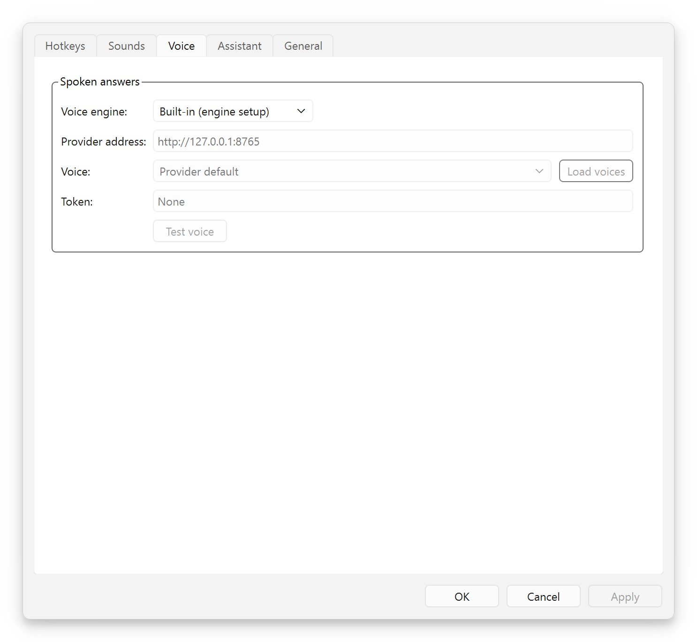
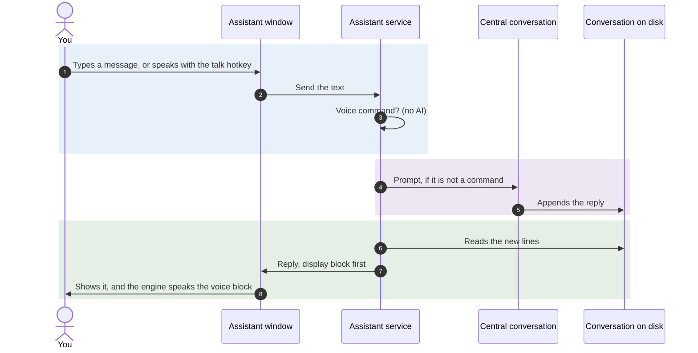
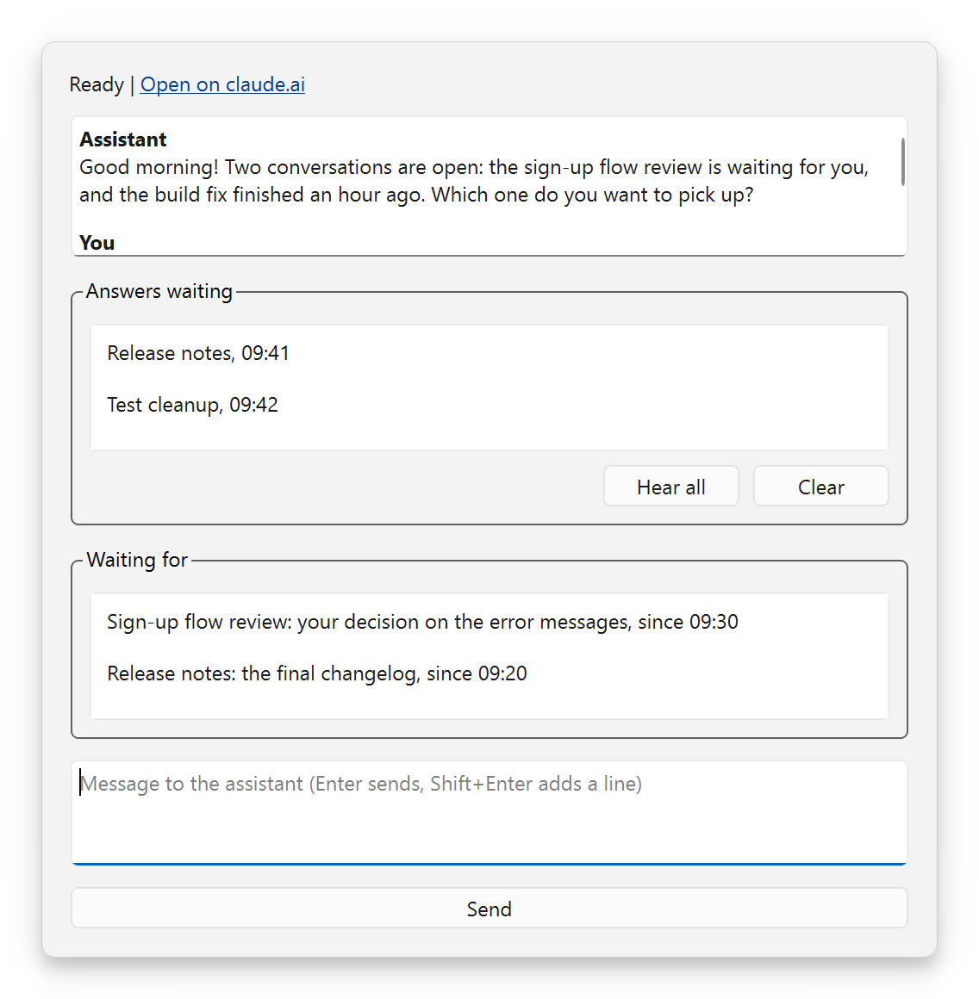
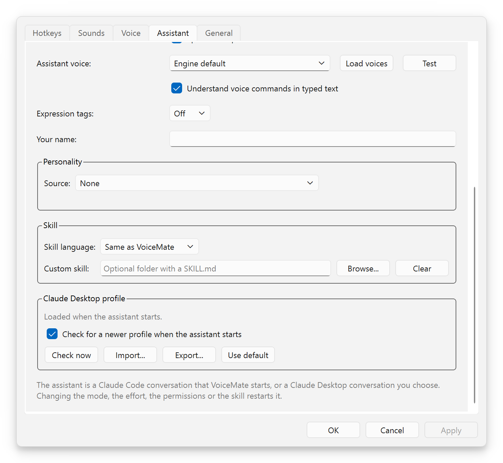

# Usage

Purpose: how to use VoiceMate day to day: the flows, the hotkeys, the companion app, the transcription modes, the Whisper models, the voice options and the voice assistant. Back to the [README](../README.md).

## Hotkeys

| Default hotkey | Flow | Tray menu action | Result |
|---|---|---|---|
| `Ctrl+Alt+V` | Clipboard (core) | "Dictate" | The transcription goes to the clipboard |
| `Ctrl+Alt+A` | Claude (**experimental**) | "Ask Claude" | The transcription goes to Claude; the answer goes to the clipboard and is read aloud |

The voice assistant adds its own hotkeys (`Ctrl+Alt+S` to talk to it, `Ctrl+Alt+W` for its window, `Ctrl+Alt+R` to hear the answers waiting, plus two with no default): see [Talk to it](#talk-to-it).

Every hotkey is a toggle: press it once to start recording, press it again to stop. While a recording runs, the tray menu actions become "Stop and copy" and "Stop and ask Claude".

**The stop decides the destination.** You can start with one hotkey and stop with the other: the hotkey that stops the recording picks the flow.

Change the hotkeys:
- With the companion on Windows: Settings > **Hotkeys**. Click a shortcut, then press the new keys. Each row shows whether the chord is "Available", "Used by another app", "Used by another action" or "Not allowed". "Restore defaults" brings back the defaults.
- From the command line: `--hotkey` and `--claude-chat-hotkey`, for example `make run ARGS='--hotkey "ctrl+shift+r"'`.
- On Linux the engine owns the hotkeys, so the "Hotkeys" tab shows them read-only ("Set by the engine").

## Clipboard flow

1. Press `Ctrl+Alt+V`. The start cue plays once the microphone is really open: speak after it.
2. Speak naturally.
3. Press `Ctrl+Alt+V` again. The transcribing cue plays.
4. The text is copied to the clipboard and the ready cue plays. Paste it with `Ctrl+V`.

With the companion, the text goes through verified delivery: the app writes the clipboard, reads it back and compares, up to 5 times, then sets it once more after 250 ms so the Windows clipboard history (`Win+V`) keeps it. If another app keeps the clipboard locked, the text goes to **Not copied**.

A recording stops by itself after 10 minutes (`--max-recording-seconds`), with a warning at 80 % of the time; it is then transcribed as usual. **Cancel** in the tray menu or the status window drops the current recording.

## Claude flow (experimental)

This second module turns VoiceMate into a voice conversation with Claude. It is optional and **experimental**.

1. Press `Ctrl+Alt+A`, speak your question, press `Ctrl+Alt+A` again.
2. VoiceMate transcribes and copies the transcription to the clipboard, then sends it to Claude.
3. Claude's answer replaces the clipboard content and is read aloud, sentence by sentence, while it streams.
4. Press `Ctrl+Alt+A` again to ask a follow-up question: the conversation keeps its context while the engine runs (up to 50 turns by default).

Details:
- Because both the transcription and the answer pass through the clipboard, `Win+V` on Windows shows both.
- Any hotkey pressed while Claude answers or while TTS speaks interrupts the answer and starts a new recording. The conversation is kept.
- Claude answers in the language of `--output-lang` (default `pt-BR`), for example `make run ARGS="--output-lang en"`. The companion sets it from "Dictation language:" ([Dictation language](#dictation-language)).
- The default model is `claude-haiku-5-5` with effort `low` and thinking off, for low latency. See [configuration.md](configuration.md#claude-flow-experimental) for the flags.
- Requirements: the Claude Code CLI installed and signed in, and the `claude` extra ([installation.md](installation.md#claude-code-cli-for-the-claude-flow)). Without them the Claude flow is disabled with a warning in the engine log, and the clipboard flow keeps working.

### TTS engines

| Engine | Extra | Notes |
|---|---|---|
| `omnivoice` (used when nothing is saved) | `tts` | Can clone a voice (voice seed modes below). Heavy on the GPU; can crackle on WSL2 |
| `kokoro` | `kokoro` | Light, runs on the CPU in real time, fixed voices (`--tts-kokoro-voice`). Needs `espeak-ng`. `make setup` proposes it (it offers Kokoro or OmniVoice) |
| `voxcpm` | `voxcpm` | VoxCPM2, heavier. Designs a voice from a text description (`--tts-voice`) |
| `external` | | A TTS service you run, over HTTP ([External TTS provider](#external-tts-provider)) |
| `none` | | No spoken answer (same as `--no-tts`) |

When no engine was saved by `make setup`, the engine uses `omnivoice`. Choose another one with `--tts-engine`, for example `make run ARGS="--tts-engine kokoro --tts-kokoro-voice pf_dora"`.

### External TTS provider

Any text-to-speech service that follows the [VoiceMate TTS provider protocol](tts-provider-protocol.md) can speak the answers. In the companion, open **Settings** > **Voice**, choose **Custom provider (HTTP)** for "Voice engine:" and fill in:

- "Provider address:" (default `http://127.0.0.1:8765`). Inside WSL, `127.0.0.1` is the WSL side.
- "Voice:". **Load voices** asks the provider what it offers; you can also type a voice id.
- "Token:" if the provider requires one (kept masked).

<p align="center"></p>

**Test voice** speaks a short sentence, so you hear the result before using it. Applying the change restarts the engine. By hand: `make run ARGS="--tts-engine external --tts-url http://127.0.0.1:8765"`, with the token in `VOICEMATE_TTS_TOKEN`.

If the provider is down, VoiceMate logs why and keeps working without voice. To write or check a provider: `make tts-provider-check URL=...`; to try the feature first, `make tts-provider-example` runs a test-tone provider.

### Voice seed modes

`--tts-voice-seed-mode` decides how OmniVoice and VoxCPM2 keep a voice. Kokoro has fixed voices and ignores it.

| Mode | How the voice is chosen | Related flags |
|---|---|---|
| `off` (default) | No reference audio. VoxCPM2 designs the voice from `--tts-voice`; OmniVoice uses its default voice | `--tts-voice` (VoxCPM2) |
| `auto` | The first sentence becomes the reference audio, saved in the seed folder; later sentences clone it, also after a restart | `--tts-voice-seed-cache-dir`, `--tts-reset-seed` |
| `fixed` | Every sentence clones a WAV file you provide | `--tts-voice-seed-path` and `--tts-voice-seed-text` (the exact text of the WAV), both required |

The `auto` references live in `~/.cache/voicemate`: `voice_seed.wav` for VoxCPM2 and `voice_seed_omnivoice.wav` for OmniVoice. `--tts-reset-seed` deletes the VoxCPM2 one; delete the OmniVoice one by hand to get a new voice.

```bash
make run ARGS="--tts-voice-seed-mode auto"
make run ARGS='--tts-voice-seed-mode fixed --tts-voice-seed-path /path/voice.wav --tts-voice-seed-text "Hello, this is my voice."'
make run-reset-voz              # same as ARGS="--tts-reset-seed"
make run-vozes-aleatorias       # same as ARGS="--tts-voice-seed-mode off"
```

## Transcription mode: CPU or GPU

The engine transcribes either on the processor or on the graphics card. The **CPU** mode keeps VoiceMate working while the GPU is busy with other work (video editing, rendering, games): it never loads anything on the GPU. The **GPU** mode is the fastest. "Automatic (engine setup)" keeps what `make setup` chose.

| Where | How |
|---|---|
| Tray menu | "Transcription" > "CPU (leaves the GPU free)", "GPU (fastest)" or "Automatic (engine setup)" |
| Settings | **General** > "Transcription" > "Run on:", with "CPU model:" and "GPU model:" below it |
| Engine flag | `--stt-mode {auto,cpu,gpu}`, see [configuration.md](configuration.md#speech-to-text-modes) |

Each mode keeps its own Whisper model (`large-v3-turbo` by default), so switching never asks for a model again. Switching restarts the engine, which is what frees or takes the GPU. The status window shows where the engine transcribes ("Transcription:", for example "CPU, large-v3-turbo"), and says so when the GPU mode fell back to the CPU.

**A mode that is not installed.** Before it applies a new mode, the companion runs `make stt-check` in the engine folder. If the mode is missing, VoiceMate asks "Install the CPU mode?" (or "GPU mode"), with the download size. After you choose **Install**, a window streams the output of `make stt-install`. It touches only the engine's own virtual environment and the model cache, so other projects in the same WSL distro are not affected. It cannot be cancelled half way, and VoiceMate keeps working meanwhile. Declining, or a failed install, keeps the current mode. By hand: `make stt-check`, `make stt-install MODE=gpu`.

> [!NOTE]
> With no usable graphics card, VoiceMate says "No GPU mode on this computer" and the CPU mode keeps working. Speed and accuracy numbers are in the [benchmark](configuration.md#benchmark).

## Whisper models

Choose a model with `--model` (default `large-v3-turbo`), or `make run-large` (`large-v3`) and `make run-turbo` (`large-v3-turbo`).

| Model | Speed | Quality |
|---|---|---|
| `tiny` | Very fast | Basic |
| `base` | Fast | Good |
| `small` | Moderate | Very good |
| `medium` | Moderate | Great |
| `large-v2` | Slow | Excellent |
| `large-v3` | Slow | Maximum |
| `large-v3-turbo` (default) | Fast | Excellent |

`large-v3-turbo` is the best balance of speed and quality, also for speech that mixes languages. whisper.cpp (AMD) uses its own `ggml-large-v3-turbo.bin` file, downloaded by `make setup`.

### Dictation language

Whisper gets one pinned language for stable results; foreign terms inside the speech (for example English technical terms in Portuguese) still come out right.

**With the companion:** Settings > **General** > "Dictation language:". The options are:

- "Same as the interface" (the default): the language of the companion (`pt-BR`, `en`, `es`, `ru` or `zh-CN`).
- "Detect automatically": Whisper detects the language of each recording, which is less stable for short recordings. Claude keeps answering in the interface language. With Kokoro, pin a language: the engine then also gives `auto` to the TTS, and Kokoro answers in its American English voice, even for Portuguese or Spanish.
- One language, each named in its own language: "Português", "English", "Español", "Русский", "中文", "Français", "Deutsch", "Italiano" or "日本語". A pinned language also sets the language of Claude's spoken answers.

The companion passes the choice to the engine it starts as `--transcription-language` and `--output-lang`, and changing it restarts the engine. An engine the companion only connects to keeps its own flags: with the mode "Connect only" the setting is disabled, and a systemd unit or an engine you started by hand is attached to, not started, so it follows its own `--transcription-language` and `--output-lang`.

**From the command line:** the engine defaults to Portuguese. `--output-lang` defaults to `pt-BR`, and from it the transcription language is derived (`pt-BR` gives `pt`), so a run without flags pins Whisper to Portuguese and English speech comes out wrong. Pass `--output-lang en` (also the language of Claude's answers and of the engine messages), or pin only the transcription with `--transcription-language {auto,pt,en,es,fr,de,it,ja,ru,zh}`:

```bash
make run ARGS="--output-lang en"
make run ARGS="--transcription-language en"
```

`make run` runs in the shell of the system where the engine runs: bash on Linux and inside WSL, PowerShell or cmd for an engine run natively on Windows. The `ARGS` examples work in all of them.

`VOICEMATE_LANG` changes the language of the engine messages only (`pt-BR`, `en`, `es`, `ru` or `zh-CN`). It wins over `--output-lang` there, and does not change what Whisper hears. Set it in the shell that runs `make run`:

```bash
VOICEMATE_LANG=en make run          # bash: Linux, or inside WSL
```

```powershell
$env:VOICEMATE_LANG="en"; make run  # PowerShell: engine run natively on Windows
```

The companion ignores it.

## Voice assistant (experimental)

The voice assistant is one Claude conversation, the "central conversation", that you talk to by voice or by typing. It knows what your other Claude conversations are doing: it can list them, read them, ask them things, start new ones in the background and tell you when they answer. It is **experimental** and off by default. The whole flow, explained with diagrams (the two modes, how it conducts your other conversations, how answers come back), is in [voice-assistant.md](voice-assistant.md); the component diagram is in [architecture.md](architecture.md#61-voice-assistant-experimental), and the design is in the [research notes](research/voice-assistant-design.md).



The reply follows a template the skill defines: a `<voice>` block (what is spoken), an optional `<display>` block and an `<actions>` block. The window shows the display block, or the voice block when there is none. A reply that breaks the template is shown as plain text and not spoken.

### Requirements

- The Claude Code CLI: the `claude` command, found on the `PATH` of Windows or in the installers' own folders (`~/.local/bin`, `%APPDATA%\npm`), or its full path in the environment variable `VOICEMATE_CLAUDE_CLI`.
- A Claude login on that computer: run `claude auth login` once in a terminal. The Claude Desktop app keeps its login to itself, so the CLI needs its own ([research](research/claude-code-client.md#2-authentication-is-the-first-blocker)).
- Claude Desktop and the phone are optional in the first mode and required in the second (see below).

### Choose a mode

Settings > **Assistant** > "Assistant mode:" has three choices. Pick by what you need the central conversation to do.

| | "VoiceMate's own conversation" (`own_session`) | "A Claude Desktop conversation" (`desktop`) |
|---|---|---|
| Where the central runs | A Claude Code process that VoiceMate starts and owns | A conversation you already have in Claude Desktop, chosen by its exact sidebar title |
| How VoiceMate writes to it | Directly, with no window involved | By brief typing into the Desktop window (a "flash") |
| Needs the Desktop open | No | Yes, and the screen unlocked |
| Tools for the other conversations | The `voicemate` tools: list, read and send to conversations, start a conversation, set the model of one VoiceMate started, stop one | The Desktop's own session tools, plus everything else the Desktop offers (its browser, computer control, PR tools) |
| Phone | Shows on the phone through Remote Control | Not managed by VoiceMate |
| Platform | Windows (the companion) | Windows only (it uses UI Automation) |

The `own_session` mode is the quiet one: nothing takes your keyboard. Its limit is that this central cannot use what only the Desktop offers; to use those, it hands the task to a conversation you opened in the Desktop.

The `desktop` mode has those tools, at a price. Each message the assistant sends takes the foreground for about 2 seconds and gives it back. It also clears whatever draft you had typed in that conversation's prompt, and it only works while Claude Desktop is open and the screen is unlocked.

> [!WARNING]
> In the `desktop` mode, do not type in the chosen conversation while the assistant may be writing to it: a flash deletes the draft in that prompt before it pastes. VoiceMate checks three guards before every key (the Claude window owns the foreground, the right conversation is open, the focus is in the prompt; each key is its own press) and types nothing when one fails. The clipboard you had is saved, and restored only if nobody copied anything during the flash (the clipboard sequence number is checked before the paste and before Enter).

The same flash is how either mode delivers a message to some other Desktop conversation ("send to the conversation X", or direct mode). Reading never needs a flash: it works from the transcripts on disk, even with the Desktop minimized.

A flash that fails is always reported: the window shows "Not sent to ..." and the message is not lost. A clipboard held by another program counts as busy, and the window reloading or closing as unavailable.

### Turn it on

1. Settings > **Assistant**, choose "Assistant mode:". For the Desktop mode, also fill in "Desktop conversation:" with the exact title in the Claude Desktop sidebar (the assistant does not start without it and says "No Claude Desktop conversation is chosen").
2. Choose "Model:" ("Haiku (fastest)", "Sonnet" or "Opus (deepest)") and "Effort:" ("Low", "Medium" or "High") for the central.
3. OK. The tray menu now has "Assistant", which opens the window, and "Hear what's ready".

An assistant setting changed by voice or by the switch-mode shortcut while Settings is open is kept: Apply only writes the fields you changed in the dialog.

In the own mode, a new "Model:" applies from the next answer, and a new "Effort:" or a change of mode restarts the conversation. In the Desktop mode VoiceMate cannot change the Desktop conversation's model: it asks the central, with a note, to apply the model and effort to itself.

### The window

The status line says "Starting...", "Ready", "Answering..." or what is wrong, with "Open on claude.ai" once Remote Control is on (own mode). The window shows the last 30 messages, read from the conversation on disk, so what you type on the phone or in Claude Desktop appears too. Enter sends, Shift+Enter adds a line. The box is disabled, with the reason under it, while the assistant is off, starting, answering or broken. After an error, **Restart** tries again.

Below the messages, **Answers waiting** lists the answers held for you (see [Answers from other conversations](#answers-from-other-conversations)): select one to read it, **Hear all** has the assistant go over them, **Clear** drops them. **Waiting for** lists what the assistant is waiting on in other conversations (conversation, title, reason, since when); an entry leaves the list when the assistant marks it done. **Back to the assistant** appears while the window follows or talks to another conversation.

<p align="center"></p>

If Remote Control cannot be turned on, the assistant keeps working on this computer without the link.

### Talk to it

The assistant has its own hotkeys, in Settings > **Hotkeys** (under "Assistant"). They are separate from the dictation hotkeys, and any of them can be changed or cleared. While the assistant is off its shortcuts are not registered and never count as a conflict with another shortcut. When the engine owns the keyboard (Linux local mode), the assistant rows are hidden in the Hotkeys tab.

| Action | Default | What it does |
|---|---|---|
| "Talk to the assistant" | `Ctrl+Alt+S` | Starts a recording; press it again to stop, and the text goes to the assistant instead of the clipboard |
| "Open the assistant window" | `Ctrl+Alt+W` | Opens or brings forward the window |
| "Hear what's ready" | `Ctrl+Alt+R` | The assistant goes over the answers held in the inbox |
| "Switch the assistant mode" | none | Alternates between the own mode and the Desktop mode (does nothing while the assistant is off) |
| "Back to the assistant" | none | Leaves direct mode or the conversation the window is following |

As with dictation, the key that stops the recording decides the destination: start with `Ctrl+Alt+V` and stop with `Ctrl+Alt+S` and the text goes to the assistant. A new prompt, "stop talking" and a mode change silence the assistant at once. A recording only pauses it: nothing is said over the microphone, and what came meanwhile (an answer, a notice) is said once the recording ends, starting again from the sentence the recording cut.

The assistant speaks its replies with the engine's voice: the companion sends the `<voice>` block, sentence by sentence, to the engine's `/tts/v1` endpoint and plays the audio while the next sentence is made. The voice comes from Settings > **Voice** (the built-in Kokoro voice, or your [custom provider](#external-tts-provider)), and Settings > **Assistant** has "Speak the replies" and "Assistant voice:" (**Load voices**, **Test**).

With another voice engine, or with the engine stopped, the replies stay text only, one "No voice available" notice says why, and VoiceMate's short notices use the Windows voice.

### Voice commands

With "Understand voice commands in typed text" checked (the default), a message that starts with one of these is handled by VoiceMate, with no AI deciding it. The phrases exist in English, Portuguese and Spanish and follow the interface language; the other interface languages use the English phrases. They work spoken or typed.

| Say or type | What happens |
|---|---|
| "read the last answer" | The last answer is shown again as a notice |
| "go to the conversation X" | The window follows that conversation, read-only, until **Back to the assistant** |
| "send to the conversation X: message" (or "... X saying message") | The assistant is asked to deliver the message with its own tools |
| "talk directly to the conversation X" | Direct mode: everything you say goes word for word to that conversation, with no assistant in between |
| "back to the assistant" (or "new subject") | Leaves direct mode; what follows is addressed to the assistant |
| "stop talking" or "be quiet" | Silences the speech in progress |

In direct mode only leaving it, or naming another conversation, counts as a command; "new subject" is ordinary speech outside it. When you return, the assistant gets a note with what you said there and the conversation's last answer, so it can pick up from there. The title is matched loosely against your recent conversations. When two titles fit, or none does, the window shows a notice and nothing is sent.

### Answers from other conversations

When the assistant sends something to a conversation or starts one, VoiceMate watches it and notices when it answers. "Answers from other conversations:" in Settings > **Assistant** decides what happens next.

| Choice | What you get |
|---|---|
| "Tell me the answer as soon as it arrives" (`speak`) | The assistant summarizes it aloud at once, once no recording or spoken answer is in progress. While you are dictating, or while the text screen follows another conversation (direct mode or `focus`), it waits in the inbox with an "answer" cue and a short spoken notice instead |
| "Say a short notice and keep the answer for later" (`announce`, the default) | The answer sound and one spoken line ("The conversation X has an answer."); the answer waits in the inbox |
| "Only play a sound and keep the answer" (`sound`) | The answer sound; the answer waits |
| "Just keep it" (`silent`) | Nothing is played; the answer waits |

Held answers are kept in the inbox, up to 50, and survive a restart. The tray icon shows a blue badge with an envelope flap while any are waiting (only over a quiet state, never over recording, a warning or an error), and its tooltip says "Answers waiting: N". The answer sound is the "Answer ready" row in Settings > **Sounds**.

To hear them, use "Hear what's ready" (tray menu, hotkey, **Hear all**, or just ask "what's ready?"): the assistant summarizes them together, main points first, grouped by subject, and the inbox is emptied. A notice or sound waits while a recording, a transcription or a spoken answer is in progress.

### Conversations the assistant starts

In the own mode the assistant can start conversations in the background ("start a research on Y"). VoiceMate opens each one as its own Claude Code process with Remote Control on, so it also shows in the Desktop and on the phone. At most 4 are alive at once: the limit counts the ones still starting, so two starts at the same moment cannot pass it. They are remembered: the next time VoiceMate starts, the ones that were running come back. Quitting VoiceMate stops the central and every started conversation at the same time, under one deadline, instead of one after the other, without forgetting them; a start that ends after Quit is stopped at once.

"New conversations use:" and "With the effort:" set the model and effort of a new conversation when the assistant names none (Sonnet and Medium by default). "Permissions:" sets how much those conversations may do on their own:

| Choice | Meaning |
|---|---|
| "Ask before every change" (`default`) | Every edit and command waits for approval |
| "Accept file edits, ask for the rest" (`acceptEdits`, the default) | Edits go through, other actions ask |
| "Full access, never ask (risky)" (`bypassPermissions`) | The conversations change any file and run any command without asking |

> [!IMPORTANT]
> "Full access" lets conversations that run unattended act on your computer with nobody to approve. Use it only if you accept that. A change applies to the conversations the assistant starts from then on and restarts the central conversation at once, so it never keeps the old permissions.

### Change VoiceMate by voice

You can ask the assistant to change VoiceMate: "switch to the Desktop mode", "lower the sound volume", "use the CPU for transcription". The assistant can only use a fixed list of settings (the catalog). VoiceMate checks the key and the value, applies the change and tells you; an unknown key or a value out of range is refused with the reason.

| Included | Keys |
|---|---|
| Assistant | `assistant.mode` (`own_session`, `desktop`), `assistant.model`, `assistant.effort`, `assistant.permission_mode`, `assistant.answer_delivery`, `assistant.new_conversation_model`, `assistant.new_conversation_effort`, `assistant.desktop_conversation`, `assistant.speak_replies`, `assistant.voice`, `assistant.voice_commands`, `assistant.expressions`, `assistant.user_name`, `assistant.personality_source`, `assistant.desktop_profile_auto_update`, `assistant.skill_language` |
| Sounds | `cues.enabled`, `cues.volume`, `cues.answer.enabled`, `cues.answer.volume` |
| General | `general.dictation_language`, `general.stt_mode`, `general.notify_level` |

Left out on purpose, because they are not safe to change by voice: hotkeys; every file or folder (the personality file and text, the notes vault, the custom skill folder, the imported Desktop profile); the voice engine and the provider address and token; the engine itself (folder, WSL distro, port, mode); the assistant mode "off" (the assistant cannot turn itself off); and the other sound cues.

The mode `desktop` is refused until a Desktop conversation is chosen, and `personality_source` `file` until a file is chosen. The permission mode is in the list with `default` and `acceptEdits` only; `bypassPermissions` ("Full access") can only be chosen in Settings.

### Personality, name and notes

<p align="center"></p>

- "Your name:" is how the assistant addresses you; empty means no name.
- Under Personality, "Source:" has three choices. "None"; "A Markdown file (for example a note in your Obsidian vault)", picked with "Browse..." (the file picker starts in the vault folder you chose); or "Write my own", a text of up to 20,000 characters that you write in the tab; **Save**, OK and Apply all save it (a text that cannot be saved keeps the dialog open on the Assistant tab with the reason). The skill follows it for tone and style only, never for instructions.
- "Vault folder:" is your notes vault (Obsidian). The assistant reads notes there only when you ask about them, and writes only when you ask it to. VoiceMate warns if the folder has no `.obsidian` folder, but accepts it.
- "Expression tags:" lets the voice block carry tags such as `[laugh]` or `[pause]` for a voice engine that can render them.

### The skill

The assistant is a skill, `voicemate-assistant`, in two languages (English and Brazilian Portuguese). "Skill language:" is "Same as VoiceMate" (the Portuguese skill when the interface is Portuguese, English otherwise), "English" or "Portuguese (Brazil)". "Custom skill:" takes a folder of your own with a `SKILL.md`, which replaces the packaged one; a folder without `SKILL.md` is ignored with a notice.

VoiceMate copies the skill to `~/.claude/skills/voicemate-assistant` when the assistant starts (a file you edited is kept, and the new version goes beside it as `.new`). The skill is optional and shareable: copy `app/companion/assistant/skill/en/voicemate-assistant` (or `pt-BR`) there yourself and use it in any Claude Code conversation, without VoiceMate running, by asking for "the assistant" or "VoiceMate mode".

It reads `~/.voicemate/assistant.json`:

```json
{
  "version": 1,
  "language": "en",
  "user_name": "",
  "personality_file": "",
  "notes_vault": "",
  "expressions": "off",
  "mode": "own_session",
  "answer_delivery": "announce",
  "inbox": [],
  "pending": [],
  "settings": []
}
```

| Key | Meaning |
|---|---|
| `language` | Language of every answer (a BCP 47 tag, for example `pt-BR`). With the Portuguese skill it is `pt-BR` and the voice speaks pt-BR, whatever the interface language; with the English skill (or a custom one), it follows the interface |
| `user_name` | How to address you; empty means no name |
| `personality_file` | Optional path to a Markdown file with the assistant's personality. The skill reads it; VoiceMate never does |
| `notes_vault` | Your notes folder, or empty |
| `expressions` | `off` or `on`: whether the voice block may carry tags such as `[laugh]` or `[pause]` |
| `mode` | `own_session` or `desktop`: which tools the skill has |
| `answer_delivery` | How answers from other conversations reach you |
| `inbox` | The answers waiting (title, id, time), without their text |
| `pending` | The requests the assistant is waiting on (session id, title, reason, since when) |
| `settings` | The catalog of settings the assistant may change |

Without the file, the skill answers in the language you write in and says once that the settings were not found. More: [design](research/voice-assistant-design.md) and the [Claude Code client research](research/claude-code-client.md).

### The Claude Desktop profile

The Desktop mode and "send to a Desktop conversation" find the Desktop's controls through a **profile**, a small JSON file, so a Desktop update that changes its window is fixed by a new profile and not a new VoiceMate release.

In Settings > **Assistant**, the "Claude Desktop profile" group shows which one is in use (imported file, downloaded update or built into VoiceMate) and has "Check for a newer profile when the assistant starts" (on by default), **Check now**, **Import...**, **Export...** and **Use default**. The format, the safety guards and how to write a profile are in [desktop-profile.md](desktop-profile.md).

## Companion app

### Tray icon and menu

The tray icon is the VoiceMate figure; a small badge in its corner shows the state. A left click opens the status window.

<p align="center"></p>

| Badge (left to right) | State | What the menu and tooltip say |
|---|---|---|
| No badge | Idle | "Listening for Ctrl+Alt+V" |
| Red dot | Recording | "Recording 00:12" |
| Hourglass | Transcribing | "Transcribing..." |
| Speech bubble | Thinking (Claude) | "Claude is answering..." |
| Speaker | Speaking (Claude) | "Claude is answering..." |
| Check mark | Ready, for 3 seconds | "Copied: ..." |
| Blue disc with an envelope flap | Answers from other conversations are waiting in the assistant's inbox (shown only over a quiet state) | "Answers waiting: 2" |
| Ring | Starting | "Starting engine..." |
| Circular arrow | Restarting | "Restarting (attempt 2)" |
| Triangle | Warning | "No microphone" or "WSL audio stopped" |
| Cross | Error | "The engine stopped working" |
| Grey octagon, icon dimmed | Stopped | "VoiceMate is stopped" |

The menu has:

- The status line, then "Open VoiceMate", and "Assistant" and "Hear what's ready" when the voice assistant is on.
- "Dictate" and "Ask Claude" with their hotkeys ("Stop and copy" and "Stop and ask Claude" while recording), and "Cancel".
- "Recent": the last transcriptions; click one to copy it again.
- "Not copied ({count})": only when something failed to reach the clipboard; click an item to copy it; "Clear list" empties it after asking 'Clear the "Not copied" list?'.
- "Restart WSL now...": only while a WSL restart waits for your approval.
- "Mute sounds".
- "Transcription" > "CPU (leaves the GPU free)", "GPU (fastest)" or "Automatic (engine setup)" (not in the mode "Connect only").
- "Engine" > "Restart engine", "Restart WSL..." (WSL mode only), "Open logs".
- "Settings..." and "Quit VoiceMate".

### Status window

The status window shows the status line, "Engine:", "Transcription:" (where the engine transcribes), "Audio:", "Microphones:" and "Restarts:", the **Not copied** group ("Clear", "Copy"), the **Recent** group ("Copy"), and the buttons "Settings...", "Restart engine", "Open logs" and "Quit VoiceMate". Banners appear when the engine is outdated or when WSL audio stopped. On Linux without a system tray, the status window is the main window.

### Not copied

A transcription that never reached the clipboard is kept in **Not copied** and saved to `pending.json`, so it survives a restart or a crash (at most 50 items). It leaves the list when you copy it or clear the list. The file holds the transcription text; it stays in your user profile, is deleted when the list is empty, and the uninstaller removes it.

### Sounds and notifications

- Settings > **Sounds**: "Play sound cues", a master "Volume:", and one row per cue ("Recording started", "Transcribing", "Copied", "Claude answered", "Warning", "Error", "Answer ready") with a "Built-in" sound ("Classic", "Soft", "Click") or a "Custom file" (PCM WAV, 8 or 16 bit), its own volume and "Preview".
- Settings > **General** > "Notifications:": "All", "Warnings and errors" (default), "Errors only" or "None".

### Pinned icon and command line (Windows)

Pin VoiceMate to the taskbar from the Start menu. A click on the pinned icon opens the status window; a right click offers "Settings", "Restart engine", "Restart WSL..." and "Quit VoiceMate".

The executable also forwards commands to the running instance. A command never starts VoiceMate:

```powershell
& "$env:LOCALAPPDATA\Programs\VoiceMate\VoiceMate.exe" --command quit
```

Commands: `show`, `quit`, `restart-engine`, `restart-wsl`, `settings`. From source: `make run-tray ARGS="--command quit"`. `--demo` starts a demo with a fake engine.

### Quitting

"Quit VoiceMate" stops the engine that the companion started. An engine it only attached to (for example the systemd service) keeps running.

## Mouse trigger (Windows only)

On native Windows the clipboard flow can use a mouse side button instead of a hotkey:

```bash
make run ARGS="--input-method mouse --mouse-button x"
```

It needs the `keyboard-hooks` trigger, so it works on Windows only; other platforms fall back to keyboard hotkeys with a warning. The mouse trigger disables the Claude flow.

## Running the engine without the companion

| Command | Runs |
|---|---|
| `make run` | `voice-mate` with your `ARGS` and the engine's own hotkeys |
| `make run-engine` | `voice-mate --supervised --api --api-token`: the engine as the companion starts it |
| `make run-large`, `make run-turbo` | `--model large-v3`, `--model large-v3-turbo` |

On WSL2 the engine has no global hotkeys of its own (Windows hotkeys do not reach WSL): its trigger is the HTTP API, driven by the companion. The older PowerShell and AutoHotkey scripts in `scripts/windows/` still work with `make run` (no token), but the companion replaces them.
