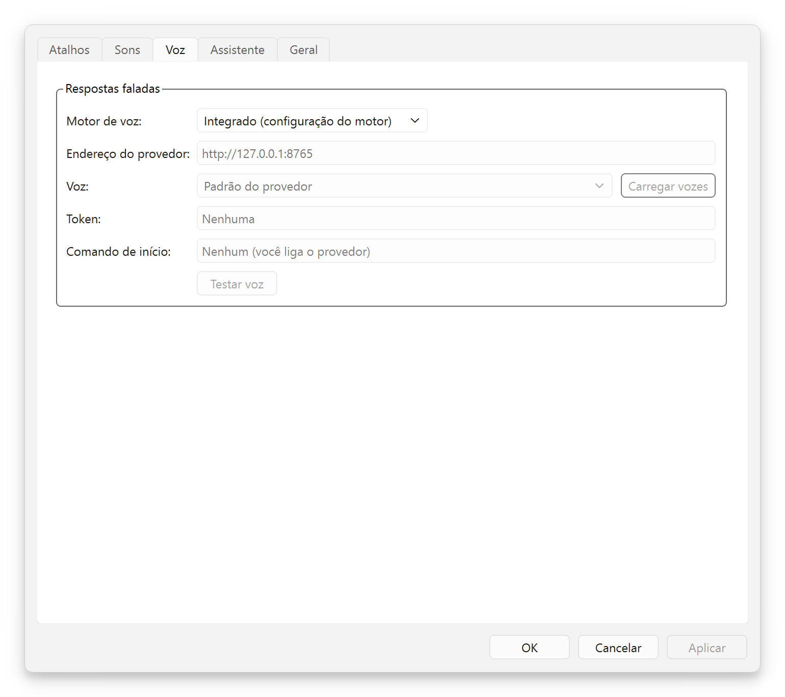
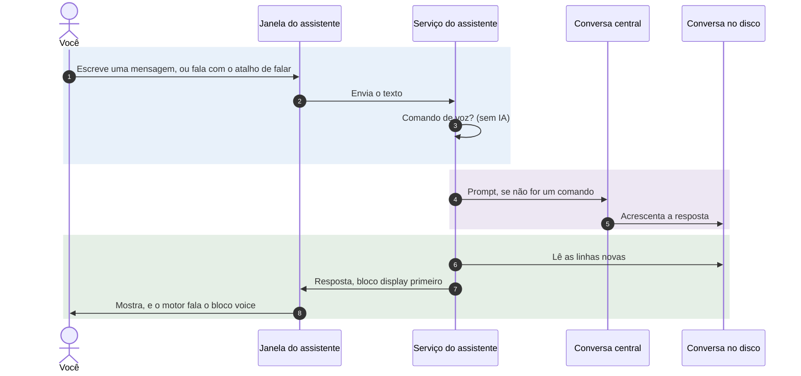
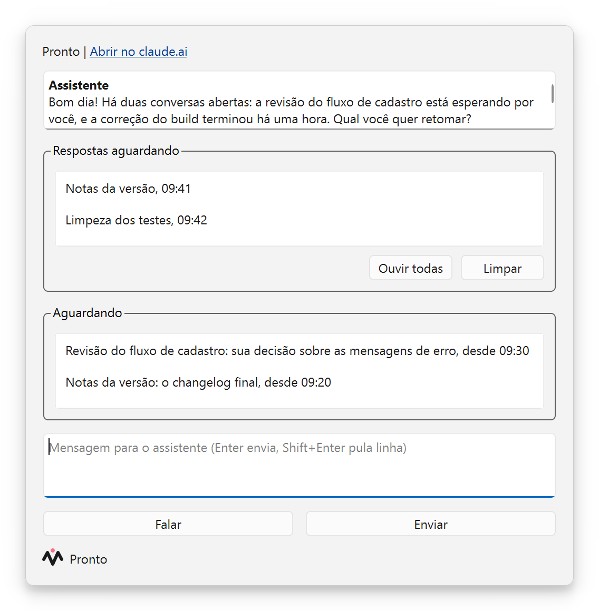
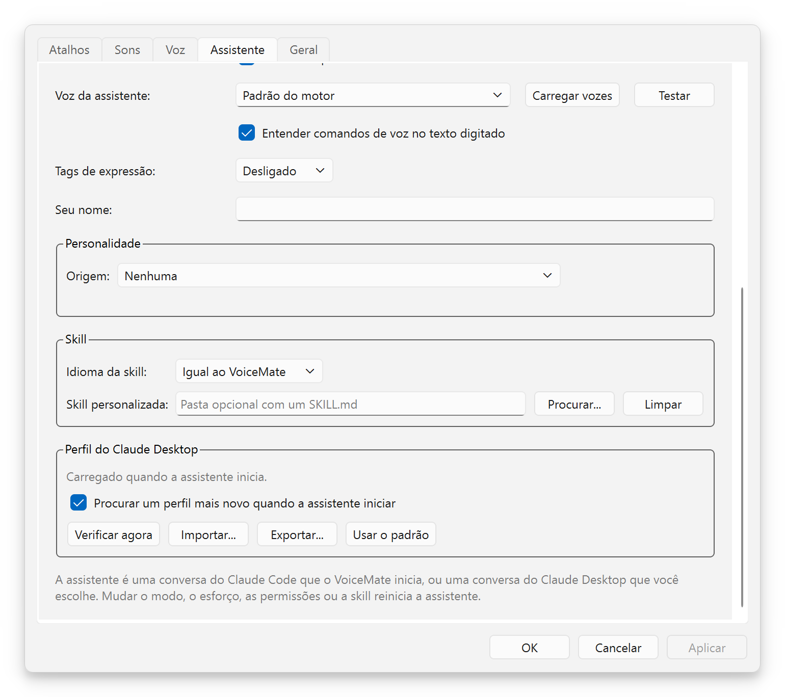
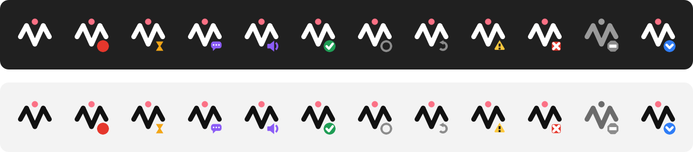

[English](usage.md) | **Português** | [Español](usage.es.md) | [Русский](usage.ru.md) | [简体中文](usage.zh-CN.md)

# Uso

Objetivo: como usar o VoiceMate no dia a dia: os fluxos, os atalhos, o aplicativo companion, os modos de transcrição, os modelos Whisper, as opções de voz e o assistente de voz. Voltar ao [README](../README.pt-BR.md).

## Atalhos

| Atalho padrão | Fluxo | Ação no menu da bandeja | Resultado |
|---|---|---|---|
| `Ctrl+Alt+V` | Área de transferência (o essencial) | "Ditar" | A transcrição vai para a área de transferência |
| `Ctrl+Alt+A` | Claude | "Perguntar ao Claude" | A transcrição vai para o Claude; a resposta vai para a área de transferência e é lida em voz alta |

O assistente de voz acrescenta os próprios atalhos (`Ctrl+Alt+S` para falar com ele, `Ctrl+Alt+W` para a janela dele, `Ctrl+Alt+R` para ouvir as respostas que estão esperando, mais dois sem padrão): veja [Falar com ele](#falar-com-ele).

Todo atalho é um liga e desliga: aperte uma vez para começar a gravar, aperte de novo para parar. Enquanto uma gravação está em andamento, as ações do menu da bandeja viram "Parar e copiar" e "Parar e perguntar ao Claude".

**Quem para a gravação decide o destino.** Você pode começar com um atalho e parar com o outro: o atalho que para a gravação escolhe o fluxo.

Para mudar os atalhos:
- Com o companion no Windows: Configurações > **Atalhos**. Clique num atalho e aperte as novas teclas. Cada linha mostra se a combinação está "Disponível", "Em uso por outro aplicativo", "Já usado por outra ação" ou "Não permitido". "Restaurar padrões" traz os padrões de volta.
- Pela linha de comando: `--hotkey` e `--claude-chat-hotkey`, por exemplo `make run ARGS='--hotkey "ctrl+shift+r"'`.
- No Linux o motor é dono dos atalhos, então a aba "Atalhos" os mostra somente para leitura ("Definido pelo motor").

## Fluxo da área de transferência

1. Aperte `Ctrl+Alt+V`. O sinal de início toca quando o microfone está realmente aberto: fale depois dele.
2. Fale naturalmente.
3. Aperte `Ctrl+Alt+V` de novo. O sinal de transcrição toca.
4. O texto é copiado para a área de transferência e o sinal de pronto toca. Cole com `Ctrl+V`.

Com o companion, o texto passa por uma entrega verificada: o aplicativo escreve na área de transferência, lê de volta e compara, até 5 vezes, e então escreve mais uma vez depois de 250 ms para que o histórico da área de transferência do Windows (`Win+V`) o guarde. Se outro aplicativo mantiver a área de transferência travada, o texto vai para **Não copiadas**.

Uma gravação para sozinha depois de 10 minutos (`--max-recording-seconds`), com um aviso aos 80 % do tempo; depois ela é transcrita normalmente. **Cancelar** no menu da bandeja ou na janela de status descarta a gravação atual.

## Fluxo do Claude

Este segundo módulo transforma o VoiceMate numa conversa por voz com o Claude. Ele é opcional.

1. Aperte `Ctrl+Alt+A`, fale a sua pergunta, aperte `Ctrl+Alt+A` de novo.
2. O VoiceMate transcreve e copia a transcrição para a área de transferência, e então a envia ao Claude.
3. A resposta do Claude substitui o conteúdo da área de transferência e é lida em voz alta, frase por frase, enquanto chega.
4. Aperte `Ctrl+Alt+A` de novo para fazer uma pergunta de acompanhamento: a conversa mantém o contexto enquanto o motor roda (até 50 turnos por padrão).

Detalhes:
- Como a transcrição e a resposta passam pela área de transferência, `Win+V` no Windows mostra as duas.
- Qualquer atalho apertado enquanto o Claude responde ou enquanto o TTS fala interrompe a resposta e inicia uma nova gravação. A conversa é mantida.
- O Claude responde no idioma de `--output-lang` (padrão `pt-BR`), por exemplo `make run ARGS="--output-lang en"`. O companion define isso a partir de "Idioma do ditado:" ([Idioma do ditado](#idioma-do-ditado)).
- O modelo padrão é `claude-haiku-5-5` com esforço `low` e raciocínio desligado, para ter baixa latência. Veja as opções em [configuration.pt-BR.md](configuration.pt-BR.md#fluxo-do-claude).
- Requisitos: a CLI do Claude Code instalada e com login feito, e o módulo `claude` ([installation.md](installation.md#claude-code-cli-for-the-claude-flow)). Sem eles, o fluxo do Claude fica desligado, com um aviso no log do motor, e o fluxo da área de transferência continua funcionando.

### Motores de TTS

| Motor | Módulo | Observações |
|---|---|---|
| o motor padrão (usado quando nada foi salvo) | `tts` | Pode clonar uma voz (modos de semente de voz abaixo). Pesado para a GPU; pode estalar no WSL2 |
| `kokoro` | `kokoro` | Leve, roda na CPU em tempo real, vozes fixas (`--tts-kokoro-voice`). Precisa do `espeak-ng`. O `make setup` o propõe (oferece o Kokoro ou o motor padrão) |
| `voxcpm` | `voxcpm` | VoxCPM2, mais pesado. Cria uma voz a partir de uma descrição em texto (`--tts-voice`) |
| `external` | | Um serviço de TTS que você roda, por HTTP ([Provedor de TTS externo](#provedor-de-tts-externo)) |
| `none` | | Sem resposta falada (o mesmo que `--no-tts`) |

Quando o `make setup` não salvou nenhum motor, o motor usa o motor padrão. Escolha outro com `--tts-engine`, por exemplo `make run ARGS="--tts-engine kokoro --tts-kokoro-voice pf_dora"`.

### Provedor de TTS externo

Qualquer serviço de texto para fala que siga o [protocolo de provedor TTS do VoiceMate](tts-provider-protocol.md) pode falar as respostas. No companion, abra **Configurações** > **Voz**, escolha **Provedor personalizado (HTTP)** em "Motor de voz:" e preencha:

- "Endereço do provedor:" (padrão `http://127.0.0.1:8765`). Dentro do WSL, `127.0.0.1` é o lado do WSL.
- "Voz:". **Carregar vozes** pergunta ao provedor o que ele oferece; você também pode digitar o id de uma voz.
- "Token:" se o provedor exigir um (fica mascarado).
- "Comando de início:" (opcional), uma única linha que inicia o provedor, como `bash ~/my-voice-provider/start.sh`. O VoiceMate o executa quando nada escuta no endereço do provedor, na inicialização e de novo se ele cair, então o provedor sobe junto com o VoiceMate (e com o Windows, se o VoiceMate abrir com ele). O VoiceMate nunca para o provedor. Veja [Starting the provider](tts-provider-protocol.md#starting-the-provider-with-voicemate).

<p align="center"></p>

**Testar voz** fala uma frase curta, para você ouvir o resultado antes de usar. Aplicar a mudança reinicia o motor. À mão: `make run ARGS="--tts-engine external --tts-url http://127.0.0.1:8765"`, com o token em `VOICEMATE_TTS_TOKEN`.

Se o provedor estiver fora do ar, o VoiceMate registra o motivo e continua funcionando sem voz. Para escrever ou conferir um provedor: `make tts-provider-check URL=...`; para experimentar o recurso antes, `make tts-provider-example` roda um provedor de tom de teste.

### Modos de semente de voz

`--tts-voice-seed-mode` decide como o motor padrão e o VoxCPM2 mantêm uma voz. O Kokoro tem vozes fixas e o ignora.

| Modo | Como a voz é escolhida | Opções relacionadas |
|---|---|---|
| `off` (padrão) | Sem áudio de referência. O VoxCPM2 cria a voz a partir de `--tts-voice`; o motor padrão usa a voz padrão dele | `--tts-voice` (VoxCPM2) |
| `auto` | A primeira frase vira o áudio de referência, salvo na pasta da semente; as frases seguintes a clonam, também depois de reiniciar | `--tts-voice-seed-cache-dir`, `--tts-reset-seed` |
| `fixed` | Toda frase clona um arquivo WAV que você fornece | `--tts-voice-seed-path` e `--tts-voice-seed-text` (o texto exato do WAV), os dois obrigatórios |

As referências do modo `auto` ficam em `~/.cache/voicemate`: `voice_seed.wav` para o VoxCPM2 e um segundo `voice_seed_*.wav` para o motor padrão. `--tts-reset-seed` apaga o do VoxCPM2; apague o outro à mão para ter uma voz nova.

```bash
make run ARGS="--tts-voice-seed-mode auto"
make run ARGS='--tts-voice-seed-mode fixed --tts-voice-seed-path /path/voice.wav --tts-voice-seed-text "Hello, this is my voice."'
make run-reset-voz              # o mesmo que ARGS="--tts-reset-seed"
make run-vozes-aleatorias       # o mesmo que ARGS="--tts-voice-seed-mode off"
```

## Modo de transcrição: CPU ou GPU

O motor transcreve no processador ou na placa de vídeo. O modo **CPU** mantém o VoiceMate funcionando enquanto a GPU está ocupada com outro trabalho (edição de vídeo, renderização, jogos): ele nunca carrega nada na GPU. O modo **GPU** é o mais rápido. "Automático (configuração do motor)" mantém o que o `make setup` escolheu.

| Onde | Como |
|---|---|
| Menu da bandeja | "Transcrição" > "CPU (deixa a GPU livre)", "GPU (mais rápida)" ou "Automático (configuração do motor)" |
| Configurações | **Geral** > "Transcrição" > "Rodar na:", com "Modelo da CPU:" e "Modelo da GPU:" abaixo |
| Opção do motor | `--stt-mode {auto,cpu,gpu}`, veja [configuration.pt-BR.md](configuration.pt-BR.md#modos-de-reconhecimento-de-fala) |

Cada modo mantém o próprio modelo Whisper (`large-v3-turbo` por padrão), então trocar nunca pede um modelo de novo. Trocar reinicia o motor, que é o que libera ou ocupa a GPU. A janela de status mostra onde o motor transcreve ("Transcrição:", por exemplo "CPU, large-v3-turbo") e avisa quando o modo GPU caiu para a CPU.

**Um modo que não está instalado.** Antes de aplicar um modo novo, o companion roda `make stt-check` na pasta do motor. Se o modo estiver faltando, o VoiceMate pergunta "Instalar o modo CPU?" (ou "modo GPU"), com o tamanho do download. Depois que você escolhe **Instalar**, uma janela mostra a saída do `make stt-install`. Ele mexe só no ambiente virtual do próprio motor e no cache de modelos, então outros projetos na mesma distro do WSL não são afetados. Não dá para cancelar no meio, e o VoiceMate continua funcionando enquanto isso. Recusar, ou uma instalação que falha, mantém o modo atual. À mão: `make stt-check`, `make stt-install MODE=gpu`.

> [!NOTE]
> Sem uma placa de vídeo utilizável, o VoiceMate diz "Sem modo GPU neste computador" e o modo CPU continua funcionando. Os números de velocidade e precisão estão no [benchmark](configuration.pt-BR.md#benchmark).

## Modelos Whisper

Escolha um modelo com `--model` (padrão `large-v3-turbo`), ou `make run-large` (`large-v3`) e `make run-turbo` (`large-v3-turbo`).

| Modelo | Velocidade | Qualidade |
|---|---|---|
| `tiny` | Muito rápido | Básica |
| `base` | Rápido | Boa |
| `small` | Moderado | Muito boa |
| `medium` | Moderado | Ótima |
| `large-v2` | Lento | Excelente |
| `large-v3` | Lento | Máxima |
| `large-v3-turbo` (padrão) | Rápido | Excelente |

O `large-v3-turbo` é o melhor equilíbrio entre velocidade e qualidade, também para fala que mistura idiomas. O whisper.cpp (AMD) usa o próprio arquivo `ggml-large-v3-turbo.bin`, baixado pelo `make setup`.

### Idioma do ditado

O Whisper recebe um idioma fixado, para ter resultados estáveis; termos estrangeiros no meio da fala (por exemplo, termos técnicos em inglês no meio do português) continuam saindo certos.

**Com o companion:** Configurações > **Geral** > "Idioma do ditado:". As opções são:

- "Igual ao da interface" (o padrão): o idioma do companion (`pt-BR`, `en`, `es`, `ru` ou `zh-CN`).
- "Detectar automaticamente": o Whisper detecta o idioma de cada gravação, o que é menos estável em gravações curtas. O Claude continua respondendo no idioma da interface. Com o Kokoro, fixe um idioma: o motor também passa `auto` ao TTS, e o Kokoro responde na voz dele de inglês americano, mesmo para português ou espanhol.
- Um idioma, cada um com o nome no próprio idioma: "Português", "English", "Español", "Русский", "中文", "Français", "Deutsch", "Italiano" ou "日本語". Um idioma fixado também define o idioma das respostas faladas do Claude.

O companion passa a escolha ao motor que ele inicia como `--transcription-language` e `--output-lang`, e mudar o idioma reinicia o motor. Um motor ao qual o companion só se conecta mantém as próprias opções: com o modo "Só conectar" a configuração fica desativada, e uma unidade do systemd ou um motor que você iniciou à mão é conectado, não iniciado, então segue os próprios `--transcription-language` e `--output-lang`.

**Pela linha de comando:** o motor usa português por padrão. `--output-lang` tem padrão `pt-BR`, e dele o idioma da transcrição é derivado (`pt-BR` dá `pt`), então uma execução sem opções fixa o Whisper em português e a fala em inglês sai errada. Passe `--output-lang en` (que também é o idioma das respostas do Claude e das mensagens do motor), ou fixe só a transcrição com `--transcription-language {auto,pt,en,es,fr,de,it,ja,ru,zh}`:

```bash
make run ARGS="--output-lang en"
make run ARGS="--transcription-language en"
```

O `make run` roda no shell do sistema em que o motor roda: bash no Linux e dentro do WSL, PowerShell ou cmd para um motor rodando nativamente no Windows. Os exemplos com `ARGS` funcionam em todos eles.

`VOICEMATE_LANG` muda só o idioma das mensagens do motor (`pt-BR`, `en`, `es`, `ru` ou `zh-CN`). Ela vale mais do que `--output-lang` nesse ponto, e não muda o que o Whisper ouve. Defina-a no shell que roda o `make run`:

```bash
VOICEMATE_LANG=en make run          # bash: Linux, ou dentro do WSL
```

```powershell
$env:VOICEMATE_LANG="en"; make run  # PowerShell: motor rodando nativamente no Windows
```

O companion a ignora.

## Assistente de voz

O assistente de voz é uma conversa do Claude, a "conversa central", com a qual você fala por voz ou escrevendo. Ele sabe o que as suas outras conversas do Claude estão fazendo: pode listá-las, lê-las, perguntar coisas a elas, iniciar novas em segundo plano e avisar quando elas respondem. Vem desligado. O que ele faz por você (encaminhamento, iniciativa, esperas e observações, instruções permanentes, limites) está em [assistant.pt-BR.md](assistant.pt-BR.md).

O fluxo inteiro, explicado com diagramas (os dois modos, como ele conduz as suas outras conversas, como as respostas voltam), está em [voice-assistant.md](voice-assistant.md); o diagrama de componentes está em [architecture.pt-BR.md](architecture.pt-BR.md#61-assistente-de-voz), e o projeto está nas [notas de pesquisa](research/voice-assistant-design.md).



A resposta segue um modelo que a skill define: um bloco `<voice>` (o que é falado), um bloco `<display>` opcional e um bloco `<actions>`. A janela mostra o bloco display, ou o bloco voice quando não há display. Uma resposta que quebra o modelo é mostrada como texto simples e não é falada.

### Requisitos

- A CLI do Claude Code: o comando `claude`, encontrado no `PATH` do Windows ou nas pastas dos próprios instaladores (`~/.local/bin`, `%APPDATA%\npm`), ou o caminho completo dela na variável de ambiente `VOICEMATE_CLAUDE_CLI`.
- Um login do Claude nesse computador: rode `claude auth login` uma vez num terminal. O aplicativo Claude Desktop guarda o login dele só para si, então a CLI precisa do próprio ([pesquisa](research/claude-code-client.md#2-authentication-is-the-first-blocker)).
- O Claude Desktop e o celular são opcionais no primeiro modo e obrigatórios no segundo (veja abaixo).

### Escolher um modo

Configurações > **Assistente** > "Modo do assistente:" tem três opções. Escolha pelo que você precisa que a conversa central faça.

| | "Conversa própria do VoiceMate" (`own_session`) | "Uma conversa do Claude Desktop" (`desktop`) |
|---|---|---|
| Onde a central roda | Um processo do Claude Code que o VoiceMate inicia e mantém | Uma conversa que você já tem no Claude Desktop, escolhida pelo título exato na barra lateral |
| Como o VoiceMate escreve nela | Diretamente, sem nenhuma janela envolvida | Digitando rapidamente na janela do Desktop (um "flash") |
| Precisa do Desktop aberto | Não | Sim, e a tela desbloqueada |
| Ferramentas para as outras conversas | As ferramentas `voicemate`: listar, ler e enviar para conversas, iniciar uma conversa, definir o modelo de uma que o VoiceMate iniciou, parar uma | As ferramentas de sessão do próprio Desktop, mais tudo o que o Desktop oferece (o navegador dele, o controle do computador, as ferramentas de PR) |
| Celular | Aparece no celular pelo Remote Control | Não é gerenciado pelo VoiceMate |
| Plataforma | Windows (o companion) | Só Windows (usa o UI Automation) |

O modo `own_session` é o silencioso: nada toma o seu teclado. O limite dele é que essa central não pode usar o que só o Desktop oferece; para usar isso, ela passa a tarefa para uma conversa que você abriu no Desktop.

O modo `desktop` tem essas ferramentas, a um preço. Cada mensagem que o assistente envia toma o primeiro plano por cerca de 2 segundos e o devolve. Ele também apaga qualquer rascunho que você tenha digitado no prompt daquela conversa, e só funciona enquanto o Claude Desktop está aberto e a tela está desbloqueada.

> [!WARNING]
> No modo `desktop`, não digite na conversa escolhida enquanto o assistente pode estar escrevendo nela: um flash apaga o rascunho daquele prompt antes de colar. O VoiceMate confere três travas antes de cada tecla (a janela do Claude está no primeiro plano, a conversa certa está aberta, o foco está no prompt; cada tecla é um aperto próprio) e não digita nada quando uma falha. A área de transferência que você tinha é salva, e restaurada só se ninguém copiou nada durante o flash (o número de sequência da área de transferência é conferido antes de colar e antes do Enter).

O mesmo flash é como qualquer dos modos entrega uma mensagem a alguma outra conversa do Desktop ("manda para a conversa X", ou o modo direto). Ler nunca precisa de flash: funciona a partir das transcrições no disco, mesmo com o Desktop minimizado.

Um flash que falha é sempre avisado: a janela mostra "Não enviado para ..." e a mensagem não se perde. Uma área de transferência ocupada por outro programa conta como ocupada, e a janela recarregando ou fechando conta como indisponível.

### Ligar

1. Configurações > **Assistente**, escolha "Modo do assistente:". Para o modo Desktop, preencha também "Conversa do Desktop:" com o título exato na barra lateral do Claude Desktop (o assistente não inicia sem isso e diz "Nenhuma conversa do Claude Desktop foi escolhida").
2. Escolha "Modelo:" ("Haiku (o mais rápido)", "Sonnet" ou "Opus (o mais profundo)") e "Esforço:" ("Baixo", "Médio" ou "Alto") para a central.
3. OK. O menu da bandeja agora tem "Assistente", que abre a janela, e "Ouvir o que está pronto".

Uma configuração do assistente mudada por voz ou pelo atalho de trocar de modo enquanto as Configurações estão abertas é mantida: Aplicar só grava os campos que você mudou no diálogo.

No modo próprio, um novo "Modelo:" vale a partir da próxima resposta, e um novo "Esforço:" ou uma troca de modo reinicia a conversa. No modo Desktop o VoiceMate não consegue mudar o modelo da conversa do Desktop: ele pede à central, com uma nota, que aplique o modelo e o esforço em si mesma.

### A janela

A linha de status diz "Iniciando...", "Pronto", "Respondendo..." ou o que está errado, com "Abrir no claude.ai" quando o Remote Control está ligado (modo próprio). A janela mostra as últimas 30 mensagens, lidas da conversa no disco, então o que você escreve no celular ou no Claude Desktop também aparece. Enter envia, Shift+Enter acrescenta uma linha. A caixa fica desativada, com o motivo embaixo, enquanto o assistente está desligado, iniciando, respondendo ou com problema. Depois de um erro, **Reiniciar** tenta de novo.

Ao lado da caixa de mensagem, **Falar** é o atalho de falar em forma de botão: clique para gravar, clique em **Parar e enviar** para parar e enviar o texto ao assistente. A linha ao lado mostra o mesmo estado, com o mesmo selo e as mesmas palavras da janela de status (gravando com o tempo decorrido, transcrevendo), também para uma gravação iniciada com um atalho. O botão fica desativado enquanto o assistente não está pronto ou o motor ainda está transcrevendo a última gravação.

Abaixo das mensagens, **Respostas aguardando** lista as respostas guardadas para você (veja [Respostas de outras conversas](#respostas-de-outras-conversas)): selecione uma para lê-la, **Ouvir todas** faz o assistente passar por elas, **Limpar** as descarta.

**Aguardando** lista o que o assistente está esperando ou observando em outras conversas (conversa, título, motivo, desde quando). Um item sai da lista quando o assistente o marca como concluído, quando a resposta que ele esperava chega, ou quando nenhum turno novo vem a tempo (1 hora para uma espera, 12 horas para uma observação que você pediu); a lista sobrevive a uma reinicialização. **Voltar ao assistente** aparece enquanto a janela acompanha ou fala com outra conversa.

<p align="center"></p>

Se o Remote Control não puder ser ligado, o assistente continua funcionando neste computador, sem o link.

### Falar com ele

O assistente tem os próprios atalhos, em Configurações > **Atalhos** (em "Assistente"). Eles são separados dos atalhos de ditado, e qualquer um pode ser mudado ou apagado. Enquanto o assistente está desligado, os atalhos dele não são registrados e nunca contam como conflito com outro atalho. Quando o motor é dono do teclado (modo local no Linux), as linhas do assistente ficam ocultas na aba Atalhos.

| Ação | Padrão | O que faz |
|---|---|---|
| "Falar com o assistente" | `Ctrl+Alt+S` | Inicia uma gravação; aperte de novo para parar, e o texto vai para o assistente em vez da área de transferência |
| "Abrir a janela do assistente" | `Ctrl+Alt+W` | Abre ou traz a janela para a frente |
| "Ouvir o que está pronto" | `Ctrl+Alt+R` | O assistente passa pelas respostas guardadas na caixa de entrada |
| "Trocar o modo do assistente" | nenhum | Alterna entre o modo próprio e o modo Desktop (não faz nada enquanto o assistente está desligado) |
| "Voltar ao assistente" | nenhum | Sai do modo direto ou da conversa que a janela está acompanhando |

Como no ditado, a tecla que para a gravação decide o destino: comece com `Ctrl+Alt+V` e pare com `Ctrl+Alt+S` e o texto vai para o assistente. Um novo prompt, "para de falar" e uma troca de modo silenciam o assistente na hora. Uma gravação só o pausa: nada é dito por cima do microfone, e o que chegou nesse meio tempo (uma resposta, um aviso) espera até a gravação terminar e ser transcrita. Então a frase que a gravação cortou é dita de novo desde o começo, seguida das frases que já estavam na fila atrás dela e do que chegou nesse meio tempo.

O assistente fala as respostas frase por frase: o companion pega o bloco `<voice>` de cada resposta e toca o áudio enquanto a frase seguinte é feita. Configurações > **Assistente** tem "Falar as respostas", "Origem da voz:" e "Voz do assistente:" (**Carregar vozes**, **Testar**).

| "Origem da voz:" | Quem fala |
|---|---|
| "Automática" (o padrão) | A voz do motor, e as vozes do Windows quando o motor não tem nenhuma ou não consegue falar |
| "A voz do motor" | Só o motor: a voz Kokoro embutida (Configurações > **Voz**), ou o seu [provedor personalizado](#provedor-de-tts-externo). Uma frase que encontra o motor ainda carregando a voz espera por ele (até 90 segundos, uma vez por queda) em vez de se perder, e os avisos curtos ficam na tela, sem fala do Windows |
| "As vozes do Windows" | Só as vozes que o Windows já tem, em todos os idiomas instalados em Configurações do Windows > Hora e idioma > Fala. Nada para baixar nem configurar |

**Carregar vozes** lista as vozes da origem escolhida e **Testar** fala uma frase curta com a que foi escolhida, os dois antes de você salvar. Quando nada pode falar, as respostas ficam só em texto e um aviso "Nenhuma voz disponível" diz o motivo.

### Comandos de voz

Com "Entender comandos de voz no texto digitado" marcado (o padrão), uma mensagem que começa com uma destas frases é tratada pelo VoiceMate, sem nenhuma IA decidindo. As frases existem em inglês, português e espanhol e seguem o idioma da interface; os outros idiomas de interface usam as frases em inglês. Funcionam faladas ou escritas.

| Diga ou escreva | O que acontece |
|---|---|
| "lê a última resposta" | A última resposta é mostrada de novo como um aviso |
| "vai para a conversa X" | A janela acompanha essa conversa, somente para leitura, até **Voltar ao assistente** |
| "manda para a conversa X: mensagem" (ou "... X dizendo mensagem") | Pede-se ao assistente que entregue a mensagem com as próprias ferramentas |
| "fala direto com a conversa X" | Modo direto: tudo o que você diz vai palavra por palavra para essa conversa, sem assistente no meio |
| "volta para o assistente" (ou "novo assunto") | Sai do modo direto; o que vem depois é dirigido ao assistente |
| "para de falar" ou "silêncio" | Silencia a fala em andamento |

No modo direto, só sair dele, ou nomear outra conversa, conta como comando; "novo assunto" é fala comum fora dele. Quando você volta, o assistente recebe uma nota com o que você disse lá e a última resposta da conversa, para poder continuar dali. O título é comparado de forma aproximada com as suas conversas recentes. Quando dois títulos servem, ou nenhum serve, a janela mostra um aviso e nada é enviado.

### Respostas de outras conversas

Quando o assistente envia algo a uma conversa ou inicia uma, o VoiceMate a observa e percebe quando ela responde. "Respostas de outras conversas:" em Configurações > **Assistente** decide o que acontece depois. Uma conversa que você pediu para continuar observando ("fica de olho em X") é diferente: todo turno que ela termina é avisado ao assistente, seja qual for essa escolha, até você mandar parar ([esperar e observar](assistant.pt-BR.md#-esperar-e-observar)).

| Escolha | O que você recebe |
|---|---|
| "Me contar a resposta assim que chegar" (`speak`) | O assistente a resume em voz alta na hora, assim que nenhuma gravação ou resposta falada estiver em andamento. Enquanto você dita, ou enquanto a tela de texto acompanha outra conversa (modo direto ou `focus`), ela espera na caixa de entrada, com um sinal de "resposta" e um aviso falado curto no lugar |
| "Dar um aviso curto e guardar a resposta para depois" (`announce`, o padrão) | O som de resposta e uma linha falada ("A conversa X tem uma resposta."); a resposta espera na caixa de entrada |
| "Só tocar um som e guardar a resposta" (`sound`) | O som de resposta; a resposta espera |
| "Só guardar" (`silent`) | Nada toca; a resposta espera |

As respostas guardadas ficam na caixa de entrada, até 50, e sobrevivem a uma reinicialização. O ícone da bandeja mostra um selo azul com a aba de um envelope enquanto houver alguma esperando (só sobre um estado de repouso, nunca sobre gravação, aviso ou erro), e a dica dele diz "Respostas aguardando: N". O som de resposta é a linha "Resposta pronta" em Configurações > **Sons**.

Para ouvi-las, use "Ouvir o que está pronto" (menu da bandeja, atalho, **Ouvir todas**, ou simplesmente pergunte "o que está pronto?"): o assistente as resume juntas, com os pontos principais primeiro, agrupadas por assunto, e a caixa de entrada é esvaziada. Um aviso ou som espera enquanto uma gravação, uma transcrição ou uma resposta falada está em andamento.

### Conversas que o assistente inicia

No modo próprio o assistente pode iniciar conversas em segundo plano ("inicia uma pesquisa sobre Y"). O VoiceMate abre cada uma como um processo próprio do Claude Code com o Remote Control ligado, então ela também aparece no Desktop e no celular. No máximo 4 ficam vivas ao mesmo tempo: o limite conta as que ainda estão iniciando, então dois inícios no mesmo instante não conseguem passar dele. Elas são lembradas: na próxima vez que o VoiceMate iniciar, as que estavam rodando voltam. Sair do VoiceMate para a central e todas as conversas iniciadas ao mesmo tempo, sob um único prazo, em vez de uma depois da outra, sem esquecê-las; um início que termina depois do Sair é parado na hora.

"Novas conversas usam:" e "Com o esforço:" definem o modelo e o esforço de uma conversa nova quando o assistente não indica nenhum (Sonnet e Médio por padrão). "Permissões:" define o quanto essas conversas podem fazer por conta própria:

| Escolha | Significado |
|---|---|
| "Perguntar antes de cada mudança" (`default`) | Toda edição e todo comando espera aprovação |
| "Aceitar edições de arquivos, perguntar o resto" (`acceptEdits`, o padrão) | As edições passam, as outras ações perguntam |
| "Acesso total, nunca perguntar (arriscado)" (`bypassPermissions`) | As conversas alteram qualquer arquivo e rodam qualquer comando sem perguntar |

> [!IMPORTANT]
> "Acesso total" deixa conversas que rodam sem supervisão agirem no seu computador sem ninguém para aprovar. Use só se você aceita isso. Uma mudança vale para as conversas que o assistente inicia daí em diante e reinicia a conversa central na hora, então ela nunca mantém as permissões antigas.

"Permissões:" não se aplica a uma sessão de terminal, IDE ou Remote Control fechada que o assistente retoma para entregar uma mensagem: essa retomada não passa modo de permissão, a menos que você defina `resume_permission_mode` no `companion.toml` ([configuração](configuration.pt-BR.md#configurações-do-assistente)).

### Mudar o VoiceMate por voz

Você pode pedir ao assistente que mude o VoiceMate: "troca para o modo Desktop", "abaixa o volume dos sons", "usa a CPU para transcrever". O assistente só pode usar uma lista fixa de configurações (o catálogo). O VoiceMate confere a chave e o valor, aplica a mudança e avisa; uma chave desconhecida ou um valor fora do intervalo é recusado, com o motivo.

| Incluído | Chaves |
|---|---|
| Assistente | `assistant.mode` (`own_session`, `desktop`), `assistant.model`, `assistant.effort`, `assistant.permission_mode`, `assistant.answer_delivery`, `assistant.new_conversation_model`, `assistant.new_conversation_effort`, `assistant.desktop_conversation`, `assistant.speak_replies`, `assistant.voice`, `assistant.voice_commands`, `assistant.expressions`, `assistant.user_name`, `assistant.personality_source`, `assistant.desktop_profile_auto_update`, `assistant.skill_language` |
| Sons | `cues.enabled`, `cues.volume`, `cues.answer.enabled`, `cues.answer.volume` |
| Geral | `general.dictation_language`, `general.stt_mode`, `general.notify_level` |

Ficam de fora de propósito, porque não são seguras de mudar por voz: os atalhos; todo arquivo ou pasta (o arquivo e o texto da personalidade, o cofre de notas, a pasta da skill personalizada, o perfil do Desktop importado); o motor de voz e o endereço e o token do provedor; o próprio motor (pasta, distro do WSL, porta, modo); o modo "desligado" do assistente (o assistente não pode se desligar); e os outros sinais sonoros.

O modo `desktop` é recusado até que uma conversa do Desktop seja escolhida, e `personality_source` como `file` até que um arquivo seja escolhido. O modo de permissão está na lista só com `default` e `acceptEdits`; `bypassPermissions` ("Acesso total") só pode ser escolhido nas Configurações.

### Personalidade, nome e notas

<p align="center"></p>

- "Seu nome:" é como o assistente se dirige a você; vazio significa sem nome.
- Em Personalidade, "Origem:" tem três opções. "Nenhuma"; "Um arquivo Markdown (por exemplo, uma nota do seu cofre do Obsidian)", escolhido com "Procurar..." (o seletor de arquivos começa na pasta do cofre que você escolheu); ou "Escrever a minha", um texto de até 20.000 caracteres que você escreve na aba; **Salvar**, OK e Aplicar todos o salvam (um texto que não pode ser salvo mantém o diálogo aberto na aba Assistente, com o motivo). A skill o segue só para tom e estilo, nunca para instruções.
- "Pasta do cofre:" é o seu cofre de notas (Obsidian). O assistente lê as notas de lá sempre que ajudam a responder a você, sem perguntar, e só escreve quando você pede. O VoiceMate não indexa o cofre; a aba de configurações sugere os cofres que o Obsidian já conhece. O VoiceMate avisa se a pasta não tem uma pasta `.obsidian`, mas a aceita.
- "Tags de expressão:" deixa o bloco voice levar tags como `[laugh]` ou `[pause]` para um motor de voz que consiga renderizá-las.

### A skill

O assistente é uma skill, `voicemate-assistant`, em dois idiomas (inglês e português do Brasil). "Idioma da skill:" é "Igual ao VoiceMate" (a skill em português quando a interface está em português, inglês nos outros casos), "English" ou "Português (Brasil)". "Skill personalizada:" aceita uma pasta sua com um `SKILL.md`, que substitui a embutida; uma pasta sem `SKILL.md` é ignorada, com um aviso.

O VoiceMate copia a skill para `~/.claude/skills/voicemate-assistant` quando o assistente inicia (um arquivo que você editou é mantido, e a versão nova fica ao lado dele como `.new`). A skill é opcional e compartilhável: copie `app/companion/assistant/skill/en/voicemate-assistant` (ou `pt-BR`) para lá você mesmo e use em qualquer conversa do Claude Code, sem o VoiceMate rodando, pedindo "o assistente" ou "o modo VoiceMate".

Ela lê `~/.voicemate/assistant.json`:

```json
{
  "version": 1,
  "language": "en",
  "user_name": "",
  "personality_file": "",
  "notes_vault": "",
  "expressions": "off",
  "mode": "own_session",
  "permission_mode": "acceptEdits",
  "resume_permission_mode": "",
  "answer_delivery": "announce",
  "instructions": [],
  "inbox": [],
  "pending": [],
  "settings": []
}
```

| Chave | Significado |
|---|---|
| `language` | Idioma de toda resposta (uma tag BCP 47, por exemplo `pt-BR`). Com a skill em português ela é `pt-BR` e a voz fala em pt-BR, seja qual for o idioma da interface; com a skill em inglês (ou uma personalizada), ela segue a interface |
| `user_name` | Como se dirigir a você; vazio significa sem nome |
| `personality_file` | Caminho opcional de um arquivo Markdown com a personalidade do assistente. A skill o lê; o VoiceMate nunca |
| `notes_vault` | A sua pasta de notas, ou vazio |
| `expressions` | `off` ou `on`: se o bloco voice pode levar tags como `[laugh]` ou `[pause]` |
| `mode` | `own_session` ou `desktop`: quais ferramentas a skill tem |
| `permission_mode` | Como as ferramentas da central são liberadas no modo próprio ("Permissões:"); vazio no modo Desktop |
| `resume_permission_mode` | O modo de permissão que uma sessão de terminal, IDE ou Remote Control fechada recebe quando o assistente a retoma; vazio (o padrão) não passa nenhum |
| `answer_delivery` | Como as respostas de outras conversas chegam a você |
| `instructions` | As suas instruções permanentes (`text`, `since`), seguidas desde a primeira resposta |
| `inbox` | As respostas aguardando (título, id, hora), sem o texto delas |
| `pending` | Os pedidos que o assistente está esperando (id da sessão, título, motivo, desde quando, `watch` para uma conversa que você pediu para observar, `until` para quando o item sai sem um turno novo) |
| `settings` | O catálogo de configurações que o assistente pode mudar |

Sem o arquivo, a skill responde no idioma em que você escreve e diz uma vez que as configurações não foram encontradas. Mais: o [projeto](research/voice-assistant-design.md) e a [pesquisa do cliente do Claude Code](research/claude-code-client.md).

### O perfil do Claude Desktop

O modo Desktop e o "enviar para uma conversa do Desktop" encontram os controles do Desktop por meio de um **perfil**, um pequeno arquivo JSON, de modo que uma atualização do Desktop que muda a janela dele é corrigida com um perfil novo e não com uma nova versão do VoiceMate.

Em Configurações > **Assistente**, o grupo "Perfil do Claude Desktop" mostra qual está em uso (arquivo importado, atualização baixada ou embutido no VoiceMate) e tem "Procurar um perfil mais novo quando o assistente iniciar" (ligado por padrão), **Verificar agora**, **Importar...**, **Exportar...** e **Usar o padrão**. O formato, as travas de segurança e como escrever um perfil estão em [desktop-profile.md](desktop-profile.md).

## Aplicativo companion

### Ícone e menu da bandeja

O ícone da bandeja é a figura do VoiceMate; um pequeno selo no canto dele mostra o estado. Um clique com o botão esquerdo abre a janela de status.

<p align="center"></p>

| Selo (da esquerda para a direita) | Estado | O que o menu e a dica dizem |
|---|---|---|
| Sem selo | Em repouso | "Aguardando Ctrl+Alt+V" |
| Ponto vermelho | Gravando | "Gravando 00:12" |
| Ampulheta | Transcrevendo | "Transcrevendo..." |
| Balão de fala | Pensando (Claude) | "O Claude está respondendo..." |
| Alto-falante | Falando (Claude) | "O Claude está respondendo..." |
| Marca de verificação | Pronto, por 3 segundos | "Copiado: ..." |
| Disco azul com a aba de um envelope | Há respostas de outras conversas aguardando na caixa de entrada do assistente (mostrado só sobre um estado de repouso) | "Respostas aguardando: 2" |
| Anel | Iniciando | "Iniciando o motor..." |
| Seta circular | Reiniciando | "Reiniciando (tentativa 2)" |
| Triângulo | Aviso | "Sem microfone" ou "O áudio do WSL parou" |
| Cruz | Erro | "O motor parou de funcionar" |
| Octógono cinza, ícone esmaecido | Parado | "O VoiceMate está parado" |

O menu tem:

- A linha de status, depois "Abrir o VoiceMate", e "Assistente" e "Ouvir o que está pronto" quando o assistente de voz está ligado.
- "Ditar" e "Perguntar ao Claude" com os atalhos deles ("Parar e copiar" e "Parar e perguntar ao Claude" durante a gravação), e "Cancelar".
- "Recentes": as últimas transcrições; clique numa para copiá-la de novo.
- "Não copiadas ({count})": só quando algo não chegou à área de transferência; clique num item para copiá-lo; "Limpar lista" a esvazia depois de perguntar 'Limpar a lista "Não copiadas"?'.
- "Reiniciar o WSL agora...": só enquanto uma reinicialização do WSL espera a sua aprovação.
- "Silenciar sons".
- "Transcrição" > "CPU (deixa a GPU livre)", "GPU (mais rápida)" ou "Automático (configuração do motor)" (não no modo "Só conectar").
- "Motor" > "Reiniciar o motor", "Reiniciar o WSL..." (só no modo WSL), "Abrir logs".
- "Configurações..." e "Sair do VoiceMate".

### Janela de status

A janela de status mostra a linha de status, "Motor:", "Transcrição:" (onde o motor transcreve), "Áudio:", "Microfones:" e "Reinícios:", o grupo **Não copiadas** ("Limpar", "Copiar"), o grupo **Recentes** ("Copiar") e os botões "Configurações...", "Reiniciar o motor", "Abrir logs" e "Sair do VoiceMate". Faixas de aviso aparecem quando o motor está desatualizado ou quando o áudio do WSL parou. No Linux sem bandeja do sistema, a janela de status é a janela principal.

### Não copiadas

Uma transcrição que nunca chegou à área de transferência é mantida em **Não copiadas** e salva em `pending.json`, então sobrevive a uma reinicialização ou a uma falha (no máximo 50 itens). Ela sai da lista quando você a copia ou limpa a lista. O arquivo guarda o texto da transcrição; fica no seu perfil de usuário, é apagado quando a lista está vazia, e o desinstalador o remove.

### Sons e notificações

- Configurações > **Sons**: "Tocar sons de aviso", um "Volume:" geral e uma linha por sinal ("Gravação iniciada", "Transcrevendo", "Copiado", "Claude respondeu", "Aviso", "Erro", "Resposta pronta") com um som "Embutido" ("Clássico", "Suave", "Clique") ou um "Arquivo próprio" (WAV PCM, 8 ou 16 bits), o volume dele e "Ouvir".
- Configurações > **Geral** > "Notificações:": "Todas", "Avisos e erros" (padrão), "Só erros" ou "Nenhuma".

### Ícone fixado e linha de comando (Windows)

Fixe o VoiceMate na barra de tarefas pelo menu Iniciar. Um clique no ícone fixado abre a janela de status; um clique com o botão direito oferece "Configurações", "Reiniciar o motor", "Reiniciar o WSL..." e "Sair do VoiceMate".

O executável também repassa comandos à instância em execução. Um comando nunca inicia o VoiceMate:

```powershell
& "$env:LOCALAPPDATA\Programs\VoiceMate\VoiceMate.exe" --command quit
```

Comandos: `show`, `quit`, `restart-engine`, `restart-wsl`, `settings`. A partir do código-fonte: `make run-tray ARGS="--command quit"`. `--demo` inicia uma demonstração com um motor de mentira.

### Sair

"Sair do VoiceMate" para o motor que o companion iniciou. Um motor ao qual ele só se conectou (por exemplo, o serviço do systemd) continua rodando.

## Gatilho do mouse (só no Windows)

No Windows nativo o fluxo da área de transferência pode usar um botão lateral do mouse em vez de um atalho:

```bash
make run ARGS="--input-method mouse --mouse-button x"
```

Ele precisa do gatilho `keyboard-hooks`, então funciona só no Windows; as outras plataformas voltam para os atalhos de teclado, com um aviso. O gatilho do mouse desliga o fluxo do Claude.

## Rodar o motor sem o companion

| Comando | O que roda |
|---|---|
| `make run` | `voice-mate` com os seus `ARGS` e os atalhos do próprio motor |
| `make run-engine` | `voice-mate --supervised --api --api-token`: o motor como o companion o inicia |
| `make run-large`, `make run-turbo` | `--model large-v3`, `--model large-v3-turbo` |

No WSL2 o motor não tem atalhos globais próprios (os atalhos do Windows não chegam ao WSL): o gatilho dele é a API HTTP, acionada pelo companion. Os scripts mais antigos de PowerShell e AutoHotkey em `scripts/windows/` ainda funcionam com `make run` (sem token), mas o companion os substitui.
