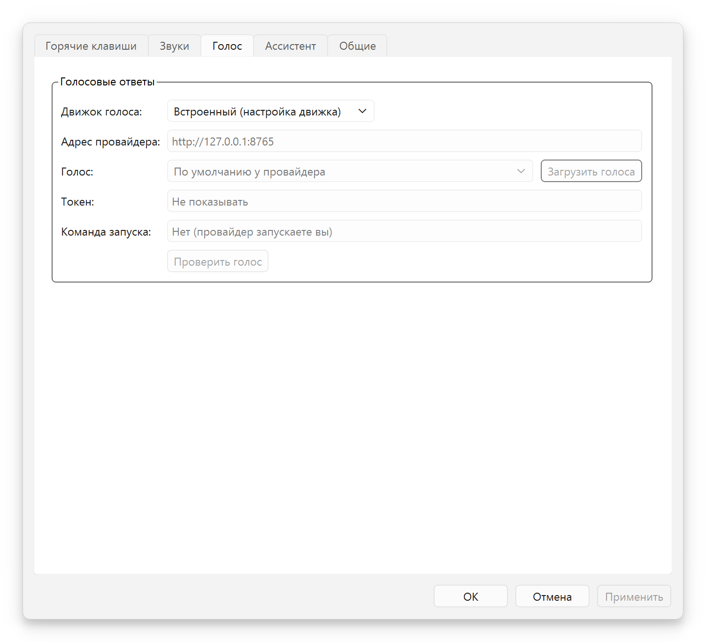
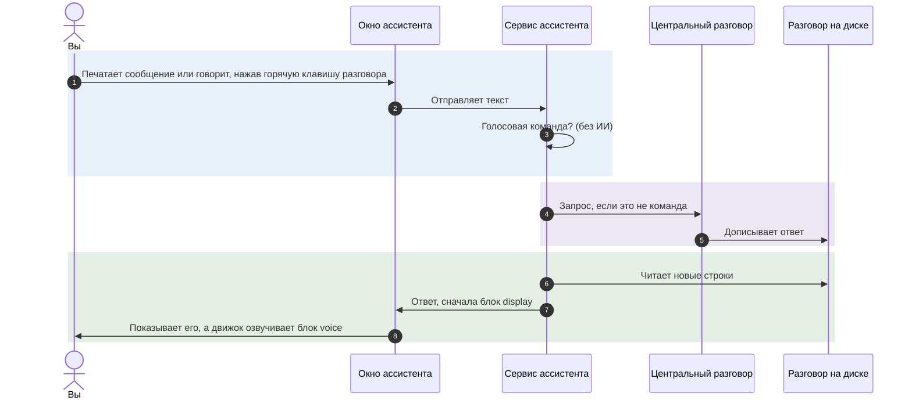
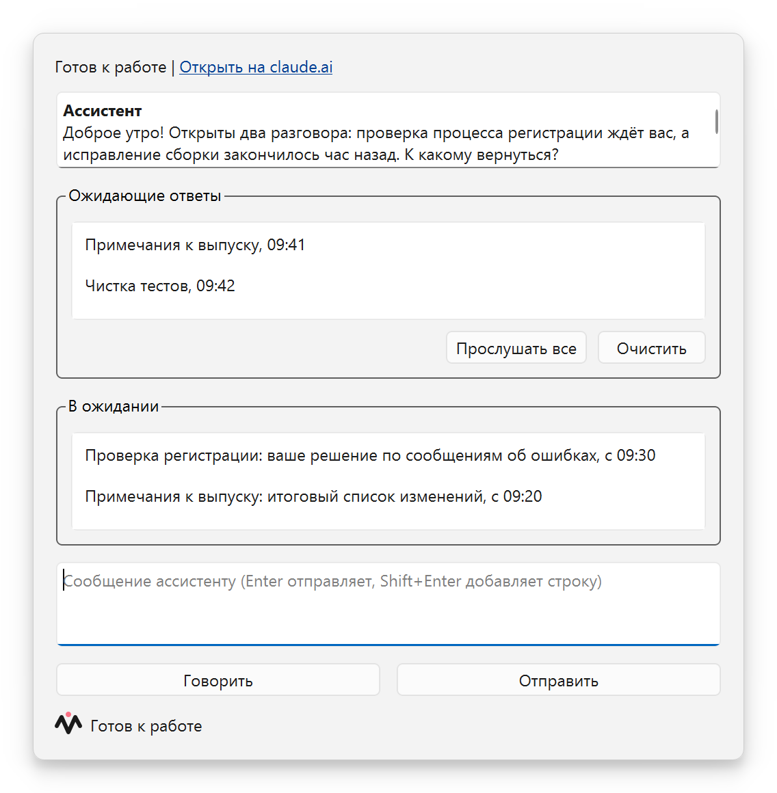
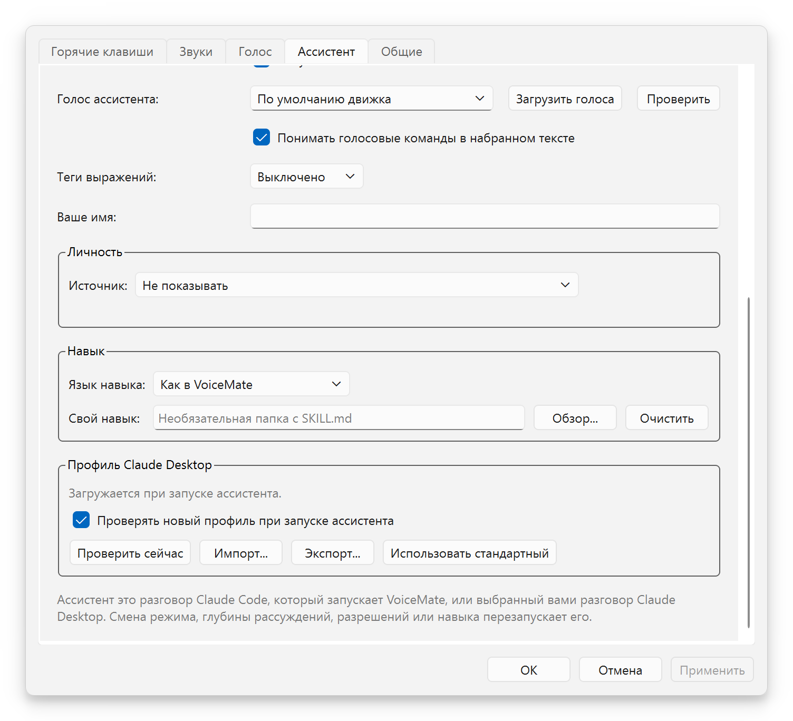
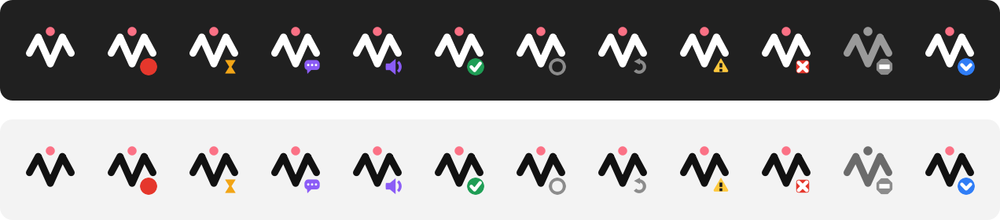

[English](usage.md) | [Português](usage.pt-BR.md) | [Español](usage.es.md) | **Русский** | [简体中文](usage.zh-CN.md)

# Использование

Назначение: как пользоваться VoiceMate изо дня в день: сценарии, горячие клавиши, приложение-компаньон, режимы распознавания, модели Whisper, варианты голоса и голосовой ассистент. Назад к [README](../README.ru.md).

## Горячие клавиши

| Горячая клавиша по умолчанию | Режим | Действие в меню в области уведомлений | Результат |
|---|---|---|---|
| `Ctrl+Alt+V` | Буфер обмена (основной) | «Диктовка» | Расшифровка попадает в буфер обмена |
| `Ctrl+Alt+A` | Claude | «Спросить Claude» | Расшифровка уходит Claude; ответ попадает в буфер обмена и зачитывается вслух |

Голосовой ассистент добавляет свои горячие клавиши (`Ctrl+Alt+S`, чтобы говорить с ним, `Ctrl+Alt+W` для его окна, `Ctrl+Alt+R`, чтобы прослушать ожидающие ответы, и ещё две без значения по умолчанию): см. [Говорите с ним](#говорите-с-ним).

Каждая горячая клавиша работает как переключатель: нажмите один раз, чтобы начать запись, нажмите ещё раз, чтобы остановить. Пока идёт запись, действия в меню в области уведомлений превращаются в «Остановить и скопировать» и «Остановить и спросить Claude».

**Остановка определяет, куда пойдёт результат.** Начать можно одной горячей клавишей, а остановить другой: режим выбирает та горячая клавиша, которая останавливает запись.

Как изменить горячие клавиши:
- С компаньоном в Windows: Настройки > **Горячие клавиши**. Щёлкните сочетание, затем нажмите новые клавиши. В каждой строке показано, какой у сочетания статус: «Свободно», «Занято другим приложением», «Занято другим действием» или «Недопустимо». «По умолчанию» возвращает значения по умолчанию.
- Из командной строки: `--hotkey` и `--claude-chat-hotkey`, например `make run ARGS='--hotkey "ctrl+shift+r"'`.
- В Linux горячими клавишами владеет движок, поэтому вкладка «Горячие клавиши» показывает их только для чтения («Задано движком»).

## Режим буфера обмена

1. Нажмите `Ctrl+Alt+V`. Сигнал начала звучит, когда микрофон действительно открыт: говорите после него.
2. Говорите естественно.
3. Нажмите `Ctrl+Alt+V` ещё раз. Звучит сигнал расшифровки.
4. Текст копируется в буфер обмена, и звучит сигнал готовности. Вставьте его через `Ctrl+V`.

С компаньоном текст проходит проверенную доставку: приложение записывает текст в буфер обмена, читает его обратно и сравнивает, до 5 раз, затем записывает его ещё раз через 250 мс, чтобы журнал буфера обмена Windows (`Win+V`) его сохранил. Если другое приложение удерживает буфер обмена заблокированным, текст попадает в список **Нескопированные**.

Запись сама останавливается через 10 минут (`--max-recording-seconds`), с предупреждением при 80 % времени; затем она расшифровывается как обычно. **Отмена** в меню в области уведомлений или в окне состояния отбрасывает текущую запись.

## Режим Claude

Этот второй модуль превращает VoiceMate в голосовой разговор с Claude. Он необязателен.

1. Нажмите `Ctrl+Alt+A`, произнесите вопрос, нажмите `Ctrl+Alt+A` ещё раз.
2. VoiceMate расшифровывает речь и копирует расшифровку в буфер обмена, затем отправляет её Claude.
3. Ответ Claude заменяет содержимое буфера обмена и зачитывается вслух, предложение за предложением, пока идёт потоковая передача.
4. Нажмите `Ctrl+Alt+A` ещё раз, чтобы задать уточняющий вопрос: разговор сохраняет контекст, пока работает движок (по умолчанию до 50 ходов).

Подробности:
- Поскольку и расшифровка, и ответ проходят через буфер обмена, `Win+V` в Windows показывает обе.
- Любая горячая клавиша, нажатая, пока Claude отвечает или говорит TTS, прерывает ответ и начинает новую запись. Разговор сохраняется.
- Claude отвечает на языке `--output-lang` (по умолчанию `pt-BR`), например `make run ARGS="--output-lang en"`. Компаньон задаёт его из «Язык диктовки:» ([Язык диктовки](#язык-диктовки)).
- Модель по умолчанию `claude-haiku-5-5` с глубиной рассуждений `low` и выключенным мышлением, ради низкой задержки. Флаги см. в [configuration.md](configuration.ru.md#режим-claude).
- Требования: установленный Claude Code CLI с выполненным входом и extra `claude` ([installation.md](installation.md#claude-code-cli-for-the-claude-flow)). Без них режим Claude отключается с предупреждением в журнале движка, а режим буфера обмена продолжает работать.

### Движки TTS

| Движок | Extra | Примечания |
|---|---|---|
| движок по умолчанию (используется, если ничего не сохранено) | `tts` | Может клонировать голос (режимы образца голоса ниже). Сильно нагружает GPU; в WSL2 может потрескивать |
| `kokoro` | `kokoro` | Лёгкий, работает на CPU в реальном времени, фиксированные голоса (`--tts-kokoro-voice`). Нужен `espeak-ng`. `make setup` предлагает его (он предлагает Kokoro или движок по умолчанию) |
| `voxcpm` | `voxcpm` | VoxCPM2, тяжелее. Создаёт голос по текстовому описанию (`--tts-voice`) |
| `external` | | TTS-сервис, который вы запускаете, по HTTP ([Внешний TTS-провайдер](#внешний-tts-провайдер)) |
| `none` | | Без голосового ответа (то же, что `--no-tts`) |

Если `make setup` не сохранил движок, используется движок по умолчанию. Другой выбирается флагом `--tts-engine`, например `make run ARGS="--tts-engine kokoro --tts-kokoro-voice pf_dora"`.

### Внешний TTS-провайдер

Любой сервис синтеза речи, который следует [протоколу TTS-провайдера VoiceMate](tts-provider-protocol.md), может озвучивать ответы. В компаньоне откройте **Настройки** > **Голос**, выберите **Свой провайдер (HTTP)** в «Движок голоса:» и заполните:

- «Адрес провайдера:» (по умолчанию `http://127.0.0.1:8765`). Внутри WSL `127.0.0.1` означает сторону WSL.
- «Голос:». **Загрузить голоса** спрашивает у провайдера, что он предлагает; можно также ввести идентификатор голоса.
- «Токен:», если провайдеру он нужен (скрыт маской).
- «Команда запуска:» (необязательно), одна строка, которая запускает провайдер, например `bash ~/my-voice-provider/start.sh`. VoiceMate выполняет её, когда по адресу провайдера никто не слушает, при запуске и снова, если провайдер упал, так что провайдер поднимается вместе с VoiceMate (и вместе с Windows, если VoiceMate открывается вместе с ней). VoiceMate никогда не останавливает провайдер. См. [Запуск провайдера](tts-provider-protocol.md#starting-the-provider-with-voicemate).

<p align="center"></p>

**Проверить голос** произносит короткую фразу, чтобы вы услышали результат до использования. Применение изменения перезапускает движок. Вручную: `make run ARGS="--tts-engine external --tts-url http://127.0.0.1:8765"`, с токеном в `VOICEMATE_TTS_TOKEN`.

Если провайдер не работает, VoiceMate записывает причину в журнал и продолжает работать без голоса. Чтобы написать или проверить провайдер: `make tts-provider-check URL=...`; чтобы сначала попробовать эту возможность, `make tts-provider-example` запускает провайдер с тестовым тоном.

### Режимы образца голоса

`--tts-voice-seed-mode` определяет, как движок по умолчанию и VoxCPM2 сохраняют голос. У Kokoro голоса фиксированные, и он этот параметр игнорирует.

| Режим | Как выбирается голос | Связанные флаги |
|---|---|---|
| `off` (по умолчанию) | Без эталонного аудио. VoxCPM2 создаёт голос по `--tts-voice`; движок по умолчанию использует свой голос по умолчанию | `--tts-voice` (VoxCPM2) |
| `auto` | Первое предложение становится эталонным аудио и сохраняется в папке образцов; следующие предложения клонируют его, в том числе после перезапуска | `--tts-voice-seed-cache-dir`, `--tts-reset-seed` |
| `fixed` | Каждое предложение клонирует предоставленный вами файл WAV | `--tts-voice-seed-path` и `--tts-voice-seed-text` (точный текст из WAV), оба обязательны |

Эталоны `auto` находятся в `~/.cache/voicemate`: `voice_seed.wav` для VoxCPM2 и второй файл `voice_seed_*.wav` для движка по умолчанию. `--tts-reset-seed` удаляет файл VoxCPM2; другой удалите вручную, чтобы получить новый голос.

```bash
make run ARGS="--tts-voice-seed-mode auto"
make run ARGS='--tts-voice-seed-mode fixed --tts-voice-seed-path /path/voice.wav --tts-voice-seed-text "Hello, this is my voice."'
make run-reset-voz              # то же, что ARGS="--tts-reset-seed"
make run-vozes-aleatorias       # то же, что ARGS="--tts-voice-seed-mode off"
```

## Режим распознавания: CPU или GPU

Движок расшифровывает речь либо на процессоре, либо на видеокарте. Режим **CPU** позволяет VoiceMate работать, пока GPU занята другой работой (монтаж видео, рендеринг, игры): он никогда ничего не загружает на GPU. Режим **GPU** самый быстрый. «Автоматически (настройка движка)» сохраняет выбор, сделанный командой `make setup`.

| Где | Как |
|---|---|
| Меню в области уведомлений | «Распознавание» > «CPU (видеокарта остаётся свободной)», «GPU (быстрее всего)» или «Автоматически (настройка движка)» |
| Настройки | **Общие** > «Распознавание» > «Выполнять на:», ниже «Модель для CPU:» и «Модель для GPU:» |
| Флаг движка | `--stt-mode {auto,cpu,gpu}`, см. [configuration.md](configuration.ru.md#режимы-распознавания-речи) |

У каждого режима своя модель Whisper (по умолчанию `large-v3-turbo`), поэтому переключение никогда не спрашивает модель заново. Переключение перезапускает движок, и именно это освобождает или занимает GPU. Окно состояния показывает, где движок расшифровывает речь («Распознавание:», например «CPU, large-v3-turbo»), и сообщает об этом, когда режим GPU перешёл на CPU.

**Режим, который не установлен.** Перед применением нового режима компаньон выполняет `make stt-check` в папке движка. Если режима нет, VoiceMate спрашивает «Установить режим CPU?» (или «режим GPU»), с указанием размера загрузки. После выбора **Установить** окно показывает вывод `make stt-install`. Он затрагивает только собственное виртуальное окружение движка и кэш моделей, поэтому другие проекты в том же дистрибутиве WSL не затрагиваются. Его нельзя отменить на полпути, а VoiceMate тем временем продолжает работать. Отказ или неудачная установка сохраняют текущий режим. Вручную: `make stt-check`, `make stt-install MODE=gpu`.

> [!NOTE]
> Если подходящей видеокарты нет, VoiceMate сообщает «На этом компьютере нет режима GPU», а режим CPU продолжает работать. Цифры скорости и точности есть в [тесте скорости](configuration.ru.md#тест-скорости).

## Модели Whisper

Модель выбирается флагом `--model` (по умолчанию `large-v3-turbo`) либо командами `make run-large` (`large-v3`) и `make run-turbo` (`large-v3-turbo`).

| Модель | Скорость | Качество |
|---|---|---|
| `tiny` | Очень высокая | Базовое |
| `base` | Высокая | Хорошее |
| `small` | Средняя | Очень хорошее |
| `medium` | Средняя | Отличное |
| `large-v2` | Низкая | Превосходное |
| `large-v3` | Низкая | Максимальное |
| `large-v3-turbo` (по умолчанию) | Высокая | Превосходное |

`large-v3-turbo` лучший баланс скорости и качества, в том числе для речи, в которой смешаны языки. whisper.cpp (AMD) использует собственный файл `ggml-large-v3-turbo.bin`, который скачивает `make setup`.

### Язык диктовки

Whisper получает один закреплённый язык ради стабильного результата; иностранные термины внутри речи (например, английские технические термины в португальской речи) по-прежнему распознаются правильно.

**С компаньоном:** Настройки > **Общие** > «Язык диктовки:». Варианты:

- «Как в интерфейсе» (по умолчанию): язык компаньона (`pt-BR`, `en`, `es`, `ru` или `zh-CN`).
- «Определять автоматически»: Whisper определяет язык каждой записи, что менее стабильно для коротких записей. Claude продолжает отвечать на языке интерфейса. С Kokoro закрепите язык: тогда движок передаёт `auto` и в TTS, и Kokoro отвечает своим американским английским голосом, даже для португальского или испанского.
- Один язык, каждый назван на своём языке: «Português», «English», «Español», «Русский», «中文», «Français», «Deutsch», «Italiano» или «日本語». Закреплённый язык также задаёт язык голосовых ответов Claude.

Компаньон передаёт выбор движку, который запускает, как `--transcription-language` и `--output-lang`, а смена выбора перезапускает движок. Движок, к которому компаньон только подключается, сохраняет свои флаги: в режиме «Только подключаться» настройка отключена, а служба systemd или запущенный вами вручную движок подключается, а не запускается, поэтому он следует собственным `--transcription-language` и `--output-lang`.

**Из командной строки:** движок по умолчанию использует португальский. `--output-lang` по умолчанию равен `pt-BR`, и от него выводится язык расшифровки (`pt-BR` даёт `pt`), поэтому запуск без флагов закрепляет Whisper на португальском, и английская речь распознаётся неправильно. Передайте `--output-lang en` (это также язык ответов Claude и сообщений движка) или закрепите только расшифровку флагом `--transcription-language {auto,pt,en,es,fr,de,it,ja,ru,zh}`:

```bash
make run ARGS="--output-lang en"
make run ARGS="--transcription-language en"
```

`make run` выполняется в оболочке той системы, где работает движок: bash в Linux и внутри WSL, PowerShell или cmd для движка, запущенного нативно в Windows. Примеры с `ARGS` работают во всех.

`VOICEMATE_LANG` меняет только язык сообщений движка (`pt-BR`, `en`, `es`, `ru` или `zh-CN`). Он важнее `--output-lang` в этом, и не меняет то, что слышит Whisper. Задайте его в оболочке, которая выполняет `make run`:

```bash
VOICEMATE_LANG=en make run          # bash: Linux или внутри WSL
```

```powershell
$env:VOICEMATE_LANG="en"; make run  # PowerShell: движок, запущенный нативно в Windows
```

Компаньон её игнорирует.

## Голосовой ассистент

Голосовой ассистент это один разговор с Claude, «центральный разговор», с которым вы общаетесь голосом или набирая текст. Он знает, что делают ваши остальные разговоры с Claude: может перечислять их, читать, задавать им вопросы, запускать новые в фоне и сообщать вам, когда они ответят. По умолчанию он выключен. Что он делает для вас (маршрутизация, инициатива, ожидание и наблюдение, постоянные инструкции, ограничения), описано в [assistant.md](assistant.ru.md).

Весь процесс с диаграммами (два режима, как он ведёт ваши остальные разговоры, как возвращаются ответы) описан в [voice-assistant.md](voice-assistant.md); диаграмма компонентов находится в [architecture.md](architecture.ru.md#61-голосовой-ассистент), а замысел в [исследовательских заметках](research/voice-assistant-design.md).



Ответ следует шаблону, который определяет навык: блок `<voice>` (то, что произносится), необязательный блок `<display>` и блок `<actions>`. Окно показывает блок display, а если его нет, блок voice. Ответ, нарушающий шаблон, показывается как обычный текст и не озвучивается.

### Требования

- Claude Code CLI: команда `claude`, найденная в `PATH` Windows или в собственных папках установщиков (`~/.local/bin`, `%APPDATA%\npm`), либо её полный путь в переменной окружения `VOICEMATE_CLAUDE_CLI`.
- Вход в Claude на этом компьютере: один раз выполните `claude auth login` в терминале. Приложение Claude Desktop хранит свой вход при себе, поэтому CLI нужен собственный ([исследование](research/claude-code-client.md#2-authentication-is-the-first-blocker)).
- Claude Desktop и телефон необязательны в первом режиме и обязательны во втором (см. ниже).

### Выбор режима

В Настройки > **Ассистент** у «Режим ассистента:» три варианта. Выбирайте по тому, что должен делать центральный разговор.

| | «Собственный разговор VoiceMate» (`own_session`) | «Разговор Claude Desktop» (`desktop`) |
|---|---|---|
| Где работает центральный | Процесс Claude Code, который запускает и которым владеет VoiceMate | Уже существующий у вас разговор в Claude Desktop, выбранный по точному названию на боковой панели |
| Как VoiceMate пишет в него | Напрямую, без участия окна | Коротким набором в окне Desktop («вспышка») |
| Нужен ли открытый Desktop | Нет | Да, и разблокированный экран |
| Инструменты для других разговоров | Инструменты `voicemate`: перечислять и читать разговоры, отправлять в них, запускать разговор, задавать модель запущенного VoiceMate разговора, останавливать его | Собственные инструменты сессий Desktop, а также всё остальное, что предлагает Desktop (его браузер, управление компьютером, инструменты для PR) |
| Телефон | Показывается на телефоне через Remote Control | VoiceMate не управляет |
| Платформа | Windows (компаньон) | Только Windows (используется UI Automation) |

Режим `own_session` тихий: ничто не перехватывает вашу клавиатуру. Его ограничение в том, что такой центральный разговор не может пользоваться тем, что есть только в Desktop; чтобы воспользоваться этим, он передаёт задачу разговору, который вы открыли в Desktop.

В режиме `desktop` эти инструменты есть, но не бесплатно. Каждое сообщение, которое отправляет ассистент, забирает передний план примерно на 2 секунды и возвращает его. Оно также стирает любой черновик, который вы набрали в строке ввода этого разговора, и работает только пока Claude Desktop открыт, а экран разблокирован.

> [!WARNING]
> В режиме `desktop` не печатайте в выбранном разговоре, пока ассистент может в него писать: вспышка удаляет черновик в этой строке ввода, прежде чем вставить текст. Перед каждой клавишей VoiceMate проверяет три защиты (окно Claude владеет передним планом, открыт нужный разговор, фокус находится в строке ввода; каждая клавиша это отдельное нажатие) и ничего не печатает, если одна из них не выполнена. Ваш буфер обмена сохраняется и восстанавливается только если за время вспышки никто ничего не скопировал (порядковый номер буфера обмена проверяется перед вставкой и перед Enter).

Такая же вспышка доставляет сообщение в любой другой разговор Desktop в обоих режимах («отправь в разговор X» или прямой режим). Для чтения вспышка не нужна никогда: оно работает по расшифровкам на диске, даже при свёрнутом Desktop.

Вспышка, которая не удалась, всегда сообщается: окно показывает «Не отправлено в ...», и сообщение не теряется. Буфер обмена, занятый другой программой, считается занятым, а перезагрузка или закрытие окна считаются недоступностью.

### Включение

1. Настройки > **Ассистент**, выберите «Режим ассистента:». Для режима Desktop также заполните «Разговор в Desktop:» точным названием с боковой панели Claude Desktop (без него ассистент не запускается и говорит «Разговор Claude Desktop не выбран»).
2. Выберите «Модель:» («Haiku (самая быстрая)», «Sonnet» или «Opus (самая глубокая)») и «Глубина рассуждений:» («Низкое», «Среднее» или «Высокое») для центрального разговора.
3. ОК. В меню в области уведомлений теперь есть «Ассистент», который открывает окно, и «Прослушать готовое».

Настройка ассистента, изменённая голосом или сочетанием клавиш переключения режима, пока открыты Настройки, сохраняется: «Применить» записывает только те поля, которые вы изменили в диалоге.

В собственном режиме новая «Модель:» действует со следующего ответа, а новая «Глубина рассуждений:» или смена режима перезапускает разговор. В режиме Desktop VoiceMate не может изменить модель разговора Desktop: он просит центральный разговор, с заметкой, применить модель и глубину рассуждений к себе.

### Окно

Строка состояния показывает «Запуск...», «Готов к работе», «Отвечает...» или то, что не так, а когда Remote Control включён (собственный режим), ещё и «Открыть на claude.ai». Окно показывает последние 30 сообщений, прочитанных из разговора на диске, так что то, что вы набираете на телефоне или в Claude Desktop, тоже появляется. Enter отправляет, Shift+Enter добавляет строку. Поле ввода отключено, а причина указана под ним, пока ассистент выключен, запускается, отвечает или сломан. После ошибки **Перезапустить** пробует снова.

Рядом с полем сообщения **Говорить** это горячая клавиша разговора в виде кнопки: нажмите, чтобы записывать, нажмите **Остановить и отправить**, чтобы остановить запись и отправить текст ассистенту. Строка рядом показывает то же состояние, с тем же бейджем и теми же словами, что и окно состояния (запись с прошедшим временем, расшифровка), в том числе для записи, начатой горячей клавишей. Кнопка отключена, пока ассистент не готов или движок ещё расшифровывает последнюю запись.

Под сообщениями **Ожидающие ответы** перечисляет ответы, оставленные для вас (см. [Ответы из других разговоров](#ответы-из-других-разговоров)): выберите ответ, чтобы прочитать его, **Прослушать все** поручает ассистенту пройтись по ним, **Очистить** отбрасывает их.

**В ожидании** перечисляет то, чего ассистент ждёт или за чем наблюдает в других разговорах (разговор, название, причина, с какого времени). Запись покидает список, когда ассистент отмечает её выполненной, когда приходит ответ, которого он ждал, или когда новый ход не приходит вовремя (1 час для ожидания, 12 часов для наблюдения, о котором вы просили); список сохраняется после перезапуска. **Вернуться к ассистенту** появляется, пока окно следит за другим разговором или говорит с ним.

<p align="center"></p>

Если включить Remote Control не удаётся, ассистент продолжает работать на этом компьютере без этой ссылки.

### Говорите с ним

У ассистента есть собственные горячие клавиши, в Настройки > **Горячие клавиши** (в группе «Ассистент»). Они отделены от горячих клавиш диктовки, и любую из них можно изменить или очистить. Пока ассистент выключен, его сочетания не регистрируются и никогда не считаются конфликтом с другим сочетанием. Когда клавиатурой владеет движок (локальный режим в Linux), строки ассистента на вкладке «Горячие клавиши» скрыты.

| Действие | По умолчанию | Что делает |
|---|---|---|
| «Говорить с ассистентом» | `Ctrl+Alt+S` | Начинает запись; нажмите ещё раз, чтобы остановить, и текст уйдёт ассистенту, а не в буфер обмена |
| «Открыть окно ассистента» | `Ctrl+Alt+W` | Открывает окно или выводит его на передний план |
| «Прослушать готовое» | `Ctrl+Alt+R` | Ассистент пересказывает ответы, оставленные во входящих |
| «Переключить режим ассистента» | нет | Переключает между собственным режимом и режимом Desktop (ничего не делает, пока ассистент выключен) |
| «Вернуться к ассистенту» | нет | Выходит из прямого режима или из разговора, за которым следует окно |

Как и при диктовке, клавиша, которая останавливает запись, определяет, куда пойдёт результат: начните с `Ctrl+Alt+V` и остановите с `Ctrl+Alt+S`, и текст уйдёт ассистенту. Новая просьба, «stop talking» и смена режима сразу заглушают ассистента. Запись лишь приостанавливает его: поверх микрофона ничего не говорится, а то, что пришло за это время (ответ, уведомление), ждёт, пока запись не закончится и не будет расшифрована. Затем фраза, которую оборвала запись, произносится заново с начала, а за ней предложения, которые уже стояли за ней в очереди, и то, что пришло за это время.

Ассистент произносит свои ответы предложение за предложением: компаньон берёт блок `<voice>` каждого ответа и воспроизводит звук, пока готовится следующее предложение. В Настройки > **Ассистент** есть «Озвучивать ответы», «Источник голоса:» и «Голос ассистента:» (**Загрузить голоса**, **Проверить**).

| «Источник голоса:» | Кто говорит |
|---|---|
| «Автоматически» (по умолчанию) | Голос движка, а когда у движка его нет или он не может говорить, голоса Windows |
| «Голос движка» | Только движок: встроенный голос Kokoro (Настройки > **Голос**) или ваш [свой провайдер](#внешний-tts-провайдер). Предложение, которое застаёт движок ещё загружающим свой голос, ждёт его (до 90 секунд, один раз на сбой), а не теряется, и короткие уведомления остаются на экране, без речи Windows |
| «Голоса Windows» | Только голоса, которые уже есть в Windows, для каждого языка, установленного в Параметры Windows > Время и язык > Речь. Ничего скачивать и настраивать не нужно |

**Загрузить голоса** перечисляет голоса выбранного источника, а **Проверить** произносит короткую фразу выбранным голосом, оба действия до сохранения. Когда говорить нечем, ответы остаются только текстом, а одно уведомление «Голос недоступен» объясняет причину.

### Голосовые команды

Если отмечено «Понимать голосовые команды в набранном тексте» (по умолчанию), сообщение, которое начинается с одной из этих фраз, обрабатывает VoiceMate, без решения со стороны ИИ. Фразы существуют на английском, португальском и испанском и следуют языку интерфейса; остальные языки интерфейса используют английские фразы. Они работают и когда их произносят, и когда набирают.

| Скажите или наберите | Что происходит |
|---|---|
| «read the last answer» | Последний ответ показывается снова как уведомление |
| «go to the conversation X» | Окно следует за этим разговором, только для чтения, пока не нажато **Вернуться к ассистенту** |
| «send to the conversation X: message» (или «... X saying message») | Ассистента просят доставить сообщение своими инструментами |
| «talk directly to the conversation X» | Прямой режим: всё, что вы говорите, идёт слово в слово в этот разговор, без ассистента посередине |
| «back to the assistant» (или «new subject») | Выход из прямого режима; то, что идёт дальше, адресовано ассистенту |
| «stop talking» или «be quiet» | Заглушает речь, которая идёт |

В прямом режиме командой считается только выход из него или называние другого разговора; «new subject» вне него обычная речь. Когда вы возвращаетесь, ассистент получает заметку с тем, что вы там сказали, и с последним ответом разговора, чтобы продолжить с этого места. Название сопоставляется нестрого с вашими недавними разговорами. Когда подходят два названия или ни одно, окно показывает уведомление, и ничего не отправляется.

### Ответы из других разговоров

Когда ассистент отправляет что-то в разговор или запускает его, VoiceMate наблюдает за ним и замечает, когда тот отвечает. «Ответы из других разговоров:» в Настройки > **Ассистент** решает, что будет дальше. Разговор, за которым вы просили следить («присматривай за X»), это другое дело: каждый завершённый им ход сообщается ассистенту при любом выборе, пока вы не скажете «хватит» ([ожидание и наблюдение](assistant.ru.md#-ожидание-и-наблюдение)).

| Выбор | Что вы получаете |
|---|---|
| «Сообщать ответ сразу, как он придёт» (`speak`) | Ассистент сразу пересказывает его вслух, как только нет ни записи, ни голосового ответа в процессе. Пока вы диктуете или пока текстовый экран следует за другим разговором (прямой режим или `focus`), он вместо этого ждёт во входящих с сигналом «ответ» и коротким устным уведомлением |
| «Коротко сообщать и сохранять ответ на потом» (`announce`, по умолчанию) | Звук ответа и одна произнесённая строка («В разговоре X есть ответ.»); ответ ждёт во входящих |
| «Только проиграть звук и сохранить ответ» (`sound`) | Звук ответа; ответ ждёт |
| «Просто сохранить» (`silent`) | Ничего не воспроизводится; ответ ждёт |

Сохранённые ответы хранятся во входящих, до 50, и переживают перезапуск. Пока есть хоть один ожидающий ответ, значок в области уведомлений показывает синий бейдж с конвертом (только поверх спокойного состояния, никогда поверх записи, предупреждения или ошибки), а его подсказка говорит «Ожидающих ответов: N». Звук ответа это строка «Ответ готов» в Настройки > **Звуки**.

Чтобы услышать их, используйте «Прослушать готовое» (меню в области уведомлений, горячая клавиша, **Прослушать все** или просто спросите «что готово?»): ассистент пересказывает их вместе, сначала главное, сгруппировав по темам, и входящие очищаются. Уведомление или звук ждёт, пока идёт запись, расшифровка или голосовой ответ.

### Разговоры, которые запускает ассистент

В собственном режиме ассистент может запускать разговоры в фоне («начни исследование по Y»). VoiceMate открывает каждый как отдельный процесс Claude Code с включённым Remote Control, так что он виден и в Desktop, и на телефоне. Одновременно живут не больше 4: лимит учитывает и те, что ещё запускаются, так что два запуска в один и тот же момент не могут его обойти. Они запоминаются: при следующем запуске VoiceMate возвращаются те, что работали. Выход из VoiceMate останавливает центральный разговор и все запущенные разговоры одновременно, в рамках одного срока, а не один за другим, не забывая их; запуск, который завершается после выхода, останавливается сразу.

«Новые разговоры используют:» и «С глубиной рассуждений:» задают модель и глубину рассуждений нового разговора, когда ассистент их не называет (по умолчанию Sonnet и Среднее). «Разрешения:» задаёт, сколько эти разговоры могут делать сами:

| Выбор | Значение |
|---|---|
| «Спрашивать перед каждым изменением» (`default`) | Каждая правка и команда ждут подтверждения |
| «Принимать правки файлов, спрашивать об остальном» (`acceptEdits`, по умолчанию) | Правки проходят, об остальных действиях спрашивается |
| «Полный доступ, никогда не спрашивать (рискованно)» (`bypassPermissions`) | Разговоры меняют любые файлы и выполняют любые команды без вопросов |

> [!IMPORTANT]
> «Полный доступ» позволяет разговорам, работающим без присмотра, действовать на вашем компьютере, когда некому подтверждать. Используйте его, только если вы с этим согласны. Изменение действует на разговоры, которые ассистент запускает с этого момента, и сразу перезапускает центральный разговор, поэтому он никогда не сохраняет старые разрешения.

«Разрешения:» не относится к закрытой сессии терминала, IDE или Remote Control, которую ассистент возобновляет, чтобы доставить сообщение: при таком возобновлении режим разрешений не передаётся, если вы не задали `resume_permission_mode` в `companion.toml` ([конфигурация](configuration.ru.md#настройки-ассистента)).

### Меняйте VoiceMate голосом

Вы можете попросить ассистента изменить VoiceMate: «переключись на режим Desktop», «уменьши громкость звуков», «используй CPU для распознавания». Ассистент может пользоваться только фиксированным списком настроек (каталогом). VoiceMate проверяет ключ и значение, применяет изменение и сообщает вам; неизвестный ключ или значение вне диапазона отклоняется с указанием причины.

| Включено | Ключи |
|---|---|
| Ассистент | `assistant.mode` (`own_session`, `desktop`), `assistant.model`, `assistant.effort`, `assistant.permission_mode`, `assistant.answer_delivery`, `assistant.new_conversation_model`, `assistant.new_conversation_effort`, `assistant.desktop_conversation`, `assistant.speak_replies`, `assistant.voice`, `assistant.voice_commands`, `assistant.expressions`, `assistant.user_name`, `assistant.personality_source`, `assistant.desktop_profile_auto_update`, `assistant.skill_language` |
| Звуки | `cues.enabled`, `cues.volume`, `cues.answer.enabled`, `cues.answer.volume` |
| Общие | `general.dictation_language`, `general.stt_mode`, `general.notify_level` |

Намеренно не включены, потому что их небезопасно менять голосом: горячие клавиши; любые файлы и папки (файл и текст личности, хранилище заметок, папка своего навыка, импортированный профиль Desktop); движок голоса, адрес провайдера и токен; сам движок (папка, дистрибутив WSL, порт, режим); режим ассистента «off» (ассистент не может выключить сам себя); и остальные звуковые сигналы.

Режим `desktop` отклоняется, пока не выбран разговор Desktop, а `personality_source` `file` пока не выбран файл. Режим разрешений есть в списке только как `default` и `acceptEdits`; `bypassPermissions` («Полный доступ») можно выбрать только в Настройках.

### Личность, имя и заметки

<p align="center"></p>

- «Ваше имя:» это то, как ассистент обращается к вам; пусто означает без имени.
- В группе «Личность» у «Источник:» три варианта. «Не показывать»; «Файл Markdown (например, заметка из вашего хранилища Obsidian)», выбирается через «Обзор...» (диалог выбора файла открывается в папке хранилища, которую вы выбрали); или «Написать свою», текст до 20 000 символов, который вы пишете на вкладке; **Сохранить**, ОК и «Применить» все сохраняют его (текст, который не удаётся сохранить, оставляет диалог открытым на вкладке «Ассистент» с указанием причины). Навык следует ему только в тоне и стиле, но никогда в инструкциях.
- «Папка хранилища:» это ваше хранилище заметок (Obsidian). Ассистент читает там заметки всякий раз, когда они помогают ответить вам, не спрашивая, а пишет только когда вы просите. VoiceMate не индексирует хранилище; вкладка настроек предлагает хранилища, которые Obsidian уже знает. VoiceMate предупреждает, если в папке нет папки `.obsidian`, но принимает её.
- «Теги выражений:» позволяют блоку voice нести теги вроде `[laugh]` или `[pause]` для движка голоса, который умеет их воспроизводить.

### Навык

Ассистент это навык `voicemate-assistant` на двух языках (английском и бразильском португальском). «Язык навыка:»: «Как в VoiceMate» (португальский навык, когда интерфейс португальский, иначе английский), «Английский» или «Португальский (Бразилия)». «Свой навык:» принимает вашу собственную папку с `SKILL.md`, которая заменяет навык из поставки; папка без `SKILL.md` игнорируется с уведомлением.

VoiceMate копирует навык в `~/.claude/skills/voicemate-assistant`, когда запускается ассистент (файл, который вы изменили, сохраняется, а новая версия кладётся рядом как `.new`). Навык необязателен и им можно делиться: скопируйте туда `app/companion/assistant/skill/en/voicemate-assistant` (или `pt-BR`) сами и используйте в любом разговоре Claude Code, без запущенного VoiceMate, попросив «ассистента» или «режим VoiceMate».

Он читает `~/.voicemate/assistant.json`:

```json
{
  "version": 1,
  "language": "en",
  "user_name": "",
  "personality_file": "",
  "notes_vault": "",
  "expressions": "off",
  "mode": "own_session",
  "permission_mode": "acceptEdits",
  "resume_permission_mode": "",
  "answer_delivery": "announce",
  "instructions": [],
  "inbox": [],
  "pending": [],
  "settings": []
}
```

| Ключ | Описание |
|---|---|
| `language` | Язык каждого ответа (тег BCP 47, например `pt-BR`). С португальским навыком это `pt-BR`, и голос говорит по-португальски (pt-BR), каким бы ни был язык интерфейса; с английским навыком (или своим) он следует за интерфейсом |
| `user_name` | Как обращаться к вам; пусто означает без имени |
| `personality_file` | Необязательный путь к файлу Markdown с личностью ассистента. Его читает навык; VoiceMate никогда |
| `notes_vault` | Ваша папка заметок или пусто |
| `expressions` | `off` или `on`: может ли блок voice нести теги вроде `[laugh]` или `[pause]` |
| `mode` | `own_session` или `desktop`: какие инструменты есть у навыка |
| `permission_mode` | Как разрешены инструменты центрального разговора в собственном режиме («Разрешения:»); в режиме Desktop пусто |
| `resume_permission_mode` | Режим разрешений, который получает закрытая сессия терминала, IDE или Remote Control, когда ассистент возобновляет её; пусто (по умолчанию) означает, что режим не передаётся |
| `answer_delivery` | Как ответы из других разговоров доходят до вас |
| `instructions` | Ваши постоянные инструкции (`text`, `since`), которым следуют с первого ответа |
| `inbox` | Ожидающие ответы (название, идентификатор, время), без их текста |
| `pending` | Запросы, которых ассистент ждёт (идентификатор сессии, название, причина, с какого времени, `watch` для разговора, за которым вы просили следить, `until`, когда запись уходит без нового хода) |
| `settings` | Каталог настроек, которые ассистент может менять |

Без этого файла навык отвечает на том языке, на котором вы пишете, и один раз сообщает, что настройки не найдены. Подробнее: [замысел](research/voice-assistant-design.md) и [исследование клиента Claude Code](research/claude-code-client.md).

### Профиль Claude Desktop

Режим Desktop и «отправка в разговор Desktop» находят элементы управления Desktop через **профиль**, небольшой файл JSON, так что обновление Desktop, которое меняет его окно, исправляется новым профилем, а не новым выпуском VoiceMate.

В Настройки > **Ассистент** группа «Профиль Claude Desktop» показывает, какой из них используется (импортированный файл, загруженное обновление или встроенный в VoiceMate), и содержит «Проверять новый профиль при запуске ассистента» (включено по умолчанию), **Проверить сейчас**, **Импорт...**, **Экспорт...** и **Использовать стандартный**. Формат, защитные меры и способ написать профиль описаны в [desktop-profile.md](desktop-profile.md).

## Приложение-компаньон

### Значок в области уведомлений и меню

Значок в области уведомлений это фигурка VoiceMate; маленький бейдж в его углу показывает состояние. Щелчок левой кнопкой открывает окно состояния.

<p align="center"></p>

| Бейдж (слева направо) | Состояние | Что говорят меню и подсказка |
|---|---|---|
| Без бейджа | Ожидание | «Ожидание нажатия Ctrl+Alt+V» |
| Красная точка | Запись | «Запись 00:12» |
| Песочные часы | Расшифровка | «Расшифровка...» |
| Облачко речи | Обдумывание (Claude) | «Claude отвечает...» |
| Динамик | Озвучивание (Claude) | «Claude отвечает...» |
| Галочка | Готово, на 3 секунды | «Скопировано: ...» |
| Синий диск с конвертом | Ответы из других разговоров ждут во входящих ассистента (виден только поверх спокойного состояния) | «Ожидающих ответов: 2» |
| Кольцо | Запуск | «Запуск движка...» |
| Круговая стрелка | Перезапуск | «Перезапуск (попытка 2)» |
| Треугольник | Предупреждение | «Нет микрофона» или «Звук в WSL остановлен» |
| Крестик | Ошибка | «Движок перестал работать» |
| Серый восьмиугольник, значок приглушён | Остановлен | «VoiceMate остановлен» |

В меню есть:

- Строка состояния, затем «Открыть VoiceMate», а также «Ассистент» и «Прослушать готовое», когда голосовой ассистент включён.
- «Диктовка» и «Спросить Claude» с их горячими клавишами («Остановить и скопировать» и «Остановить и спросить Claude» во время записи) и «Отмена».
- «Недавние»: последние расшифровки; щёлкните одну, чтобы скопировать её снова.
- «Нескопированные ({count})»: только когда что-то не удалось доставить в буфер обмена; щёлкните пункт, чтобы скопировать его; «Очистить список» очищает список после вопроса «Очистить список «Нескопированные»?».
- «Перезапустить WSL сейчас...»: только пока перезапуск WSL ждёт вашего подтверждения.
- «Выключить звуки».
- «Распознавание» > «CPU (видеокарта остаётся свободной)», «GPU (быстрее всего)» или «Автоматически (настройка движка)» (нет в режиме «Только подключаться»).
- «Движок» > «Перезапустить движок», «Перезапустить WSL...» (только в режиме WSL), «Открыть журналы».
- «Настройки...» и «Выйти из VoiceMate».

### Окно состояния

Окно состояния показывает строку состояния, «Движок:», «Распознавание:» (где движок расшифровывает речь), «Звук:», «Микрофоны:» и «Перезапуски:», группу **Нескопированные** («Очистить», «Копировать»), группу **Недавние** («Копировать») и кнопки «Настройки...», «Перезапустить движок», «Открыть журналы» и «Выйти из VoiceMate». Баннеры появляются, когда движок устарел или когда остановился звук в WSL. В Linux без системного трея окно состояния служит главным окном.

### Нескопированные

Расшифровка, которая так и не попала в буфер обмена, хранится в списке **Нескопированные** и сохраняется в `pending.json`, поэтому переживает перезапуск или сбой (не больше 50 элементов). Она покидает список, когда вы копируете её или очищаете список. Файл содержит текст расшифровки; он остаётся в вашем профиле пользователя, удаляется, когда список пуст, и удаляется деинсталлятором.

### Звуки и уведомления

- Настройки > **Звуки**: «Воспроизводить звуковые сигналы», общая «Громкость:» и по одной строке на каждый сигнал («Запись началась», «Расшифровка», «Скопировано», «Claude ответил», «Предупреждение», «Ошибка», «Ответ готов») со «Встроенный» звуком («Классический», «Мягкий», «Щелчок») или «Свой файл» (WAV PCM, 8 или 16 бит), собственной громкостью и «Прослушать».
- Настройки > **Общие** > «Уведомления:»: «Все», «Предупреждения и ошибки» (по умолчанию), «Только ошибки» или «Не показывать».

### Закреплённый значок и командная строка (Windows)

Закрепите VoiceMate на панели задач из меню «Пуск». Щелчок по закреплённому значку открывает окно состояния; щелчок правой кнопкой предлагает «Настройки», «Перезапустить движок», «Перезапустить WSL...» и «Выйти из VoiceMate».

Исполняемый файл также пересылает команды запущенному экземпляру. Команда никогда не запускает VoiceMate:

```powershell
& "$env:LOCALAPPDATA\Programs\VoiceMate\VoiceMate.exe" --command quit
```

Команды: `show`, `quit`, `restart-engine`, `restart-wsl`, `settings`. Из исходников: `make run-tray ARGS="--command quit"`. `--demo` запускает демонстрацию с поддельным движком.

### Выход

«Выйти из VoiceMate» останавливает движок, который запустил компаньон. Движок, к которому он только подключился (например, служба systemd), продолжает работать.

## Мышь как триггер (только Windows)

В нативном Windows режим буфера обмена может использовать боковую кнопку мыши вместо горячей клавиши:

```bash
make run ARGS="--input-method mouse --mouse-button x"
```

Нужен триггер `keyboard-hooks`, поэтому это работает только в Windows; на других платформах происходит возврат к горячим клавишам клавиатуры с предупреждением. Триггер-мышь отключает режим Claude.

## Запуск движка без компаньона

| Команда | Что запускает |
|---|---|
| `make run` | `voice-mate` с вашими `ARGS` и собственными горячими клавишами движка |
| `make run-engine` | `voice-mate --supervised --api --api-token`: движок в том виде, в каком его запускает компаньон |
| `make run-large`, `make run-turbo` | `--model large-v3`, `--model large-v3-turbo` |

В WSL2 у движка нет собственных глобальных горячих клавиш (горячие клавиши Windows до WSL не доходят): его триггером служит HTTP API, которым управляет компаньон. Старые скрипты PowerShell и AutoHotkey в `scripts/windows/` по-прежнему работают с `make run` (без токена), но компаньон их заменяет.
