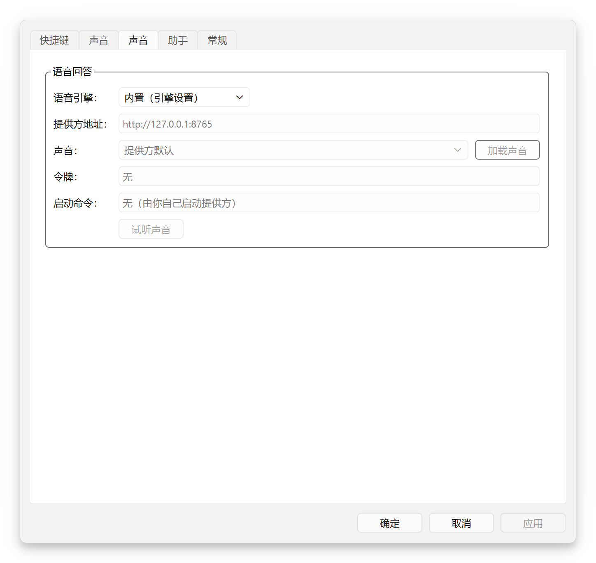
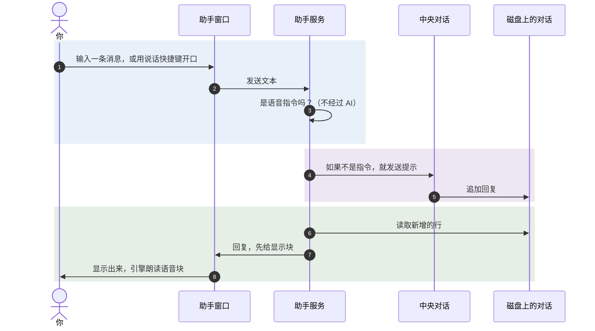
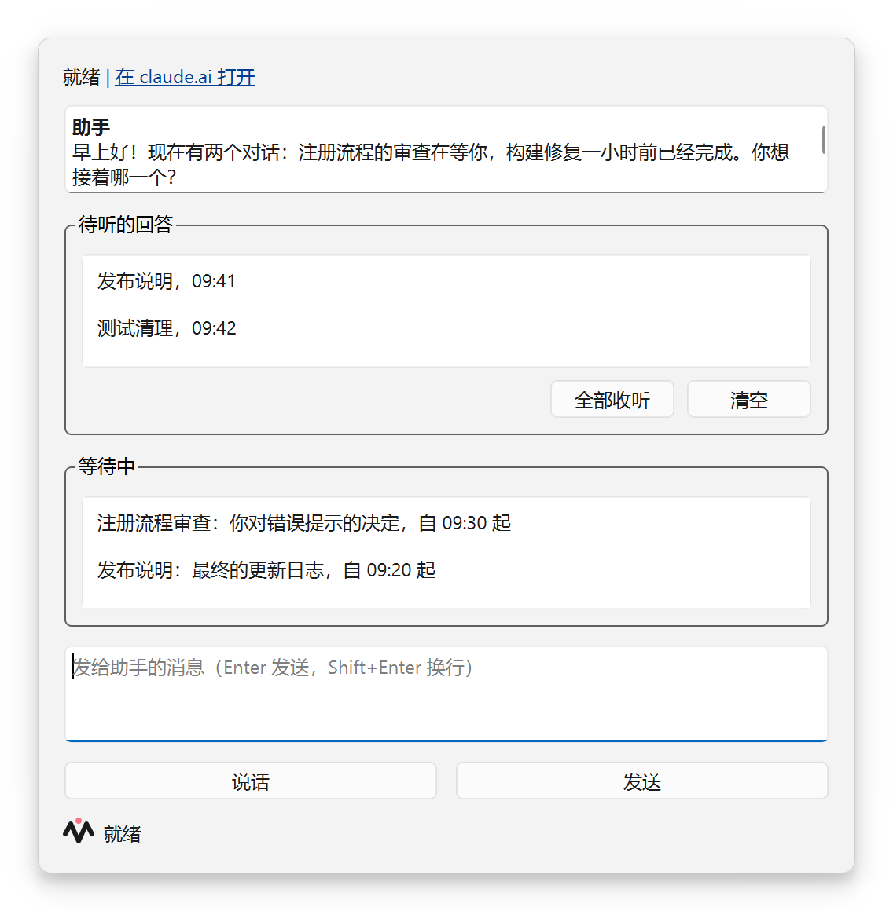
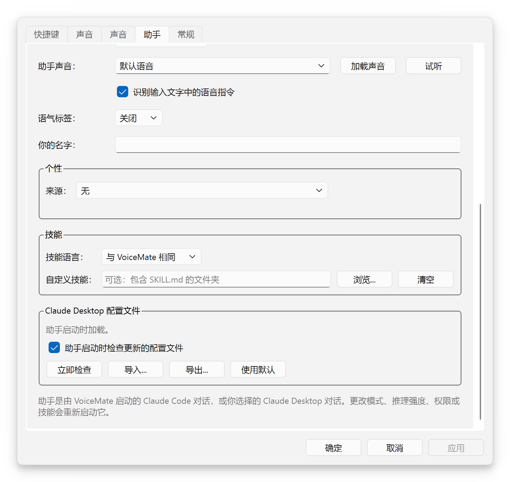
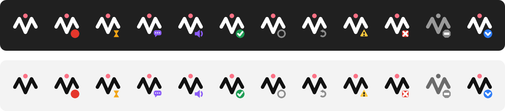

[English](usage.md) | [Português](usage.pt-BR.md) | [Español](usage.es.md) | [Русский](usage.ru.md) | **简体中文**

# 使用

目的：说明如何在日常中使用 VoiceMate：各种流程、快捷键、配套应用、转写模式、Whisper 模型、语音选项和语音助手。返回 [README](../README.zh-CN.md)。

## 快捷键

| 默认快捷键 | 流程 | 托盘菜单项 | 结果 |
|---|---|---|---|
| `Ctrl+Alt+V` | 剪贴板（核心） | “听写” | 转写文本进入剪贴板 |
| `Ctrl+Alt+A` | Claude | “询问 Claude” | 转写文本发送给 Claude；回答进入剪贴板并被朗读出来 |

语音助手有自己的快捷键（`Ctrl+Alt+S` 对它说话，`Ctrl+Alt+W` 打开它的窗口，`Ctrl+Alt+R` 收听待听的回答，另有两个没有默认值）：见 [与助手对话](#与助手对话)。

每个快捷键都是开关：按一次开始录音，再按一次停止。录音进行时，托盘菜单项会变成“停止并复制”和“停止并询问 Claude”。

**停止时按的键决定去向。** 你可以用一个快捷键开始，用另一个停止：用来停止录音的那个快捷键决定走哪个流程。

更改快捷键：
- 使用 Windows 上的配套应用：设置 > **快捷键**。点击一个快捷键，然后按下新的组合键。每一行都会显示这个组合键是“可用”“已被其他应用使用”“已被其他操作使用”还是“不允许”。“恢复默认值”会还原默认设置。
- 使用命令行：`--hotkey` 和 `--claude-chat-hotkey`，例如 `make run ARGS='--hotkey "ctrl+shift+r"'`。
- 在 Linux 上，快捷键由引擎掌管，所以“快捷键”选项卡以只读方式显示它们（“由引擎设置”）。

## 剪贴板流程

1. 按下 `Ctrl+Alt+V`。麦克风真正打开后会播放开始提示音：请在它之后说话。
2. 自然地说话。
3. 再按一次 `Ctrl+Alt+V`。会播放转写提示音。
4. 文本被复制到剪贴板，并播放就绪提示音。用 `Ctrl+V` 粘贴。

使用配套应用时，文本会经过经校验的写入：应用写入剪贴板，读回来并比对，最多重试 5 次，然后在 250 毫秒后再设置一次，让 Windows 剪贴板历史（`Win+V`）留住它。如果另一个应用一直锁定着剪贴板，文本会进入 **未复制**。

录音在 10 分钟后自动停止（`--max-recording-seconds`），在时间用到 80 % 时给出警告；随后照常转写。托盘菜单或状态窗口中的 **取消** 会丢弃当前的录音。

## Claude 流程

这第二个模块把 VoiceMate 变成与 Claude 的语音对话。它是可选的。

1. 按下 `Ctrl+Alt+A`，说出你的问题，再按一次 `Ctrl+Alt+A`。
2. VoiceMate 转写并把转写文本复制到剪贴板，然后发送给 Claude。
3. Claude 的回答会替换剪贴板的内容，并在流式输出的同时一句一句地朗读出来。
4. 再按一次 `Ctrl+Alt+A` 可以追问：引擎运行期间，对话会保留上下文（默认最多 50 轮）。

细节：
- 转写文本和回答都经过剪贴板，所以 Windows 上的 `Win+V` 会同时显示两者。
- 在 Claude 回答或 TTS 朗读时按下任何快捷键，都会打断回答并开始新的录音。对话会保留。
- Claude 用 `--output-lang` 指定的语言回答（默认 `pt-BR`），例如 `make run ARGS="--output-lang en"`。配套应用根据“听写语言：”来设置它（[听写语言](#听写语言)）。
- 默认模型是 `claude-haiku-5-5`，投入度为 `low`，关闭思考，以获得低延迟。参数见 [configuration.zh-CN.md](configuration.zh-CN.md#claude-流程)。
- 要求：已安装并登录 Claude Code CLI，以及 `claude` 附加组件（[installation.md](installation.md#claude-code-cli-for-the-claude-flow)）。缺少它们时，Claude 流程会被停用，并在引擎日志中给出警告，剪贴板流程仍然可用。

### TTS 引擎

| 引擎 | 附加组件 | 说明 |
|---|---|---|
| 默认引擎（没有保存任何选择时使用） | `tts` | 可以克隆声音（见下面的声音种子模式）。对 GPU 负担较重；在 WSL2 上可能出现爆音 |
| `kokoro` | `kokoro` | 轻量，在 CPU 上就能实时运行，声音固定（`--tts-kokoro-voice`）。需要 `espeak-ng`。`make setup` 会推荐它（提供 Kokoro 或默认引擎两个选择） |
| `voxcpm` | `voxcpm` | VoxCPM2，较重。根据文字描述（`--tts-voice`）设计出一个声音 |
| `external` | | 你自己运行的 TTS 服务，通过 HTTP 连接（[外部 TTS 提供方](#外部-tts-提供方)） |
| `none` | | 不朗读回答（与 `--no-tts` 相同） |

当 `make setup` 没有保存任何引擎时，引擎使用默认引擎。用 `--tts-engine` 选择其他引擎，例如 `make run ARGS="--tts-engine kokoro --tts-kokoro-voice pf_dora"`。

### 外部 TTS 提供方

任何遵循 [VoiceMate TTS 提供方协议](tts-provider-protocol.md) 的文字转语音服务，都可以朗读回答。在配套应用中，打开 **设置** > **声音**，在“语音引擎：”中选择 **自定义提供方（HTTP）**，然后填写：

- “提供方地址：”（默认 `http://127.0.0.1:8765`）。在 WSL 内，`127.0.0.1` 指的是 WSL 一侧。
- “声音：”。**加载声音** 会向提供方询问它提供哪些声音；你也可以直接输入一个声音 id。
- “令牌：”，如果提供方需要的话（以掩码显示）。
- “启动命令：”（可选），启动提供方的一行命令，例如 `bash ~/my-voice-provider/start.sh`。当提供方的地址上没有任何服务在监听时，VoiceMate 会运行它，在启动时运行，提供方掉线后也会再次运行，这样提供方会随 VoiceMate 一起启动（如果 VoiceMate 随 Windows 启动，也就随 Windows 一起启动）。VoiceMate 从不停止提供方。参见[随 VoiceMate 启动提供方](tts-provider-protocol.md#starting-the-provider-with-voicemate)。

<p align="center"></p>

**测试声音** 会朗读一句简短的话，让你在使用之前先听到效果。应用更改会重启引擎。手动方式：`make run ARGS="--tts-engine external --tts-url http://127.0.0.1:8765"`，令牌放在 `VOICEMATE_TTS_TOKEN` 中。

如果提供方没有运行，VoiceMate 会记录原因，并在没有声音的情况下继续工作。要编写或检查一个提供方：`make tts-provider-check URL=...`；想先试用这个功能，`make tts-provider-example` 会运行一个测试音调的提供方。

### 声音种子模式

`--tts-voice-seed-mode` 决定默认引擎和 VoxCPM2 如何保持同一个声音。Kokoro 的声音是固定的，会忽略它。

| 模式 | 声音如何选定 | 相关参数 |
|---|---|---|
| `off`（默认） | 没有参考音频。VoxCPM2 根据 `--tts-voice` 设计声音；默认引擎使用它的默认声音 | `--tts-voice`（VoxCPM2） |
| `auto` | 第一句话成为参考音频，保存在种子文件夹中；之后的句子都克隆它，重启后也一样 | `--tts-voice-seed-cache-dir`、`--tts-reset-seed` |
| `fixed` | 每一句话都克隆你提供的一个 WAV 文件 | `--tts-voice-seed-path` 和 `--tts-voice-seed-text`（该 WAV 的确切文本），两者都必需 |

`auto` 的参考音频保存在 `~/.cache/voicemate`：VoxCPM2 的是 `voice_seed.wav`，默认引擎的是另一个 `voice_seed_*.wav`。`--tts-reset-seed` 会删除 VoxCPM2 的那个；另一个要手动删除，才能得到新的声音。

```bash
make run ARGS="--tts-voice-seed-mode auto"
make run ARGS='--tts-voice-seed-mode fixed --tts-voice-seed-path /path/voice.wav --tts-voice-seed-text "Hello, this is my voice."'
make run-reset-voz              # same as ARGS="--tts-reset-seed"
make run-vozes-aleatorias       # same as ARGS="--tts-voice-seed-mode off"
```

## 转写模式：CPU 或 GPU

引擎可以在处理器上转写，也可以在显卡上转写。**CPU** 模式让 VoiceMate 在 GPU 忙于其他工作（视频剪辑、渲染、游戏）时依然可用：它绝不会在 GPU 上加载任何东西。**GPU** 模式最快。“自动（引擎设置）”保持 `make setup` 选定的方式。

| 位置 | 方式 |
|---|---|
| 托盘菜单 | “转写” > “CPU（不占用 GPU）”、“GPU（最快）”或“自动（引擎设置）” |
| 设置 | **常规** > “转写” > “运行于：”，下面是“CPU 模型：”和“GPU 模型：” |
| 引擎参数 | `--stt-mode {auto,cpu,gpu}`，见 [configuration.zh-CN.md](configuration.zh-CN.md#语音识别模式) |

每种模式都保留自己的 Whisper 模型（默认 `large-v3-turbo`），所以切换时不会再问模型。切换会重启引擎，这正是释放或占用 GPU 的原因。状态窗口会显示引擎在哪里转写（“转写：”，例如“CPU，large-v3-turbo”），当 GPU 模式回退到 CPU 时也会说明。

**尚未安装的模式。** 在应用新模式之前，配套应用会在引擎文件夹中运行 `make stt-check`。如果缺少这个模式，VoiceMate 会询问“要安装 CPU 模式吗？”（或“GPU 模式”），并告知下载大小。你选择 **安装** 之后，会有一个窗口实时显示 `make stt-install` 的输出。它只改动引擎自己的虚拟环境和模型缓存，所以同一个 WSL 发行版中的其他项目不受影响。安装无法在中途取消，期间 VoiceMate 仍然可用。拒绝，或安装失败，都会保留当前的模式。手动方式：`make stt-check`、`make stt-install MODE=gpu`。

> [!NOTE]
> 没有可用的显卡时，VoiceMate 会提示“这台电脑上没有 GPU 模式”，CPU 模式继续工作。速度和准确率的数据见[基准测试](configuration.zh-CN.md#基准测试)。

## Whisper 模型

用 `--model` 选择模型（默认 `large-v3-turbo`），或者用 `make run-large`（`large-v3`）和 `make run-turbo`（`large-v3-turbo`）。

| 模型 | 速度 | 质量 |
|---|---|---|
| `tiny` | 非常快 | 基础 |
| `base` | 快 | 良好 |
| `small` | 中等 | 很好 |
| `medium` | 中等 | 优秀 |
| `large-v2` | 慢 | 极佳 |
| `large-v3` | 慢 | 最高 |
| `large-v3-turbo`（默认） | 快 | 极佳 |

`large-v3-turbo` 在速度和质量之间取得了最好的平衡，对夹杂多种语言的语音也是如此。whisper.cpp（AMD）使用它自己的 `ggml-large-v3-turbo.bin` 文件，由 `make setup` 下载。

### 听写语言

Whisper 会得到一个固定的语言，以保证结果稳定；语音中夹杂的外语术语（例如葡萄牙语里的英文技术术语）仍然能被正确转写。

**使用配套应用：** 设置 > **常规** > “听写语言：”。选项有：

- “与界面相同”（默认）：配套应用的语言（`pt-BR`、`en`、`es`、`ru` 或 `zh-CN`）。
- “自动检测”：Whisper 检测每一段录音的语言，对较短的录音不太稳定。Claude 仍然用界面语言回答。使用 Kokoro 时，请固定一种语言：此时引擎也会把 `auto` 交给 TTS，而 Kokoro 会用它的美式英语声音回答，即使是葡萄牙语或西班牙语。
- 单一语言，每种都用它自己的语言命名：“Português”“English”“Español”“Русский”“中文”“Français”“Deutsch”“Italiano”或“日本語”。固定一种语言，同时也决定了 Claude 语音回答所用的语言。

配套应用会把这个选择以 `--transcription-language` 和 `--output-lang` 的形式传给它启动的引擎，更改后会重启引擎。配套应用只是连接的引擎会保留它自己的参数：在“仅连接”模式下这项设置被停用，systemd 单元或你手动启动的引擎是被连接而不是被启动的，所以它遵循自己的 `--transcription-language` 和 `--output-lang`。

**使用命令行：** 引擎默认使用葡萄牙语。`--output-lang` 默认是 `pt-BR`，转写语言由它派生（`pt-BR` 得到 `pt`），所以不带参数运行时 Whisper 会被固定为葡萄牙语，英语语音会被转写错。请传入 `--output-lang en`（它同时也是 Claude 回答和引擎消息的语言），或者只固定转写语言：`--transcription-language {auto,pt,en,es,fr,de,it,ja,ru,zh}`：

```bash
make run ARGS="--output-lang en"
make run ARGS="--transcription-language en"
```

`make run` 在引擎所在系统的 shell 中运行：Linux 和 WSL 内是 bash，在 Windows 上原生运行的引擎是 PowerShell 或 cmd。`ARGS` 的示例在所有这些环境中都能用。

`VOICEMATE_LANG` 只改变引擎消息的语言（`pt-BR`、`en`、`es`、`ru` 或 `zh-CN`）。在这件事上它优先于 `--output-lang`，并且不会改变 Whisper 听的语言。请在运行 `make run` 的 shell 中设置它：

```bash
VOICEMATE_LANG=en make run          # bash: Linux, or inside WSL
```

```powershell
$env:VOICEMATE_LANG="en"; make run  # PowerShell: engine run natively on Windows
```

配套应用会忽略它。

## 语音助手

语音助手是一个 Claude 对话，即“中央对话”，你可以用语音或打字与它交流。它知道你的其他 Claude 对话在做什么：可以列出它们、读取它们、向它们提问、在后台启动新的对话，并在它们回答时告诉你。它默认关闭。它为你做的事（请求的去向、主动性、等待与关注、长期指令、限制）见 [assistant.zh-CN.md](assistant.zh-CN.md)。

整个流程配有图表说明（两种模式、它如何统筹你的其他对话、回答如何回来），见 [voice-assistant.md](voice-assistant.md)；组件图在 [architecture.zh-CN.md](architecture.zh-CN.md#61-语音助手)，设计见[研究笔记](research/voice-assistant-design.md)。



回复遵循技能定义的模板：一个 `<voice>` 块（朗读的内容）、一个可选的 `<display>` 块和一个 `<actions>` 块。窗口显示 display 块；没有时显示 voice 块。违反模板的回复会以纯文本显示，不会被朗读。

### 前提条件

- Claude Code CLI：`claude` 命令，位于 Windows 的 `PATH` 中或安装程序自己的文件夹中（`~/.local/bin`、`%APPDATA%\npm`），或者通过环境变量 `VOICEMATE_CLAUDE_CLI` 给出它的完整路径。
- 这台电脑上的 Claude 登录：在终端里运行一次 `claude auth login`。Claude Desktop 应用的登录只留给它自己，所以 CLI 需要单独登录（[研究](research/claude-code-client.md#2-authentication-is-the-first-blocker)）。
- Claude Desktop 和手机在第一种模式中是可选的，在第二种模式中是必需的（见下文）。

### 选择模式

设置 > **助手** > “助手模式：”有三个选项。按你需要中央对话做什么来选择。

| | “VoiceMate 自己的对话”（`own_session`） | “Claude Desktop 对话”（`desktop`） |
|---|---|---|
| 中央对话在哪里运行 | 由 VoiceMate 启动并持有的一个 Claude Code 进程 | 你在 Claude Desktop 里已有的一个对话，按它在侧边栏中的确切标题选择 |
| VoiceMate 如何向它写入 | 直接写入，不涉及任何窗口 | 向 Desktop 窗口短暂输入（一次“闪现”） |
| 是否需要 Desktop 保持打开 | 不需要 | 需要，并且屏幕未锁定 |
| 用于其他对话的工具 | `voicemate` 工具：列出、读取和向对话发送消息，启动对话，设置 VoiceMate 所启动对话的模型，停止对话 | Desktop 自己的会话工具，加上 Desktop 提供的其他一切（它的浏览器、电脑控制、PR 工具） |
| 手机 | 通过 Remote Control 显示在手机上 | 不由 VoiceMate 管理 |
| 平台 | Windows（配套应用） | 仅限 Windows（它使用 UI Automation） |

`own_session` 模式是安静的那一种：不会占用你的键盘。它的局限是，这个中央对话无法使用只有 Desktop 才提供的东西；要用那些，它会把任务交给你在 Desktop 里打开的一个对话。

`desktop` 模式拥有那些工具，但有代价。助手发送的每条消息都会占用前台约 2 秒，然后归还。它还会清除你在那个对话的输入框里键入的任何草稿，而且只有在 Claude Desktop 打开、屏幕未锁定时才能工作。

> [!WARNING]
> 在 `desktop` 模式下，助手可能正在向所选对话写入时，请不要在那个对话里打字：一次闪现会在粘贴之前删除那个输入框里的草稿。VoiceMate 在每个按键之前都会检查三项条件（Claude 窗口占据前台、打开的是正确的对话、焦点在输入框中；每个按键都是单独的一次按下），任何一项不满足就什么也不输入。你原有的剪贴板会被保存，并且只有在闪现期间没有人复制过任何东西时才会恢复（在粘贴之前和按 Enter 之前，都会检查剪贴板序列号）。

无论哪种模式，向 Desktop 里的其他对话发送消息（“发送给对话 X”，或直接模式）也是靠同一种闪现。读取从不需要闪现：它基于磁盘上的记录，即使 Desktop 最小化也能工作。

失败的闪现一定会被报告：窗口显示“未发送到 ...”，消息不会丢失。被其他程序占用的剪贴板算作忙碌，窗口正在重新加载或关闭则算作不可用。

### 开启

1. 设置 > **助手**，选择“助手模式：”。对于 Desktop 模式，还要在“Desktop 对话：”中填入 Claude Desktop 侧边栏里的确切标题（没有它助手不会启动，并提示“未选择 Claude Desktop 对话”）。
2. 为中央对话选择“模型：”（“Haiku（最快）”“Sonnet”或“Opus（最深入）”）和“投入度：”（“低”“中”或“高”）。
3. 确定。托盘菜单里现在有“助手”（打开窗口）和“收听已就绪的内容”。

在设置打开期间，通过语音或切换模式快捷键更改的助手设置会被保留：应用只会写入你在对话框里改过的字段。

在自有模式下，新的“模型：”从下一条回答开始生效，而新的“投入度：”或模式更改会重启对话。在 Desktop 模式下，VoiceMate 无法更改 Desktop 对话的模型：它会请中央对话（附一条说明）把模型和投入度应用到它自己身上。

### 窗口

状态行显示“正在启动...”“就绪”“正在回答...”或出了什么问题，Remote Control 开启后（自有模式）还会显示“在 claude.ai 上打开”。窗口显示最近 30 条消息，从磁盘上的对话中读取，所以你在手机或 Claude Desktop 里输入的内容也会出现。Enter 发送，Shift+Enter 换行。当助手处于关闭、正在启动、正在回答或出错状态时，输入框被禁用，原因显示在它下面。出错后，**重新启动** 会再试一次。

在消息输入框旁边，**说话** 是说话快捷键的按钮版本：点击开始录音，点击 **停止并发送** 停止并把文本发给助手。它旁边的那一行显示同样的状态，使用与状态窗口相同的角标和文字（录音及已用时间、正在转写），用快捷键开始的录音也一样。当助手尚未就绪，或引擎仍在转写上一段录音时，这个按钮被禁用。

消息下方，**待听的回答** 列出为你保留的回答（见[其他对话的回答](#其他对话的回答)）：选中一条就能阅读，**全部收听** 让助手把它们过一遍，**清除** 会丢弃它们。

**等待中** 列出助手正在其他对话中等待或关注的内容（对话、标题、原因、起始时间）。条目会在助手把它标记为完成、它等待的回答到达，或者没有新的一轮在时限内到来（等待为 1 小时，你要求的关注为 12 小时）时离开列表；列表在重启后依然保留。当窗口正在跟随另一个对话或与它交谈时，会出现 **回到助手**。

<p align="center"></p>

如果无法开启 Remote Control，助手会在这台电脑上继续工作，只是没有那个链接。

### 与助手对话

助手有自己的快捷键，位于设置 > **快捷键**（在“助手”下）。它们与听写快捷键是分开的，每一个都可以更改或清除。助手关闭时，它的快捷键不会被注册，也绝不会与其他快捷键产生冲突。当引擎掌管键盘时（Linux 本地模式），“快捷键”选项卡里的助手各行会被隐藏。

| 操作 | 默认值 | 作用 |
|---|---|---|
| “与助手对话” | `Ctrl+Alt+S` | 开始录音；再按一次停止，文本会发给助手而不是剪贴板 |
| “打开助手窗口” | `Ctrl+Alt+W` | 打开窗口或把它带到前面 |
| “收听已就绪的内容” | `Ctrl+Alt+R` | 助手把收件箱里保留的回答过一遍 |
| “切换助手模式” | 无 | 在自有模式和 Desktop 模式之间切换（助手关闭时没有作用） |
| “回到助手” | 无 | 离开直接模式，或窗口正在跟随的那个对话 |

和听写一样，停止录音的那个键决定去向：用 `Ctrl+Alt+V` 开始、用 `Ctrl+Alt+S` 停止，文本就会发给助手。新的提示、“别说了”和模式更改会立刻让助手静音。录音只会让它暂停：麦克风开着时不会有任何朗读，这期间到来的内容（一条回答、一条通知）会等到录音结束并转写完成后再说。然后，被录音打断的那句话会从头再说一遍，接着是已在它后面排队的句子，以及这期间到来的内容。

助手一句一句地朗读它的回复：配套应用取每条回复的 `<voice>` 块，在合成下一句的同时播放音频。设置 > **助手** 中有“朗读回复”“语音来源：”和“助手声音：”（**加载声音**、**测试**）。

| “语音来源：” | 谁来朗读 |
|---|---|
| “自动”（默认） | 引擎的声音；当引擎没有声音或无法朗读时，使用 Windows 的声音 |
| “引擎的声音” | 只用引擎：内置的 Kokoro 声音（设置 > **声音**），或你的[自定义提供方](#外部-tts-提供方)。遇到引擎仍在加载声音的句子会等待它（最多 90 秒，每次中断只算一次），而不是丢失，简短的通知则留在屏幕上，不使用 Windows 语音 |
| “Windows 的声音” | 只用 Windows 已有的声音，涵盖 Windows 设置 > 时间和语言 > 语音 中安装的每一种语言。无需下载或设置任何东西 |

**加载声音** 列出所选来源的声音，**测试** 用选中的那个声音朗读一句简短的话，两者都在你保存之前进行。当没有任何东西能朗读时，回复只保留文字，并有一条“没有可用的声音”的通知说明原因。

### 语音指令

勾选“在输入的文本中也识别语音指令”（默认勾选）后，以下面某一条开头的消息会由 VoiceMate 处理，不由 AI 决定。这些短语有英语、葡萄牙语和西班牙语版本，并跟随界面语言；其他界面语言使用英语短语。无论是说出来还是输入，都有效。

| 说或输入 | 会发生什么 |
|---|---|
| “read the last answer” | 最后一条回答会再次作为通知显示 |
| “go to the conversation X” | 窗口以只读方式跟随那个对话，直到 **回到助手** |
| “send to the conversation X: message”（或“... X saying message”） | 请助手用它自己的工具转交这条消息 |
| “talk directly to the conversation X” | 直接模式：你说的一切原话发给那个对话，中间没有助手 |
| “back to the assistant”（或“new subject”） | 离开直接模式；接下来的话是对助手说的 |
| “stop talking”或“be quiet” | 让正在进行的朗读静音 |

在直接模式中，只有离开它或指名另一个对话才算指令；在它之外，“new subject”只是普通的话。你返回时，助手会收到一条备注，里面是你在那里说的话和那个对话的最后一条回答，让它能接着往下做。标题与你最近的对话做宽松匹配。当有两个标题符合，或没有符合的，窗口会显示一条通知，什么也不会发送。

### 其他对话的回答

当助手向某个对话发送了什么，或启动了一个对话时，VoiceMate 会关注它，并在它回答时留意到。设置 > **助手** 中的“其他对话的回答：”决定接下来发生什么。你要求它持续关注的对话（“盯着 X”）则不同：无论这个选择是什么，它完成的每一轮都会报告给助手，直到你说停（[等待与关注](assistant.zh-CN.md#-等待与关注)）。

| 选项 | 你得到什么 |
|---|---|
| “回答一到就告诉我”（`speak`） | 在没有录音或语音回答进行时，助手立刻用语音概括它。当你正在听写，或文字界面正在跟随另一个对话（直接模式或 `focus`）时，它会带着“回答”提示音留在收件箱里，并改为一句简短的语音通知 |
| “简短提示一下，回答先留着”（`announce`，默认） | 回答提示音和一句语音（“对话 X 有回答了。”）；回答留在收件箱里等待 |
| “只播放提示音，保留回答”（`sound`） | 回答提示音；回答等待 |
| “只保留”（`silent`） | 什么都不播放；回答等待 |

保留的回答存放在收件箱中，最多 50 条，重启后依然保留。只要有回答在等待，托盘图标就会显示一个带信封翻盖的蓝色角标（只显示在安静状态之上，绝不会盖住录音、警告或错误），它的提示文字是“待听的回答：N”。回答提示音对应设置 > **声音** 中的“回答已就绪”这一行。

要听它们，使用“收听已就绪的内容”（托盘菜单、快捷键、**全部收听**，或直接问“有什么已就绪？”）：助手会把它们放在一起概括，要点在前，按主题分组，然后清空收件箱。当录音、转写或语音回答正在进行时，通知或提示音会等待。

### 助手启动的对话

在自有模式下，助手可以在后台启动对话（“就 Y 做一项研究”）。VoiceMate 把每一个都作为独立的 Claude Code 进程打开，并开启 Remote Control，所以它们也会显示在 Desktop 和手机上。同时最多存活 4 个：这个上限把仍在启动中的也算在内，所以两次同时发生的启动也不会越过它。它们是被记住的：下次 VoiceMate 启动时，原来在运行的会回来。退出 VoiceMate 会同时停止中央对话和所有已启动的对话，使用同一个期限，而不是一个接一个，但不会忘记它们；在退出之后才结束的启动会被立刻停止。

“新对话使用：”和“投入度：”在助手没有指定时，设定新对话的模型和投入度（默认是 Sonnet 和中）。“权限：”设定这些对话可以自己做多少事：

| 选项 | 含义 |
|---|---|
| “每次更改前都询问”（`default`） | 每次编辑和每条命令都等待批准 |
| “接受文件编辑，其余询问”（`acceptEdits`，默认） | 编辑直接通过，其他操作要询问 |
| “完全访问，从不询问（有风险）”（`bypassPermissions`） | 这些对话修改任何文件、运行任何命令都不会询问 |

> [!IMPORTANT]
> “完全访问”会让无人值守运行的对话在你的电脑上行动，没有人来批准。只有在你接受这一点时才使用它。更改会应用到助手此后启动的对话，并立刻重启中央对话，所以它绝不会保留旧的权限。

“权限：”不适用于助手为转交一条消息而恢复的、已关闭的终端、IDE 或 Remote Control 会话：那次恢复不传递任何权限模式，除非你在 `companion.toml` 中设置了 `resume_permission_mode`（[配置](configuration.zh-CN.md#助手设置)）。

### 用语音修改 VoiceMate

你可以请助手修改 VoiceMate：“切换到 Desktop 模式”“把提示音音量调低”“转写改用 CPU”。助手只能使用一份固定的设置清单（目录）。VoiceMate 检查键和值，应用更改并告诉你；未知的键或超出范围的值会被拒绝，并说明原因。

| 包含 | 键 |
|---|---|
| 助手 | `assistant.mode`（`own_session`、`desktop`）、`assistant.model`、`assistant.effort`、`assistant.permission_mode`、`assistant.answer_delivery`、`assistant.new_conversation_model`、`assistant.new_conversation_effort`、`assistant.desktop_conversation`、`assistant.speak_replies`、`assistant.voice`、`assistant.voice_commands`、`assistant.expressions`、`assistant.user_name`、`assistant.personality_source`、`assistant.desktop_profile_auto_update`、`assistant.skill_language` |
| 声音 | `cues.enabled`、`cues.volume`、`cues.answer.enabled`、`cues.answer.volume` |
| 常规 | `general.dictation_language`、`general.stt_mode`、`general.notify_level` |

有意排除的项目，因为通过语音更改并不安全：快捷键；所有文件或文件夹（个性文件和文本、笔记库、自定义技能文件夹、导入的 Desktop 配置文件）；语音引擎以及提供方的地址和令牌；引擎本身（文件夹、WSL 发行版、端口、模式）；助手模式“关闭”（助手不能把自己关掉）；以及其他提示音。

在选择了 Desktop 对话之前，模式 `desktop` 会被拒绝；在选择了文件之前，`personality_source` 的 `file` 会被拒绝。权限模式在清单中只有 `default` 和 `acceptEdits`；`bypassPermissions`（“完全访问”）只能在设置中选择。

### 个性、名字和笔记

<p align="center"></p>

- “你的名字：”是助手称呼你的方式；留空表示不用名字。
- 在“个性”下，“来源：”有三个选项。“无”；“一个 Markdown 文件（例如你的 Obsidian 笔记库里的一篇笔记）”，用“浏览...”选取（文件选择器从你选定的笔记库文件夹开始）；或者“自己编写”，在选项卡里写一段最多 20,000 个字符的文本；**保存**、确定和应用都会保存它（无法保存的文本会让对话框停留在“助手”选项卡并给出原因）。技能只在语气和风格上遵循它，绝不把它当作指令。
- “笔记库文件夹：”是你的笔记库（Obsidian）。只要笔记有助于回答你，助手就会去那里读，不会先问；只有在你要求时才写入。VoiceMate 不为笔记库建索引；设置选项卡会推荐 Obsidian 已经知道的笔记库。如果文件夹里没有 `.obsidian` 文件夹，VoiceMate 会给出提醒，但仍然接受。
- “表情标签：”让 voice 块带上 `[laugh]` 或 `[pause]` 这样的标签，供能渲染它们的语音引擎使用。

### 技能

助手是一个技能，`voicemate-assistant`，有两种语言（英语和巴西葡萄牙语）。“技能语言：”可选“与 VoiceMate 相同”（界面是葡萄牙语时用葡萄牙语技能，否则用英语）、“English”或“Portuguese (Brazil)”。“自定义技能：”接受你自己的一个带有 `SKILL.md` 的文件夹，它会取代内置的技能；没有 `SKILL.md` 的文件夹会被忽略，并给出一条通知。

助手启动时，VoiceMate 会把技能复制到 `~/.claude/skills/voicemate-assistant`（你编辑过的文件会被保留，新版本以 `.new` 放在旁边）。这个技能是可选的，也可以分享：自己把 `app/companion/assistant/skill/en/voicemate-assistant`（或 `pt-BR`）复制到那里，就可以在任何 Claude Code 对话中使用它，不需要 VoiceMate 运行，只要说一句“助手”或“VoiceMate 模式”。

它读取 `~/.voicemate/assistant.json`：

```json
{
  "version": 1,
  "language": "en",
  "user_name": "",
  "personality_file": "",
  "notes_vault": "",
  "expressions": "off",
  "mode": "own_session",
  "permission_mode": "acceptEdits",
  "resume_permission_mode": "",
  "answer_delivery": "announce",
  "instructions": [],
  "inbox": [],
  "pending": [],
  "settings": []
}
```

| 键 | 含义 |
|---|---|
| `language` | 每条回答所用的语言（BCP 47 标签，例如 `pt-BR`）。使用葡萄牙语技能时它是 `pt-BR`，无论界面是什么语言，声音都说 pt-BR；使用英语技能（或自定义技能）时，它跟随界面 |
| `user_name` | 如何称呼你；留空表示不用名字 |
| `personality_file` | 指向一个描述助手个性的 Markdown 文件的可选路径。技能会读取它；VoiceMate 从不读取 |
| `notes_vault` | 你的笔记文件夹，或留空 |
| `expressions` | `off` 或 `on`：voice 块是否可以带 `[laugh]` 或 `[pause]` 这样的标签 |
| `mode` | `own_session` 或 `desktop`：技能拥有哪些工具 |
| `permission_mode` | 在自有模式下，中央对话的工具如何被允许（“权限：”）；在 Desktop 模式下为空 |
| `resume_permission_mode` | 助手恢复已关闭的终端、IDE 或 Remote Control 会话时，该会话得到的权限模式；为空（默认）时不传递任何模式 |
| `answer_delivery` | 其他对话的回答如何送到你面前 |
| `instructions` | 你的长期指令（`text`、`since`），从第一条回复起就遵守 |
| `inbox` | 等待中的回答（标题、id、时间），不含正文 |
| `pending` | 助手正在等待的请求（会话 id、标题、原因、起始时间、你要求关注的对话用 `watch`、条目在没有新一轮时离开列表的时刻 `until`） |
| `settings` | 助手可以更改的设置目录 |

没有这个文件时，技能会用你书写的语言回答，并说一次没有找到设置。更多：[设计](research/voice-assistant-design.md)和 [Claude Code 客户端研究](research/claude-code-client.md)。

### Claude Desktop 配置文件

Desktop 模式和“发送到 Desktop 对话”通过一个**配置文件**（一个小的 JSON 文件）找到 Desktop 的各个控件，所以当 Desktop 更新改变了它的窗口时，用一个新的配置文件就能修复，不需要发布新的 VoiceMate 版本。

在设置 > **助手** 中，“Claude Desktop 配置文件”分组显示正在使用的是哪一个（导入的文件、下载的更新，或内置于 VoiceMate 的），并提供“助手启动时检查是否有更新的配置文件”（默认开启）、**立即检查**、**导入...**、**导出...** 和 **使用默认值**。格式、安全防护以及如何编写配置文件，见 [desktop-profile.md](desktop-profile.md)。

## 配套应用

### 托盘图标和菜单

托盘图标是 VoiceMate 的形象；它角上的一个小角标显示状态。左键单击会打开状态窗口。

<p align="center"></p>

| 角标（从左到右） | 状态 | 菜单和提示文字的内容 |
|---|---|---|
| 无角标 | 空闲 | “等待按下 Ctrl+Alt+V” |
| 红点 | 录音中 | “录音中 00:12” |
| 沙漏 | 转写中 | “正在转写...” |
| 对话气泡 | 思考中（Claude） | “Claude 正在回答...” |
| 扬声器 | 朗读中（Claude） | “Claude 正在回答...” |
| 对勾 | 就绪，持续 3 秒 | “已复制：...” |
| 带信封翻盖的蓝色圆盘 | 助手的收件箱里有其他对话的回答在等待（只显示在安静状态之上） | “待听的回答：2” |
| 圆环 | 正在启动 | “正在启动引擎...” |
| 圆形箭头 | 正在重启 | “正在重启（第 2 次尝试）” |
| 三角形 | 警告 | “没有麦克风”或“WSL 音频已停止” |
| 叉号 | 错误 | “引擎停止工作了” |
| 灰色八边形，图标变暗 | 已停止 | “VoiceMate 已停止” |

菜单包含：

- 状态行，然后是“打开 VoiceMate”；语音助手开启时还有“助手”和“收听已就绪的内容”。
- “听写”和“询问 Claude”，附带它们的快捷键（录音时为“停止并复制”和“停止并询问 Claude”），以及“取消”。
- “最近”：最近的转写；点击其中一条可以再次复制。
- “未复制（{count}）”：只在有内容没能进入剪贴板时出现；点击一项即可复制；“清空列表”会先询问“要清空‘未复制’列表吗？”再清空。
- “立即重启 WSL...”：只在 WSL 重启等待你批准时出现。
- “静音提示音”。
- “转写” > “CPU（不占用 GPU）”、“GPU（最快）”或“自动（引擎设置）”（“仅连接”模式下没有）。
- “引擎” > “重启引擎”、“重启 WSL...”（仅 WSL 模式）、“打开日志”。
- “设置...”和“退出 VoiceMate”。

### 状态窗口

状态窗口显示状态行、“引擎：”、“转写：”（引擎在哪里转写）、“音频：”、“麦克风：”和“重启次数：”，**未复制** 分组（“清空”“复制”），**最近** 分组（“复制”），以及“设置...”“重启引擎”“打开日志”和“退出 VoiceMate”按钮。引擎过期或 WSL 音频停止时会出现横幅。在没有系统托盘的 Linux 上，状态窗口就是主窗口。

### 未复制

从未进入剪贴板的转写文本会保留在 **未复制** 中，并保存到 `pending.json`，所以重启或崩溃后也不会丢失（最多 50 项）。你复制它或清空列表时，它才会离开列表。这个文件保存转写文本；它留在你的用户配置文件夹中，列表为空时被删除，卸载程序会把它移除。

### 声音和通知

- 设置 > **声音**：“播放提示音”、总的“音量：”，以及每个提示音一行（“录音开始”“转写中”“已复制”“Claude 已回答”“警告”“错误”“回答已就绪”），可选“内置”声音（“经典”“柔和”“点击”）或“自定义文件”（PCM WAV，8 位或 16 位），并有各自的音量和“预听”。
- 设置 > **常规** > “通知：”：“全部”“警告和错误”（默认）“仅错误”或“无”。

### 固定的图标和命令行（Windows）

从开始菜单把 VoiceMate 固定到任务栏。点击固定的图标会打开状态窗口；右键单击会提供“设置”“重启引擎”“重启 WSL...”和“退出 VoiceMate”。

这个可执行文件还可以把命令转发给正在运行的实例。命令绝不会启动 VoiceMate：

```powershell
& "$env:LOCALAPPDATA\Programs\VoiceMate\VoiceMate.exe" --command quit
```

命令：`show`、`quit`、`restart-engine`、`restart-wsl`、`settings`。从源码运行：`make run-tray ARGS="--command quit"`。`--demo` 用一个假引擎启动演示。

### 退出

“退出 VoiceMate”会停止由配套应用启动的引擎。它只是连接的引擎（例如 systemd 服务）会继续运行。

## 鼠标触发（仅限 Windows）

在原生 Windows 上，剪贴板流程可以用鼠标侧键代替快捷键：

```bash
make run ARGS="--input-method mouse --mouse-button x"
```

它需要 `keyboard-hooks` 触发器，所以只能在 Windows 上使用；其他平台会回退到键盘快捷键并给出警告。鼠标触发会停用 Claude 流程。

## 不使用配套应用运行引擎

| 命令 | 运行内容 |
|---|---|
| `make run` | 带有你的 `ARGS` 和引擎自带快捷键的 `voice-mate` |
| `make run-engine` | `voice-mate --supervised --api --api-token`：配套应用启动时所用的那种引擎 |
| `make run-large`、`make run-turbo` | `--model large-v3`、`--model large-v3-turbo` |

在 WSL2 上，引擎没有自己的全局快捷键（Windows 快捷键传不到 WSL）：它的触发方式是 HTTP API，由配套应用驱动。`scripts/windows/` 里较早的 PowerShell 和 AutoHotkey 脚本仍然能配合 `make run`（不带令牌）使用，但配套应用已经取代了它们。
