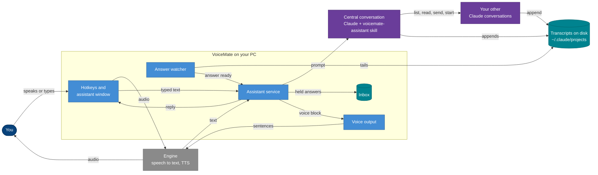
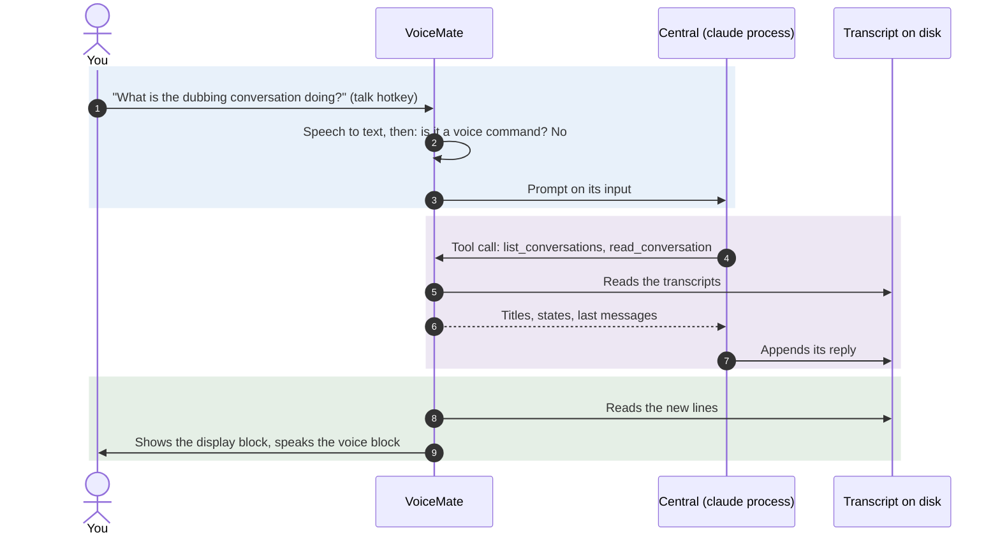
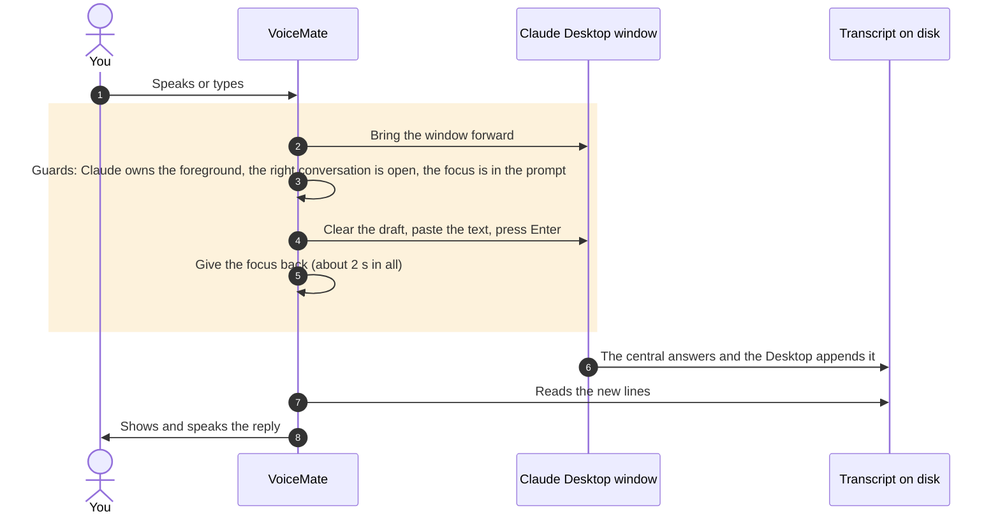
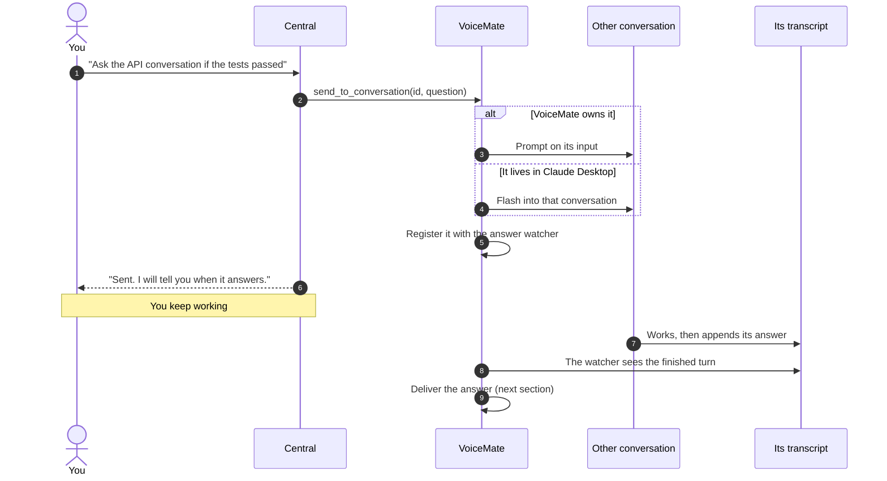
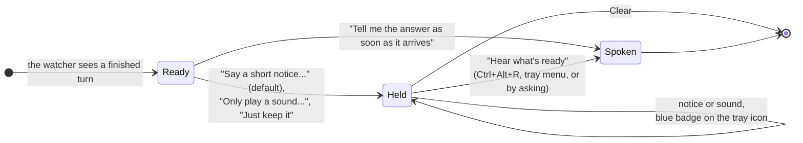
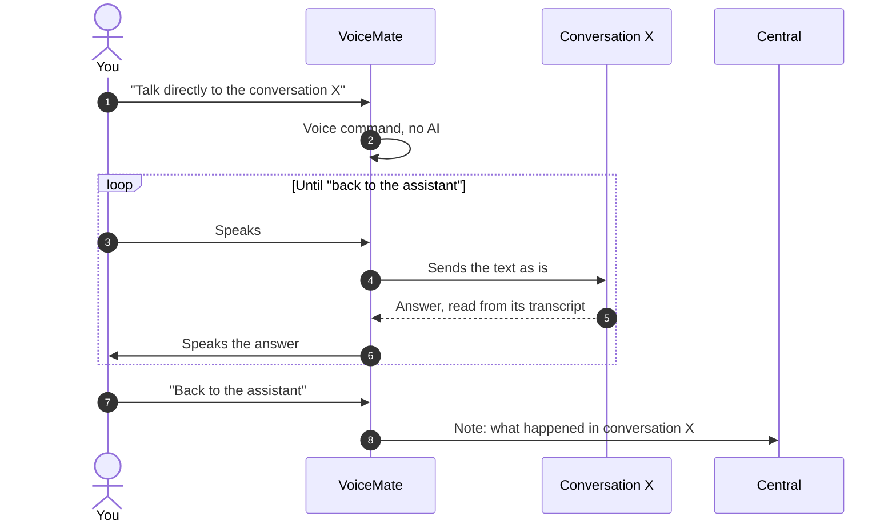
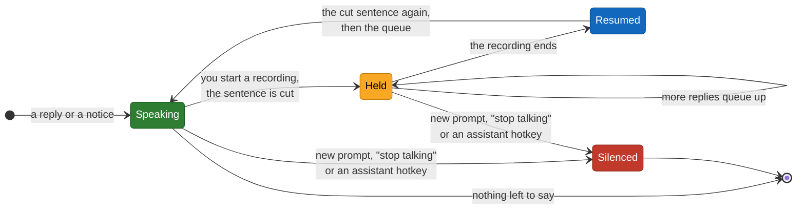

# Voice assistant and Claude

> [!NOTE]
> The voice assistant is **experimental** and off by default. Dictation to the clipboard does not need any of this.

The voice assistant is one Claude conversation, the **central conversation**, that you talk to by voice or by typing. It knows what your other Claude conversations are doing: it lists them, reads them, asks them things, starts new ones in the background and tells you when they answer. You keep working; the assistant keeps track.

This page explains the whole flow: how VoiceMate plugs into Claude, the two modes, how the assistant orchestrates your other conversations, how answers come back to you and how the voice works. The step-by-step settings are in [usage.md](usage.md#voice-assistant-experimental), and the component-level diagram is in [architecture.md](architecture.md#61-voice-assistant-experimental).

<p align="center"></p>

## Contents

1. [The big picture](#1-the-big-picture)
2. [How VoiceMate plugs into Claude](#2-how-voicemate-plugs-into-claude)
3. [The two modes](#3-the-two-modes)
4. [Orchestrating other conversations](#4-orchestrating-other-conversations)
5. [Answers coming back](#5-answers-coming-back)
6. [Direct mode and voice commands](#6-direct-mode-and-voice-commands)
7. [The voice](#7-the-voice)
8. [Settings by voice, personality and skill](#8-settings-by-voice)
9. [Getting started](#9-getting-started)
10. [Safety and limits](#10-safety-and-limits)

## 1. The big picture

You speak (or type) to VoiceMate. VoiceMate hands your words to the central conversation, which is a normal Claude conversation with a skill that teaches it to be your assistant. The central talks to your other conversations through tools, and VoiceMate watches those conversations on disk to tell you when they answer. Replies come back as text in the assistant window and as speech.



Three ideas hold the design together:

- **Claude does the thinking, VoiceMate does the plumbing.** VoiceMate never decides what to ask or what to answer. It carries text in and out, watches transcripts, holds answers and speaks.
- **Everything is read from disk.** Claude Code writes every conversation to a transcript under `~/.claude/projects`. VoiceMate reads replies there, never from a process output, so a message typed on the phone or in Claude Desktop shows up too.
- **Writing is the hard part, and it is guarded.** Reading is free and silent. Writing to a conversation either goes through a process VoiceMate owns, or through a short, checked typing into Claude Desktop.

## 2. How VoiceMate plugs into Claude

VoiceMate uses only what you already have on your computer. It never asks for your password or token and never calls a private API.

| Piece | What VoiceMate uses it for |
|---|---|
| **Claude Code CLI** (`claude`) | Runs the central conversation in the own mode, and the conversations the assistant starts. It uses the CLI's own login (`claude auth login`). |
| **Claude Desktop** | Hosts the central in the Desktop mode, and any conversation you opened there. VoiceMate writes to it through Windows UI Automation. |
| **Transcripts** (`~/.claude/projects/**/*.jsonl`) | The source of truth for every conversation: VoiceMate lists, reads and watches them. |
| **Remote Control** | Shows the conversations VoiceMate owns in Claude Desktop and on your phone, so you can follow or answer from there. |
| **The `voicemate-assistant` skill** | Teaches the central to be your assistant: tone, the reply template, when to use each tool, and the rules below. English and Brazilian Portuguese. |
| **The `voicemate` tools** (MCP) | Give the central hands in the own mode: `list_conversations`, `read_conversation`, `send_to_conversation`, `start_conversation`, `set_conversation_model`, `stop_conversation`. |

### The reply template

Every reply of the central follows a template the skill defines, so VoiceMate knows what to say and what to show:

```text
<voice>What VoiceMate speaks, short and natural.</voice>
<display>What the window shows (optional; the voice block is shown when there is none).</display>
<actions>
{"version": 1, "actions": [{"type": "set_setting", "key": "assistant.answer_delivery", "value": "sound"}]}
</actions>
```

The `<actions>` block carries requests that VoiceMate carries out itself:

| Action | What VoiceMate does |
|---|---|
| `set_setting` | Changes one setting from a fixed list ([section 8](#8-settings-by-voice)). |
| `follow_up` / `follow_up_done` | Adds or removes an entry of the "Waiting for" list. |
| `read_inbox` / `clear_inbox` | Sends the held answers to the central as one digest, or drops them (only after you confirm). |
| `focus` | The window follows that conversation (or none). |

Unknown actions are ignored, and an action that fails never stops the others.

## 3. The two modes

Settings > **Assistant** > "Assistant mode:" chooses where the central conversation lives.

| | VoiceMate's own conversation (`own_session`) | A Claude Desktop conversation (`desktop`) |
|---|---|---|
| Where the central runs | A Claude Code process that VoiceMate starts and owns | A conversation you already have in Claude Desktop, chosen by its exact title |
| How VoiceMate writes to it | Directly, through the process input. Nothing touches your screen | A **flash**: the Desktop window comes forward for about 2 seconds, the text is pasted and sent, and the focus goes back |
| Tools for other conversations | The `voicemate` tools | The Desktop's own session tools, plus everything the Desktop offers (browser, computer control, PR tools) |
| Needs Claude Desktop open | No | Yes, with the screen unlocked |
| Phone | Yes, through Remote Control | Not managed by VoiceMate |
| Best for | Quiet, background work | Using the Desktop's extra tools |

### Own mode: a conversation VoiceMate owns

VoiceMate starts `claude` as a long-lived child process named "VoiceMate", with the skill and the `voicemate` tools, and keeps it running. VoiceMate is the only writer of that conversation; Claude Desktop and the phone see it through Remote Control.



### Desktop mode: a conversation you already have

The central is a conversation you picked in Claude Desktop. VoiceMate writes to it with a flash and reads the reply from its transcript. Where the Desktop's controls are comes from a [profile](desktop-profile.md), so a Desktop update is fixed by a new profile and not by a new VoiceMate.



The three guards are checked before every key. If one fails (the screen is locked, another window took the focus, the conversation changed), nothing is typed and the window says "Not sent to ...", so the message is never lost. Your clipboard is saved and restored, unless something else copied during the flash.

## 4. Orchestrating other conversations

The point of the assistant is to work with your **other** conversations so you do not have to switch windows.

| You say | What happens |
|---|---|
| "What are my conversations doing?" | The central lists them (title, state, last activity) and summarizes. |
| "Read the last answer of the API conversation" | The central reads that transcript and tells you the gist. |
| "Ask the dubbing conversation if the tests passed" | The central sends that question to it and tells you it will let you know. |
| "Start a conversation to review the README" | The central starts a new conversation in the background, with the model and effort you chose. |
| "Use Opus in that conversation" / "Stop it" | The central changes the model of, or stops, a conversation VoiceMate started. |

Sending never waits for the answer. The central sends, says so, and moves on; VoiceMate watches the transcript and brings the answer back when it is ready.



Conversations the assistant starts are capped at 4 at once, have Remote Control on, and are remembered across restarts. "Permissions:" in Settings > **Assistant** decides what they may do on your computer.

## 5. Answers coming back

"Answers from other conversations:" decides what happens when one of them answers.



- **Spoken**: the answer goes to the central, which tells you the gist in its own words.
- **Held**: the answer waits in the **inbox** (50 at most, kept across restarts). The assistant window lists it under "Answers waiting", the tray icon shows a blue badge with the count, and "Hear what's ready" makes the central summarize all of them at once.
- Nothing is announced while you record, while VoiceMate transcribes, or while it speaks.

<p align="center"></p>

The **Waiting for** list shows what the central is still waiting on in other conversations (conversation, reason, since when). The central adds and removes entries itself.

## 6. Direct mode and voice commands

Some phrases never reach Claude: VoiceMate recognizes them itself, in English, Portuguese and Spanish, so they are instant and cost nothing.

- **Read the last answer**, **stop talking**.
- **Go to** a conversation (the window follows it), **send to** a conversation.
- **Talk directly to the conversation X**: from then on, what you say goes word for word to that conversation, and its replies are spoken back. The central is out of the loop.
- **Back to the assistant**: leaves direct mode; VoiceMate tells the central what happened in the meantime.



The full phrase list is in [usage.md](usage.md#voice-commands).

## 7. The voice

You talk with the **talk hotkey** (`Ctrl+Alt+S` by default): press, speak, press again. The engine transcribes on your computer and the text goes to the assistant instead of the clipboard.

Replies are spoken by the engine, sentence by sentence, so the first sentence plays while the next one is made. The voice comes from Kokoro or from your own provider, any service that follows the [TTS provider protocol](tts-provider-protocol.md) (Settings > **Voice**). If the engine cannot speak, the replies stay text and the short notices use the Windows voice.

### Never over a recording

The assistant's voice never speaks over the microphone. While VoiceMate records, anything the assistant has to say waits: a reply, an answer from another conversation delivered by voice, a short notice. It is said when the recording ends.

If you start a recording while it is speaking, the sentence you were hearing is cut and said again from its start afterwards, followed by whatever was waiting. The voice goes quiet at the moment you press the key, before the microphone opens.

A recording that does not reach the assistant does not lose anything: the voice simply goes on. What does silence it for good is a new prompt to the assistant, "stop talking", and the other assistant hotkeys ("Hear what's ready", the window, the mode and "Back to the assistant").



## 8. Settings by voice

Ask "only play a sound when a conversation answers" or "use Sonnet" and the central changes that setting through a `set_setting` action. VoiceMate checks it against a fixed list, applies it the same way the settings window does, and shows a notice ("Setting changed: Answers from other conversations = Only play a sound and keep the answer").

The list covers 23 settings: the mode, model and effort, permissions, answer delivery, the model and effort of new conversations, the Desktop conversation, voice, voice commands, your name, personality, skill language, sounds, dictation language, transcription mode and notifications. Hotkeys, files and folders, the voice engine and turning the assistant off are left out on purpose. The central never edits VoiceMate's files: `set_setting` is the only way, and VoiceMate rewrites `assistant.json` itself.

### Personality and skill

- **Personality** (Settings > **Assistant** > Personality): none, a Markdown file (for example a note in an Obsidian vault) or a text you write. "Vault folder:" tells the assistant where your notes are; it reads them only when asked.
- **Skill language:** automatic, English or Brazilian Portuguese. "Custom skill:" replaces the skill with a folder of your own that holds a `SKILL.md`.
- **The skill works on its own:** copy `app/companion/assistant/skill/en/voicemate-assistant` (or `pt-BR`) into `~/.claude/skills` and ask for "the assistant" in any Claude Code conversation. It reads its settings from `~/.voicemate/assistant.json`.

## 9. Getting started

1. Install [Claude Code](https://docs.claude.com/en/docs/claude-code) and run `claude auth login` once in a terminal.
2. In the VoiceMate status window, press **Assistant**. While the assistant is off, its window says how to turn it on.
3. Settings > **Assistant**: choose "Assistant mode:". For the Desktop mode, type the exact title of the conversation in "Desktop conversation:".
4. Press `Ctrl+Alt+S`, say "what are my conversations doing?", and press `Ctrl+Alt+S` again.

<p align="center"></p>

| Hotkey | Action |
|---|---|
| `Ctrl+Alt+S` | Talk to the assistant |
| `Ctrl+Alt+W` | Open the assistant window (also the **Assistant** button in the status window) |
| `Ctrl+Alt+R` | Hear what's ready |
| none by default | Switch the assistant mode, Back to the assistant |

## 10. Safety and limits

- **Text from other conversations is data.** Answers reach the central marked as quoted data, and the skill never follows instructions found in them.
- **Nobody can approve a prompt in the background.** The central runs without a screen, so the skill tells it to say what failed and offer another way, never to ask you to approve something you cannot see.
- **Permissions of the conversations it starts.** "Full access, never ask (risky)" lets them change any file and run any command without asking. Keep the default unless you trust what you ask them to do.
- **The flash takes your keyboard for about 2 seconds** and clears any draft in that Desktop conversation's prompt. Do not type in the chosen conversation while the assistant may write to it.
- **No credentials are touched.** VoiceMate never reads or stores your Claude login, and the processes it starts do not inherit Claude Desktop's own environment.
- **Windows only** for the companion and the Desktop mode.

Design notes, risks and the stories still to come: [research/voice-assistant-design.md](research/voice-assistant-design.md). The Claude Desktop and phone experiments behind the modes: [research/claude-code-client.md](research/claude-code-client.md).
